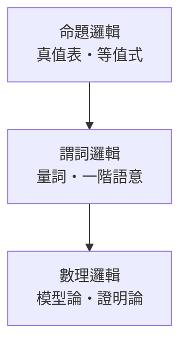

# AGENTS.md —— 百科全書撰寫規範

本倉庫是一套**繁體中文通用百科全書**，以 Markdown 撰寫、放置於 GitHub 供人閱讀與協作。
所有新條目與分類頁**必須**遵守本規範，否則會與既有結構不一致。

## 快速驗證（寫完任何條目後執行）

```bash
python3 tools/check_links.py        # 全站檢查（目前應為 0 項問題）
python3 tools/check_links.py 邏輯學  # 只查某概念資料夾（相對 site/）
python3 tools/build_tables.py       # 改過 tools/data/levels.py 或 concepts.py 後必跑
python3 tools/build_progress.py     # 更新 PROGRESS.md
```

沒有套件安裝、沒有 build/test——純 Markdown + Python 標準庫工具；唯一的「測試」就是 `check_links.py`。

---

## 一、目錄結構

```
markpedia/
├── README.md            全域總目錄（唯一的大表，連結以 site/ 開頭）
├── PROGRESS.md         撰寫進度（由 tools/build_progress.py 產生）
├── prompts.md           分類設計原始需求（勿改）
└── site/                所有分類與條目皆放在 site/ 之下
    ├── 人/ 事/ 時/ 地/ 物/ 天/ 文/ 法/ 商/ 理/ 工/ 醫/ 農/ 食/ 衣/ 住/ 行/ 育/ 樂/
    │                     第一層資料夾（19 個），各含 README.md 入口頁與實體條目
    └── <概念名稱>/      第二層概念資料夾（僅一層，420 個）
        ├── README.md    該概念的分類入口頁（只有表格）
        ├── <概念名稱>.md    概念本文
        ├── <子分類>.md      第三層條目
        └── <孫分類>.md      第四層條目
```

規則：

- **所有分類與條目一律放在 `site/` 之下**，根目錄只保留全域索引、進度與工具。
- 第二層概念資料夾**只允許一層**，不得再嵌套子資料夾。
- **第一層名稱同時是資料夾**：`site/人/`、`site/事/`、`site/時/`、`site/地/`、`site/物/`、`site/天/`…共 19 個；其 `README.md` 即原本的第一層入口頁，內含該層的「子分類｜孫分類」總表。
- **實體條目的落點**：所有具名實體（人名、著作、工具、材料、事件、地名、年份）一律放進**最明確的分類資料夾**（例如 `site/科學家/牛頓.md`、`site/數學/九章算術.md`、`site/戰爭史/第一次世界大戰.md`）；一個人有多種身分時只放最具代表性的一類，詳見第三之四節。
- 概念資料夾（420 個）位於 `site/` 之下，**不**塞進第一層資料夾內，避免兩層巢狀。
- 每個概念資料夾內的第一個檔案必須是 `README.md`（GitHub 以它作為資料夾落地頁）。
- 概念本文檔名與資料夾同名，例如 `邏輯學/邏輯學.md`。

---

## 二、命名規則

| 規則 | 說明 | 正例 | 反例 |
| --- | --- | --- | --- |
| **不含空格** | 分類名一律單一詞或固定片語，**任何層級皆不得出現空格** | `SAT求解`、`GIS`、`STEM教育`、`AI應用`、`DNA與RNA`、`ISO8601標準`、`IUCN類別` | `SAT 求解`、`AI 的應用`、`DNA 與 RNA`、`ISO 8601`、`人工智慧 與 電腦` |
| 一個概念一個名稱 | 不使用「A、B 與 C」式合併 | `電子工程`、`通訊工程` | `電機、電子與通訊` |
| 繁體中文 | 全站用繁體；專有名詞保留原文 | `軟體`、`晶片` | `软件`、`芯片` |
| 同義共用 | 語意相同的概念共用同一資料夾 | `氣象學`（天＋理） | 另建 `天象學` |
| 階層用語 | 第二層＝概念，第三層＝**子分類**，第四層＝**孫分類** | — | 「子子分類」 |
| 不夾雜外文 | 外文縮寫直接黏合，不留空格、不夾中文 | `AI應用`、`n型半導體` | `AI 的應用`、`記憶 consolidation` |
| 概念唯一 | 同一概念在第三、四層不得與同概念其他名稱重複 | `電化學` | `電化學` 與 `電化` 同時出現 |

---

## 三、`README.md`（分類入口頁）

**只放表格與連結定義，不放敘述內容。**

結構固定如下：

```markdown
---
title: 邏輯學
tags:
  - 分類/第二層
  - 文
---

# 邏輯學

| 子分類 | 孫分類 |
| --- | --- |
| [命題邏輯] | [真值表] · [等值式] · [命題公式] · [范式] · [三段論] |
| [謂詞邏輯] | [一階邏輯] · [量詞] · [謂詞演算] · [模型語意] · [變元消去] |

## 連結定義

[文]: ../文/README.md
[命題邏輯]: 命題邏輯.md
[真值表]: 真值表.md
```

要點：

1. 表頭固定為 `| 子分類 | 孫分類 |`，**只有兩欄**，不設第三欄。
2. 每個子分類、孫分類**都必須是參考式連結**（`[名稱]`），定義集中在文末「## 連結定義」。
3. 表格內的連結一律用參考式；文末不得留下未被使用的定義。
4. 跨資料夾連結：第一層入口寫 `../文/README.md`；其他概念寫 `../哲學/README.md`。
5. `README.md` 內不放任何敘述段落——敘述一律寫在同名概念條目中。
6. **連結一律先預留**：即使對應的 `<概念>/<子分類>.md`、`<概念>/<孫分類>.md` 尚未撰寫，表格仍須輸出連結與定義，不要用純文字或「（待建立）」取代。撰寫條目時再補上檔案即可。

---

## 三之二、第一層入口頁（`人/README.md` … `樂/README.md`）

第一層入口頁位於**第一層資料夾內**（如 `文/README.md`），格式與概念 `README.md` 一致，只是表格的兩欄各升一階：

```markdown
---
tags:
  - 分類/第一層
  - 文
---

# 文

> 哲學宗教、語言文學、藝術與傳播

> 對應維基百科：[中文維基百科：文](https://zh.wikipedia.org/wiki/%E4%BA%BA%E6%96%87)　·　[English Wikipedia: Humanities](https://en.wikipedia.org/wiki/Humanities)

## 分類表

| 子分類 | 孫分類 |
| --- | --- |
| [哲學] | （待建立） |
| [邏輯學] | [命題邏輯] · [謂詞邏輯] · [模態邏輯] · [非古典邏輯] |

## 連結定義

[哲學]: ../哲學/README.md
[邏輯學]: ../邏輯學/README.md
[命題邏輯]: ../邏輯學/命題邏輯.md
```

> 因入口頁已移入第一層資料夾，連結目標一律以 `../` 開頭。

要點：

1. `子分類` 欄為**第二層概念**（連到該概念的 `README.md`）；`孫分類` 欄為該概念的**第三層條目**（連到 `<概念>/<子分類>.md`）。
2. `孫分類` 欄的名稱**一律為連結**，即使條目尚未撰寫也要預留連結。
3. 尚未建立第三層者，該欄填「（待建立）」，不可留空或杜撰。
4. `地.md` 同時收錄「地（空間與地理）」與「地（自然與環境）」兩條分支。
5. 入口頁同樣需要「對應維基百科」一行。

---

## 三之三、第三／四層分類的資料來源

第二層概念的第三層（子分類）與第四層（孫分類）名稱集中在 `tools/data/levels.py`：

```python
LEVELS = {
    "邏輯學": [
        ("命題邏輯", ["真值表", "等值式", "命題公式", "范式", "三段論"]),
        ("謂詞邏輯", ["一階邏輯", "量詞", "謂詞演算", "模型語意", "變元消去"]),
    ],
}
```

規則：

1. 每個第二層概念建議 **4 至 5 個子分類**，每個子分類 **3 至 5 個孫分類**。
2. 同一概念內的子分類與孫分類**名稱不得重複**（否則參考式連結定義會衝突）。
3. 名稱一律**不含空格**、使用繁體中文、單一概念一個名稱（例：`SAT求解`、`AI應用`、`ISO8601標準`，而非 `SAT 求解`、`AI 的應用`、`ISO 8601`）。
3.1 名稱不得夾雜外文或使用符號（如 `記憶 consolidation`、` wholly-owned 子公司`、`減災 vs 防災`）；外文縮寫直接黏合（`n型半導體`）。
4. 新增或修改後，執行下列指令重新產生所有表格：

   ```bash
   python3 tools/build_tables.py
   ```

   此指令會重建 420 個概念的 `README.md`（`| 子分類 | 孫分類 |`）與 20 個第一層入口頁。
5. 表格中的連結**一律輸出**（預留），不管條目檔是否已存在；撰寫 `<概念>/<子分類>.md`、`<概念>/<孫分類>.md` 後即為有效連結。
6. 檢查器會把「已登記於 `levels.py` 但檔案尚未建立」的路徑視為**預留連結**（有效），因此表格可先行建好；未登記的失效連結仍會報錯。
7. 第一層概念的清單在 `tools/data/concepts.py`，修改後同樣執行 `tools/build_tables.py`。

---

## 三之四、實體條目的存放位置（全部歸入最明確的概念資料夾）

**所有具名實體——包括人名——一律放到最明確的概念資料夾**裡去，讓實體與其所屬領域的分類條目住在一起。`site/人/`、`site/事/`、`site/地/`、`site/物/`、`site/時/` 僅保留第一層入口頁（`README.md`），不再收錄實體條目。

| 實體類型 | 存放位置 | 例 |
| --- | --- | --- |
| **人物（科學家）** | `site/科學家/` | `site/科學家/牛頓.md`、`site/科學家/伽利略.md` |
| **人物（藝術家）** | `site/藝術家/` | `site/藝術家/梵谷.md`、`site/藝術家/莎士比亞.md` |
| **人物（歷史人物）** | `site/歷史人物/` | `site/歷史人物/拿破崙.md`、`site/歷史人物/凱撒.md` |
| **人物（宗教領袖）** | `site/宗教領袖/` | `site/宗教領袖/釋迦牟尼.md`、`site/宗教領袖/穆罕默德.md` |
| **人物（工程師、建築師等）** | 對應技術／職業概念資料夾 | `site/航空工程/沃克·伊文思.md`、`site/建築設計/勒·柯布西耶.md` |
| 數學著作 | 所屬概念資料夾 | `site/數學/九章算術.md` |
| 文學作品 | 所屬概念資料夾 | `site/小說/紅樓夢.md`、`site/戲劇文學/哈姆雷特.md` |
| 文字學／工具 | 所屬概念資料夾 | `site/文字/說文解字.md`、`site/書法/毛筆.md` |
| 科學概念與技術 | 所屬概念資料夾 | `site/遺傳學/DNA.md`、`site/天文學/光學望遠鏡.md`、`site/土木工程/鋼筋混凝土.md` |
| 歷史事件 | 所屬概念資料夾 | `site/戰爭史/第一次世界大戰.md`、`site/政治革命/辛亥革命.md`、`site/太空旅行/阿波羅計畫.md` |
| 地名（城市） | 所屬概念資料夾 | `site/城市/巴黎.md` |
| 年份、時期 | 所屬概念資料夾 | `site/紀年/1789年.md`、`site/世界史/冷戰時期.md` |
| 尚未有合適概念者 | 該領域最接近的概念資料夾 | 先歸入語意最接近者，之後再調整 |

規則：

1. **名稱不得含空格**（例：`聖彼得堡` 而非 `聖彼得 堡`）。
2. **實體檔放在概念資料夾內**（僅一層，不再為每個實體開子資料夾）；`site/人/`、`site/事/`、`site/地/`、`site/物/`、`site/時/` 只留入口頁。
3. 放置時先問兩個問題：「這個實體的核心主題屬於哪個概念？」「這個人最應該被歸為哪一類人物？」——答案就是它的資料夾。
3.1 **一個人只放一個類別**：人物有多種身分（科學家也是教師、藝術家也是革命者）時，只放進**最具代表性的一類**（科學家、藝術家、歷史人物、宗教領袖、工程師之類的職業／身分概念資料夾），不得複製到多處。
4. 實體條目的 frontmatter：

   ```markdown
   ---
   title: 拿破崙
   tags:
     - 分類/實體
     - 人名
   status: 初稿
   ---
   ```

   `tags` 第二行標明實體類型（`人名`、`事件`、`地名`、`物品`、`著作` 等）。
5. 實體條目**不必展開長文**：撰寫概念時遇到實體，**先建 stub 檔**（約 40 行：frontmatter、「對應維基百科」行、關鍵事實列點、與相關概念的關係、相關條目連結），把力氣花在分類條目上；實體長文日後再補。stub 也必須滿足檢查器的 40 行下限與參考式連結規範。
6. 引用時使用參考式連結並在文末定義，**路徑依引用者所在資料夾計算**：
   - 引用同資料夾內的實體：`[九章算術]: 九章算術.md`
   - 引用其他概念資料夾內的實體：`[DNA]: ../遺傳學/DNA.md`
   - 引用人名（在其所屬概念資料夾內）：`[拿破崙]: ../歷史人物/拿破崙.md`
7. 同一實體只建立**一個**條目檔；其他分類要用時直接連結該檔，不要複製。
8. 實體條目的建立順序不重要，但**被引用的當下就要建檔**，避免出現失效連結。
9. 搬移既有實體檔時，必須一併更新全站的參考式連結定義（相對路徑會隨之改變），再跑 `python3 tools/check_links.py` 確認 0 項問題。
10. 新增實體時先確認 `ls site/<目標資料夾>/` 是否已有同名檔案；同名實體只保留一份。

---

## 四、條目檔案

### 4.1 frontmatter

```markdown
---
title: 真值表
tags:
  - 分類/孫分類
  - 邏輯學
  - 命題邏輯
status: 初稿
---
```

- `title`：與檔名一致。
- `tags`：第一行為層級（`分類/第二層`｜`分類/子分類`｜`分類/孫分類`），其後依序為父概念標籤。
- `status`：`初稿`。**不得**寫 `待撰寫`。

檔名與層級的對應（全部置於同一個概念資料夾內，不另開子資料夾）：

| 層級 | 檔名 | 位置 | 對應 `levels.py` |
| --- | --- | --- | --- |
| 第二層（概念） | `<概念>.md` | `<概念>/<概念>.md` | 該概念的 key |
| 第三層（子分類） | `<子分類>.md` | `<概念>/<子分類>.md` | `levels[概念]` 的第一項 |
| 第四層（孫分類） | `<孫分類>.md` | `<概念>/<孫分類>.md` | `levels[概念]` 各項的陣列元素 |

- 檔名**不得含空格**，且須與 `levels.py` 登記的名稱完全一致（連結才會對得上）。
- 第三、四層檔案為「待撰寫」的目標時，可先建立空檔或直接撰寫；一旦建立，表格中的預留連結即自動生效。

### 4.2 開頭引言

```markdown
# 真值表

> 隸屬：[邏輯學](邏輯學.md) › [命題邏輯](命題邏輯.md)　·　狀態：初稿

> 對應維基百科：[中文維基百科：真值表](https://zh.wikipedia.org/wiki/%E7%9C%9F%E5%80%BC%E8%A1%A8)　·　[English Wikipedia: Truth table](https://en.wikipedia.org/wiki/Truth_table)
```

### 4.3 內容要求（硬性）

1. **長度至少 100 行**；每個概念都要寫到能被外行讀懂。
2. **至少一個具體範例**：能用例子說明就不要只給定義。範例可以是具體命題與推導步驟、具體數值、具體歷史人物與年份、具體程式片段或操作步驟。
3. **術語首次出現時用一句白話解釋**（例：「有效性指前提為真時結論必定為真」）。
4. **寫出前因後果與互相驅動**：此概念為何出現、解決了上一層的什麼瓶頸、又推動了哪些後續技術或研究。不可只做名詞解釋。
5. 段落與段落之間要有承接，可用「因此」「然而」「這帶來」「反過來」等連接詞把因果鏈講清楚。
6. **遇到不清楚的事實，先查維基百科**再落筆（見第五節），不得憑印象撰寫年份、數值或人名。
7. 子分類與孫分類的條目在尚未撰寫前，**可先建立檔案骨架**（含 frontmatter、引言、維基百科行、連結定義），內容後補。

### 4.4 章節模板

**第二層概念（`<概念>.md`）**

```markdown
# 邏輯學

> 隸屬：第一層 [文]　·　相關分類：[哲學]、[語言學]　·　子分類總表見 [README](README.md)

<一段話說明這個概念是什麼、解決什麼問題>

## 核心問題

<白話說明 + 必備公式>

## 因果鏈

1. <第一步：瓶頸>
2. <第二步：解法>
…

## 子分類的定位與相互驅動

### 命題邏輯

<這個子分類做什麼、與其他子分類如何互相推動>

## 容易混淆之處

- <常見誤解>

## 連結定義
```

**第三層（子分類）**

```markdown
# 命題邏輯

> 隸屬：[邏輯學](邏輯學.md)　·　狀態：初稿

<定義段落>

## 技術與理論的關聯

- <列點：定義要點、推導、限制>

## 孫分類

| 孫分類 | 狀態 |
| --- | --- |
| [真值表] | 初稿 |
| [等值式] | 初稿 |

## 連結定義
```

**第四層（孫分類）**

```markdown
# 真值表

> 隸屬：[邏輯學](邏輯學.md) › [命題邏輯](命題邏輯.md)　·　狀態：初稿

<定義段落：它是什麼、為什麼需要它>

## 技術要點

- <要點一>
- <要點二>

## 範例

<具體例子與逐步說明>

## 與相鄰分類的關聯

- 與 [等值式](等值式.md) 的關係：<互相驅動>
- 在上位概念 [邏輯學](邏輯學.md) 中，本概念扮演什麼角色：<解決什麼瓶頸、推動什麼>

## 連結定義
```

---

## 五、維基百科對應條目（必辦）

### 5.1 硬性要求

1. **每個條目**（第二層概念、第三層子分類、第四層孫分類）都必須在**開頭引言之後**加上「對應維基百科」一行。
2. 該行至少要有一個**有效的**維基百科條目連結；中文優先，英文補充。
3. 條名必須**實際查證存在**，不得憑印象猜測。
4. 中文維基百科無對應條目時，只列英文維基百科；兩者皆無時，寫：

   ```markdown
   > 對應維基百科：中文與英文維基百科均無對應條目（參考：史丹佛哲學百科全書〈…〉）
   ```

### 5.2 查證方式

倉庫內附批次查證工具，可一次確認多個條名是否存在（自動處理重導向、變體轉換與速率限制）：

```bash
python3 tools/wiki_check.py 候選.json 結果.json
```

`候選.json` 格式：

```json
{
  "真值表.md": { "zh": ["真值表"], "en": ["Truth table"] }
}
```

輸出會列出每個條目的**正式條名**（canonical），連結網址請使用正式條名（中文站多為簡體，顯示文字則用繁體）。

### 5.3 手動查證方式

撰寫或引用條目之前，**遇到不清楚的事實，先查維基百科**，不要憑印象作答。可用 MediaWiki API 批次查詢條名是否存在：

```bash
# 中文維基百科（回傳 redirect 與 missing 欄位）
curl -s "https://zh.wikipedia.org/w/api.php?action=query&format=json&redirects=1&titles=邏輯|真值表|命題邏輯"

# 英文維基百科
curl -s "https://en.wikipedia.org/w/api.php?action=query&format=json&redirects=1&titles=Propositional%20logic|Truth%20table"
```

判讀方式：

- 出現在 `pages` 且有 `pageid` → 條目存在（若在 `redirects` 中，代表被導向另一個條名，連結請用**導向後的條名**）。
- 出現在 `pages` 且標記 `missing` → **該語言無此條目**，請改用另一語言或相近條目。
- 條名含空格、括號時，URL 必須百分號編碼（`空格 → _`、`( → %28`、`)` → %29`）。

### 5.4 撰寫格式

```markdown
> 對應維基百科：[中文維基百科：真值表](https://zh.wikipedia.org/wiki/%E7%9C%9F%E5%80%BC%E8%A1%A8)　·　[English Wikipedia: Truth table](https://en.wikipedia.org/wiki/Truth_table)
```

- 連結文字使用繁體中文條名；連結目標為**百分號編碼**後的網址，避免括號破壞行內連結。
- 此行與「隸屬」行之間**空一行**，使其渲染為獨立段落。
- 同一分類的不同條目若對應同一維基條目（例如 `量化消去` 與 `Skolemization`），可各自連結，但連結文字要寫出條目自身的名稱。

### 5.5 引用與查證

- 維基百科是**查證與導覽的起點**，不是內容的來源；撰寫時仍須以自己的組織與語言重述。
- 若某項事實在維基百科上有明確說法，與其衝突時應重新查證並確認版本。
- 對維基百科本身存疑或已標示爭議的內容，條目中應以「有爭議」「主流觀點為……」等方式標明。

---

## 六、連結規範

1. 內文一律使用**參考式連結** `[名稱]`，檔案末尾以 `## 連結定義` 集中定義。
2. 定義目標路徑：

   | 目標 | 路徑寫法 |
   | --- | --- |
   | 同資料夾內的檔案 | `真值表.md` |
   | 其他第二層概念 | `../哲學/README.md` |
   | 第一層入口頁 | `../文/README.md` |

3. 每個定義都必須被用到；不得有未使用的定義。
4. 每個用到的標籤都必須有定義；不得有未解析的連結。
5. 不得使用裸 URL 以外的寫法（如 `[[wikilink]]`、相對路徑 `./`）——本倉庫統一採參考式連結。

---

## 七、數學式（TeX）

GitHub 以 MathJax 渲染，規則如下：

1. 行內公式寫 `$x$`，**`$` 前後必須有空格**，例如：
   - 正確：`若 $P \to Q$ 成立，則 $\neg P \lor Q$ 也成立。`
   - 錯誤：`若$P \to Q$成立。`
2. 獨立公式用 `$$ ... $$` 區塊，上下各留空行。
3. 區塊公式中的命令用 `\qquad`、`\text{...}`、`\begin{aligned}` 等標準 LaTeX；中文註解放在 `\text{}` 內。
4. 公式必須正確；不得使用自創語法。常用符號：`\neg \wedge \lor \to \leftrightarrow \forall \exists \models \vdash \equiv \land \lor`。
5. 不要在表格儲存格內放過長的區塊公式。

---

## 八、Mermaid 圖

用於呈現概念間的因果或依賴關係，GitHub 原生支援。

````markdown

````

規則：

1. 節點標籤**一律加雙引號**，避免括號、逗號等造成解析錯誤。
2. 需要換行用 `<br/>`；中文分隔用 `・`。
3. 只在「概念條目」與「子分類條目」使用，孫分類條目通常不需要圖。
4. 每張圖最多約 12 個節點，否則難以閱讀。

---

## 九、撰寫完成後的自我檢查

在提交前必須逐項確認：

- [ ] `README.md` 只有表格與連結定義，沒有敘述段落。
- [ ] 每個檔案至少 100 行。
- [ ] 每個條目至少有一個具體範例。
- [ ] 有寫出前因後果與互相驅動的關係。
- [ ] 內文全部為參考式連結，文末有 `## 連結定義`，且無未使用定義。
- [ ] 所有連結目標檔案都存在（已登記於 `levels.py` 的預留條目視為有效）。
- [ ] TeX 的 `$` 前後都有空格，公式正確。
- [ ] Mermaid 語法可解析。
- [ ] 開頭有「對應維基百科」一行，且條名已查證存在（連結網址使用正式條名）。
- [ ] 第一層入口頁與概念 `README.md` 的表格皆為「子分類 | 孫分類」兩欄格式。
- [ ] 新增的子分類／孫分類名稱已同步寫入 `tools/data/levels.py`。
- [ ] 文中提到的人名／事件／年份／地名／物品，已在對應第一層資料夾建立實體條目並以參考式連結引用。
- [ ] 無 `TODO`、無「待撰寫」、無佔位文字；`status: 初稿`。
- [ ] 分類名稱**不含空格**（含子分類與孫分類），且與 `tools/data/levels.py` 登記的名稱一致。
- [ ] 表格中的子分類與孫分類**皆為連結**，未撰寫的條目已預留連結（不以純文字或「（待建立）」取代）。

可執行下列指令做機器檢查（連結缺定義、連結目標不存在、檔案過短）：

```bash
python3 tools/check_links.py            # 全站檢查（掃描 site/ 之下）
python3 tools/check_links.py 邏輯學      # 僅檢查某資料夾（路徑相對 site/）
python3 tools/build_tables.py           # 依 tools/data/levels.py 重建所有分類表格
```

---

## 九之二、工具總表

| 指令 | 用途 |
| --- | --- |
| `python3 tools/check_links.py` | 全站檢查：連結缺定義／多餘定義／失效目標、行數不足、佔位文字、TeX 空格、表格純度、維基百科行 |
| `python3 tools/check_links.py 邏輯學` | 僅檢查某個概念資料夾 |
| `python3 tools/build_tables.py` | 依 `tools/data/levels.py` 重建所有概念 `README.md` 與第一層入口頁 |
| `python3 tools/merge_levels.py <片段.py>` | 把新的第三／四層分類片段合併進 `tools/data/levels.py` |
| `python3 tools/wiki_check.py 候選.json 結果.json` | 批次查證維基百科條名是否存在（回傳正式條名） |
| `python3 tools/fix_math_spacing.py <資料夾>` | 自動把行內公式補成「`$` 前後有空格」 |
| `python3 tools/build_progress.py` | 依檔案存在狀態重建 `PROGRESS.md` |

---

## 十、禁止事項

- 不得修改 `prompts.md`（原始需求）。
- 不得刪除或改名既有的概念資料夾與入口頁。
- 不得在 `README.md` 的表格中放入表格外的概念名；新增概念必須同步更新該概念資料夾的 `README.md`。
- 不得使用簡體中文。
- 不得留下未完成的段落或「（待補）」之類的佔位。
