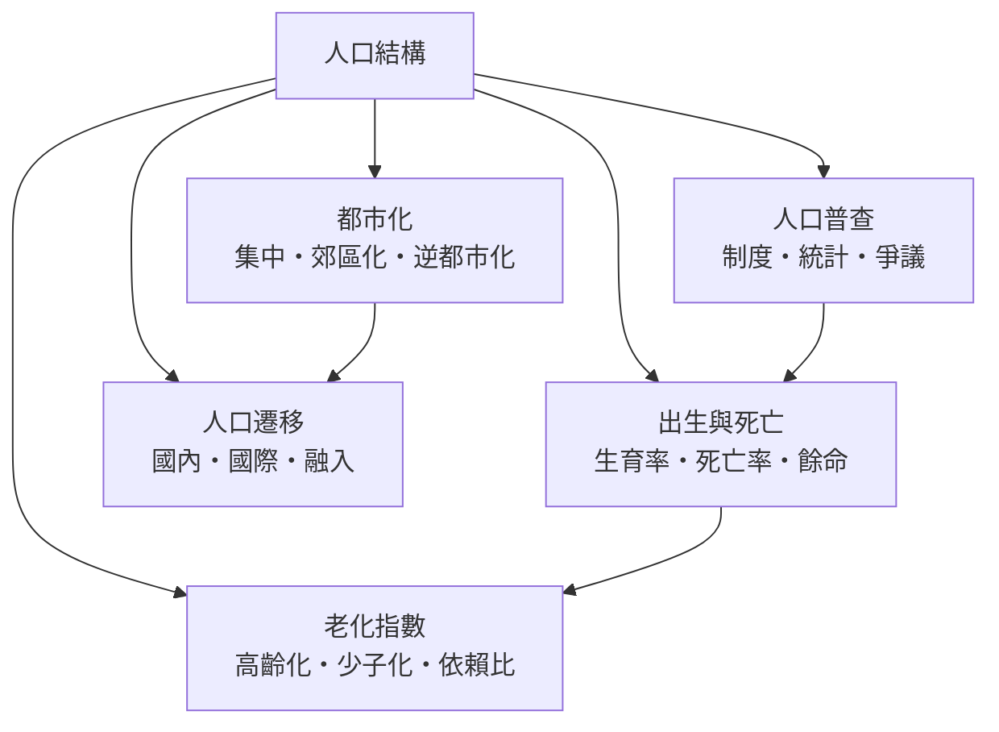

# 人口結構

> 分類範圍：以數量、年齡與空間三個軸描述一地人口的組成——普查、出生與死亡、老化、都市化與遷移——並說明結構如何決定社會的負擔與機會。　·　隸屬第一層：[人]　·　相關分類：[社會學]、[經濟學]、[人類學]　·　子分類總表見 [README]

> 對應維基百科：中文維基百科無對應條目　·　[English Wikipedia: Population structure](https://en.wikipedia.org/wiki/Population_structure)

「人口結構」回答一個看似簡單的問題：**一個社會裡的人，是怎樣的一群——多大年紀、住在哪裡、從哪裡來**。這個問題之所以關鍵，是因為結構決定時間表：一個年輕的社會要辦學校，一個高齡的社會要辦醫院與年金；結構變動比政策變動慢得多，因此**提前幾十年看結構，是政府少數能預知的未來**。本條目把這個預知的技術拆成五個子分類。

## 核心問題：年齡金字塔的時間機器

人口結構最有力的工具是**年齡金字塔**：把人口按性別與歲數畫成直方圖，塔的形狀即為歷史與未來的縮影。

- **寬底塔**（高出生率）：未來的學校與就業壓力大。
- **中段膨脹**（嬰兒潮世代）：一波一波的壓力沿年齡軸向上移動——先搶學校、再擠就業、最後壓垮年金。
- **倒塔**（低出生率＋高餘命）：照護與財政壓力集中於頂部。

讀懂金字塔，等於讀懂未來二十至六十年的公共支出表。這正是人口結構作為「時間機器」的意義。

## 因果鏈

1. **調查的建立**：定期 [人口普查] 使國家第一次看見自己的人口——沒有普查，就沒有政策人口學。
2. **死亡率的下降**：公共衛生使死亡率先降；出生率尚未跟上，人口快速膨脹（人口轉型的中段）。
3. **出生率的下降**：都市化、女性教育與避孕技術使生育率跟著下降；金字塔從寬底變成中寬。
4. **老化的到來**：低生育率與長餘命疊加，老年比例持續上升——[高齡化] 由結果變成常態。
5. **空間的集中**：就業機會把人口拉向都市——[都市化] 重排了人口的地圖。
6. **遷移的補充**：出生不足的地區以 [國際移民] 補充勞動力；人口問題從國內議題變成跨國議題。

## 子分類的定位與相互驅動

- [人口普查] 是**基準儀器**：其他一切分析都以其資料為底。
- [出生與死亡] 是**引擎**：兩條曲線的差距決定人口的膨脹或收縮。
- [老化指數] 是**結果的儀表**：少子化與高齡化同時發生時，[依賴比] 急速惡化。
- [都市化] 是**空間的引擎**：人口不只在變少，更在變集中。
- [人口遷移] 是**調節閥**：結構問題（勞動力不足）常以遷移來緩衝，但緩衝帶來新的融入問題。

## 範例：同一份金字塔的兩種讀法

以一個典型東亞社會為例：

1. **政策讀法**：金字塔中段（戰後嬰兒潮）十年內進入六十五歲，年金與醫療支出將跳升——這是預算表可以直接算出的未來。
2. **市場讀法**：同一批人三十年前是消費主力、二十年前是房貸世代、現在是照護需求；企業的產品線隨金字塔移動。
3. **共同點**：兩種讀法都依賴同一份普查資料——**資料的公共性**（可被任何人取用與檢驗）是人口結構研究的制度前提。

## 結構資料的閱讀順序

閱讀任何一份人口結構資料，建議固定順序：先看**年齡金字塔**（誰多誰少）、再看**依賴比**（負擔多重）、然後看**城鄉分布**（壓力在哪）。順序顛倒常導致把總數當結構、把平均當分布的錯讀。

## 容易混淆之處

- **總人口不等於結構**：總數穩定而結構劇變的情況極常見；只盯總數會錯過全部重點。
- **少子化與高齡化不是同一件事**：前者是出生端的事，後者是年齡分布的結果；政策工具完全不同。
- **都市化不等於都更**：都市化是人口的空間過程，都更是建成環境的改造；兩者常被混談。
- **普查數字有誤差與政治性**：漏報、族群類別與選區重劃都牽動資料的使用；「官方數字」仍需批判閱讀。

- **資料的跨國對齊**：使用國際資料庫比較各國時，先確認年齡分組、都市定義與普查年份是否對齊；未對齊的比較是人口學最常見的誤用。

## 延伸閱讀

- [社會學]：人口變遷的社會面向。
- [經濟學]：勞動力與扶養負擔的經濟分析。
- [地理學]：以空間視角研究人口分布的鄰接領域。
- [生命週期]：個體層面的人口學鄰接領域。

## 連結定義

[人]: ../人/README.md
[README]: README.md
[社會學]: ../社會學/README.md
[經濟學]: ../經濟學/README.md
[地理學]: ../人類學/README.md
[生命週期]: ../生命週期/README.md
[人類學]: ../人類學/README.md
[人口普查]: 人口普查.md
[出生與死亡]: 出生與死亡.md
[老化指數]: 老化指數.md
[都市化]: 都市化.md
[人口遷移]: 人口遷移.md
[高齡化]: 高齡化.md
[依賴比]: 依賴比.md
[國際移民]: 國際移民.md
