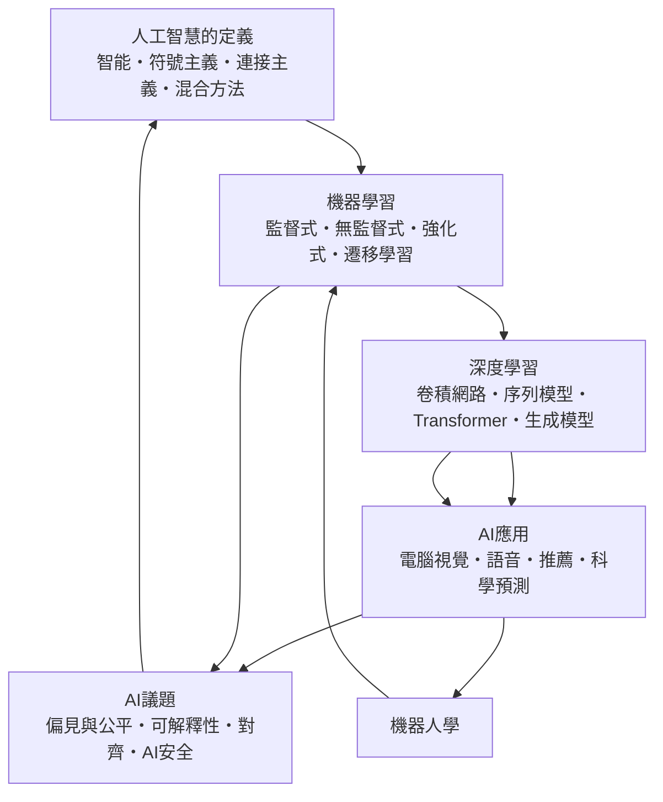

# 人工智慧

> 隸屬：第一層 [工]　·　相關分類：[演算法]、[資料科學]、[機器人學]　·　子分類總表見 [README]

> 對應維基百科：[中文維基百科：人工智慧](https://zh.wikipedia.org/wiki/%E4%BA%BA%E5%B7%A5%E6%99%BA%E6%85%A7)　·　[English Wikipedia: Artificial intelligence](https://en.wikipedia.org/wiki/Artificial_intelligence)

人工智慧是研究如何讓機器表現出需要智慧才得以完成的行為的學科。它的核心問題只有一句話：**如何讓計算機處理「什麼是對的」這類無法用公式直接寫死的問題**。傳統的 [電腦] 只會依程式行事，因此 [圖靈] 在 1950 年提出以對話來判斷機器是否具備智能的著名操作準則；然而真正的工程突破並不是靠「讓機器推理」，而是靠**讓機器從資料中學會規則**。

本條目所屬的分類體系把人工智慧拆成五個層次：先釐清 [智能] 與 [符號主義]、[連接主義]、[混合方法] 三條典範路線的定義邊界，再說明 [機器學習] 與 [深度學習] 這兩套技術主力如何互相驅動，接著交代 [AI應用] 的落地形態，最後處理 [AI議題] 之中關於偏見、可解釋性、對齊與安全的論爭。這樣的分層不是字典式的分類，而是因果鏈：定義決定了方法的適用範圍，方法決定了應用的能力上限，應用又反過來逼出新的議題。

## 核心問題

人工智慧的核心問題可以拆成三層。

1. **判準層**：怎麼定義「智能」，使得「機器是否聰明」不再是一句感覺話。[人工智慧的定義] 條目處理的正是此問題，並以 [符號主義] 與 [連接主義] 的對立作為學術史的主軸。
2. **方法層**：在沒有明寫規則的情況下，如何從資料中自動取得規律。[機器學習] 依「有無標註」「有無回饋」分成 [監督式]、[無監督式] 與 [強化式] 三類，[深度學習] 則以多層 [卷積網路]、[序列模型]、[Transformer] 與 [生成模型] 大幅擴張了可用問題的範圍。
3. **治理層**：當模型進入 [醫療衛生政策]、[資訊安全] 與日常決策時，如何讓它的行為可被質疑、可被追責、可被限制。這是 [AI議題] 存在的理由。

三層是層層相扣的：判準不清，方法的成功便無從判定；方法不成熟，應用只能停留在玩具；治理缺席，前兩層的進步反而可能釀成風險。**因此人工智慧的歷史，與其說是技術史，不如說是「把不可形式化的問題逐步形式化」的歷史。**

## 因果鏈

1. **可計算性的邊界**：1930 年代 [圖靈] 用圖靈機定義了可計算性，證明「機器能否思考」不是形上學問題，而是可以精確表述的技術問題。
2. **命名與奠基**：1950 年 [麥卡錫] 發表《計算機器與智能》，提出以對話判斷智能；1956 年達特矛斯會議上，[麥卡錫] 與 [明斯基] 等人正式提出人工智慧一詞，此年成為學科的起點（見 [1956年]）。
3. **第一次繁榮與第一次寒冬**：1960 年代以邏輯定理證明器與搜尋程式為主的系統取得一時成就，但計算力不足、組合爆炸使承諾落空，1970 年代形成「人工智慧寒冬」，資金與信心雙雙退潮。
4. **專家系統的實用化**：1980 年代知識庫與規則引擎讓專家系統在製造、醫療與維修領域真正上線（見 [1986年] 的專家系統復興），但維護成本高、知識難以取得，瓶頸轉向「知識從哪來」。
5. **統計學習的轉向**：1990 年代以降，[機器學習] 以 [機率統計] 的嚴謹方法取代手寫規則，支援向量機、決策樹與貝氏網路讓「從資料學」成為主流，學科重心從「教機器推理」轉為「讓機器自己歸納」。
6. **算力與資料的合流**：2012 年 [2012年] 的 AlexNet 以 GPU 訓練深層 [卷積網路] 在影像分類上大幅超越傳統方法，證明「更多資料加上更多算力加上更深模型」能跨越長期停滯的特徵工程瓶頸（見 [深度學習]）。
7. **注意力機制的通用化**：2017 年提出的 Transformer 架構以自注意力取代循環結構，使並行化與長距離依賴同時可行（見 [2017年]），此後 [序列模型] 與 [生成模型] 迅速整合，語言模型、多模態系統與 [AI應用] 全面鋪開。
8. **能力的躍升與治理的追趕**：1997 年 [深度藍] 擊敗世界棋王、2016 年 [2016年] 的圍棋系統擊敗頂尖棋手，能力邊界快速外推；與此同時，[偏見與公平]、[可解釋性]、[對齊] 與 [AI安全] 成為必須正面處理的問題，人工智慧因而從純技術領域變成公共議題。

## 子分類的定位與相互驅動

- [人工智慧的定義] 是**語義地基**：它區分「能力」與「實現方式」，並說明 [符號主義]（以邏輯與規則表達推理）與 [連接主義]（以神經網路從經驗中調整權重）的歷史分歧；[混合方法] 則指出當代系統多為兩者結合。
- [機器學習] 是**方法主幹**：它把「智慧」翻譯成可最佳化的目標函數，並依資料形式分為 [監督式]（有標註）、[無監督式]（無標註，找結構）、[強化式]（靠回饋試誤）與 [遷移學習]（把已學到的能力搬到新任務）。
- [深度學習] 是**能力擴張器**：多層非線性表示讓 [卷積網路] 處理影像、[序列模型] 處理時序、[Transformer] 處理長距離依賴、[生成模型] 處理合成內容，把過去需要人工設計特徵的問題改為端到端學習。
- [AI應用] 是**落地檢驗場**：[電腦視覺]、[語音]、[推薦] 與 [科學預測] 把前述方法變成可被日常使用的工具；應用的規模也帶來真實世界的資料污染與偏見。
- [AI議題] 是**回饋迴路**：當應用進入醫療、招聘與治安等高風險領域，[偏見與公平]、[可解釋性]、[對齊] 與 [AI安全] 便要求研究重新檢視方法本身，甚至回頭影響 [智能] 的定義。

## 範例

**問題**：用一個小模型分辨一封電子郵件是否為垃圾郵件，並說明整條技術鏈如何運作。

1. **建立資料**：蒐集使用者收到的郵件，由使用者回報「垃圾／非垃圾」，形成帶標註的資料集 $D = \{(x_i, y_i)\}_{i=1}^{n}$ ，其中 $x_i$ 為文字特徵、 $y_i \in \{0, 1\}$ 。這是 [監督式] 的典型起點。
2. **選擇特徵**：最簡單的版本以詞頻矩陣表示郵件，令 $x_{ij}$ 為第 $j$ 個詞在第 $i$ 封信中出現的次數。
3. **訓練模型**：以邏輯迴歸為例，學得權重向量 $w$ 與偏置 $b$ ，使機率模型
   $$ p(y = 1 \mid x) = \frac{1}{1 + e^{-(w^\top x + b)}} $$
   盡量逼近標註結果。訓練即是以 [機率統計] 的最大概然法反覆做梯度下降。
4. **評估**：不可只看訓練準確率，須用分佈在時間之後的測試集計算混淆矩陣。若召回率（真正垃圾信被抓出來的比例）為 0.92 、精確率（被判定為垃圾信中確實是垃圾的比例）為 0.80 ，則
   $$ F_1 = \frac{2 \times 0.92 \times 0.80}{0.92 + 0.80} \approx 0.857 . $$
5. **換成深度模型**：若改用 [卷積網路] 處理原文序列，詞彙的局部組合模式可被自動抽取，特徵工程大幅簡化，這就是 [深度學習] 相對 [機器學習] 傳統做法的價值所在。
6. **延伸為生成式**：若再接上 [Transformer] 與 [生成模型]，便可產生「摘要」或「回覆草稿」，此時輸出不再是標籤而是文字，於是 [語音] 與 [可解釋性] 的問題同時浮現。
7. **進入治理層**：當這套模型被用在企業的求職篩選上，訓練資料中既存的性別偏差會被學進權重，[偏見與公平] 便不再是倫理口號，而是工程問題。

第二個例子說明 [強化式] 與 [監督式] 的差異。若要訓練機器人走迷宮，資料標註極難取得，但每一步的「移動後是否更接近終點」卻是自然的回饋訊號。於是策略 $\pi(a \mid s)$ 以狀態 $s$ 為輸入、動作 $a$ 為輸出，回饋 $r$ 依下列式更新：

$$
\theta \leftarrow \theta + \alpha \, \nabla_\theta \left( r + \gamma \max_{a'} Q(s', a') - Q(s, a) \right)
$$

其中 $\alpha$ 為學習率、 $\gamma$ 為折扣因子。這一整套 [強化式] 方法與 [機器人學] 的自主控制直接相連，說明兩個領域是同一套數學工具的兩種舞台。

## 容易混淆之處

- **人工智慧與機器學習不同**：人工智慧是目標與學科，機器學習是其中以資料驅動的方法族；並非所有人工智慧系統都是機器學習系統（純邏輯推論的定理證明器就不是）。
- **深度學習不是「更聰明的機器學習」**：它主要是表示方法的改變，帶來的是在特定任務上的統計優勢，而非通用智能。
- **生成式模型的「理解」仍有爭議**：模型能產生流暢文本，並不必然等於具備語意理解能力，此點在 [對齊] 與 [AI安全] 的討論中是核心議題。
- **偏見不是模型單方面的缺陷**：多數 [偏見與公平] 案例中，資料集本身的取樣與標註方式才是主要來源，因此「去偏」不只是演算法工作。
- **可解釋性與準確率常被混為一談**：可解釋模型可能損失效能，而高效能模型未必能被說明理由，兩者需要權衡而非互相取代；在 [科學預測] 這類高風險領域，此權衡尤其具體。
- **專用超級電腦的勝利不等於通用人工智慧**：如 [深度藍] 在棋類上的成就，是在規則明確領域的專用搜索，並非 [智能] 定義下的通才。
- **「AI 應用」不是自動成立**：同一模型在 [電腦視覺] 上有效，不代表它能承擔涉及 [外科] 判定等高風險任務的責任。

## 延伸閱讀

- [人工智慧的定義]：智能與典範的語義基礎。
- [機器學習]：方法主幹與三種學習型態。
- [機器人學]：人工智慧在物理世界中的對應分支。
- [資料科學]：把統計方法工程化的實務框架。
- [倫理學]：AI 議題在規範層的討論框架。

## 連結定義

[工]: ../工/README.md
[README]: README.md
[演算法]: ../演算法/README.md
[資料科學]: ../資料科學/README.md
[機器人學]: ../機器人學/README.md
[電腦]: ../電腦/README.md
[資訊安全]: ../資訊安全/README.md
[醫療衛生政策]: ../醫療衛生政策/README.md
[機器學習]: 機器學習.md
[深度學習]: 深度學習.md
[AI應用]: AI應用.md
[AI議題]: AI議題.md
[人工智慧的定義]: 人工智慧的定義.md
[智能]: 智能.md
[符號主義]: 符號主義.md
[連接主義]: 連接主義.md
[混合方法]: 混合方法.md
[監督式]: 監督式.md
[無監督式]: 無監督式.md
[強化式]: 強化式.md
[遷移學習]: 遷移學習.md
[卷積網路]: 卷積網路.md
[序列模型]: 序列模型.md
[Transformer]: Transformer.md
[生成模型]: 生成模型.md
[電腦視覺]: 電腦視覺.md
[語音]: 語音.md
[推薦]: 推薦.md
[科學預測]: 科學預測.md
[偏見與公平]: 偏見與公平.md
[可解釋性]: 可解釋性.md
[對齊]: 對齊.md
[AI安全]: AI安全.md
[機率統計]: ../機率統計/README.md
[倫理學]: ../倫理學/README.md
[外科]: ../外科/README.md
[圖靈]: ../人/數學家/圖靈.md
[麥卡錫]: ../人/數學家/麥卡錫.md
[明斯基]: ../人/數學家/明斯基.md
[深度藍]: ../物/深度藍.md
[1956年]: ../時/1956年.md
[1986年]: ../時/1986年.md
[2012年]: ../時/2012年.md
[2016年]: ../時/2016年.md
[2017年]: ../時/2017年.md
