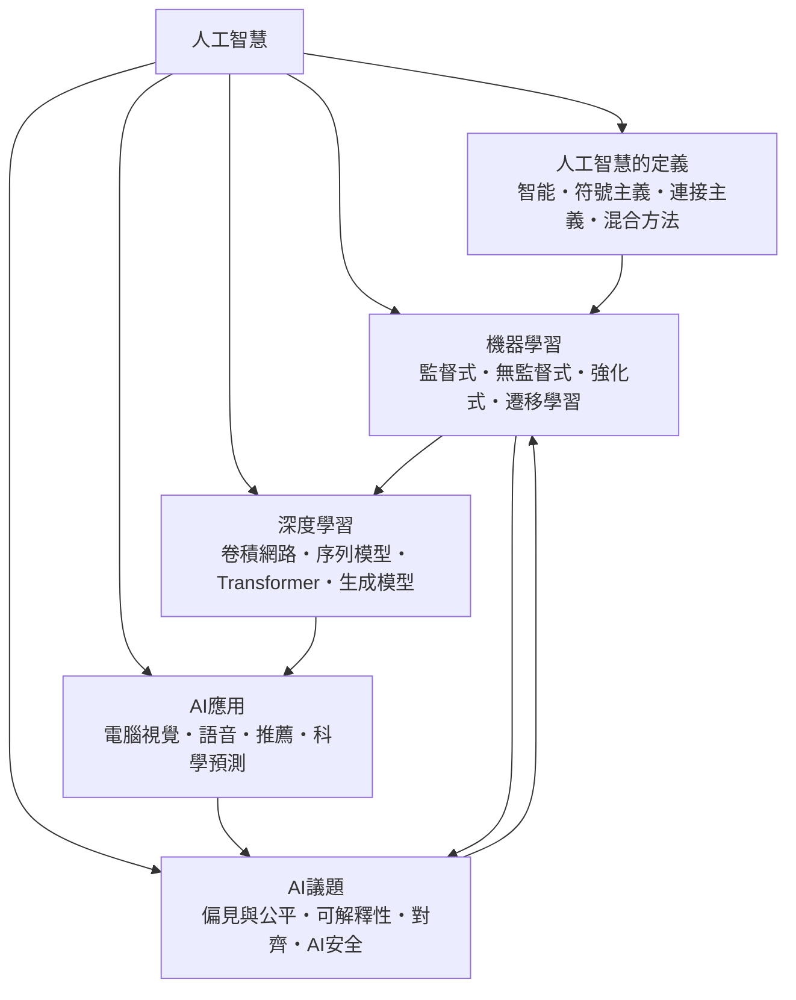

# 人工智慧

> 隸屬：第一層 [工]　·　相關分類：[演算法]、[資料科學]、[神經科學]　·　子分類總表見 [README]

> 對應維基百科：[中文維基百科：人工智慧](https://zh.wikipedia.org/wiki/%E4%BA%BA%E5%B7%A5%E6%99%BA%E8%83%BD)　·　[English Wikipedia: Artificial intelligence](https://en.wikipedia.org/wiki/Artificial_intelligence)

人工智慧研究的是**如何讓機器表現出需要智慧才辦得到的能力**：從模糊影像中認出物體、從語句中抽出意圖、從經驗中學會策略、在不確定中作出決策。這個領域的特色是，它從來不是單一學科，而是一組方法的匯集地——[機率統計] 提供不確定性的語言，[演算法] 提供搜尋與學習的引擎，[神經科學] 與 [認知科學] 提供「什麼算學會了」的參照系。

它的歷史可以看成一部「期待與失望交替」的紀錄。[愛達] 在 1843 年就指出 [巴貝奇] 的分析引擎可以處理符號而不只是數字，這是全最早的「電腦可以思考」主張；[圖靈] 在 1936 年用圖靈機定義了可計算性的邊界，並在 1950 年提出模仿遊戲，把「智能」轉成可操作的行為判準；[麥卡錫] 在 1956 年正式提出人工智慧這個詞，並與 [明斯基] 等人開創了以程式實作推理的 [符號主義] 路線。然而從 1970 年代起，兩次「寒冬」說明純靠規則堆疊的方法無法擴展到真實世界。

轉折點來自 [桑代克] 與 [斯金納] 的學習理論、[馬可夫] 的鏈式模型，以及 1980 至 1990 年代被重新發現的反向傳播與統計學習。1997 年 [深度藍] 擊敗棋王，2012 年之後的深度學習浪潮，以及 2017 年以來以 [Transformer] 為核心的大模型，都把這個領域從「要不要造智慧」的爭論，推到「如何治理既有智慧」的階段——這正是 [AI議題] 存在的理由。

## 核心問題

人工智慧可以歸結為四個互相咬合的問題。

1. **表徵**：世界要用什麼樣的內部表示來承載？像素、向量、符號、圖、機率分布，各有擅長的問題類型。
2. **學習**：表示與行為之間的映射如何從經驗中得來？資料從哪裡來、怎麼標註、怎麼避免把噪聲學成規律。
3. **推理與決策**：面對不完整資訊如何產生行動？目標函數如何定義，獎勵如何設計。
4. **可信與治理**：模型行為如何被理解、糾正與約束？這是 [偏見與公平]、[可解釋性]、[對齊] 與 [AI安全] 處理的問題。

用一句話說：前三個問題是「怎麼做到」，第四個問題是「做到之後怎麼負責」。人工智慧的成熟度不只由準確率決定，也由第四個問題的答案決定。

## 因果鏈

1. **演算法的古老根源**：19 世紀 [布爾] 的邏輯代數與 [巴貝奇] 的差分引擎，提供「以符號步驟表達計算」的藍圖。
2. **可計算性的邊界**：[圖靈] 在 1936 年定義圖靈機，把「能算的」與「不能算的」清楚切開，為後來的證明不可判定性留下空間。
3. **行為判準**：[圖靈] 在 1950 年提出模仿遊戲，把「是否會思考」轉成「能否在對話中讓人分辨不出來」。
4. **學科的正式命名**：[麥卡錫] 在 1956 年於達特茅斯會議提出人工智慧一詞，界定研究範圍。
5. **符號方法的巔峰與停滯**：[明斯基] 的 [推理] 研究與專家系統在 1960 年代達到頂峰，隨後因組合爆炸與知識獲取困難而停滯。
6. **學習方法的復興**：統計學習、反向傳播與 [馬可夫] 模型在 1980 至 1990 年代被重新重視，開啟機器學習的實證時代。
7. **算力與資料的匯流**：1997 年 [深度藍] 的勝利、2012 年影像競賽的突破，以及網際網路帶來的大規模資料，使深度學習成為主流。
8. **規模化與治理並行**：2017 年以後 [Transformer] 與大模型把通用能力集中到少數模型上，效率、可解釋性與安全成為新的核心問題。

## 子分類的定位與相互驅動

- [人工智慧的定義] 是**詞彙層**：它處理「智能」到底指什麼，以及 [符號主義]、[連接主義] 與 [混合方法] 三種解釋的取捨，決定了後續所有工作的假設。
- [機器學習] 是**方法層**：把「手寫規則」換成「從資料估計規則」，是這個領域實際可用的原因。
- [深度學習] 是**架構層**：以多層表示與端到端訓練榨出資料中的規律，並把 [機器學習] 的方法族收攏到少數幾種網路骨架上。
- [AI應用] 是**出口層**：把模型能力轉成具體產品與研究工具，是回饋資料與資金的來源。
- [AI議題] 是**約束層**：它檢查上述四層的產物是否可被信任，並反過來改寫資料採集與訓練目標。

## 範例：從垃圾郵件分類到蛋白質摺疊

**問題**：把使用者收到的郵件分成垃圾與正常兩類，並在另一個任務中預測蛋白質的三維結構。

1. **表徵**：把郵件轉成詞頻向量 $x \in \mathbb{R}^d$ ，把蛋白質的胺基酸序列轉成長度為 $L$ 的符號序列。
2. **模型**：垃圾郵件分類可用邏輯迴歸，決策邊界為 $w^{\top} x + b = 0$ ；蛋白質摺疊則需要能捕捉長距離依賴的 [序列模型] 或 [Transformer]，並用多個結構預測頭分別輸出摺疊座標。
3. **訓練**：以標註資料最小化交叉熵損失
   $$ \mathcal{L}(\theta) = -\sum_{i} \sum_{c} y_{ic} \log p_\theta(c \mid x_i) $$
   並用反向傳播求出 $\nabla_\theta \mathcal{L}$ ，再以隨機梯度下降更新。
4. **不確定性**：把預測機率拿來排序，設定閾值 $t$ ；當 $p(\text{spam} \mid x) > t$ 才攔截。閾值直接對應業務上的「漏擋成本」與「誤擋成本」之比。
5. **評估**：垃圾郵件分類以精確率與召回率衡量；蛋白質結構預測以 GDT（平均 TM-score）衡量摺疊準確度。
6. **治理**：若攔截率在特定族群顯著偏高，模型就會被判定為不公平，必須回到資料重新抽樣或改用分群閾值；這一步把 [AI議題] 拉進工程流程。

這條流程把整個人工智慧的分工一次走完：**定義 → 學習 → 深度架構 → 應用 → 治理**，而且治理結果會回頭改寫學習所用的資料。

## 容易混淆之處

- **人工智慧不等於機器學習**：機器學習是人工智慧的一種實作手段；符號推理、搜尋與規劃不屬於機器學習。
- **機器學習不等於深度學習**：深度學習是機器學習的一個子集，特徵由網路自行學出。
- **生成模型不等於判別模型**：前者學的是資料分布，後者學的是類別邊界。
- **模型準確率高不等於模型有用**：部署成本、延遲、可解釋性與失效後果同樣決定實用性。
- **AI應用不等於 AI 取代某職業**：多數成果是任務層面的自動化，而非整個職業的消失。
- **「對齊」不等於「受控制」**：對齊關注的是系統目標與人類價值的相符程度，與行為邊界的約束是不同問題。
- **AI 安全不等於資安**：資安處理外部攻擊，AI 安全處理系統自身的目標錯置與失效模式。

## 延伸閱讀

- [演算法]：學習與搜尋的演算法基礎。
- [資料科學]：資料準備與評估的實務框架。
- [機率統計]：不確定性量化與貝氏更新的方法論。
- [神經科學]：神經元計算的生物學對照。
- [認知科學]：心智與學習的理論模型。
- [機器人學]：人工智慧在物理世界中的落地形態。

## 連結定義

[工]: ../工/README.md
[README]: README.md
[演算法]: ../演算法/README.md
[資料科學]: ../資料科學/README.md
[神經科學]: ../神經科學/README.md
[機率統計]: ../機率統計/README.md
[認知科學]: ../認知科學/README.md
[人工智慧的定義]: 人工智慧的定義.md
[機器學習]: 機器學習.md
[深度學習]: 深度學習.md
[AI應用]: AI應用.md
[AI議題]: AI議題.md
[偏見與公平]: 偏見與公平.md
[可解釋性]: 可解釋性.md
[對齊]: 對齊.md
[AI安全]: AI安全.md
[符號主義]: 符號主義.md
[混合方法]: 混合方法.md
[連接主義]: 連接主義.md
[Transformer]: Transformer.md
[序列模型]: 序列模型.md
[機器人學]: ../機器人學/README.md
[愛達]: ../人/數學家/愛達.md
[巴貝奇]: ../人/數學家/巴貝奇.md
[圖靈]: ../人/數學家/圖靈.md
[麥卡錫]: ../人/數學家/麥卡錫.md
[明斯基]: ../人/數學家/明斯基.md
[桑代克]: ../人/心理學家/桑代克.md
[斯金納]: ../人/心理學家/斯金納.md
[馬可夫]: ../人/數學家/馬可夫.md
[布爾]: ../人/數學家/布爾.md
[深度藍]: ../物/深度藍.md
[推理]: 符號主義.md
