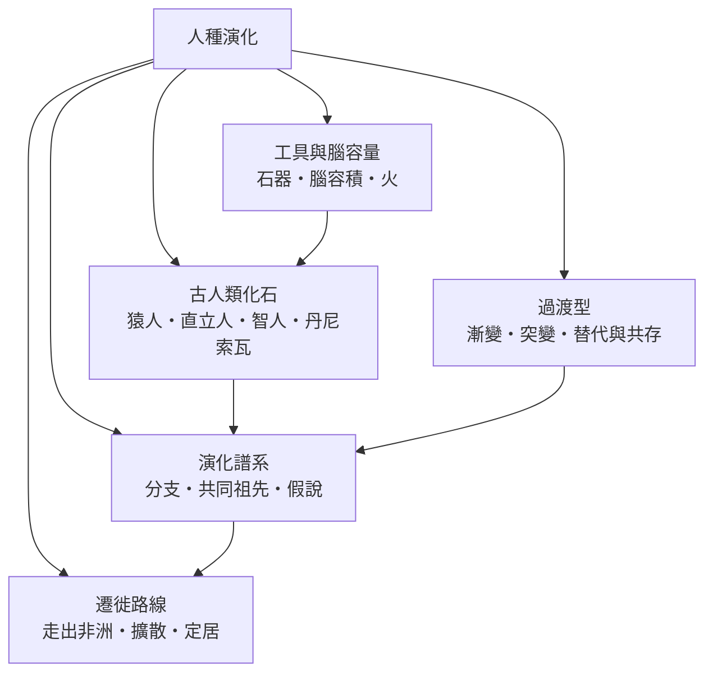

# 人種演化

> 分類範圍：以化石、譜系與遷徙證據重建人屬從猿類共同祖先到智人的演化過程，並說明工具、腦容量與火如何互相推動。　·　隸屬第一層：[人]　·　相關分類：[人類學]、[遺傳學]、[考古人類學]　·　子分類總表見 [README]

> 對應維基百科：中文維基百科無對應條目　·　[English Wikipedia: Human evolution](https://en.wikipedia.org/wiki/Human_evolution)

「人種演化」處理一個時間尺度極大的問題：**人是如何在幾百萬年裡，從與黑猩猩共享祖先的狀態，變成今天的智人**。這個問題的特殊困難在於證據的稀缺與不完整——化石是不規則取樣的殘片，年代有誤差，行為只能從器物與遺跡間接推斷。因此本條目在組織上不追求「一條直線的故事」，而是把已知材料按五個面相組織：化石是什麼、譜系怎麼排、技術與腦如何互動、人群怎麼散開、過渡是漸變還是突變。

## 核心問題：樹狀演化與「直線進步」的錯覺

人類演化常被畫成一條從猿到人的直線，這是嚴重的誤導：

1. **演化是樹不是梯**：同一時期常有多種人科並存——南方古猿、直立人與早期智人在時間上長期重疊；「誰是誰的祖先」經常沒有單一答案。
2. **沒有演化的方向**：演化不朝「更進步」前進，只對當下的環境做出回應；「原始」與「進步」不是演化學的範疇。
3. **解釋以假說競爭的方式進行**：走出非洲與多地起源的辯論、漸變與突變的辯論，都是**用新證據裁決的假說競爭**——這正是本分類的敘事方式。

## 因果鏈

1. **共同祖先的分家**：約六至七百萬年前，人類與黑猩猩的祖先分離；早期人科的關鍵變化是**直立行走**——腦還不大，先站起來。
2. **南方古猿的適應**：約四至二百萬年前的非洲，南方古猿以直立行走與混合性食性存活；腦容量與猿相近。
3. **工具的出現**：約二百六十萬年前最早的石器出現；肉食與石器的組合改變了營養與社會。
4. **人屬的擴張**：腦容量上升、身形增大的直立人在約一百八十萬年前走出非洲，是第一次地理擴張。
5. **火與熟食**：火的使用改變飲食與消化負擔，間接支持了高能耗的大腦。
6. **智人的出現**：約三十萬年前智人在非洲出現；約七萬年前後完成現代行為的擴散，並在約六萬至五萬年前走出非洲。
7. **與古人種的交會**：智人在歐亞與尼安德塔人、丹尼索瓦人共存並雜交——現代人的基因組裡仍留有這些痕跡。
8. **全球定居**：約一萬五千年前後進入美洲，約四千年前抵達太平洋深處偏遠島嶼。

## 子分類的定位與相互驅動

- [古人類化石] 提供**材料**：沒有化石與遺址，一切譜系都是紙上談兵。
- [演化譜系] 提供**骨架**：把材料排成有時序、有親緣關係的樹。
- [工具與腦容量] 提供**機制**：技術、飲食與腦的互相推動是演化壓力的具體內容。
- [遷徙路線] 提供**地理**：演化發生在移動的人群中，擴散路徑決定了誰遇到誰。
- [過渡型] 提供**節奏**：漸變或突變、替代或共存，是解讀整個過程的兩大框架。

## 範例：丹尼索瓦人——只用基因發現的古人種

丹尼索瓦人是近年最有啟發性的案例：

1. **發現**：二〇一〇年，在西伯利亞丹尼索瓦洞的一節指骨中提取出完整的粒線體基因組；化石極少，**基因組先於形態**確立了一個新人種。
2. **雜交證據**：今日大洋洲與部分東亞人群的基因組中攜帶可觀比例的丹尼索瓦成分。
3. **適應的饋贈**：藏族人群的高海拔適應基因即來自丹尼索瓦人——古代雜交成為現代人群的生理資產。
4. **方法論意義**：它證明人種演化的證據類型已從化石擴展到分子層次，也修正了「替代」的舊圖像——不是你死我活，而是**混合著分開**。

- **每個子分類都是一種證據系統**：化石看形態、譜系看關係、技術看行為、遷徙看地理、過渡看節奏；閱讀本分類時先分辨正在使用哪一種證據。

## 因果鏈的重點提醒

上述八步是「主線」，不是「證明」；每一步的證據強度不同，引用時應回到對應的子分類核對。此外，主線刻意省略了多波走出非洲與早期擴散的爭議細節——那些內容屬於 [遷徙路線] 的專題。

## 容易混淆之處

- **「人種」不是等級**：本條目的「人種」指人屬內的各個物種與族群，不帶優劣判斷；以演化論證種族歧視是對學科的徹底誤用。
- **「缺失的環節」是媒體用語**：演化是分支過程，不存在單一的、尚未找到的中間型；每件新化石都增加的是**分支**，不是鏈環。
- **腦容量不等於智力**：腦容量是粗指標，神經組織、發育期與社會學習同樣關鍵；尼安德塔人腦容量不低於智人，卻在競爭中處於劣勢。
- **年代要附誤差**：「約三十萬年前」是區間不是時刻；引用年代時應保留誤差意識。

## 延伸閱讀

- [人類學]：五條路徑的總框架。
- [遺傳學]：分子證據的技術來源。
- [走出非洲]：現代人起源假說的專條。
- [考古人類學]：遺址與器物的分析技術。
- [人種演化] 各子分類：化石、譜系、技術、遷徙與過渡的分頭敘述。

## 連結定義

[人]: ../人/README.md
[README]: README.md
[人類學]: ../人類學/人類學.md
[遺傳學]: ../遺傳學/README.md
[走出非洲]: 走出非洲.md
[人種演化]: 人種演化.md
[考古人類學]: ../人類學/考古人類學.md
[古人類化石]: 古人類化石.md
[演化譜系]: 演化譜系.md
[工具與腦容量]: 工具與腦容量.md
[遷徙路線]: 遷徙路線.md
[過渡型]: 過渡型.md
