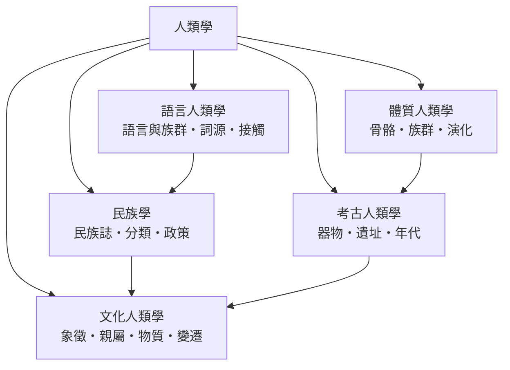

# 人類學

> 分類範圍：以「人」為整體對象的比較研究——文化、考古、體質、民族與語言五條路徑——並說明田野方法如何使人類學有別於其他關於人的學問。　·　隸屬第一層：[人]　·　相關分類：[社會學]、[宗教學]、[世界史]　·　子分類總表見 [README]

> 對應維基百科：[中文維基百科：人类学](https://zh.wikipedia.org/wiki/%E4%BA%BA%E7%B1%BB%E5%AD%A6)　·　[English Wikipedia: Anthropology](https://en.wikipedia.org/wiki/Anthropology)

人類學的定義可以很簡短：**研究人作為生物與文化存在的全部變異**。但它的特殊性不在定義而在方法——人類學堅持「親自到場」：研究者長期住進被研究者的生活裡，用當地的語言問問題、用當地的時間表作息。這種方法上的固執，使人類學成為唯一以第一手生活經驗為主要證據的人文科學。本條目要處理的問題是：**當我們說「人」，究竟是在說哪一種人——而這個問題如何被五條不同的研究路徑分頭回答**。

## 核心問題：整體性與比較

人類學有兩條不可退讓的原則：

1. **整體性**：任何一項文化事實都要放回它的整體脈絡理解——婚俗與經濟、喪禮與宇宙觀、飲食與權力是同一張網上的結點，切開來各自研究必然失真。
2. **比較性**：單一社會的描述只是起點；只有把它與其他社會並排，才能分辨「這是人性的通則」還是「這是此地此時的選擇」。

這兩條原則共同回答了人類學的原始問題：十九世紀歐洲人初見非西方社會時，慣於把差異解釋為「先進與落後」。人類學的回答是：**差異不是階梯，而是不同的解法**——每個社會都在用自己的方案處理吃、住、婚、死這些同樣的問題。

## 因果鏈

1. **殖民接觸與收藏**：十六世紀起的航海與殖民使歐洲人累積了大量異文化的器物、詞彙與記述；這些「材料」是學科得以成立的前提，也使早期人類學帶著無法迴避的殖民陰影。
2. **演化論與單線進化說**：十九世紀的學者以生物演化為範本，把所有社會排成一條從野蠻到文明的階梯；這套框架今日已被揚棄，但它提供了「全人類可比較」的前提。
3. **田野方法的革命**：二十世紀初，[馬凌諾斯基] 在特羅布里恩群島長期居住、學習當地語言，證明只有進入日常生活才能理解制度的功能；「參與觀察」從此成為學科的入門儀式。
4. **歷史特殊論**：[鮑亞士] 反對單線進化，主張每個文化有自己的歷史軌跡，必須先還原其自身脈絡；文化相對論由此成為倫理基調。
5. **結構與象徵**：[李維史陀] 把親屬與神話視為普遍心智結構的表現；[紀爾茲] 則主張文化是「意義之網」，人類學的工作是詮釋而非找定律。
6. **反思與合作**：當代田野工作必須面對研究者身分、報導人權益與返還問題——被研究者成為合作者與讀者，寫作的權力被重新檢討。

## 子分類的定位與相互驅動

- [文化人類學] 是學科的**中心**：象徵、親屬、物質與變遷四個入口，把田野材料組織成文化分析。
- [考古人類學] 提供**時間深度**：沒有考古，人類學只能談當代；器物與遺址使「沒有文字的人」也有歷史。
- [體質人類學] 提供**生物基礎**：骨骼與演化資料劃出了文化解釋的邊界——哪些是適應，哪些是選擇。
- [民族學] 承擔**描述與分類**的傳統任務：民族誌是整個學科的資料庫，分類與政策則是它與國家的介面。
- [語言人類學] 提供**接觸的證據**：語言之間的借用與分化，記錄了人群遷徙與接觸的歷史，常與考古、體質資料互相校正。

## 範例：同一個問題，五條路徑的回答

以「一個社會為什麼有成年禮」為例：

1. **文化人類學**：以 [通過儀禮] 的三段結構（隔離—過渡—再整合）解釋成年禮如何完成身分的轉換。
2. **考古人類學**：從成年禮使用的器物（飾物、傷疤工具）在遺址中的出現與分布，追溯儀式何時成形。
3. **體質人類學**：檢視骨骼上的儀式痕跡（如牙齒修飾）與年齡的對應，確認儀式確實繫於特定年齡。
4. **民族學**：比較鄰近民族的成年禮異同，寫出本地版本的民族誌描述。
5. **語言人類學**：分析成年禮中新獲得的稱謂與禁忌語，看身分轉換如何被語言標記。

這個例子顯示人類學的**多證據互證**性質：任何單一資料都可能誤導，五條路徑的交叉才是學科的工作方式。

## 容易混淆之處

- **人類學不等於「研究原始民族」**：現代田野工作同樣研究都市、企業、實驗室與網路社群；「他方」只是方法的訓練場，不是對象的限制。
- **文化相對論不是「無法評價」**：它要求先理解再評價，而不是拒絕一切判斷；理解本身就是學科的倫理底線。
- **人類學與社會學的界線在方法與尺度**：社會學多以問卷與統計處理大型社會，人類學以參與觀察處理可住進去的小社群；兩者互相借鏡而非互相取代。
- **體質與文化的分界被二十世紀的血統論嚴重污染**：以生物特徵解釋文化高低的用法是科學史的錯誤，也是本條目必須明言的邊界。

## 延伸閱讀

- [社會學]：以統計與制度為方法的姊妹學科。
- [宗教學]：宗教作為文化系統的人類學研究。
- [語言學]：語言結構分析的技術來源。
- [考古學]：與考古人類學共享的技術層。
- [世界史]：人群遷徙與接觸的大尺度背景。

## 連結定義

[人]: ../人/README.md
[README]: README.md
[社會學]: ../社會學/社會學.md
[宗教學]: ../宗教學/README.md
[世界史]: ../世界史/README.md
[語言學]: ../語言學/語言學.md
[考古學]: ../考古學/README.md
[文化人類學]: 文化人類學.md
[考古人類學]: 考古人類學.md
[體質人類學]: 體質人類學.md
[民族學]: 民族學.md
[語言人類學]: 語言人類學.md
[通過儀禮]: https://zh.wikipedia.org/wiki/%E9%80%9A%E8%BF%87%E4%BB%AA%E7%A4%BC
[馬凌諾斯基]: ../人/馬凌諾斯基.md
[鮑亞士]: ../人/鮑亞士.md
[李維史陀]: ../人/李維史陀.md
[紀爾茲]: ../人/紀爾茲.md
