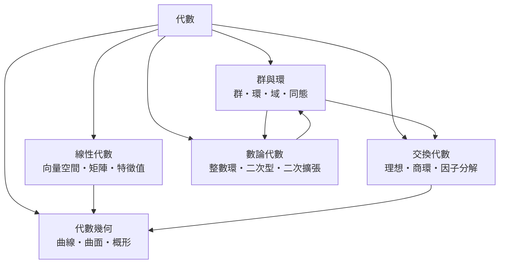

# 代數

> 隸屬：第一層 [理]　·　相關分類：[數學]、[數學的分支]、[幾何]　·　子分類總表見 [README]

> 對應維基百科：[中文維基百科：代數](https://zh.wikipedia.org/wiki/%E4%BB%A3%E6%95%B0)　·　[English Wikipedia: Algebra](https://en.wikipedia.org/wiki/Algebra)

代數研究**符號、運算與結構**。它有兩個不太相同的面向：一是用符號代表未知量，依照運算規則求解方程；二是把「集合加上運算」組成的結構本身當成研究對象，考察它們的同構、分解與不變量。

第二個面向是代數在 19 世紀末成熟的關鍵。1830 至 1831 年，[伽羅瓦] 研究五次方程時發現，方程能否用根式求解，取決於其根的置換所形成的群的結構；他證明可解方程所對應的群必須是可解群，並依結構對這些群分類。把一個具體方程問題轉化為結構分類問題，這一步是抽象代數的起點，也是現代數學觀唸的重大轉變：研究的對象從「數」變成「運算的規律」。

此後抽象代數提供了整個 20 世紀物理學與資訊理論的語言：群論描述對稱性，環與域描述代數，範疇論統一「映射與結構」的觀點，而代數幾何則證明幾何問題可以被化為交換代數問題。

## 核心問題

代數的核心問題有三層。

1. **求解**：給定方程或系統，如何找出全部解？這是代數最古老、也最容易被公眾理解的一面。
2. **不變量**：在運算過程中什麼保持不變？根的和與積、不變量因子、群的階、特徵值，都是用來區分與分類的量。
3. **結構**：哪些運算系統彼此同構？它們能被分解成哪些基本塊？這是 19 世紀末以後代數的主線，也是把代數與物理、幾何、資訊理論縫合起來的接口。

三層問題的關係是：求解往往做不到（一般高次方程沒有根式解），但不變量與結構仍可研究。**[伽羅瓦] 的定理正是在說明這件事：不可解的方程，仍然有可分類的結構。**

## 因果鏈

1. **古巴比倫的方程術**：以「增加多少」「乘以多少」的形式處理一次方程，問題被限制在具體的數與商品。
2. **[九章算術] 的方程術**：正負術與盈不足術給出多元一次方程組的解法，形式上仍是程序而非符號。
3. **花拉子米的分類**：約 820 年的《代數學》把方程按形式分類並給出通解，「代數」一詞由此定型。
4. **韋達與笛卡兒的符號化**：16 至 17 世紀，人們用字母代表未知量、用運算規則處理方程，[笛卡兒] 進一步把幾何化為代數。
5. **19 世紀的解與結構**：高斯、克羅涅克等人系統研究方程的根式可解性；[伽羅瓦] 把問題改寫為群的可解性，開啟抽象代數。
6. **環、理想與交換代數**：Dedekind 引入理想，Hilbert 建立基定理，Emmy Noether 把抽象方法推廣到更一般的環，交換代數遂成形。
7. **線性代數的成熟**：高斯消去法、行列式與特徵值理論成為物理與工程的通用工具。
8. **代數幾何與範疇論**：Grothendieck 用交換代數重寫幾何，概形成為現代代數幾何的語言，範疇論則統一了結構與映射的觀點。

## 子分類的定位與相互驅動

- [群與環] 是**基礎層**：群、環、域是所有其他代數結構的原型，同態則是比較結構的工具。
- [線性代數] 是**計算層**：向量空間、矩陣與特徵值提供了最可操作的線性語言。
- [交換代數] 是**機制層**：理想與商環是「化繁為簡」的核心手段，因子分解則是它的原型問題。
- [代數幾何] 是**交會層**：它用交換代數重寫幾何，證明幾何問題可以完全代數化。
- [數論代數] 是**應用層**：整數環與二次擴張把代數結構用到整數與算術上，並回頭深化 [數論]。

## 範例：從方程到結構

1. **具體問題**：求五次方程 $x^5 - x - 1 = 0$ 的根。
2. **第一層回應**：用符號運算嘗試通解。Cardano 的三次方程公式可用於化簡，但五次方程的根式通解不存在。
3. **第二層回應**：檢查根的對稱性。若把方程的 5 個根做任意排列，得到一個置換群；可解性由這個群決定。
4. **第三層回應**：若群是可解群，則方程有根式解；若不可解，則沒有。此方程的群不可解，因此沒有根式解——但根仍存在，仍可用數值方法逼近到任意精度。
5. **第四層回應（現代）**：由 Galois 對應，根的域擴張 $K / \mathbb{Q}$ 與群 $G$ 的子群一一對應。問題「求根」變成「描述子群結構」，這正是代數幾何與 [數論代數] 使用的語言。

這條鏈條說明：代數的抽象不是逃避計算，而是把無法計算的問題改寫成可以研究的問題。

## 容易混淆之處

- **代數與算術不同**：算術研究整數的加乘，代數研究運算的結構規則。
- **初等代數與線性代數不同**：前者處理多項式與方程，後者處理線性結構，兩者的歷史與方法並不相同。
- **代數幾何不等於幾何**：它研究的是由代數方程定義的幾何，而非一般幾何。
- **抽象代數不等於「更難的代數」**：它換了問題的種類，用結構代替了數值。
- **同構與相等不同**：兩個同構的結構在元素上可以完全不同。

## 延伸閱讀

- [數學]：代數所屬的整體。
- [群與環]：最基本的代數結構。
- [線性代數]：最可計算的代數分支。
- [交換代數]：現代代數的主幹。
- [數學的分支]：代數在學科地圖上的位置。

## 連結定義

[理]: ../理/README.md
[README]: README.md
[數學]: ../數學/README.md
[數學的分支]: ../數學/數學的分支.md
[幾何]: ../幾何/README.md
[九章算術]: ../數學/九章算術.md
[數論]: ../數學/數論.md
[伽羅瓦]: ../人/數學家/伽羅瓦.md
[笛卡兒]: ../人/數學家/笛卡兒.md
[群與環]: 群與環.md
[線性代數]: 線性代數.md
[交換代數]: 交換代數.md
[代數幾何]: 代數幾何.md
[數論代數]: 數論代數.md
