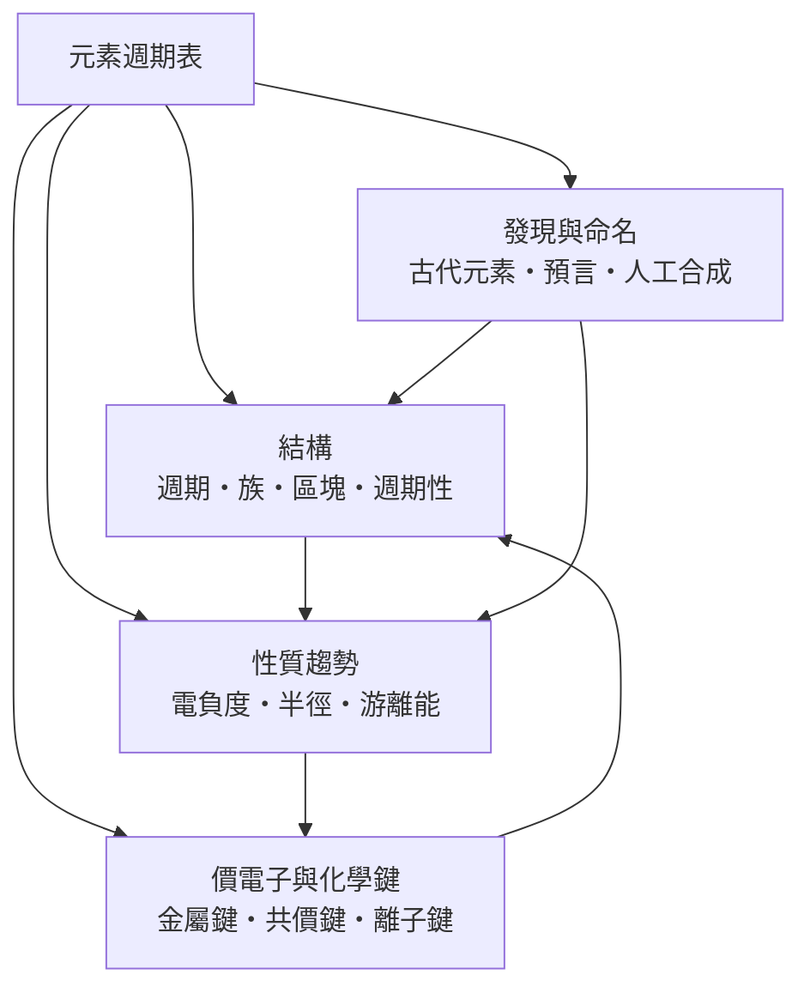

# 元素週期表

> 隸屬：第一層 [物]　·　相關分類：[化學]、[金屬]、[非金屬]　·　子分類總表見 [README]

> 對應維基百科：[中文維基百科：元素週期表](https://zh.wikipedia.org/wiki/%E5%85%83%E7%B4%A0%E5%91%A8%E6%9C%9F%E8%A1%A8)　·　[English Wikipedia: Periodic table](https://en.wikipedia.org/wiki/Periodic_table)

元素週期表是**把所有化學元素按原子序排列、使性質相似的元素落在同一縱行的系統表格**。它同時是一張地圖與一份預言：橫向的「週期」告訴你電子殼層如何逐層填充，縱向的「族」告訴你哪些元素化學行為相似（鹼金屬都爆炸性地活潑、鹵素都搶電子）；空格則曾經是預言——1869 年 [門捷列夫] 留下未發現元素的空位，並準確說出它們的原子量與性質，數年後鎵、鍺的發現使週期表一舉成名。

週期表解決的核心問題是：**元素有百餘種、化合物有上億種，知識若無秩序便無法傳授**。在週期表之前，化學是百科式的記憶；在週期表之後，性質隨原子序的**週期性**變成可預測的規律，而規律背後的機制——電子在殼層中的排布——由二十世紀的原子物理補齊。因此週期表是化學的「骨架文件」：記住一族的性質，就記住了十幾種元素；理解一條趨勢，就理解了數百條反應。

它的地位不只在化學內部。原子序的確定（莫色勒 1913 年的 X 射線研究）把週期表與原子結構直接綁定；超鈾元素的合成把週期表寫到 118 號；天體物理用週期表講述宇宙的核合成史——氫與氦來自大爆炸，其餘元素來自恆星與超新星。這張印刷在每間化學教室牆上的表格，其實是一份宇宙物質的完整家譜。

## 核心問題

週期表組織知識的方式，回答四個層層遞進的問題。

1. **元素如何排列**：按原子序（質子數）排列，這是莫色勒之後確立的物理標準，取代了門捷列夫時代依原子量的排序。
2. **性質如何重複**：化學性質隨原子序呈週期性變化；根源是最外層電子數的重複——鹼金屬都有一個易失去的外層電子，鹵素都差一個電子補滿。
3. **相似性如何分組**：同族元素反應模式相似（因此有族名：鹼金屬、鹼土金屬、鹵素、惰性氣體）；同週期元素則分享「電子填到第幾層」的背景。
4. **性質趨勢如何預測**：原子半徑從左到右縮小、從上到下增大；游離能與 [電負度] 有相應的系統趨勢。知道趨勢，未合成的元素的性質也能估算。

## 因果鏈

1. **原子量的累積**：19 世紀中葉，原子量的測定漸趨可靠；1862 年尚古多的螺旋圖與 1865 年紐蘭茲的「八音律」首次注意到性質按原子量排布時的重複。
2. **週期律的確立**：1869 年 [門捷列夫] 以原子量排列並留下空位預言，1875 年鎵、1886 年鍺相繼被發現且性質吻合，週期表從假說變成定律。
3. **物理基礎的注入**：1913 年莫色勒以 X 射線證明排序的真正依據是原子序；波耳的殼層模型解釋了「週期」＝電子層的填充，週期表獲得微觀解釋。
4. **量子力學的完成**：1920 年代，量子數與包立不相容原理完整解釋電子組態；區塊（s、p、d、f）與各族性質全部落到量子結構上。
5. **表格的修訂**：惰性氣體加入成為 0 族（後改 18 族）；鋼系鑭系移出主表成為底部的獨立兩列，使主表可讀。
6. **合成元素的競賽**：1940 年起，反應器與粒子加速器把表從 92 號推向 118 號；預言的「穩定島」與相對論效應成為新元素化學的前沿。
7. **趨勢的量化與應用**：[鮑林] 的電負度標度、離子半徑表與晶格能理論，使週期性從描述變成計算工具，支撐 [金屬]、[非金屬] 與 [礦物學] 的材料選擇。

## 子分類的定位與相互驅動

- [元素週期表的結構] 是**框架**：週期、族與區塊是閱讀這張地圖的三套座標；沒有框架，一百多個元素只是一串名單。
- [元素的發現與命名] 是**歷史軸**：從古代七種金屬到 118 號合成元素，元素的發現史就是分析技術的進步史，也解釋了表上為何有「預言」這一章。
- [元素的性質趨勢] 是**規律**：電負度、原子半徑與游離能的系統變化是週期表的定量內容，也是預測未知化合物行為的依據。
- [價電子與化學鍵] 是**機制**：性質趨勢的最終原因是價電子組態；金屬鍵、共價鍵與離子鍵把表格的縱行橫列翻譯成物質的世界——三種鍵的分布幾乎完全由週期表的位置決定。

## 範例：用趨勢預測一個化合物

**問題**：為什麼氯化鈉是離子晶體、氯化氫是分子，而氯化鋁偏向共價？

1. **查電負度**：鈉 0.93、氫 2.20、鋁 1.61、氯 3.16（鮑林標度）。
2. **算差值**：鈉與氯差 2.23，遠超約 1.7 的經驗分界，電子完全轉移，形成 $\mathrm{Na^+Cl^-}$ 離子晶體，熔點 801 °C。
3. **氫與氯**差 0.96，電子共享但偏向氯，是極性共價分子，常溫為氣體。
4. **鋁與氯**差 1.55，處於灰區： $\mathrm{AlCl_3}$ 以共價為主，熔點 192 °C 且易昇華，無水狀態是雙聚分子 $\mathrm{Al_2Cl_6}$ 。
5. **意義**：同一根「氯化物」系列，性質沿週期表左上→右下連續滑移；這條「電負度差決定鍵型」的推理鏈，正是週期表作為預測工具的日常用法。

## 容易混淆之處

- **原子序不是原子量**：排序依原子序（質子數）；原子量是同位素的加權平均，門捷列夫時代用原子量排序，個別錯位（碘與碲）靠性質判斷強行「更正」，後來證明是對的。
- **族與週期的方向**：縱行（族）性質相似，橫行（週期）性質漸變；把「同週期元素」誤當「相似元素」是初學者最常見錯誤。
- **稀有氣體不是絕對不反應**：氙可與氟、氧形成化合物（1962 年首次合成）；「惰性」是相對的。
- **金屬性不只在左側**：過渡金屬與後段金屬佔表的大半；氫放左上角只是排版慣例，它不是鹼金屬。
- **鑭系錒系並非「兩個元素」**：底部兩列是 15＋15 個元素，只是為排版抽出；把它們當成一格會嚴重誤判化學性質。

## 延伸閱讀

- [化學]：以週期表為骨架的母學科。
- [金屬]：週期表左與中部元素的集合。
- [非金屬]：右上角元素的集合。
- [礦物學]：元素在自然界的賦存形態。
- [物理學]：原子結構與量子力學，週期性的機制來源。
- [門捷列夫]：週期律的發現者。
- [鮑林]：電負度標度的提出者。

## 連結定義

[物]: ../物/README.md
[README]: README.md
[化學]: ../化學/README.md
[金屬]: ../金屬/README.md
[非金屬]: ../非金屬/README.md
[礦物學]: ../礦物學/README.md
[物理學]: ../物理學/README.md
[元素週期表的結構]: 元素週期表的結構.md
[元素的發現與命名]: 元素的發現與命名.md
[元素的性質趨勢]: 元素的性質趨勢.md
[價電子與化學鍵]: 價電子與化學鍵.md
[電負度]: 電負度.md
[門捷列夫]: ../人/化學家/門捷列夫.md
[鮑林]: ../人/化學家/鮑林.md
