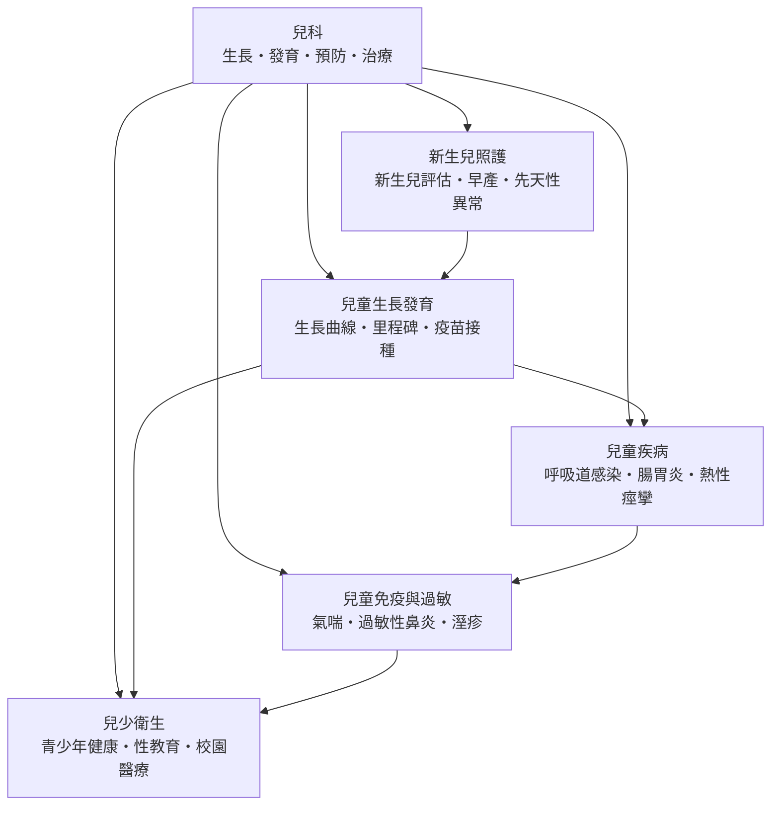

# 兒科

> 隸屬：第一層 [醫]　·　相關分類：[內科]、[婦產科]、[免疫系統]、[發展心理學]　·　子分類總表見 [README]

> 對應維基百科：[中文維基百科：小儿科]　·　[English Wikipedia: Pediatrics]

兒科是研究與照顧「從出生到成年」這段時期健康的醫學部門。它與 [內科] 最根本的差異在於：兒科病人不是「縮小的成人」——器官還在發育、免疫系統尚未成熟、劑量要以體重計算、病史常常由照顧者代述，而且疾病譜隨年齡急速變化。因此兒科的核心不是單一器官的疾病，而是**生長發育本身**：一個孩子體重掉了幾個百分位、發展里程碑晚了幾個月，其意義可能比任何單一檢驗數值都大。

## 核心問題

兒科反覆回答四個問題：

1. **長得好不好**：用生長曲線與發展里程碑，把「這個孩子」放上「同齡孩子的分布」中比對；持續落後或跨越多條百分位線是警訊。
2. **病的是什麼**：同樣是發燒，三個月以下嬰兒可能代表敗血症，五歲幼兒多半是病毒感染——年齡本身就是最重要的鑑別診斷變項。
3. **劑量對不對**：兒童藥量常以體重（mg/kg）計算，肝腎代謝能力隨年齡改變，成人的「半顆」不是兒童的標準答案。
4. **如何預防**：疫苗接種、營養、意外傷害防制與兒少保護，是兒科相對於成人醫學更重的預防面向。

## 因果鏈

1. **古代的「小兒科」雛形**：傳統醫學早有幼科專著，但普遍假設兒童只是成人的縮影；嬰兒死亡率長期高企，被視為不可抗的天命。
2. **嬰兒餵養與營養科學**：十九世紀末牛奶稀釋與配方餵養的科學化、維生素的發現（如維生素D與佝僂病），把營養不良與骨骼畸型從「體質」變成可矯正的問題。
3. **體溫計、體重計與生長曲線**：常規測量讓「發育遲緩」變成可量化、可比較的指標；生長曲線圖把個別兒童放進群體分布，早期診斷自此有了座標。
4. **免疫學與疫苗時代**：白喉抗毒素、百日咳、小兒麻痺疫苗相繼問世，曾經的頭號殺手逐一被馴服；這也使兒科的重心從「治感染」轉向「預防感染」。
5. **新生兒科學的建立**：[艾普嘉] 在 [1952年] 提出以心率、呼吸、張力、反射與膚色五項評分的新生兒評估法，讓「出生後第一分鐘好不好」第一次有了客觀語言；早產兒照護、育兒室與新生兒加護病房隨之制度化。
6. **意外傷害取代感染成為頭號死因**：隨著感染死亡下降，車禍、溺水、異物吞入成為兒童死亡的主因，兒科因此把觸角伸向公共衛生、法規與安全教育。
7. **慢性病與神經發展照護**：氣喘、過敏、過動症與自閉症光譜的系統化診斷，使兒科與 [精神醫學]、[心理治療] 與教育體系合作日深。
8. **青少年醫學的分支**：青春期從生理到心理都有獨特的醫療需求（性教育、精神健康、隱私與知情同意），兒少衛生於是成為兒科的延伸戰場。

## 子分類的定位與相互驅動

- [新生兒照護] 是**起點**：出生後第一分鐘與第一週的評估、早產與先天性異常的處理，決定了後續所有發展的基礎；育兒室制度與新生兒篩檢把「第一線照顧」變成標準流程。
- [兒童生長發育] 是**主軸**：生長曲線、里程碑與疫苗接種時程構成兒科門診的例行骨架；其他子分類發現的任何問題，最終都要回來問一句「這對生長發育有沒有影響」。
- [兒童疾病] 是**日常戰場**：呼吸道感染與腸胃炎是兒科門診與急診最大宗的病人來源；這些常見病的處置經驗，也訓練出對「看起來怪怪的」重症前兆的警覺。
- [兒童免疫與過敏] 是**免疫系統的功課**：免疫耐受尚未成熟的階段，過敏性疾病隨環境與飲食改變而攀升；氣喘與異位性皮膚炎的管理需要長期追蹤，與生長發育的監測互相嵌合。
- [兒少衛生] 是**出口與延伸**：從青春期生理、精神健康到校園醫療，把兒科照顧延伸到家庭與學校；也把疫苗、營養與意外防制以公共衛生的規模推動。

## 範例：一個五天大新生兒的黃疸評估

以新生兒黃疸為例，示範兒科各子分類如何接力：

1. **新生兒照護**：出生第五天出現皮膚泛黃，先以經皮膽紅素測定初篩；若數值接近照光門檻，抽血量化總膽紅素。
2. **評估與鑑別**：餵奶量足不足（母乳餵養不足性黃疸）、有無溶血（母子血型不合）、早產與否——同一數值對三十六週與四十週嬰兒的危險度完全不同。
3. **量化處置**：依小時別膽紅素曲線決定照光或換血；此處的「曲線」與生長曲線同源——都是把個別數值放上分齡分布。
4. **追蹤與發育**：膽紅素過高可能造成核黃疸與聽力損傷，出院後須納入聽力篩檢與 [里程碑] 追蹤。
5. **預防端**：衛教母親正確哺餵、確認新生兒篩檢（G6PD缺乏症等）已完成——治療單一黃疸的同時，把整個預防網補齊。

## 容易混淆之處

- **兒科不是內科的縮小版**：兒童的疾病譜、藥物代謝與溝通方式都不同；兒科醫師訓練的重心之一正是「從照顧者口中問出病史」。
- **發燒不等於感染嚴重度**：體溫高低與病情嚴重度未必平行，活動力、進食與呼吸型態往往更有預測力。
- **生長曲線要看趨勢而非單點**：單次落在第十百分位不一定是問題，連續跨越兩條百分位線才是警訊。
- **過敏與感冒不同**：過敏性鼻炎的症狀常持續數週、早晚明顯且少發燒；反覆「感冒」的孩子，有一部分其實是過敏。
- **熱性痙攣不是癲癇**：單純型熱性痙攣預後極佳，多數孩子不需長期抗癲癇藥物；把兩者混為一談會造成不必要的治療與焦慮。

## 延伸閱讀

- [內科]：成人疾病的對照系，許多兒科慢性病（如氣喘、糖尿病）成年後仍延續。
- [婦產科]：新生兒照護的上游，產前診斷與生產過程直接決定新生兒狀態。
- [免疫系統]：疫苗與過敏的機制基礎。
- [疫苗學]：預防接種的科學主體。
- [營養素]：兒童生長的物質基礎。
- [發展心理學]：里程碑背後的行為科學。

## 連結定義

[醫]: ../醫/README.md
[README]: README.md
[內科]: ../內科/README.md
[婦產科]: ../婦產科/README.md
[免疫系統]: ../免疫系統/README.md
[疫苗學]: ../疫苗學/README.md
[營養素]: ../營養素/README.md
[發展心理學]: ../發展心理學/README.md
[精神醫學]: ../精神醫學/README.md
[心理治療]: ../心理治療/README.md
[新生兒照護]: 新生兒照護.md
[兒童生長發育]: 兒童生長發育.md
[兒童疾病]: 兒童疾病.md
[兒童免疫與過敏]: 兒童免疫與過敏.md
[兒少衛生]: 兒少衛生.md
[里程碑]: 里程碑.md
[艾普嘉]: ../人/醫學家/艾普嘉.md
[1952年]: ../時/1952年.md
[English Wikipedia: Pediatrics]: https://en.wikipedia.org/wiki/Pediatrics
[中文維基百科：小儿科]: https://zh.wikipedia.org/wiki/%E5%B0%8F%E5%84%BF%E7%A7%91
