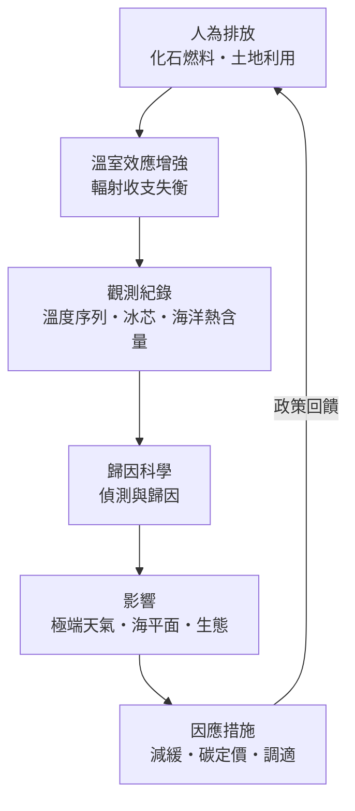

# 全球暖化

> 隸屬：第一層 [天]　·　相關分類：[氣象學]、[海洋學]、[冰川]　·　子分類總表見 [README]

> 對應維基百科：[中文維基百科：全球变暖]　·　[English Wikipedia: Climate change]

全球暖化指地球平均氣溫因人為溫室氣體排放而持續上升的長期趨勢。工業革命以來，大氣二氧化碳濃度已從約 280 ppm 升至 2024 年的約 420 ppm，全球平均地表溫度相對 1850 至 1900 年基期升高約 1.1 至 1.3 攝氏度，其中 2023 年是有儀器觀測以來最熱的一年。它不是一門獨立的「學科」，而是由 [觀測紀錄]、輻射物理、海洋學與冰川學共同支撐的**科學診斷**：先確認「地球正在變熱」，再回答「為什麼變熱」、「會造成什麼後果」、「能做什麼」。

## 核心問題

1. **熱從哪裡來？** [溫室效應] 解釋大氣如何截留紅外輻射；[溫室氣體] 列出二氧化碳、甲烷等分子的輻射特性；[人為排放] 把增溫歸因到化石燃料與土地利用。
2. **我們怎麼知道它在發生？** [溫度序列] 給出儀器時代的實測曲線，[冰芯紀錄] 把基準拉回八十萬年前，[海洋升溫] 補上儲存了九成多餘熱量的海洋。
3. **它會造成什麼？** [極端天氣] 的頻率變化、[海平面上升] 的速率、[生態系統] 的位移與 [健康與粮食] 的風險。
4. **人類能做什麼？** [減緩] 削減排放、[碳定價] 改變誘因、[碳捕捉] 處理難減的剩餘排放、[調適] 承接無法避免的衝擊。

## 因果鏈

1. **物理學先給出預言**：1824 年[傅立葉]提出大氣有保溫作用，1859 年[廷德耳]量測二氧化碳與水汽的紅外吸收，1896 年[阿倫尼烏斯]算出二氧化碳倍增將升溫約 5 至 6 攝氏度——暖化在被觀測到之前就已被理論預測。
2. **排放規模史無前例**：工業革命後煤炭、石油、天然氣大量燃燒，[人為排放] 使碳循環失去平衡；[1958年] 起基林的冒納羅亞觀測站開始連續量測，著名的「基林曲線」逐年爬升，成為最直接的證據。
3. **觀測證實趨勢**：[1880年] 以來的全球 [溫度序列] 顯示，最熱的十個年份全部出現在最近十餘年；[冰芯紀錄] 證明當前二氧化碳濃度是八十萬年來最高。
4. **海洋與冰圈同步回應**：[海洋升溫] 使海水膨脹，[冰川] 大規模退縮，[南極大陸] 與格陵蘭冰蓋加速流失，[海平面上升] 從衛星測高（1992 年起）得到逐年確認。
5. **歸因科學定案**：1995 年起政府間氣候變遷委員會（IPCC）逐步給出「人類活動是主要成因」的結論；2004 年前後「偵測與歸因」方法把增溫信號從自然變率中分離出來。
6. **影響顯現並放大**：[極端天氣] 的熱浪、豪雨與乾旱頻率上升，[生態系統] 向兩極與高海拔位移，作物減產與疾病分布擴大威脅 [健康與粮食]。
7. **治理體系成形**：[1992年]《聯合國氣候變化綱要公約》、[1997年]《京都議定書》、[2015年]《巴黎協定》把「控制升溫遠低於 2 攝氏度、力爭 1.5 攝氏度」變成全球政治目標，[減緩] 與 [碳定價] 由此制度化。
8. **科技與調適並進**：再生能源成本十年內大幅下降，[碳捕捉] 與自然碳匯補上難減部門，[調適] 從口號變成基礎建設與保險制度的日常工作。

## 子分類的定位與相互驅動

### 暖化成因

[暖化成因] 回答「地球為什麼變熱」：[溫室效應] 的輻射物理、[溫室氣體] 的濃度與來源、[反照率] 的回饋、[人為排放] 的清單與盤查。它是整個概念的地基——先有能量收支失衡的機制，後面的觀測與對策才有意義；反過來，觀測數據又持續檢驗並修正成因模型的敏感度估計。

### 觀測紀錄

[觀測紀錄] 是暖化的「病歷」：[溫度序列] 把分散的測站資料拼成全球曲線，[冰芯紀錄] 提供工業化之前的自然基線，[海洋升溫] 與 [海平面] 則是無法用城市熱島解釋的獨立證據。沒有觀測紀錄，成因只是假說；有了觀測紀錄，[影響] 的每一次異常才能被歸責。

### 影響

[影響] 把「全球平均」翻譯成「具體地方與具體人」：[極端天氣] 的歸因研究、[海平面上升] 對海岸城市與島嶼的威脅、[生態系統] 的物候錯位、[健康與粮食] 的風險鏈。影響評估供養著 [因應措施]——衝擊越大、越明確，減緩與調適的政治動能就越強。

### 因應措施

[因應措施] 是診斷之後的處方：[減緩] 涵蓋能源轉型與需求管理，[碳定價] 讓排放有價格，[碳捕捉] 處理水泥、鋼鐵等難減部門，[調適] 面對已鎖定的暖化。措施的成本效益反過來要求更精確的 [觀測紀錄] 與更可信的歸因——科學與政策在這裡形成閉環。

## 範例

以「為什麼 2023 年特別熱」完整走一遍四個子分類。成因端：聖嬰現象（自然變率）疊加持續上升的溫室氣體濃度，加上船舶硫排放管制減少了反光氣膠，三者共同推高溫度。觀測端：[溫度序列] 顯示 2023 年比 1850 至 1900 年基期高約 1.45 攝氏度，是迄今最熱年份；海洋熱含量同步創新高，證明熱確實累積在地球系統裡。影響端：加拿大破紀錄的野火、歐洲與亞洲的極端熱浪、全球海表溫度屢創新高，都可透過極端事件歸因分析量化「暖化使其發生機率提高多少倍」。對策端：同年年底的聯合國氣候大會首次達成「轉型脫離化石燃料」的決議，各國據此更新減排目標——一個年度的異常，四個子分類各司其職地把現象變成知識與行動。

## 容易混淆之處

- **氣候變遷不等於全球暖化**：暖化是氣候變遷中人為主導的溫度上升部分；地質史上也有自然冷暖波動，但速率與現代完全不同。
- **「歷史上也有暖期」不能洗白現況**：冰芯顯示過往暖期經歷數千年，現代增溫只用了百餘年，速率才是問題核心。
- **天氣冷不等於暖化停了**：個別寒潮是短期的環流現象，判斷要看十年以上的平均。
- **1.5 攝氏度不是安全閾值**：它是政治談判選定的風險界線，超過並非世界末日，但不超過也不代表零風險。
- **溫室效應本身不是壞事**：沒有它地球平均溫度將低於冰點；問題在於人為排放使它過度增強。

## 延伸閱讀

- [氣象學]：天氣與氣候的觀測與預報基礎。
- [海洋學]：海洋如何吸收熱與碳，是暖化最沉默的夥伴。
- [冰川]：冰圈的退縮是暖化最直觀的指標。
- [再生能源]：減緩路線中成長最快的供給側方案。
- [保育生物學]：生態系統如何因應氣候位移。
- [南極大陸]：冰蓋穩定性與海平面的長期命題。

## 連結定義

[天]: ../天/README.md
[README]: README.md
[氣象學]: ../氣象學/README.md
[海洋學]: ../海洋學/README.md
[冰川]: ../冰川/README.md
[再生能源]: ../再生能源/README.md
[保育生物學]: ../保育生物學/README.md
[南極大陸]: ../地/南極大陸.md
[1958年]: ../時/1958年.md
[1880年]: ../時/1880年.md
[1992年]: ../時/1992年.md
[1997年]: ../時/1997年.md
[2015年]: ../時/2015年.md
[暖化成因]: 暖化成因.md
[溫室效應]: 溫室效應.md
[溫室氣體]: 溫室氣體.md
[反照率]: 反照率.md
[人為排放]: 人為排放.md
[觀測紀錄]: 觀測紀錄.md
[溫度序列]: 溫度序列.md
[冰芯紀錄]: 冰芯紀錄.md
[海洋升溫]: 海洋升溫.md
[海平面]: 海平面.md
[影響]: 影響.md
[極端天氣]: 極端天氣.md
[海平面上升]: 海平面上升.md
[生態系統]: 生態系統.md
[健康與粮食]: 健康與粮食.md
[因應措施]: 因應措施.md
[減緩]: 減緩.md
[碳定價]: 碳定價.md
[碳捕捉]: 碳捕捉.md
[調適]: 調適.md
[傅立葉]: ../人/物理學家/傅立葉.md
[廷德耳]: ../人/物理學家/廷德耳.md
[阿倫尼烏斯]: ../人/化學家/阿倫尼烏斯.md
[中文維基百科：全球变暖]: https://zh.wikipedia.org/wiki/%E5%85%A8%E7%90%83%E5%8F%98%E6%9A%96
[English Wikipedia: Climate change]: https://en.wikipedia.org/wiki/Climate_change
