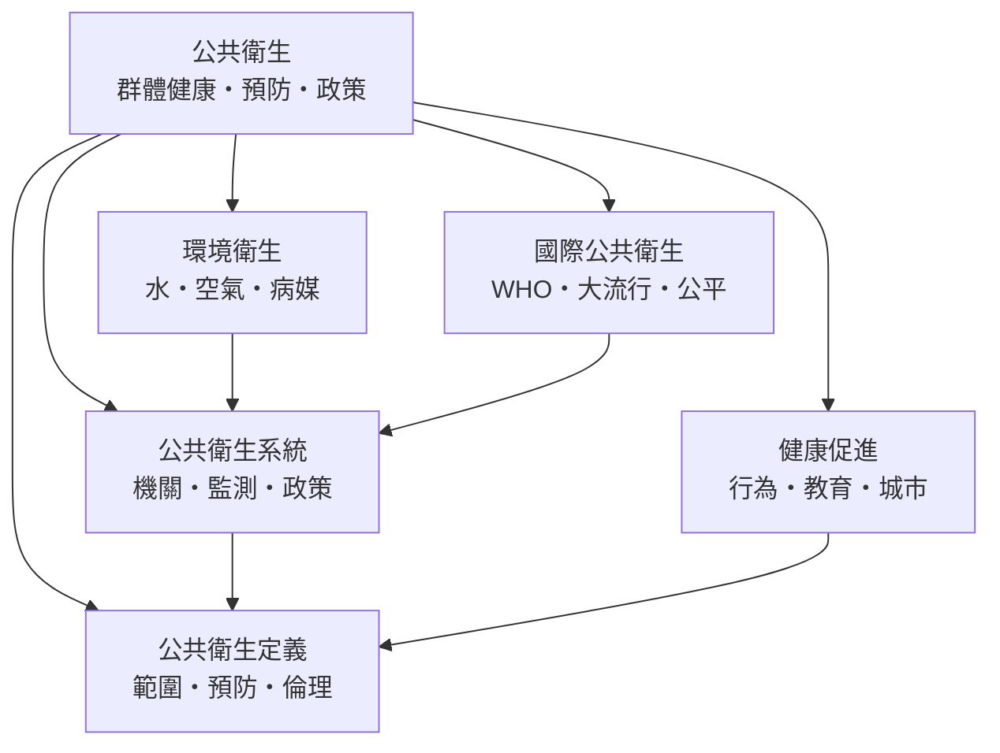

# 公共衛生

> 隸屬第一層 [醫]　·　相關分類：[流行病學]、[微生物學]、[醫療衛生政策]　·　子分類總表見 [README]

> 對應維基百科：[中文維基百科：公共卫生](https://zh.wikipedia.org/wiki/%E5%85%AC%E5%85%B1%E5%8D%AB%E7%94%9F)　·　[English Wikipedia: Public health](https://en.wikipedia.org/wiki/Public_health)

公共衛生是以**群體**而非個體為對象的健康科學：它問的不是「這位病人為什麼生病、該怎麼治」，而是「這一群人為什麼會以這種模式生病、社會該如何組織資源讓疾病不要發生」。臨床醫學治療已經發生在單一病人身上的疾病；公共衛生則透過監測、教育、環境改造、政策立法與疫苗接種，在疾病抵達任何一個人之前就介入。前者一次幫助一個人，後者一次幫助十萬人——因此公共衛生的成效常以統計數字呈現，例如平均餘命的延長、嬰兒死亡率的下降，反而缺乏戲劇性的個案故事，這也是它長期被低估的原因。

## 核心問題：三級預防與群體健康

公共衛生的核心模型是**三級預防**：

1. **初級預防**：讓疾病根本不發生——接種疫苗、提供乾淨飲水、戒菸宣導、改善營養。
2. **次級預防**：疾病已經啟動但尚未出現症狀時及早發現——新生兒篩檢、子宮頸抹片、血壓普查。
3. **三級預防**：疾病已經確診後減少失能與復發——復健、慢性病管理、防止併發症。

另一個核心概念是**群體健康**（population health）：健康的單位是人口而非個人，衡量工具是發病率、盛行率、死亡率與平均餘命等統計量。例如某市冬季流感盛行率 $5\%$ 意味著該市每二十人約有一人在該季罹病——公共衛生決策看的正是這種群體層級的數字。

## 因果鏈

1. **城市的誕生帶來傳染病密集化**：人類聚居城市後，污水、擁擠與流動人口讓瘟疫成為週期性災難；十六至十九世紀的霍亂大流行迫使歐洲城市正視「環境與健康」的關係。
2. **約翰·斯諾的流行病學調查**：[約翰斯諾] 在 [1854年] 藉地圖標記倫敦蘇活區霍亂死亡案例，鎖定布羅德街水井為感染源，證明霍亂經水傳播——「數據可以指出污染源」的現代公共衛生由此誕生。
3. **細菌學說確立病因**：巴斯德與科赫在十九世紀末確立微生物致病論，使消毒、隔離、供水處理有了科學根據，公共衛生從經驗法則變成可驗證的工程與政策。
4. **衛生工程與法規化**：下水道、自來水過濾消毒、食品檢驗與職業安全法規陸續建立，政府正式承接「保障群體健康」的責任，公共衛生系統成形。
5. **國際組織的出現**：傳染病不認國界，[1948年] 世界衛生組織（[WHO]）成立，公共衛生正式國際化，天花在 1980 年成為第一個被全球合作根除的人類疾病。
6. **流行病學與生物統計的成熟**：吸菸與肺癌的世代研究、隨機對照試驗的推廣，讓「什麼措施有效」可以被量化評估，公共衛生決策進入實證時代。
7. **從傳染病到慢性病**：已開發國家的死亡主因轉為心臟病、癌症、糖尿病，公共衛生的重心轉向健康促進與行為改變——戒菸、運動、飲食政策取代了消毒與隔離。
8. **全球化與大流行時代**：航空交通讓病原體在數小時內跨洲，COVID-19 大流行證明監測、疫苗研發分配與政策溝通必須在全球層級協調，公共衛生成為國家安全議題。

## 子分類的定位與相互驅動

- [公共衛生定義] 是**地基**：界定「群體健康」與三級預防的範圍，回答「什麼算公共衛生、政府該管到哪裡」的邊界問題；沒有清楚的定義，資源分配與立法都失去依據。
- [公共衛生系統] 是**執行骨架**：衛生機關、基層醫療、疾病監測與衛生政策把定義變成日常運作——通報系統、篩檢計畫、立法管制都在這一層運轉。
- [環境衛生] 是**上游**：水質、空氣、廢棄物與病媒控制從環境端切斷疾病來源，是成本最低、覆蓋最廣的初級預防，也是系統監測的第一批指標。
- [健康促進] 是**下游擴張**：當傳染病被控制、慢性病成為主因，公共衛生從「對抗病原」轉向「改變行為」，以教育、城市設計與校園計畫推動健康生活方式。
- [國際公共衛生] 是**邊界的延伸**：病原體、食品、藥品與污染都跨境流動，WHO、全球疾病計畫與大流行準備把各國系統串成網絡，也處理疫苗分配的公平問題。

## 範例：一次霍亂疫情的完整公共衛生反應

1. **監測觸發**：某市一週內急性腹瀉通報從常態的每週十例升到兩百例，法定傳染病系統自動發出警訊。
2. **流行病學調查**：衛生單位以病例對照研究比對病患與健康者的飲水、飲食史，發現病例集中在同一供水區。
3. **環境衛生介入**：檢出水源大腸桿菌超標，立即停用污染井、發放飲水消毒錠、修復破裂水管。
4. **臨床與系統配合**：醫療院所擴充口服補液鹽供應、隔離重症病患，通報與檢驗量能同時升級。
5. **政策與後續**：修訂該區供水法規、納入常規水質監測；國際上依《國際衛生條例》向 WHO 通報疫情。

整個過程中，治療個案的醫療只佔一小部分；真正的疫情終結來自環境改造、系統動員與政策修正——這正是公共衛生與臨床醫學的分工。

## 容易混淆之處

- **公共衛生不等於公共醫療**：前者以預防與政策為主，後者指由公共資源支應的醫療服務；兩者常被混稱但任務不同。
- **「預防勝於治療」不是口號而是經濟命題**：疫苗一劑的成本遠低於一例重症的醫療與社會成本，但預防成效看不見（疾病沒有發生），導致預算常被砍。
- **公共衛生不等於個人衛生**：洗手、戴口罩是個人實踐，但水系統、法規、監測網才是公共衛生的主體。
- **健康不等於沒有病**：WHO 對健康的定義包含生理、心理與社會安適，公共衛生因此涵蓋心理健康、暴力防治與社會連結。

## 延伸閱讀

- [流行病學]：公共衛生的偵測與證據引擎，判斷「誰在生病、為什麼」。
- [微生物學]：病原體的基礎科學，感染管制與疫苗的知識來源。
- [疫苗學]：初級預防最有效的工具之一。
- [醫療衛生政策]：資源、保險與法規的制度設計。
- [瘟疫大流行]：大流行史與準備工作的歷史教訓。
- [污染防治]：環境衛生在工程端的延伸。

## 連結定義

[醫]: ../醫/README.md
[README]: README.md
[流行病學]: ../流行病學/README.md
[微生物學]: ../微生物學/README.md
[醫療衛生政策]: ../醫療衛生政策/README.md
[瘟疫大流行]: ../瘟疫大流行/README.md
[疫苗學]: ../疫苗學/README.md
[污染防治]: ../污染防治/README.md
[公共衛生定義]: 公共衛生定義.md
[公共衛生系統]: 公共衛生系統.md
[環境衛生]: 環境衛生.md
[健康促進]: 健康促進.md
[國際公共衛生]: 國際公共衛生.md
[約翰斯諾]: ../人/醫學家/約翰斯諾.md
[1854年]: ../時/1854年.md
[1948年]: ../時/1948年.md
[WHO]: WHO.md
