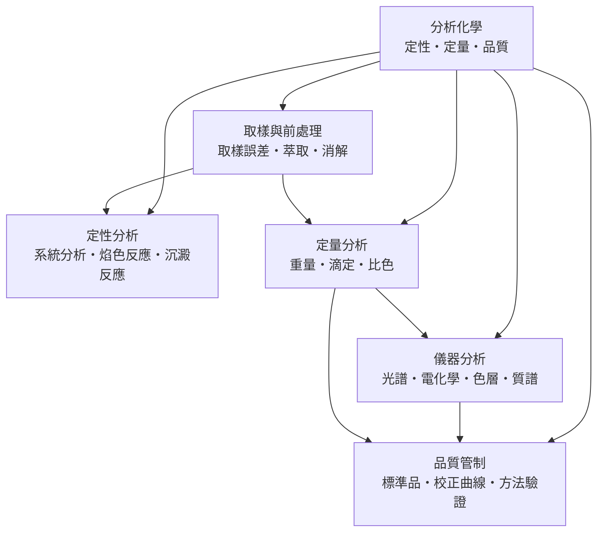

# 分析化學

> 隸屬：第一層 [理]　·　相關分類：[化學]、[無機化學]、[有機化學]　·　子分類總表見 [README]

> 對應維基百科：[中文維基百科：分析化学](https://zh.wikipedia.org/wiki/%E5%88%86%E6%9E%90%E5%8C%96%E5%AD%A6)　·　[English Wikipedia: Analytical chemistry](https://en.wikipedia.org/wiki/Analytical_chemistry)

分析化學是**測定物質組成與含量的學科**：定性分析回答「樣品裡有什麼」，定量分析回答「有多少」。它解決的問題是所有化學、生命科學與工業製程的共同瓶頸——當你不知道一個樣品的成分與濃度，任何合成、製造或診斷都無從驗證。

這門學科的兩大支柱是**化學分析法**（靠沉澱、滴定等反應，用質量與體積計算）與**儀器分析法**（靠光譜、電化學、質譜等物理信號）。十九世紀以前以前者為主，二十世紀以後儀器分析因靈敏度高、速度快而成為主流；然而無論用哪種方法，都必須先取到有代表性的樣品、做好前處理，並用 [標準品] 與 [校正曲線] 證明結果可信，這就是 [品質管制] 的角色。

## 核心問題

分析化學的核心問題可以拆成四層。

1. **辨認**：樣品含有哪些成分？這是 [定性分析] 的問題，從古早的 [焰色反應] 到現代質譜圖譜比對都屬於它。
2. **計量**：每種成分有多少？這是 [定量分析] 的問題，要求結果有確定的準確度（接近真值）與精密度（重複一致）。
3. **取得信號**：如何把「分子的存在與數量」變成可測量的物理量？這是 [儀器分析] 的問題，核心是光譜、電位、色層滯留時間與質荷比。
4. **證明可信**：結果的可信範圍是多少？這是 [取樣與前處理] 與 [品質管制] 的問題——分析結果的品質永遠不可能高於樣品本身的代表性。

四層的邏輯順序是：先取樣，再前處理，接著選擇定性或定量方法，最後用品質管制證明整條流程沒有系統性偏差。

## 因果鏈

1. **定量化學的誕生**：十八世紀末，[拉瓦錫] 用精密天平證明質量守恆，把化學從描述性學問變成可測量的學問，重量分析由此奠基。
2. **滴定與濕法分析成熟**：十九世紀，酸鹼、氧化還原與錯合滴定系統化，玻璃量器與指示劑讓溶液化學達到 $0.1\%$ 級的精密度。
3. **光譜法開啟儀器時代**：1859 年 [本生] 與基爾霍夫發明分光鏡，由 [焰色反應] 發展出光譜定性分析，並藉此發現銫、銣等新元素。
4. **電化學與色層法**：1900 年代前後電位法、電解分析成形；1903 年 Tswett 以 [色層分析] 分離葉綠素，為混合物分離建立通用方法。
5. **質譜與現代光譜**：質譜儀從同位素測定發展為有機結構鑑定的核心；1950 年代以後紅外、核磁共振與原子吸收光譜相繼商品化。
6. **自動化與聯用技術**：氣相層析－質譜（GC-MS）、液相層析－質譜（LC-MS）把「分離」與「鑑定」串成一條流水線，偵測極限推進到 $10^-12$ 克級。
7. **品質管制與法規化**：製藥、環境與食品法規要求分析方法經過 [方法驗證]，分析化學從「實驗技巧」升級為有標準作業程序與不確定度評估的計量科學。

## 子分類的定位與相互驅動

- [定性分析] 是**入口**：先用便宜的濕法反應判斷「有什麼」，再決定要不要動用昂貴儀器；它的分組邏輯也訓練了對化學反應選擇性的直覺。
- [定量分析] 是**計量核心**：重量、滴定與比色法把「含量」變成質量、體積與吸光度這類可稽核的數字，至今仍是校正儀器方法的仲裁法。
- [儀器分析] 是**靈敏度引擎**：光譜、電化學、色層與質譜把偵測極限從毫克級推向皮克級，也反過來要求更乾淨的前處理與更嚴格的校正。
- [取樣與前處理] 是**隱形地基**：取樣誤差往往大於儀器誤差；萃取與消解決定待測物能否真正進入分析系統。
- [品質管制] 是**信任機制**：[標準品]、[校正曲線] 與 [方法驗證] 把單次測量變成可重複、可比較、可送法規審查的證據。

## 範例：測定自來水中的鈣（水硬度）

**問題**：估計自來水中鈣離子濃度，判斷是否為硬水。

1. **定性**：取樣品加入草酸銨，出現白色沉澱 $\mathrm{CaC_2O_4}$ ，證明含鈣——這是 [沉澱反應] 的用法。
2. **定量（滴定）**：調整 $\mathrm{pH}$ 至 10（氨緩衝液），以鉻黑 T 為指示劑，用 $0.0100\ \mathrm{M}$ EDTA 滴定，終點由酒紅轉純藍；三次平行消耗 $12.40\ \mathrm{mL}$ 、 $12.35\ \mathrm{mL}$ 、 $12.38\ \mathrm{mL}$ ，相對標準差小於 $0.2\%$ 。
3. **計算**： $0.0100 \times 0.01238\ \mathrm{mol} = 1.238 \times 10^{-4}\ \mathrm{mol}$ Ca，對應 $4.96\ \mathrm{mg}$ ；若取樣 $50.00\ \mathrm{mL}$ ，濃度為 $99.2\ \mathrm{mg/L}$ （以 $\mathrm{CaCO_3}$ 計 $248\ \mathrm{mg/L}$ ，屬硬水）。
4. **品質管制**：以已知濃度的 [標準品] 做加標回收，回收率 $98\%$ 至 $102\%$ ，證明基質沒有明顯干擾。
5. **儀器比較**：同批樣品若用火焰原子吸收光譜測，於 $422.7\ \mathrm{nm}$ 讀訊號並用 [校正曲線] 定量，單次分析只需一分鐘，但必須先驗證與滴定法結果一致。

這個例子完整走了「定性 → 定量 → 品管」三步，也正是本概念五個子分類在實務上的出場順序。

## 容易混淆之處

- **分析化學不等於化學分析**：前者是研究「如何測得準」的學科（含理論與統計），後者只是操作面。
- **準確度與精密度不同**：精密度是重複測量的一致性，準確度是接近真值的程度；可以用「射箭」理解——彈著集中但偏靶，是精密而不準確。
- **偵測極限不是定量極限**：能「偵測到有」的濃度低於能「可靠定量」的濃度，兩者相差約三倍。
- **定性分析與儀器鑑定並行不悖**：濕法系統分析並未過時，在教學與無儀器場合仍是首選。
- **誤差來自全流程**：取樣誤差常被忽略，但它往往是總誤差最大的一項。

## 延伸閱讀

- [化學]：本概念所屬的母學科。
- [無機化學]：陽離子與陰離子反應的理論基礎。
- [有機化學]：有機結構鑑定（光譜與質譜）的應用對象。
- [元素週期表]：定性分組與光譜線的元素背景。
- [機率統計]：誤差分析與方法驗證的數學工具。
- [生物學]：生化分析（蛋白質、核酸定量）的應用領域。

## 連結定義

[README]: README.md
[儀器分析]: 儀器分析.md
[元素週期表]: ../元素週期表/README.md
[化學]: ../化學/README.md
[取樣與前處理]: 取樣與前處理.md
[品質管制]: 品質管制.md
[定性分析]: 定性分析.md
[定量分析]: 定量分析.md
[拉瓦錫]: ../人/化學家/拉瓦錫.md
[方法驗證]: 方法驗證.md
[有機化學]: ../有機化學/README.md
[本生]: ../人/化學家/本生.md
[校正曲線]: 校正曲線.md
[標準品]: 標準品.md
[機率統計]: ../機率統計/README.md
[沉澱反應]: 沉澱反應.md
[無機化學]: ../無機化學/README.md
[焰色反應]: 焰色反應.md
[理]: ../理/README.md
[生物學]: ../生物學/README.md
[色層分析]: 色層分析.md
