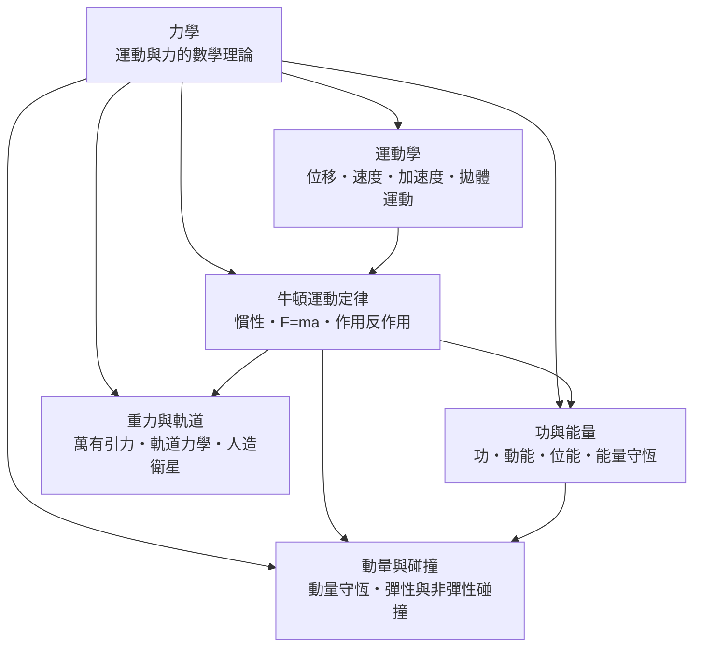

# 力學

> 隸屬：第一層 [理]　·　相關分類：[物理學]、[微積分]、[熱力學]　·　子分類總表見 [README]

> 對應維基百科：[中文維基百科：力學](https://zh.wikipedia.org/wiki/%E5%8A%9B%E5%AD%A6)　·　[English Wikipedia: Mechanics](https://en.wikipedia.org/wiki/Mechanics)

力學是物理學中歷史最悠久的分支，研究**物體的運動與使運動改變的原因（力）**。它回答三個層層相依的問題：物體在哪裡、往哪裡去（運動學）；為什麼會這樣動（動力學）；運動伴隨哪些可轉換、可守恆的量（能量與動量）。1687 年 [牛頓] 在《自然哲學的數學原理》中以三條運動定律與萬有引力定律把天上與地上的運動統一起來，力學從此成為第一門以數學定律描述自然的科學，也是整個 [物理學] 的範本。

力學的地位不只是「物理的一章」。它提供了物理學的基本思考方式：先理想化（質點、剛體、無摩擦），再列方程（ $F = ma$ ），然後用 [微積分] 求解，最後用守恆律檢驗。這套「建模—求解—驗證」的流程後來被熱學、電磁學乃至 [量子力學] 全盤繼承。反過來，力學的需求也推動了數學：牛頓為了描述連續變化而發明流數術（即微積分），拉格朗日與 [哈密爾頓] 為了處理多體問題而發展分析力學，其數學結構日後竟成為量子力學的現成語言。

## 核心問題

力學的核心可以壓縮成一條方程與兩個守恆量。

1. **運動的描述**：位置 $x(t)$ 、速度 $v = \frac{dx}{dt}$ 、加速度 $a = \frac{dv}{dt}$ 。只描述、不問原因的部分稱為運動學。
2. **運動的原因**：牛頓第二定律
   $$
   F = ma
   $$
   力等於質量乘加速度。知道物體所受的合力，就能預測它未來的全部運動。
3. **不變的量**：在許多問題裡，與其解微分方程，不如先找守恆量——能量 $E = K + U$ 與動量 $p = mv$ 。守恆律把「逐時追蹤」化為「起點終點比一比」。

這三層的邏輯順序是：先能描述（運動學），才能解釋（動力學）；解釋到極致後，人們發現某些量根本不隨過程改變（守恆律），於是物理學家養成「先找守恆量」的習慣，這個習慣一路延伸到粒子物理。

## 因果鏈

1. **亞里士多德的錯誤起點**：古代通行「重物下落較快」「運動需要持續推力」的直覺觀念，能解釋日常，卻無法定量預測。
2. **伽利略的實驗與理想化**：[伽利略] 用斜面實驗稀釋重力、用外推法證明自由落體是等加速運動，並提出「不受力則維持運動」的慣性雛形。力學第一次以「實驗＋數學」立身。
3. **開普勒整理天體資料**：[開普勒] 從第谷的觀測歸納出行星三大定律，說明行星走橢圓、掃過相等面積——天體運動有了精確的經驗規律，等一個理論來解釋。
4. **牛頓的綜合**：1687 年（見 [1687年]）[牛頓] 以三定律加平方反比引力，同時導出開普勒三定律與落地拋體的軌跡，天上力學與地上力學合而為一。
5. **分析力學的改寫**：18 至 19 世紀，[歐拉]、[拉格朗日]、[哈密爾頓] 把 $F = ma$ 改寫成以能量為主的廣義方程，多體問題、剛體與振動得以系統處理；這套形式日後成為量子力學的模板。
6. **與熱、電磁的交會**：力學的能量概念被推廣為普遍的能量守恆，催生 [熱力學] 與統計力學；電磁場的應力與動量則把力學語言帶進場論。
7. **邊界暴露與修正**：高速下牛頓力學讓位給相對論（ $E = mc^2$ 即來自動力學的改寫），微觀下讓位給量子力學；但在日常尺度，牛頓力學仍是工程、航天的標準工具。
8. **現代應用**：軌道力學使人造衛星與太空探測成為可能（1957 年史普尼克一號，見 [1957年]）；生物力學、結構力學、車輛碰撞安全都建立在同一組方程上。

## 子分類的定位與相互驅動

- [運動學] 是**描述層**：只處理「怎麼動」，不問「為何動」。它提供了位置、速度、加速度這套語言，是動力學的必要前置。
- [牛頓運動定律] 是**解釋層**：三條定律把「力的效果」寫成可計算的方程，是整個力學的中樞；運動學的量在其中被微分方程串起來。
- [功與能量] 是**積分層**：把力沿路徑積分成「功」，得到動能與位能，能量守恆讓許多不必解方程的問題可以直接算答案。
- [動量與碰撞] 是**衝擊層**：碰撞瞬間力極大、時間極短，用力和加速度描寫反而困難；動量守恆專門處理這種「交換」問題。
- [重力與軌道] 是**應用與綜合層**：萬有引力是牛頓力學最大的一次勝利，軌道力學則是它在太空時代的工程化身。

五者的先後是嚴格的：沒有運動學的語言寫不出 $F = ma$ ；沒有 $F = ma$ 就推不出能量與動量守恆；沒有這些工具，萬有引力與軌道計算無從下手。

## 範例

**範例一：自由落體。** 質量 $2\,\mathrm{kg}$ 的石塊從 $20\,\mathrm{m}$ 高處靜止落下，取 $g = 9.8\,\mathrm{m/s^2}$ 。

- 落地時間： $20 = \frac{1}{2}(9.8)t^2$ ，得 $t = \sqrt{40/9.8} \approx 2.02\,\mathrm{s}$ 。
- 落地速度： $v = 9.8 \times 2.02 \approx 19.8\,\mathrm{m/s}$ 。
- 用能量驗算： $mgh = \frac{1}{2}mv^2$ ， $v = \sqrt{2 \times 9.8 \times 20} \approx 19.8\,\mathrm{m/s}$ ，與運動學一致——兩條獨立路徑得到同一答案，這正是守恆律的檢驗力。

**範例二：彈性碰撞。** 質量 $4\,\mathrm{kg}$ 的車以 $5\,\mathrm{m/s}$ 撞上靜止的 $1\,\mathrm{kg}$ 車（彈性碰撞）。動量守恆： $4 \times 5 = 4v_1 + v_2$ ；動能守恆： $\frac{1}{2}(4)(25) = \frac{1}{2}(4)v_1^2 + \frac{1}{2}v_2^2$ 。解得 $v_1 = 3\,\mathrm{m/s}$ 、 $v_2 = 8\,\mathrm{m/s}$ ：小球以比入射更快（ $8 > 5$ ）的速度彈出，這是「輕球被重球抽打」的典型結果，也是高爾夫球桿擊球的原理。

**範例三：衛星速度。** 低軌道衛星在地球表面上方 $400\,\mathrm{km}$ 處， $r = 6.77 \times 10^6\,\mathrm{m}$ ，地球質量 $M = 5.97 \times 10^{24}\,\mathrm{kg}$ 。圓軌道條件是引力提供向心力： $\frac{GMm}{r^2} = \frac{mv^2}{r}$ ，故 $v = \sqrt{GM/r} = \sqrt{\frac{6.67 \times 10^{-11} \times 5.97 \times 10^{24}}{6.77 \times 10^6}} \approx 7.7 \times 10^3\,\mathrm{m/s}$ ，約每秒 7.7 公里。這個數字解釋了為什麼進入太空如此昂貴：燃料的絕大部分都用來換取這一速度。

## 容易混淆之處

- **質量與重量不同**：質量是物體抗拒加速的量度（單位公斤），重量是 $mg$ 這個力（單位牛頓）。登月後重量變為六分之一，質量不變。
- **速度為零不代表合力為零**：垂直上拋的球在最高點速度為零，但重力仍在，加速度仍為 $g$ 向下——「瞬間靜止」與「平衡」是兩回事。
- **作用力與反作用力不會抵消**：牛頓第三定律的兩個力作用在**不同物體**上；會抵消的是同一物體上的兩個力。
- **能量守恆不等於「動能守恆」**：非彈性碰撞中動能大量轉為熱與形變，總能量仍守恆；動量則幾乎總是守恆（只要無外力）。
- **失重不是沒有重力**：太空站裡的太空人仍受約九成地表重力，失重來自「整體一起自由下落」，而非重力消失。

## 延伸閱讀

- [物理學]：力學所屬的上層學科，基本量與方法論的總表。
- [微積分]：力學的數學引擎，位移—速度—加速度正是逐階微分。
- [熱力學]：把力學的能量概念推廣到熱現象的學科。
- [電磁學]：另一套「場＋力」的理論，結構上與力學互相輝映。
- [量子力學]：力學形式（哈密頓量）在微觀世界的接班人。
- [牛頓]、[伽利略]：力學兩位奠基者的傳記條目。

## 連結定義

[理]: ../理/README.md
[README]: README.md
[物理學]: ../物理學/README.md
[微積分]: ../微積分/README.md
[熱力學]: ../熱力學/README.md
[電磁學]: ../電磁學/README.md
[量子力學]: ../量子力學/README.md
[運動學]: 運動學.md
[牛頓運動定律]: 牛頓運動定律.md
[功與能量]: 功與能量.md
[動量與碰撞]: 動量與碰撞.md
[重力與軌道]: 重力與軌道.md
[牛頓]: ../人/物理學家/牛頓.md
[伽利略]: ../人/物理學家/伽利略.md
[開普勒]: ../人/天文學家/開普勒.md
[哈密爾頓]: ../人/數學家/哈密爾頓.md
[歐拉]: ../人/數學家/歐拉.md
[拉格朗日]: ../人/數學家/拉格朗日.md
[1687年]: ../時/1687年.md
[1957年]: ../時/1957年.md
