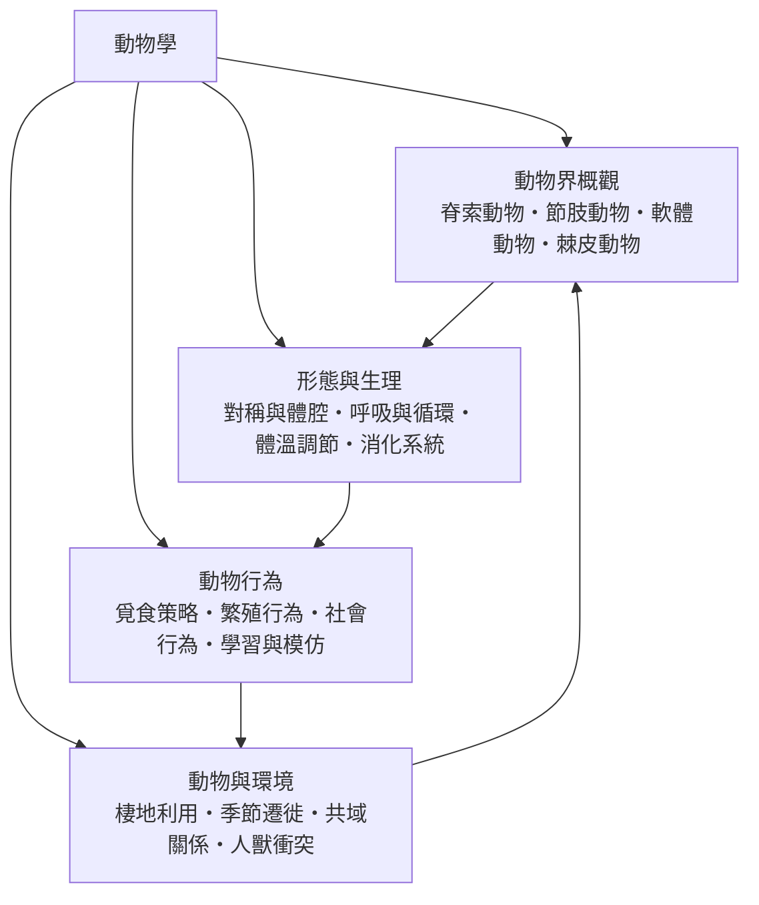

# 動物學

> 隸屬：第一層 [理]　·　相關分類：[生物學]、[生物分類學]、[演化生物]、[生態學]　·　子分類總表見 [README]

> 對應維基百科：[中文維基百科：動物學](https://zh.wikipedia.org/wiki/%E5%8A%A8%E7%89%A9%E5%AD%A6)　·　[English Wikipedia: Zoology](https://en.wikipedia.org/wiki/Zoology)

動物學研究**動物**：牠們有什麼樣的身體、如何運作、如何行動，以及牠們如何與環境和彼此相處。已描述的動物物種約有一百五十萬種，其中光是昆蟲就占了數十萬種；然而在動物學家眼中，動物不只是等待被點名編目的種類清單，而是一連串可解釋的機制：某個構造如何解決一個工程問題，某種行為如何在演化與學習之間取得平衡。

動物學與整體 [生物學] 的差別，在於研究對象的邊界。植物、微生物與真菌各有自己的專門領域，因此動物學可以集中在「動物如何移動、如何覓食、如何感知與溝通」這一組問題上；但它與 [生物分類學]、[演化生物]、[生態學] 卻密不可分，因為動物的多樣性必須用系統發育來解釋，而行為與構造又都離不開環境與演化的脈絡。

另一項特色是**多層次描述同一個體**。一隻鳥可以同時被描述為：具有羽毛的脊椎動物、恆溫的恆溫動物、在巢中孵卵的繁殖者、在遷徙季節長距飛行的高原留鳥。動物學的技術核心，就是把這些描述接合成一個自洽的整體，而不是把它們當成互不相干的標籤。

## 核心問題

1. **動物界由哪些類群構成，彼此的親緣關係如何？** 這是 [動物界概觀] 回答的問題：從 [脊索動物]、[節肢動物]、[軟體動物] 到 [棘皮動物]，各門的共同特徵與分支順序。
2. **動物的身體如何運作？** 這是 [形態與生理] 回答的問題：體腔與對稱如何影響運動方式，[呼吸與循環]、[體溫調節] 與 [消化系統] 如何配合支持恆定。
3. **動物如何行動？** 這是 [動物行為] 回答的問題：[覓食策略] 如何在能量收益與風險間取捨，[繁殖行為] 與 [社會行為] 如何受演化與荷爾蒙塑造，以及 [學習與模仿] 如何讓個體調整行為。
4. **動物與環境如何糾纏？** 這是 [動物與環境] 回答的問題：[棲地利用] 與 [季節遷徙] 如何因應季節與資源變動，[共域關係] 如何構成生態網絡，而 [人獸衝突] 又如何成為現代保育的核心難題。

四者構成閉環：概觀給出對象與親緣，形態生理給出機制，行為給出個體層次的決策，環境則把這些決策放回生態與人的脈絡中。

## 因果鏈

1. **解剖記述的累積**：早期自然史學者以解剖紀錄描述「可見的構造」，奠定了比較解剖的材料基礎；[顯微鏡] 的普及則讓「不可見的構造」進入視野。
2. **細胞學說的確立**：1839 年 [施旺] 與施萊登提出所有生物由細胞構成，動物學從描述器官轉向解釋細胞層次的機制。
3. **命名與分類的標準化**：[林奈] 的二名法讓物種名稱可穩定引用，動物種類第一次能被跨世代、跨地域地累積比較。
4. **演化論的注入**：[1859年] [達爾文] 出版《物種起源》，[華萊士] 獨立提出自然選擇機制；此後「動物的相似與差異」不再是靜態清單，而成為要追溯的歷史。
5. **野外生物學的轉向**：[孟德爾] 的遺傳學在 1900 年被重新發現後，遺傳與環境的爭論促使研究者走向野外，以標記、捕捉與長期觀測研究族群與行為。
6. **行為學的制度化**：20 世紀中期，固定行為模式、印痕學習與覓食最優化模型相繼提出，觀察被量化為行為與生態的數據。
7. **分子與系統發育的匯流**：分子標記讓物種的親緣關係可以被重新檢驗，許多外形相似的類群被拆開或合併，動物界的門級框架因此大幅修訂。
8. **保育與全球變遷的壓力**：棲地破碎化、外來種與人獸衝突把動物學從描述性學科推向政策現場，監測資料成為保育決策的依據。

## 子分類的定位與相互驅動

- [動物界概觀] 是**地圖**：先確定每一個門的位置與親緣，後面的構造比較才有比較基準，否則「同功」與「同源」會被混為一談。
- [形態與生理] 是**機制**：身體構造不是清單，而是對運動、能量收支與環境壓力的解；它把概觀中的分類特徵翻譯成功能。
- [動物行為] 是**個體層次**：行為是動物在特定環境中調整的過程，必須以形態生理為基礎，卻又把個體的選擇帶進族群與群落。
- [動物與環境] 是**情境**：環境決定哪些行為策略划算，資源分布決定遷徙與棲地利用，而人類活動則成為當代最大的環境變因。

四者不是並列的學科分支，而是同一門學問的四個提問順序：有哪些、怎麼運作、怎麼決定、置身何地。

## 範例：用覓食收益模型解釋一項覓食策略

假設一隻涉禽在潮間帶覓食，每分鐘可獲得能量 $E$ 的食物，但只要暴露於岸邊就有被捕食的風險 $p$。若個體選擇在某處停留 $t$ 分鐘，淨收益可寫成

$$
G(t) = a \cdot E \cdot t - c \cdot p \cdot t
$$

其中 $a$ 為捕食效率、$c$ 為被捕食的期望損失。

1. **最佳化原則**：個體應選擇使 $G(t)$ 最大的策略，而不是只最大化食物量；若 $aE > cp$，停留是划算的。
2. **風險敏感度**：若捕食風險上升（例如天敵出現），$cp$ 增大，個體會縮短停留時間、轉往更安全的覓食地，於是同一片泥灘上的個體會分散到不同潮位帶。
3. **與形態的關聯**：腿長較短的鳥通常在較安全的內側覓食，涉禽則能在較深的水邊取得高收益但高風險的食物——這說明 [形態與生理] 與 [動物行為] 必須一起解讀。
4. **與環境的關聯**：潮汐週期決定可用覓食窗口，於是 [季節遷徙] 與 [棲地利用] 成為行為策略在更大尺度上的延伸。
5. **與保育的關聯**：若汙染使食物品質下降、但捕食風險不變，$E$ 下降，個體必須投入更多時間，潮間帶的個體密度因而升高，最終可能觸發 [人獸衝突] 中的鳥類大量死亡事件。

這個簡單模型說明：動物學的各個子分類並非平行陳述，而是同一個決策問題在不同尺度上的展開。

## 容易混淆之處

- **動物學不等於「研究動物的一切」**：遺傳、發育與分子機制多由 [遺傳學] 與 [分子生物] 接手，動物學關注的是個體與整體層次的表現。
- **分類名稱不等於演化分支**：「爬蟲類」與「鳥類」在形態上差異明顯，但現代系統發育研究顯示鳥類是恐龍的一支，傳統分類名稱因此需要重新解讀。
- **行為不是純粹本能**：[繁殖行為] 與 [社會行為] 常被視為固定程式，但 [學習與模仿] 顯示行為的表現形式同時受基因、發育經驗與環境塑造。
- **「變溫」不等於「體溫不穩定」**：變溫動物的體溫隨環境變動，但許多種類仍有有效的體溫調節機制，只是成本較高。
- **共域關係不是單向利用**：寄主與寄生者互利共生的案例同樣存在，[共域關係] 必須以雙向影響來理解。
- **個體數多的物種不一定佔優勢**：物種的生態影響與其個體數量、分布範圍和繁殖率共同決定。

## 延伸閱讀

- [生物學]：動物學所屬的上位學科與方法論基礎。
- [生物分類學]、[演化生物]、[生態學]：親緣、解釋與情境三個方向。
- [保育生物學]、[海洋學]、[遺傳學]：動物學成果的主要下游應用。
- [化學]、[物理學]、[地球與大氣科學]：動物生理與環境研究所需的跨學科工具。
- [化石]：形態演化的直接證據。
- [林奈]、[達爾文]、[華萊士]、[施旺]、[孟德爾]：塑造現代動物學的關鍵人物。

## 連結定義

[理]: ../理/README.md
[README]: README.md
[生物學]: ../生物學/README.md
[生物分類學]: ../生物分類學/README.md
[演化生物]: ../生物學/演化生物.md
[生態學]: ../生物學/生態學.md
[生物學方法]: ../生物學/生物學方法.md
[保育生物學]: ../保育生物學/README.md
[海洋學]: ../海洋學/README.md
[遺傳學]: ../遺傳學/README.md
[分子生物]: ../分子生物/README.md
[化學]: ../化學/README.md
[物理學]: ../物理學/README.md
[地球與大氣科學]: ../地球與大氣科學/README.md
[化石]: ../物/化石.md
[顯微鏡]: ../物/顯微鏡.md
[達爾文]: ../人/生物學家/達爾文.md
[林奈]: ../人/生物學家/林奈.md
[華萊士]: ../人/生物學家/華萊士.md
[施旺]: ../人/生物學家/施旺.md
[孟德爾]: ../人/生物學家/孟德爾.md
[1859年]: ../時/1859年.md
[動物界概觀]: 動物界概觀.md
[形態與生理]: 形態與生理.md
[動物行為]: 動物行為.md
[動物與環境]: 動物與環境.md
[脊索動物]: 脊索動物.md
[節肢動物]: 節肢動物.md
[軟體動物]: 軟體動物.md
[棘皮動物]: 棘皮動物.md
[呼吸與循環]: 呼吸與循環.md
[體溫調節]: 體溫調節.md
[消化系統]: 消化系統.md
[覓食策略]: 覓食策略.md
[繁殖行為]: 繁殖行為.md
[社會行為]: 社會行為.md
[學習與模仿]: 學習與模仿.md
[棲地利用]: 棲地利用.md
[季節遷徙]: 季節遷徙.md
[共域關係]: 共域關係.md
[人獸衝突]: 人獸衝突.md
