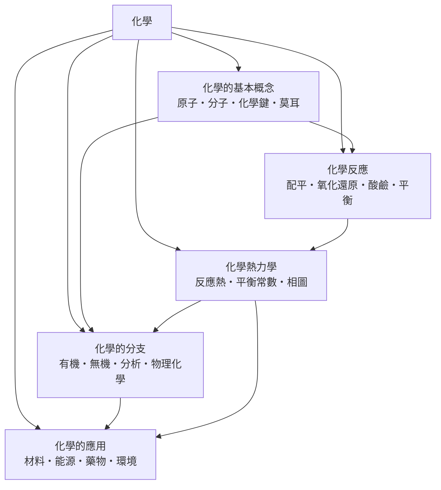

# 化學

> 隸屬：第一層 [理]　·　相關分類：[物理學]、[生物學]、[元素週期表]　·　子分類總表見 [README]

> 對應維基百科：[中文維基百科：化學]　·　[English Wikipedia: Chemistry]

化學研究**物質的組成、結構、性質與轉變**。它的中心物件是原子與分子：原子以 [化學鍵] 連結成分子與晶體，化學反應則把一種組合拆散重組為另一種。化學的核心公式是反應方程，例如氫氣燃燒：

$$
2\,\mathrm{H_2} + \mathrm{O_2} \longrightarrow 2\,\mathrm{H_2O}, \qquad \Delta H = -572 \text{ kJ/mol}
$$

化學在科學體系中占據**轉接層**的位置：往下，它用 [物理學] 的原子理論與量子力學解釋鍵結；往上，它為 [生物學] 提供分子的語言——DNA、蛋白質、醣類都是化學物件。與其他科學最大的不同在於：化學不只理解物質，還**製造**自然界沒有的物質。肥料、抗生素、塑膠、鋰電池電解液，都是化學合成的直接產品。

化學成為科學的關鍵一步是定量革命。1789 年 [拉瓦錫] 以質量守恆推翻燃素說；1803 年 [道爾頓] 提出原子論，使化學反應第一次可用原子量計算；1869 年 [門捷列夫] 排出 [元素週期表] 並預言未發現元素。20 世紀量子力學接手後，鍵結、軌域、反應速率全部獲得微觀解釋——化學從描述性技藝變成可預測的設計科學。

## 核心問題

化學的四個核心問題彼此嵌套。

1. **組成**：這物質是什麼構成的？答案靠分析：滴定、光譜、層析、質譜。定量組成是後續一切問題的前提。
2. **結構**：原子如何連結？鍵長、鍵角、立體組態——「結構決定性質」是化學的第一公理，X 射線晶體學與核磁共振是回答它的儀器。
3. **變化**：反應會不會發生、往哪邊走、走多快？前兩問屬 [化學熱力學]（自由能、平衡常數），第三問屬動力學（活化能、催化）。
4. **應用**：如何依需求設計分子？藥物、材料、能源與環境問題（[化學的應用]）都是這一問的展開。

四者的邏輯順序：先知道是什麼（組成），才知道怎麼連（結構）；先懂結構與能量，才能預測與控制變化；能控制變化，才能設計製造（應用）。

## 因果鏈

1. **煉金術的遺產**：中世紀的蒸餾、冶煉與玻璃技術累積了大量操作經驗，但缺乏定量方法，一切解釋都訴諸「性質」與「精髓」。
2. **定量革命**：1789 年 [拉瓦錫] 用精密天平確立質量守恆與氧氣說，化學反應第一次可以「記帳」。
3. **原子論與當量**：1803 年 [道爾頓] 以原子假說解釋定比定律，[門捷列夫] 於 1869 年排出週期表並留下預言空格，化學元素獲得系統秩序。
4. **結構理論**：1865 年凱庫勒的苯環、1874 年范特荷夫的四面體碳，使「同分異構」可以預測；有機合成從此成為設計活動。
5. **物理化學的定量化**：1876 年吉布斯的化學勢、1889 年阿瑞尼士的活化能，把「反應方向」與「反應速率」變成可計算的量。
6. **量子力學接手**：1926 年後，薛丁格方程解釋共價鍵；鮑林把量子理論用於化學鍵與蛋白質結構，化學獲得微觀基礎。
7. **儀器革命**：1950 年代後核磁共振、質譜、層析與 X 射線晶體學成熟，1953 年 DNA 雙螺旋的解析是化學方法餵養 [生物學] 的標誌事件。
8. **設計與永續**：組合化學、計算化學與綠色化學把化學推向「依需求設計分子」與「製程零廢棄」的新階段。

## 子分類的定位與相互驅動

- [化學的基本概念] 是**地基**：原子、分子、莫耳是所有計量的單位系統，沒有它就無法配平任何方程。
- [化學的分支] 是**版圖**：有機、無機、分析、物理化學四分天下，各以對象與方法劃界。
- [化學反應] 是**動態核心**：化學的獨特性在於轉變；配平、氧化還原、酸鹼與平衡是描述轉變的四種語言。
- [化學熱力學] 是**裁判**：判決反應能否發生、極限在哪；沒有它，合成與工業製程都是盲試。
- [化學的應用] 是**出口**：材料、能源、藥物與環境問題把化學推回社會現場，也反過來提出新的基礎問題。

## 範例：從質量守恆到產率計算

**問題**：以 10.0 克氫氣與過量氧氣反應，理論上可得多少水？實際得 85.0 克，產率為何？

1. **換莫耳**：氫的莫耳質量 2.016 g/mol，故 $n_{\mathrm{H_2}} = 10.0 / 2.016 \approx 4.96$ mol。
2. **按計量比**： $2\,\mathrm{H_2} \to 2\,\mathrm{H_2O}$ ，即 1:1，理論得水 4.96 mol。
3. **換回質量**：水的莫耳質量 18.015 g/mol，理論產量 $4.96 \times 18.015 \approx 89.4$ 克。
4. **算產率**： $85.0 / 89.4 \times 100\% \approx 95.1\%$ ；損失來自蒸發、副反應與純化損耗。
5. **驗證質量守恆**：消耗氧 $4.96 / 2 \times 32.00 \approx 79.4$ 克，投入 $10.0 + 79.4 = 89.4$ 克，與產物質量一致——[拉瓦錫] 的記帳原則在每一個工業反應器中每天被驗證。

## 容易混淆之處

- **化學不等於「分子層次的物理」**：化學的對象是轉變與合成，物理化學只是它借來的定量工具。
- **純物質與混合物**：蒸餾水是化合物（固定比例 H₂O），鹽水是混合物（比例任意）；兩者性質行為完全不同。
- **溶於水不等於導電**：共價溶質（糖）不解離，離子溶質（鹽）才導電。
- **放熱反應不必然自發**：方向由自由能 $\Delta G = \Delta H - T\Delta S$ 決定，熵的貢獻在高溫可能反轉結論。
- **催化劑不改變平衡**：它同時加速正逆反應，只縮短到達平衡的時間。
- **有機物不一定來自生物**：1828 年維勒合成尿素之後，「有機」只指含碳骨架的化學。

## 延伸閱讀

- [物理學]：化學的微觀基礎來源。
- [元素週期表]：元素的系統秩序。
- [生物學]：化學往上銜接的學科。
- [化學工程]：把實驗室反應放大成工業流程的學科。
- [熱力學]：化學熱力學的母理論。
- [分析化學]：化學的分支之一，與儀器科學深度交疊。

## 連結定義

[理]: ../理/README.md
[README]: README.md
[物理學]: ../物理學/README.md
[生物學]: ../生物學/README.md
[元素週期表]: ../元素週期表/README.md
[化學工程]: ../化學工程/README.md
[熱力學]: ../熱力學/README.md
[分析化學]: ../分析化學/README.md
[化學的基本概念]: 化學的基本概念.md
[化學鍵]: 化學鍵.md
[化學的分支]: 化學的分支.md
[化學反應]: 化學反應.md
[化學熱力學]: 化學熱力學.md
[化學的應用]: 化學的應用.md
[拉瓦錫]: ../人/化學家/拉瓦錫.md
[道爾頓]: ../人/化學家/道爾頓.md
[門捷列夫]: ../人/化學家/門捷列夫.md
[中文維基百科：化學]: https://zh.wikipedia.org/wiki/%E5%8C%96%E5%AD%B8
[English Wikipedia: Chemistry]: https://en.wikipedia.org/wiki/Chemistry
