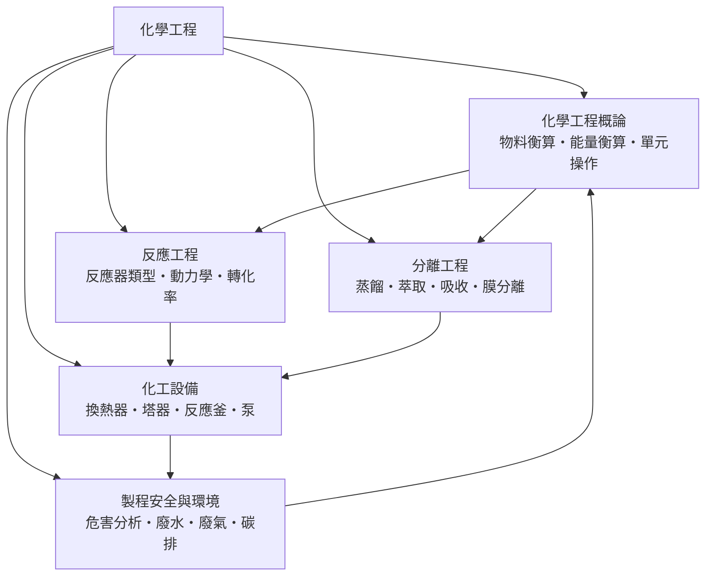

# 化學工程

> 隸屬：第一層 [工]　·　相關分類：[化學]、[熱力學]、[石化工程]　·　子分類總表見 [README]

> 對應維基百科：[中文維基百科：化學工程](https://zh.wikipedia.org/wiki/%E5%8C%96%E5%AD%A6%E5%B7%A5%E7%A8%8B)　·　[English Wikipedia: Chemical engineering](https://en.wikipedia.org/wiki/Chemical_engineering)

化學工程是**把實驗室裡成功的化學反應，放大成安全、經濟、可連續運轉的工業流程**的學科。化學家關心「反應會不會發生、產物是什麼」；化學工程師則要回答另一組問題：原料每小時幾公噸、反應器要多大、熱怎麼移走、副產品怎麼分開、跑到第幾年設備會壞、出了異常要怎麼保住人的命。換句話說，化學工程是化學與 [機械工程] 之間的轉接層：上游是分子科學，下游是噸級的鋼鐵、泵與控制閥。

它的核心工具不是「更多的化學」，而是**衡算與單元操作**。無論工廠生產的是硫酸、氨、塑膠還是藥品，流程都能拆成一個個不變的積木——流體輸送、換熱、蒸餾、吸收、過濾、反應——每塊積木都用同樣的質量守恆與能量守恆寫成方程式。因此化學工程師可以跨產業調動：今天設計煉油廠的分餾塔，明天設計疫苗廠的純化管線，方法完全相同。

這門學科的誕生本身就是一次「放大」：十九世紀末，英國的喬治·戴維斯把製鹼、製酸、蒸餾等工廠操作整理成講義，1888 年美國麻省理工學院開出第一門「化學工程」課程，把零散的工廠經驗變成可傳授的系統知識。20 世紀上半葉，單元操作的概念確立；二次大戰後，曼哈頓計畫的擴散工廠與石油化工的爆發式成長，讓「反應器設計」與「程序模擬」成為獨立的分支。1964 年合成氨技術的持續大型化、1990 年代以後的程序模擬軟體與綠色製程，使化學工程進入以安全、節能與永續為目標的新階段。

## 核心問題

化學工程的核心問題可以拆成四層，彼此嵌套。

1. **量的問題**：原料進多少、產品出多少、中間流股各是什麼組成？這靠 [物料衡算]（質量守恆的工廠版）回答，是每一張流程圖的起點。
2. **能量的問題**：反應放熱要怎麼移走、吸熱要怎麼供給、蒸餾要燒多少蒸汽？這靠 [能量衡算] 與 [熱力學] 回答。
3. **速率與設備的問題**：反應多快、需要多大體積的反應器、塔要幾層板、泵要多大揚程？這是 [反應工程]、[分離工程] 與 [化工設備] 的領域。
4. **系統與安全的問題**：這些設備如何連成一條流程？控制系統如何應對擾動？出錯時如何不讓小事故升級成大災難？這是 [流程] 設計與 [製程安全與環境] 的領域。

四者的邏輯順序：先算清楚量（衡算），才知道能量需求；能量與速率決定設備尺寸；設備連成系統之後，安全與環境約束再回頭修正整個設計。工業設計就是這樣迭代收斂的。

## 因果鏈

1. **工業化學的瓶頸**：十九世紀的製鹼、製酸工廠靠經驗試誤，同一個反應換一座廠就失敗；「實驗室能做、工廠做不成」是常態，缺乏可傳授的放大方法。
2. **單元操作的概念誕生**：1888 年前後，戴維斯與麻省理工學院的諾頓等人把工廠操作拆成與產品無關的積木（蒸餾、過濾、吸收），放大問題第一次有了通用語言。
3. **衡算方法論確立**：二十世紀初，質量與能量守恆被系統化為流程計算的骨架，任何新製程的可行性都能先在紙上「記帳」。
4. **戰爭催生大型化**：一次大戰與二次大戰對炸藥、合成氨與航空汽油的需求，迫使美英把實驗室流程以十倍百倍放大；流化床觸媒裂解等新技術在戰時誕生。
5. **合成氨的示範**：[1913年] [哈伯] 與波許完成高壓合成氨工業化，證明高溫高壓、觸媒與循環迴路可以協調成一條連續生產線，成為化學工程的教科書案例。
6. **程序系統化**：1960 年代電腦問世後，程序模擬把衡算方程自動聯立求解；流程設計從手算收斂變成最佳化搜尋。
7. **安全與環境的內建**：1974 年英國弗利克斯巴勒環己烷爆炸、1984 年印度波帕毒氣事故之後，本質安全設計與危害分析成為法定要求；綠色化學接手把廢棄物消滅在源頭。
8. **新領域的轉進**：半導體製程、生物製藥、鋰電池與碳捕集都是放大問題的新變體，化學工程的方法論持續向 [材料工程] 與 [生物學] 輸出。

## 子分類的定位與相互驅動

- [化學工程概論] 是**地基**：物料與能量衡算是所有後續計算的骨架；單元操作提供把任何工廠拆解成積木的視角，沒有衡算就無法判斷一條流程在物質上是否成立。
- [反應工程] 是**心臟**：反應器決定產品生成的地方有多大、多熱、待多久；它把化學 [動力學] 翻譯成設備體積與進料策略。
- [分離工程] 是**手術刀**：反應器出來的永遠是混合物，把想要的從不要的裡分出來佔整廠投資的一半以上；蒸餾的能量需求又反過來驅動換熱與節能設計。
- [化工設備] 是**肌肉**：衡算與設計最終落成換熱器、塔器、反應釜與泵的具體尺寸；設備的極限（耐壓、耐蝕、傳熱面積）又回頭約束流程方案。
- [製程安全與環境] 是**底線與修正器**：危害分析回頭改變流程結構（少存危險物料、降低操作溫度），廢水廢氣處理則把流程的輸出變成法規可接受的形狀——安全約束反過來驅動更簡潔的設計。

## 範例：合成氨的物料衡算

**問題**：合成氨反應 $\mathrm{N_2 + 3H_2 \to 2NH_3}$ ，進料每小時 100 kmol 氮氣與 300 kmol 氫氣，單程轉化率 15%。未反應氣體循環使用，最終全部轉化，每小時產多少氨？

1. **單程反應**：轉化 15% 的氮氣，即 15 kmol $\mathrm{N_2}$ ，消耗氫 45 kmol，生成氨 30 kmol。
2. **未反應氣體**：85 kmol $\mathrm{N_2}$ 與 255 kmol $\mathrm{H_2}$ 經冷凝分離氨後循環回反應器。
3. **總衡算**：由於循環，總轉化率趨近 100%，每小時理論產氨 200 kmol，約 $200 \times 17.03 \approx 3406$ kg。
4. **意義**：單程轉化率低不代表製程差——「低轉化率＋高循環比＋及時分離」正是合成氨百年來的標準設計，這個權衡（反應速率、平衡限制與分離成本）只有靠衡算才能定量化，是化學工程有別於實驗室化學的第一課。

## 容易混淆之處

- **化學工程不等於「工廠裡的化學家」**：化學家追求分子的新反應，化學工程師追求同一個反應在工業條件下的經濟、安全與穩定；兩者訓練重點不同。
- **轉化率高不等於產率高**：單程轉化率 15% 的循環製程，總收率可以接近 100%；評估製程要看整體衡算，不是單一數字。
- **平衡與速率是兩回事**：熱力學說「反應能不能到達某處」，動力學說「多快到達」；合成氨在熱力學上低溫有利、在速率上高溫有利，工程設計就是調和這對矛盾。
- **單元操作不是化學操作**：蒸餾、過濾、萃取過程中沒有化學反應發生，只是物理分離；誤把混合物當純物質計算是新手常見錯誤。
- **安全不是附加章節**：本質安全要求在概念設計階段就消除危害，事後加裝警報與圍堵只是補救，成本與可靠性都差得多。

## 延伸閱讀

- [化學]：化學工程上游的分子科學。
- [熱力學]：能量衡算與相平衡的理論母體。
- [石化工程]：化學工程最大的產業應用場景。
- [機械工程]：設備機械設計的鄰接學科。
- [材料工程]：耐蝕、耐壓材料選擇的知識來源。
- [高分子塑膠]：聚合反應器設計的產品出口。
- [生物學]：生物製藥與發酵工程放大問題的新應用領域。

## 連結定義

[工]: ../工/README.md
[README]: README.md
[化學]: ../化學/README.md
[熱力學]: ../熱力學/README.md
[石化工程]: ../石化工程/README.md
[機械工程]: ../機械工程/README.md
[材料工程]: ../材料工程/README.md
[高分子塑膠]: ../高分子塑膠/README.md
[生物學]: ../生物學/README.md
[化學工程概論]: 化學工程概論.md
[物料衡算]: 物料衡算.md
[能量衡算]: 能量衡算.md
[反應工程]: 反應工程.md
[動力學]: 動力學.md
[分離工程]: 分離工程.md
[化工設備]: 化工設備.md
[製程安全與環境]: 製程安全與環境.md
[流程]: 流程.md
[哈伯]: ../人/化學家/哈伯.md
[1913年]: ../時/1913年.md
