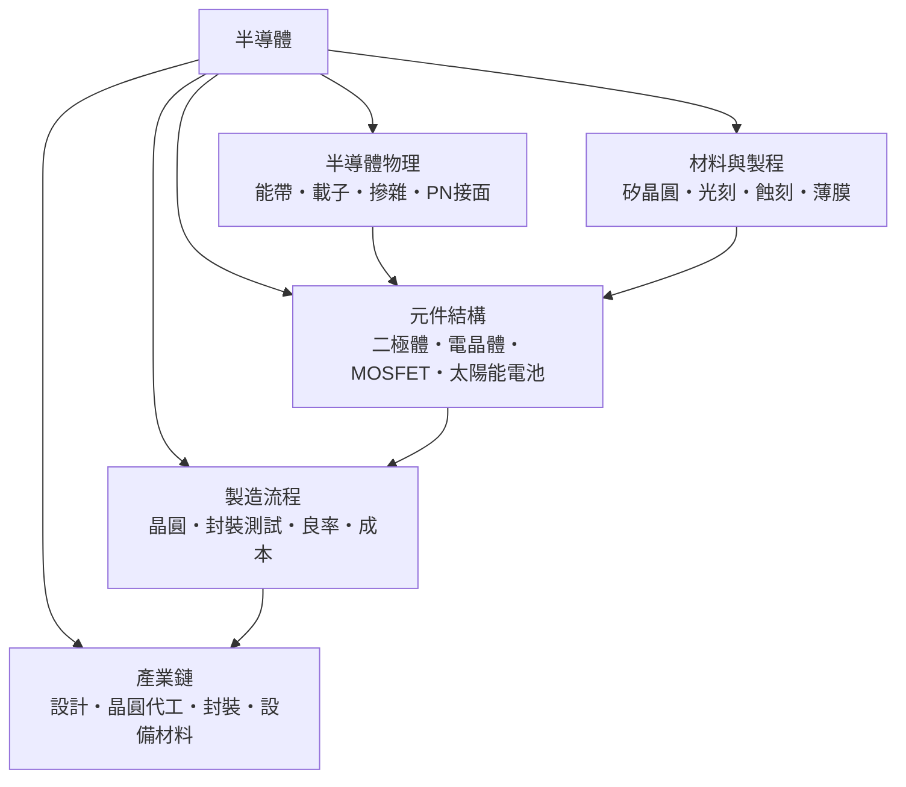

# 半導體

 > 隸屬：第一層 [工]　·　相關分類：[物理學]、[化學]、[電子工程]　·　子分類總表見 [README]

> 對應維基百科：[中文維基百科：半導體](https://zh.wikipedia.org/wiki/%E5%8D%8A%E5%AF%BC%E4%BD%93)　·　[English Wikipedia: Semiconductor](https://en.wikipedia.org/wiki/Semiconductor)

半導體是**導電能力介於導體與絕緣體之間、且導電性可以被精確控制的材料**。矽的電阻率約為 $2.3 \times 10^5\ \Omega \cdot \text{m}$ （純態），摻入百萬分之一濃度的磷原子後可降到 $10^{-2}\ \Omega \cdot \text{m}$ 量級——相差七個數量級的可調性，正是半導體成為電子工業基石的原因。一切 [電子工程] 的放大與開關，最終都建立在這種「可控的導電」之上。

半導體物理的核心語言是**能帶**。大量原子結合成晶體時，分立的原子能階展寬成連續的 [能帶結構]：導體的價帶與導帶相連或部分重疊；絕緣體的能隙 $E_g$ 大於 $4$ eV，價帶電子幾乎無法跨越；半導體的能隙居中——矽為 $1.12$ eV、砷化鎵為 $1.42$ eV，室溫的熱能與摻雜都足以產生少量可動的 [載子]（電子與電洞）。電流、溫度與光的效應全部由此解釋。

二十世紀中葉，這門材料科學完成了三次跳躍：1947 年在 [貝爾實驗室] 用鍺做出點接觸電晶體（[蕭克利]、[巴丁]、[布拉頓]）；1958 年 [基爾比] 把多個元件做在同一塊半導體上，開啟 [積體電路] 時代；1971 年 Intel 以矽閘製程推出 4004 微處理器。此後 [摩爾定律] 描述的指數縮微，把製程節點從 $10\ \mu\text{m}$ 一路推到 $3$ nm 以下，半導體從一門物理分支變成數兆美元產值的全球產業。

## 核心問題

半導體的核心問題可以串成一句話：**如何把材料的微觀電子結構，變成設計者要的巨觀電流**。

1. **導電從哪裡來**：晶格中的電子被什麼允許或禁止移動？答案由 [能帶結構] 與費米–狄拉克分布給出，導帶電子與價帶 [載子] 的濃度決定電導。
2. **如何控制濃度**：純半導體的載子太稀少且太敏感。以 [摻雜] 引入五價或三價原子，分別製造多數載子為電子的 n 型與為電洞的 p 型材料，濃度可在 $10^{13}$ 至 $10^{20}\ \text{cm}^{-3}$ 之間自由設定。
3. **如何整流與放大**：把 p 型與 n 型相接成 [PN接面]，電流只容易單向流動；把三片摻雜區疊成電晶體，小基極電流即可控制大集極電流；把接面換成金屬–氧化物–半導體疊層，就得到以電壓控制、幾乎不耗輸入功率的 MOSFET。
4. **如何在奈米尺度量產**：把設計圖變成晶片，需要 [光刻]、[蝕刻]、[薄膜成長] 與離子注入等上百道工序，在 $300$ mm 矽晶圓上重複出線寬僅數十奈米的圖形，並把 [良率] 保持在可用水準。

## 因果鏈

1. **整流器的需求**：早期無線電接收需要可靠的高頻整流；1874 年布勞恩發現金屬–硫化物接觸的不對稱導電，1930 年代硒與氧化亞銅整流器已商品化，但原理不明——「知其然而不知其所以然」催生理論。
2. **量子理論解釋固體**：1928 年後，布洛赫、威爾森等人把量子力學引入晶體，建立能帶理論與摻雜概念，第一次從原理上說明整流為何發生。
3. **戰爭催化**：二戰中雷達需要高性能矽檢波器，帶動純化與摻雜工藝；戰後對固體放大器的探索由 [貝爾實驗室] 大力推動。
4. **電晶體誕生**：1947 年 12 月 [巴丁] 與 [布拉頓] 觀察到點接觸增益，1948 年 [蕭克利] 提出接面電晶體理論，1950 年代鍺、矽電晶體相繼量產，真空管開始退場。
5. **矽勝出鍺**：矽的能隙較大（ $1.12$ eV 對 $0.66$ eV）、可長出穩定的二氧化矽絕緣層，耐溫與平面製程優勢使矽在 1960 年代成為主流。
6. **積體化與平面製程**：1959 年 [諾伊斯] 的矽平面製程讓元件與連線都在同一片晶圓上完成，1960 年代中期 [摩爾] 觀察出電晶體數的指數成長，成本曲線自此鎖定在縮微路線上。
7. **MOS 時代**：矽閘 MOSFET 與 CMOS 結構大幅降低靜態功耗，1970 年代起成為數位晶片的預設技術；光刻波長從可見光走到深紫外，線寬突破光學極限。
8. **奈米與多樣化**：製程進入奈米後，鰭式電閘、極紫外光刻、III-V 化合物與功率半導體（SiC、GaN）接續登場；半導體同時服務邏輯、記憶、感測與能源（[太陽能電池]），成為現代經濟的關鍵材料。

## 子分類的定位與相互驅動

- [半導體物理] 是**地基**：能帶、載子與 PN 接面的理論解釋一切元件行為；沒有它，製程工程師只能盲試參數。
- [材料與製程] 是**轉化器**：把理論參數（摻雜濃度、接面深度）變成真實晶圓上的幾何與雜質分布，[光刻] 解析度直接限制元件尺寸。
- [元件結構] 是**價值所在**：二極體、電晶體與 MOSFET 把物理變成功能；元件設計在物理極限與製程能力之間找平衡。
- [製造流程] 是**規模化的考驗**：數百道工序、以 [良率] 為生命線；良率每跌幾個百分點，一座先進晶圓廠的年度利潤就會被吞掉數十億。
- [產業鏈] 是**分工的結果**：設計（[設計] 公司）、製造（[晶圓代工] 廠）、封裝與設備材料各自專精，形成今天台積電、設計公司與設備商三方結構。

## 範例

**範例一：二極體的整流。** 理想二極體方程 $I = I_S\left(e^{V / n V_T} - 1\right)$ ，其中 $V_T = kT/q \approx 25.9$ mV（室溫）、 $n \approx 1$ 、 $I_S = 10^{-12}$ A。當 $V = 0.6$ V 時 $e^{0.6/0.0259} \approx 1.1 \times 10^{10}$ ，電流約為 $11$ mA；當 $V = -0.6$ V 時電流僅約 $-10^{-12}$ A——同一個元件，正向導通、反向近乎斷路，這就是整流。

**範例二：摻雜計算電阻。** 某矽棒摻磷至 $N_D = 10^{16}\ \text{cm}^{-3}$ ，電子遷移率約 $\mu_n = 1350\ \text{cm}^2/(\text{V} \cdot \text{s})$ ，則電導率 $\sigma = q N_D \mu_n \approx 1.6 \times 10^{-19} \times 10^{16} \times 1350 = 2.16\ \Omega^{-1} \text{cm}^{-1}$ ，電阻率約 $0.46\ \Omega \cdot \text{cm}$ 。摻雜濃度加倍，電阻率約減半——設計者用它來「調音」。

**範例三：CMOS 反相器功耗。** 一顆手機晶片含百億級電晶體，CMOS 之所以可用，在於靜態時兩顆電晶體永遠一開一關，理論上不從電源取電流；功耗主要來自開關時對負載電容 $C_L$ 充放電： $P = \alpha C_L V_{DD}^2 f$ 。若 $C_L = 20$ fF、 $V_{DD} = 0.8$ V、 $f = 2$ GHz、切換率 $\alpha = 0.1$ ，單一節點動態功耗僅約 $2.6\ \mu\text{W}$ ，乘上總節點數才構成瓦級晶片功耗——這條公式是整個低功耗設計的出發點。

## 容易混淆之處

- **半導體不是「半個導體」**：它的導電性並非不高不低，而是**可以被刻意控制**；金屬的電阻率幾乎不可調，這才是分類的關鍵。
- **電洞不是真實粒子**：電洞是價帶中「缺少一個電子」的等效描述，搬運的是正電荷的概念；用電洞描述遠比追蹤整個價帶簡單。
- **本質與非本質半導體**：純矽是本質（intrinsic）半導體，載子極少；實用元件都是摻雜後的非本質半導體，「矽導電」的說法忽略了摻雜這一步。
- **二極體不等於發光二極體**：矽 PN 接面發光效率極低，LED 需要用砷化鎵等直接能隙材料；同為 PN 接面，材料決定了用途。
- **奈米節點的名字已不對應實際線寬**：「3 nm」是行銷代號，閘極長度與金屬層間距並不等於節點數字；比較製程要看電晶體密度與效能。
- **良率不是成品率**：良率指通過測試的良品晶粒占比，還要再經封裝與最終測試，最終出貨良率通常更低。

## 延伸閱讀

- [物理學]：能帶理論的母體，量子力學是半導體物理的數學語言。
- [化學]：純化、磊晶與蝕刻氣體都屬化學工程，材料的純度要求達 $99.9999999\%$ （九個九）。
- [電子工程]：半導體元件的「用戶」，把元件組成放大器、邏輯閘與系統。
- [積體電路]：半導體技術最主要的產品形態。
- [材料工程]：矽、砷化鎵、碳化矽等材料的成長與缺陷控制。
- [奈米材料]：奈米尺度下的量子效應，是未來元件的設計空間。

## 連結定義

[工]: ../工/README.md
[README]: README.md
[物理學]: ../物理學/README.md
[化學]: ../化學/README.md
[電子工程]: ../電子工程/README.md
[積體電路]: ../積體電路/README.md
[材料工程]: ../材料工程/README.md
[奈米材料]: ../奈米材料/README.md
[半導體物理]: 半導體物理.md
[能帶結構]: 能帶結構.md
[載子]: 載子.md
[摻雜]: 摻雜.md
[PN接面]: PN接面.md
[材料與製程]: 材料與製程.md
[光刻]: 光刻.md
[蝕刻]: 蝕刻.md
[薄膜成長]: 薄膜成長.md
[元件結構]: 元件結構.md
[太陽能電池]: 太陽能電池.md
[製造流程]: 製造流程.md
[良率]: 良率.md
[產業鏈]: 產業鏈.md
[設計]: 設計.md
[晶圓代工]: 晶圓代工.md
[蕭克利]: ../人/物理學家/蕭克利.md
[巴丁]: ../人/物理學家/巴丁.md
[布拉頓]: ../人/物理學家/布拉頓.md
[基爾比]: ../人/工程師/基爾比.md
[諾伊斯]: ../人/工程師/諾伊斯.md
[摩爾]: ../人/工程師/摩爾.md
[摩爾定律]: ../積體電路/README.md
[貝爾實驗室]: ../研究機構/README.md
