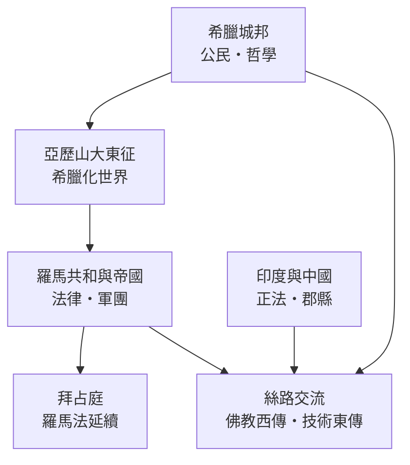

# 古典時代

> 隸屬：[古代史] › [古代史]　·　狀態：初稿

> 對應維基百科：[中文維基百科：古典时代](https://zh.wikipedia.org/wiki/%E5%8F%A4%E5%85%B8%E6%97%B6%E4%BB%A3)　·　[English Wikipedia: Classical antiquity](https://en.wikipedia.org/wiki/Classical_antiquity)

古典時代一般指地中海世界自前 8 世紀希臘城邦復興至 5 世紀西羅馬滅亡的千年，廣義上同時涵蓋波斯的帝國傳統與東亞的秦漢體系，是[古代史]中制度化最成熟的一段。

它的特徵是「普遍性方案」的競爭：希臘的公民與哲學、羅馬的法律與軍團、波斯的行省與驛道、印度的正法與解脫、中國的郡縣與編戶——各家都在回答「如何治理大規模社會」，答案不同，問題相同。

本子分類下設三個孫分類：[希臘城邦]聚焦公民政治與思想革命，[羅馬共和與帝國]聚焦法律與普世帝國，[印度與中國]聚焦兩大東方文明的另類整合方案。

## 技術與理論的關聯

- 軸心時代（雅斯貝斯語，約前 800 至前 200 年）：希臘哲學、希伯來先知、佛陀與諸子百家幾乎同時出現，思想第一次對「人應如何生活」給出系統答案。
- 鐵器與重裝步兵使作戰成本下降，公民兵與公民權掛鉤，推動希臘城邦內部的政治擴張。
- 波斯帝國（前 550 年起）的行省、驛道與仲裁式統治，示範了「低強度治理大疆域」的模板，亞歷山大與羅馬都是其繼承者。
- 羅馬把法律變成統治技術：從《十二銅表法》（前 451 年）到萬民法，行省居民第一次受「同一套規則」保護，這是帝國能維持數百年的制度基礎。
- 孔雀王朝（前 322 至前 185 年）以阿育王的石刻敕令推廣佛教行政，秦（前 221 年）以郡縣與編戶齊民統一七國，東方兩大方案與地中海平行發展。
- 公元 3 至 5 世紀的危機（羅馬三世紀危機、中國永嘉之亂、笈多前的印度分裂）顯示古典體系的共同弱點：過度依賴邊疆軍事與中央財政。

## 孫分類

| 孫分類 | 狀態 |
| --- | --- |
| [希臘城邦] | 初稿 |
| [羅馬共和與帝國] | 初稿 |
| [印度與中國] | 初稿 |

## 範例

前 490 年馬拉松、前 480 年薩拉米斯：希臘城邦擊退波斯兩次遠征。以人口與資源論，波斯占絕對優勢；但公民兵為「自己的城邦」作戰，動員效率與士氣不同。這兩場勝仗保住了城邦制度的實驗期，希臘戲劇、哲學與史學（希羅多德即以此次戰爭為題）才有舞台。

前 221 年秦統六國與前 27 年奧古斯都確立元首制，是東西方「帝國定形」的雙子事件。秦以郡縣、統一度量衡與馳道把七國變成一體；羅馬以行省、軍團與羅馬法把地中海變成「內湖」。兩者的共同答案是標準化。

## 前因後果

- 前因：[青銅時代]崩潰後的鐵器小型化社會，經數百年重組出城邦與新帝國。
- 瓶頸：城邦太小、帝國太大，二者都需要新的正當性與行政技術。
- 解法：公民制度使小邦高動員，法律與行省制使大國可治理，軸心思想為兩者供給論述。
- 後果：古典體系在 3 至 6 世紀過載而崩解，遺產由[拜占庭]、[伊斯蘭世界]與[唐代中國]三分繼承，[中古世界]由此開場。

## 與相鄰分類的關聯

- 與[希臘城邦]的關係：公民政治與哲學是古典時代的制度與思想引擎。
- 與[羅馬共和與帝國]的關係：法律帝國是古典治理的成熟形態與終局。
- 與[印度與中國]的關係：兩大東方方案提供了比較基準，絲路把三區連成網絡。
- 與[城邦]的關係：古典時代的希臘城邦是青銅時代城邦傳統的極致發展。
- 與[哲學]的關聯：軸心時代的思想突破是西方與印度哲學史的起點。

## 容易混淆之處

- 「古典時代」以西地中海為標準斷代，套用到中國或印度時必須另設座標。
- 羅馬滅亡不是一年事件：476 年只是西羅馬末帝被廢，東部延續千年。
- 雅典民主與現代民主差異極大：直接表決、排他公民權與奴隸制並存。

## 技術要點

- 分期以政治事件（前 776 年奧運、前 509 年共和、前 27 年元首制、476 年）為錨點，配合考古層位。
- 銘刻與紙草文書（如羅馬埃及的稅收紙草）是行政史的一手材料。
- 錢幣學以鑄幣成分與發行量追蹤財政與貿易，是古典經濟史的量化基礎。
- 考古的地中海廣域調查（field survey）重構鄉村人口與墾殖密度，修正「城市中心論」。
- 碑銘與莎草紙的「名」資料庫可估算公民人口與流動，檢驗文獻數字。
- 分子考古（穩定同位素、古 DNA）追蹤軍團兵源與移民，使「羅馬化」研究趨於實證。

## 常見的論爭

- 羅馬衰亡原因：吉本的道德論、內政財政論、瘟疫與氣候論、軍事外包論，至今未有一致答案。
- 「羅馬化」是否成立：自上而下的文化灌輸，或行省社會的主動選擇，近年偏向雙向互動。
- 秦漢與羅馬的可比性：官僚結構近似，但意識形態（正統經學 vs 羅馬法）與繼承制度差異，比較史學爭論不休。

## 延伸閱讀

- [希臘城邦]：公民政治的實驗室。
- [羅馬共和與帝國]：古典治理的成熟形態。
- [印度與中國]：東方兩大方案。
- [哲學]：軸心時代思想的總入口。

## 連結定義

[古代史]: 古代史.md
[希臘城邦]: 希臘城邦.md
[羅馬共和與帝國]: 羅馬共和與帝國.md
[印度與中國]: 印度與中國.md
[城邦]: 城邦.md
[拜占庭]: 拜占庭.md
[伊斯蘭世界]: 伊斯蘭世界.md
[唐代中國]: 唐代中國.md
[中古世界]: 中古世界.md
[青銅時代]: 青銅時代.md
[哲學]: ../哲學/README.md
