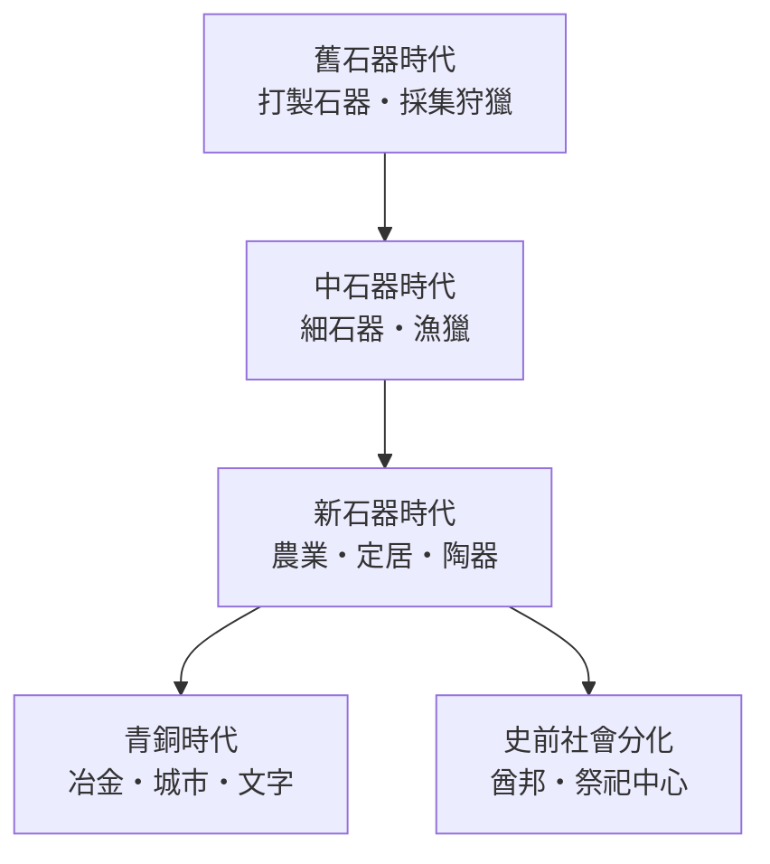

# 史前時代

> 隸屬：[古代史] › [古代史]　·　狀態：初稿

> 對應維基百科：[中文維基百科：史前時代](https://zh.wikipedia.org/wiki/Prehistory)　·　[English Wikipedia: Prehistory](https://en.wikipedia.org/wiki/Prehistory)

史前時代指文字發明（約西元前 3200 年）之前的人類歷史，時間跨度占人類史的百分之九十九以上。它沒有文獻可考，只能依靠考古發掘的石器、骨骼、聚落遺址與碳十四定年重建。

史前時代的意義在於它解釋了「為什麼會有歷史」：採集狩獵的流動群體如何變成定居農民、村落如何長成城市、平等的小社會如何分化出階層。這些轉變發生在文字出現之前，卻決定了文字出現之後一切國家的雛形。

本條目之下分為三個孫分類：[石器文化]處理技術演進，[農業起源]處理生產方式革命，[新石器]處理定居社會的整體轉型。三者合起來，就是從直立行走到城市門檻的完整故事。

## 技術與理論的關聯

- 史前史的方法論核心是「以物證史」：類型學排比石器形制、地層學確定先後、碳十四與鉀氬定年給出絕對年代，三者疊加才能建立年表。
- 「史前」與「歷史時期」的分界因地而異：兩河流域在前 3200 年就有文字，西歐要到羅馬征服才進入文字紀錄，大洋洲部分島嶼遲至 18 世紀仍是史前社會。
- 考古學家在史前史中扮演文獻學家在斷代史中的角色：[謝里曼]對特洛伊的發掘雖屬青銅時代，其「以挖掘驗證傳說」的方法論正承襲自史前考古。
- 史前人口估計顯示：農業出現前全球人口不超過一千萬，農業傳播後在數千年內成長十倍以上，這是理解社會複雜化的量化基礎。
- 冰期與間冰期的氣候序列（末次冰盛期約 2 萬年前、新仙女木事件約 1.29 萬年前）為解釋[農業起源]提供了環境驅動力的框架。
- 分子生物學加入後，古人類基因組定序使「史前」與「[人種演化]」接軌，遷移路線可以直接從 DNA 讀出，修正了單純依賴器物推論的舊模型。

## 孫分類

| 孫分類 | 狀態 |
| --- | --- |
| [石器文化] | 初稿 |
| [農業起源] | 初稿 |
| [新石器] | 初稿 |

## 範例

土耳其的恰塔霍裕克（Çatalhöyük）聚落繁榮於約西元前 7100 至前 6000 年，住民約五千人，房屋擠在一起、由屋頂出入，牆上繪有牛頭與壁畫，卻沒有發現王宮或神廟。它顯示定居社會可以先達到相當規模，而階層化的國家機構尚未出現。

法國拉斯科洞窟壁畫繪於約 1.7 萬年前，野牛、鹿群與人獸形象用礦物顏料繪於深處洞壁。象徵行為的出現說明舊石器晚期的智人已具備宗教與敘事能力，史前不只是「沒有歷史的時代」。

## 前因後果

- 前因：第四紀冰期氣候波動逼出靈活的採集適應與工具創新，人口沿海岸與河谷擴散到各大洲。
- 轉折：末次冰期結束後氣候穩定，野生穀物富集區（肥沃月彎、長江流域、中美高地）各自獨立發生馴化，即[農業起源]。
- 後果：定居使人口與儲存同時增長，社會分化與專業手工業在[新石器]時代成形，為青銅時代的城市與國家鋪路。
- 長波影響：史前確立的村落、血緣組織與儀式中心，成為此後一切文明的地基；文字、金屬與王權都是在這塊地基上加蓋。

## 與相鄰分類的關聯

- 與[石器文化]的關係：技術分期是史前敘事的骨架，石器的演進直接對應認知與生計的變化。
- 與[新石器]的關係：新石器是史前時代的收尾章節，定居與馴化在此完成，門檻之外就是金屬時代。
- 與[青銅時代]的關係：史前的瓶頸（缺乏長程協調與紀錄）正好由青銅時代的冶金、文字與城市解決。
- 與[人類學]的關聯：民族誌類比是解讀史前遺址的常用工具，現代採集社會提供了聚落與分工的參照系。

## 容易混淆之處

- 「史前」不是「原始落後」：拉斯科壁畫、巨石陣與恰塔霍裕克顯示史前社會有複雜的象徵與工程能力。
- 史前時代的下限因地而異，不能把西元前 3000 年當成全球一致的斷代。
- 農業不必然「進步」：骨骼證據顯示早期農民的健康與身高常不如採集先民，轉型的動力是人口壓力而非生活品質。

## 技術要點

- 定年技術鏈：相對定年（地層、類型學）＋絕對定年（碳十四、樹輪校正）構成史前紀年體系。
- 植物考古與浮選法從土壤中回收炭化種子，直接判定馴化與否，是研究[農業起源]的關鍵手段。
- 石器操作鏈（chaîne opératoire）分析重建打製步驟，可反推技術傳承與人群關係。
- 聚落考古以遺址面積、房址密度與儲藏設施推估人口與社會組織層級。
- 同位素分析（鍶、氧）可判定個體遷徙與飲食，把「人群移動」從推測變成實測。
- 古 DNA 定序自 2010 年代成熟後，使史前遷移史（如印歐語系擴張、班圖擴張）得以用基因譜系檢驗。

## 常見的論爭

- 農業為何發生：人口壓力說、氣候說、競宴說（社會競爭）各有證據，目前趨向多因素疊加。
- 國家起源於衝突還是合作：戰爭論（卡內羅）與整合論（祭司協調灌溉）在史前考古中各有案例支持。
- 新仙女木事件與農業起源的因果強度仍有爭議：氣候衝擊是觸發還是只是背景，聚落資料尚不足以定論。

## 延伸閱讀

- [石器文化]：史前技術分期的核心條目。
- [農業起源]：從採集到生產的關鍵轉折。
- [新石器]：定居革命的整體圖像。
- [人類學]：解讀史前社會的比較框架。

## 連結定義

[古代史]: 古代史.md
[石器文化]: 石器文化.md
[農業起源]: 農業起源.md
[新石器]: 新石器.md
[人類學]: ../人類學/README.md
[人種演化]: ../人種演化/README.md
[謝里曼]: ../人/考古學家/謝里曼.md
[青銅時代]: 青銅時代.md
