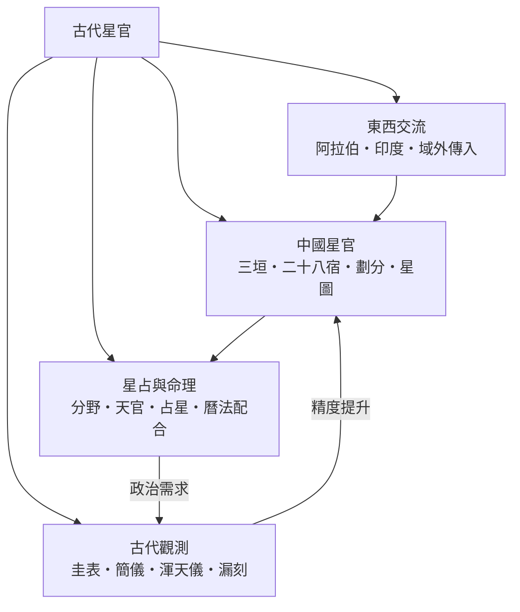

# 古代星官

> 隸屬：第一層 [天]　·　相關分類：[星座]、[天文學]、[農曆]　·　子分類總表見 [README]

> 對應維基百科：[中文維基百科：星官]　·　[English Wikipedia: Chinese constellations]

星官是中國古代對恆星群組的劃分與命名，與西方星座是兩套獨立發展的體系：西方星座以神話人物與動物為骨架，星官則以**人間的宮廷、官署、市井**投射到天上——紫微垣是天帝的宮殿，天市垣是天上集市，北斗是天帝的車駕。整套體系由 [三垣]、[二十八宿] 與眾多小星官構成，至三國時代[陳卓]總結為 283 官、1464 星，成為後世星圖的標準。古代星官不只是天文命名法，它同時是曆法、[占星] 與國家治理的交會點：觀天者既在測量天，也在替天命做記錄。

## 核心問題

1. **天上的星如何組織成有意義的系統？** [星官劃分] 回答命名的邏輯，[星圖] 保存了系統的視覺形態。
2. **觀測到的星象如何對應人間秩序？** [分野] 把星空區域對應到地面州國，[天官] 制度把觀測變成官職。
3. **沒有望遠鏡的年代如何量得準？** [圭表] 量影、[漏刻] 計時、[渾天儀] 模擬天球、[簡儀] 簡化測量，構成 [古代觀測] 的工具鏈。
4. **中國的星官知識如何與其他文明交流？** [東西交流] 梳理 [阿拉伯星名]、[印度星名] 的傳入與 [域外傳入] 的雙向影響。

## 因果鏈

1. **觀星是為了記時**：新石器時代的先民以昏中星定季節，斗柄指向成為最原始的月曆；《尚書・堯典》記載以鳥、火、虛、昴四星定四仲中星，觀測與農事直接掛鉤。
2. **體系成形於戰國至漢**：戰國時期[甘德]、[石申]各自測編星表，馬王堆帛書《五星占》保存了早期的行星觀測；[司馬遷]《史記・天官書》把星空整體組織成「天官」體系。
3. **[陳卓]定於一尊**：三國吳太史令[陳卓]綜合甘、石、巫咸三家，整理出 283 星官 1464 星的標準星表，此後一千餘年星圖皆以此為底本。
4. **儀器推動精度**：漢代[落下閎]造渾儀，元代[郭守敬]簡化為 [簡儀]，赤道式裝置領先西方數百年；儀器的精度使歲差被發現（[虞喜]，四世紀）、恆星位置表一再重測。
5. **曆法依賴星官**：二十八宿是曆法計量的座標框架——二十八宿距星構成古代的「赤經線」，日月五星的位置以「入宿度」表示，曆法的成敗直接以星官測量為準。
6. **占星與政治互相塑造**：天象被視為天命的顯示，[天官] 的觀測記錄（日食、彗星、客星）因此連續累積兩千年，意外留下了超新星紀錄（如 1054 年天關客星即蟹狀星雲前身）等現代天文學仍受用的資產。
7. **交流帶來雙向改寫**：隋唐時期印度曆法與星官知識隨佛經傳入，元明清時期阿拉伯天文學、耶穌會士的西方星圖先後進入，星官體系一面吸收、一面堅守自身框架。
8. **現代的轉譯**：當代把中國星官對應到西方星座座標，[星圖] 與中西星名對照工具使古代體系成為天文史與文化天文學的研究對象。

## 子分類的定位與相互驅動

### 中國星官

[中國星官] 是體系的骨幹：[三垣] 劃出北天極附近的「中央政府」，[二十八宿] 沿黃赤道帶切成二十八个「省份」，[星官劃分] 說明命名與隸屬的邏輯，[星圖] 把整體視覺化。它是其他三個子分類的座標語言——沒有統一的星官框架，觀測、占星與交流都無從談起。

### 星占與命理

[星占與命理] 是體系的「使用目的」：[分野] 把天區對應地面，[天官] 是執行觀測與解讀的官職制度，[占星] 是解讀的規則集，[曆法配合] 則把星象與曆日、吉凶繫在一起。占星的政治需求反過來是觀測制度與儀器投資的最大動力——帝國需要有人日夜盯著天。

### 古代觀測

[古代觀測] 是體系的「測量層」：[圭表] 定冬至以校曆，[漏刻] 提供均勻的時間軸，[渾天儀] 把天球模型做成儀器，[簡儀] 把測量簡化到極致。每一次儀器升級都讓星官座標更精確，也讓曆法更準；反過來，曆法預報失準的政治壓力又催生下一次儀器革命。

### 東西交流

[東西交流] 是體系的「邊界」：印度與波斯知識經絲路與佛典傳入，阿拉伯天文台的儀器與星表在元代進入中國宮廷，明末耶穌會士帶來球面天文與望遠鏡。[阿拉伯星名] 與 [印度星名] 的星名、[宣明篇] 等譯介文獻，記錄了中國體系如何在吸收外來知識的同時維持自身的星官框架。

## 範例

以二十八宿中的「大火」心宿二說明星官體系的運作。心宿屬東方蒼龍七宿，「大火」即心宿二（天蠍座 α 星）。《詩經》「七月流火」記錄的是：農曆七月黃昏時大火星向西沉，提醒秋天將至、農事將收——這是星官作為農事曆的原始功能。春秋時期設「火正」專職觀測大火昏中以頒布農時，是 [天官] 制度的縮影。《左傳》記載的分野體系中，心宿對應宋、陳一帶的地面區域，天象吉凶據此「落地」。到了天文計算層面，曆法家以二十八宿距星為座標框架記錄行星「入宿度」，火星犯心宿（「熒惑守心」）被視為最凶的天象之一。一顆星，同時是曆法錨點、官職職掌、分野地圖與占辭對象——星官體系的四個功能在同一顆星上重疊。

## 容易混淆之處

- **星官不等於星座**：星官是小群的星（常為一至十餘顆）加官署式命名，規模與神話邏輯都與西方星座不同；一個西方星座可能橫跨數個星官。
- **三垣二十八宿不是「33 個星座」**：三垣各含數十個小星官，二十八宿每一宿也是一片天區與其宿主星的組合。
- **二十八宿沿赤道還是黃道？** 二十八宿大體沿黃道帶分布，但古代座標以赤道系（入宿度、去極度）表達，與西方的黃道傳統不同。
- **占星紀錄不全是迷信廢料**：日食、客星、彗星的連續記錄是現代研究歷史超新星、地球自轉變化的珍貴資料。
- **「中國古代沒有天文學只有占星」是誤解**：曆法的精度要求（如[郭守敬]的回歸年長度測量）完全是定量科學的工作。

## 延伸閱讀

- [星座]：西方體系的對照組，理解兩套命名法的差異。
- [天文學]：星官所屬的上層學科脈絡。
- [農曆] 與 [二十四節氣]：星官觀測的曆法出口。
- [天文台]：從古代觀象臺到現代天文台的演化。
- [郭守敬]：簡儀的設計者，中國古代觀測技術的高峰。

## 連結定義

[天]: ../天/README.md
[README]: README.md
[星座]: ../星座/README.md
[天文學]: ../天文學/README.md
[農曆]: ../農曆/README.md
[二十四節氣]: ../二十四節氣/README.md
[天文台]: ../天文台/README.md
[郭守敬]: ../人/天文學家/郭守敬.md
[中國星官]: 中國星官.md
[三垣]: 三垣.md
[二十八宿]: 二十八宿.md
[星官劃分]: 星官劃分.md
[星圖]: 星圖.md
[星占與命理]: 星占與命理.md
[分野]: 分野.md
[天官]: 天官.md
[占星]: 占星.md
[曆法配合]: 曆法配合.md
[古代觀測]: 古代觀測.md
[圭表]: 圭表.md
[簡儀]: 簡儀.md
[渾天儀]: 渾天儀.md
[漏刻]: 漏刻.md
[東西交流]: 東西交流.md
[阿拉伯星名]: 阿拉伯星名.md
[印度星名]: 印度星名.md
[宣明篇]: 宣明篇.md
[域外傳入]: 域外傳入.md
[陳卓]: ../人/天文學家/陳卓.md
[甘德]: ../人/天文學家/甘德.md
[石申]: ../人/天文學家/石申.md
[司馬遷]: ../人/歷史學家/司馬遷.md
[落下閎]: ../人/天文學家/落下閎.md
[虞喜]: ../人/天文學家/虞喜.md
[中文維基百科：星官]: https://zh.wikipedia.org/wiki/%E6%98%9F%E5%AE%98
[English Wikipedia: Chinese constellations]: https://en.wikipedia.org/wiki/Chinese_constellations
