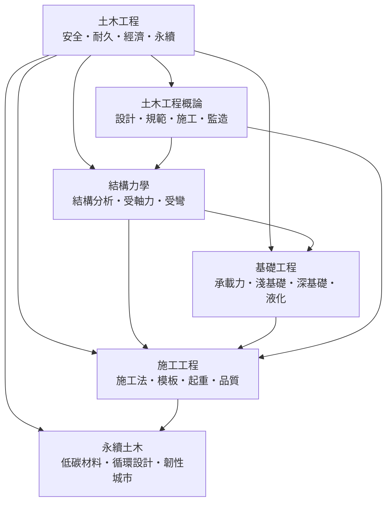

# 土木工程

> 隸屬：第一層 [工]　·　相關分類：[結構力學]、[流體力學]、[地質學]、[材料工程]　·　子分類總表見 [README]

> 對應維基百科：[中文維基百科：土木工程](https://zh.wikipedia.org/wiki/%E5%9C%9F%E6%9C%A8%E5%B7%A5%E7%A8%8B)　·　[English Wikipedia: Civil engineering](https://en.wikipedia.org/wiki/Civil_engineering)

土木工程是**設計、建造與維護社會賴以存續的公共工程系統**的學科：橋梁、道路、隧道、水庫、堤防、港埠、機場、給排水管網，乃至承載這些設施的地基與支撐結構，都屬於它的領域。

它與其他工程分支的根本差別在**對象的性質**。機械工程處理的是「會動的機器」，其功能靠運動傳遞；電子工程處理的是「會傳訊的系統」，其功能靠電訊號傳遞；土木工程處理的卻是**不會動、也不發訊號的巨物**——它們不產生能量，也不傳遞資訊，而是以自身的存在改變人類的地理、氣候與時間尺度：一条堤防把洪水隔在千里之外，一座水庫把季節的能量搬進旱季，一條隧道把兩小時的車程壓成三十分鐘。

因此土木工程的三大特徵是：**尺度大、壽命長、容錯低**。一棟大樓可以用八十年，一座水庫要用一百年；判斷的錯誤不像機械那樣可以用一顆螺絲補救——結構失效的代價是生命。這個性質決定了它的方法論：把安全與可驗證性放在第一位，把經驗、規範與監測並列為知識的三大來源。

## 核心問題

土木工程要回答的問題，可以收斂為五個互相咬合的子問題。

1. **強度與剛度**：結構在承受外載時，內部應力如何分布？構件會不會斷裂、屈服或失穩？這是 [結構力學] 提供的部分，回答的是「理想化構件在給定載荷下的反應」。
2. **地基與支承**：土不是剛體，也不是連續的彈性體。土怎麼變形、承載力有多少、有效應力如何演化？這是 [基礎工程] 的領域，答案來自 [地質學] 的地層資訊與原位試驗。
3. **施工的可行性**：一個設計出來的構件，能不能在現場以合理的成本與時間造出來？混凝土會泌水、會養生不足、會模板漏漿；鋼材會鏽蝕、會焊接變形。**設計與施工之間的落差，是土木工程最容易被忽略、也最昂貴的風險來源。**
4. **壽命與維護**：結構建成之後會老化、會受損、會被超載使用。如何讓維修成本與結構壽命取得平衡？這決定了「造價最低」並不等於「總成本最低」。
5. **外部性與永續**：土木工程占全球材料消耗與固體廢棄的極大比重，也直接改變自然地理與生態系。**因此「要不要建、在哪裡建、怎麼維護」如今與「怎麼建」同等重要。**

這五個問題彼此牽制：加大斷面可以提高承載力卻增加自重與碳排；採用預力可以控制裂縫卻提高前期施工複雜度；提高設計安全係數可以降低失效風險卻抬高造價。**土木工程的本質，就是在这些相互牴觸的取捨中找出一個可被計算、可被檢驗、可被維護的平衡點。**

## 因果鏈

1. **建築的需求先於學科**：古代的橋梁、渠道與城牆靠經驗與匠藝，規模一大就失敗，沒有任何理論能解釋為何某個形狀站得住、某個形狀站不住。
2. **[結構力學] 的建立**：17 世紀伽利略與牛頓的力學、18 世紀歐拉與拉格朗日的分析力學，把「構件受力」變成可解的方程式；[材料工程] 與 [結構力學] 隨後成為土木工程的第一根支柱。
3. **材料與施工的工業化**：19 世紀水泥、鋼鐵與預力技術成熟，使得「可算得出的結構」第一次能被「批量製造」；工程師從此不只設計形狀，也設計製程。
4. **土工學的獨立成科**：[太沙基] 在 [1925年] 至 [1943年] 之間把土的行為轉換成有效應力、固結與承載力公式，使「建在軟土上」從賭博變成可計算的工程，[1883年] 出生的他被後世稱為土力學之父。
5. **大型結構的尺度躍升**：跨海橋梁、长大隧道、山嶽隧道與大型水利樞紐在 20 世紀後半大量興建，帶來結構形態（斜拉橋、懸索橋）、基礎形式（深基礎、沉井）與施工機具（盾構機、起重船）的全面進步。
6. **規範化與風險意識**：事故頻傳——從橋梁斷裂到水庫潰決——催生了強制規範、強制監造與結構健康監測制度；**土木工程因此走向高度制度化，「誰簽核、誰監造、誰維護」成為專業的一部分。**
7. **永續轉向**：材料的隱含碳（尤其水泥）、既有設施的延壽、拆除廢棄的再利用，把 [碳循環] 與 [永續土木] 推到設計的前台；「少拆、少建、延长壽命」逐步與「造得更好」並列。
8. **韌性與數位化**：氣候變遷使設計極端事件（颱風、暴雨、地震）常態化，韌性城市理念、[都市規劃] 與結構監測成為新的顯性議題。

## 子分類的定位與相互驅動

- [土木工程概論] 是**方法與制度層**：它規定一項土木工程從需求、設計、規範、施工到監造與驗收的完整流程，回答「這個行業怎麼做事」；其他三個子分類都建立在它給出的流程之上。
- [結構力學] 是**力學層**（橫跨本分類與獨立的結構力學概念）：提供構件在載荷下的內力與變形，是判斷「會不會壞、會不會太軟」的工具。它假設支撐條件已知，因此必須由 [基礎工程] 補上另一半。
- [基礎工程] 是**地層層**：把地質條件轉換成承載力、沉降與穩定性判據，是土木工程與 [地質學]、[流體力學] 的交會處；液化判斷更是橋梁與港埠設計的常規風險項。
- [施工工程] 是**現實層**：設計圖上的構件必須在工地被造出來；模板、起重與品質管理決定了設計成果能否被實現，同時施工誤差也會回頭修正設計（例如預埋件偏差造成鋼構件改孔）。
- [永續土木] 是**評價層**：把碳排、資源循環與災害韌性納入設計目標，是對前三層成果的重新取捨，而不是另一套結構技術。

五者的關係可用一句話概括：**概論定流程，力學定形狀，地層定基礎，施工定成敗，永續定取捨。**

## 範例

**範例一：跨江大橋的三個層次。** 一座跨越寬江的斜拉橋，會同時用到四個子分類：

- **結構層**（[結構力學]）：主桁的軸力與彎矩組合、斜撐的穩定檢核、風振與地震反應分析，決定了鋼箱梁的尺寸與索力。
- **地層層**（[基礎工程]）：江中覆土層厚達 30 公尺、且屬軟弱淤泥，淺基礎的承載力不足，必須採深基礎（例如直徑 2 公尺的鑽孔灌注樁深入堅硬土層）；同時須檢核地震時的液化工況。
- **施工層**（[施工工程]）：索塔與主梁如何在通航航道不封閉的條件下分段吊裝，模板與支架的拆除順序如何避免結構在施工階段受力反轉，全靠施工法設計與嚴格的品質管理。
- **永續層**（[永續土木]）：若改採鋼骨混凝土橋塔並增加預應力索，可減少用鋼與未來拆除廢棄量，造價與碳排的取捨在此發生。

**範例二：同一棟建築的兩種基礎方案。** 一棟 18 層住宅，地下室開挖 5 公尺，地層為軟弱黏性土：

- **淺基礎**（筏基＋局部擴底）：承載力大致足夠，但總沉降可能達 8 至 10 公分，超過一般框架對差異沉降的容許值，且開挖階段的降水會引起鄰房沉降。
- **深基礎**（26 支預製樁或灌注樁）：造價提高約 15% 至 25%，沉降可降至 2 至 3 公分以內。

**決策點不在造價，而在「未來發生差異沉降的可能性」。** 這正是 [基礎工程] 與 [施工工程] 攜手、並由 [監造] 與 [品質管理] 把關的地方。

**範例三：同一噸水泥的兩種碳排結果。** 對一段 1 公里的雙向四車道市區道路：

- 方案 A：瀝青路面＋水泥穩定基層。
- 方案 B：全鋪 [瀝青] 混合料並提高再生瀝青摻配率、延後重建既有結構。

兩方案的初期碳排可能接近，但在 30 年生命週期內，方案 B 因減少重建次數、並以 [碳循環] 的減碳技術攤平初期排放，總碳排顯著較低。**這說明「一次性碳排」不是正確的評價指標，全生命週期才是。**

## 容易混淆之處

- **土木工程不等於「蓋房子」**：建築結構只是其中一支；橋梁、隧道、水利、港埠、道路與地下管線同樣是核心領域，且往往與建築共享相同的力學與施工技術。
- **結構力學與結構分析不是同一件事**：前者研究構件在載荷下的行為原理（解一道梁、一個框架），後者是把它們組成整體結構的數值方法（矩陣位移法、有限元素）。
- **承載力與沉降是兩個問題**：承載力夠不夠、會不會沈陷，是兩種不同的失效模式；軟弱黏土常是「不壞但沉」。
- **規範不是法律，而是風險的量化**：安全係數與容許應力的本質，是在不確定性下對失效機率與後果做取捨，不是絕對安全的保證。
- **永續不等於降低強度**：減碳的主要手段往往是「少做結構、延長壽命、回收再利用」，而不是使用強度更低的材料。
- **「施工誤差」不是施工問題**：預埋件位置偏差、鋼材實際強度離散、混凝土強度離散，都會改變設計假定；真正的設計單位要預留施工公差並把公差反映在構件上。

## 延伸閱讀

- [結構力學]：構件與整體結構的力學分析基礎。
- [流體力學]：水力、滲流與風工程所需的流體理論。
- [地質學]：土層與岩層資訊的來源，決定基礎方案。
- [材料工程]：混凝土、鋼材與瀝青的材料性能與試驗方法。
- [建築設計]：土木工程在建築領域的對應分支。
- [水利工程]：土木工程在水系與能源領域的分支。
- [城市]、[都市規劃]：土木設施在空間上的組織與韌性設計。
- [碳循環]、[綠建築]：永續土木的量化對象。
- [太沙基]：把土從經驗提升為科學的人。

## 連結定義

[監造]: 監造.md
[品質管理]: 品質管理.md

[工]: ../工/README.md
[README]: README.md
[結構力學]: ../結構力學/README.md
[流體力學]: ../流體力學/README.md
[地質學]: ../地質學/README.md
[材料工程]: ../材料工程/README.md
[建築設計]: ../建築設計/README.md
[水利工程]: ../水利工程/README.md
[城市]: ../城市/README.md
[都市規劃]: ../都市規劃/README.md
[碳循環]: ../碳循環/README.md
[綠建築]: ../綠建築/README.md
[土木工程概論]: 土木工程概論.md
[基礎工程]: 基礎工程.md
[施工工程]: 施工工程.md
[永續土木]: 永續土木.md
[太沙基]: ../人/工程師/太沙基.md
[1883年]: ../時/1883年.md
[1925年]: ../時/1925年.md
[1943年]: ../時/1943年.md
[瀝青]: ../物/瀝青.md
