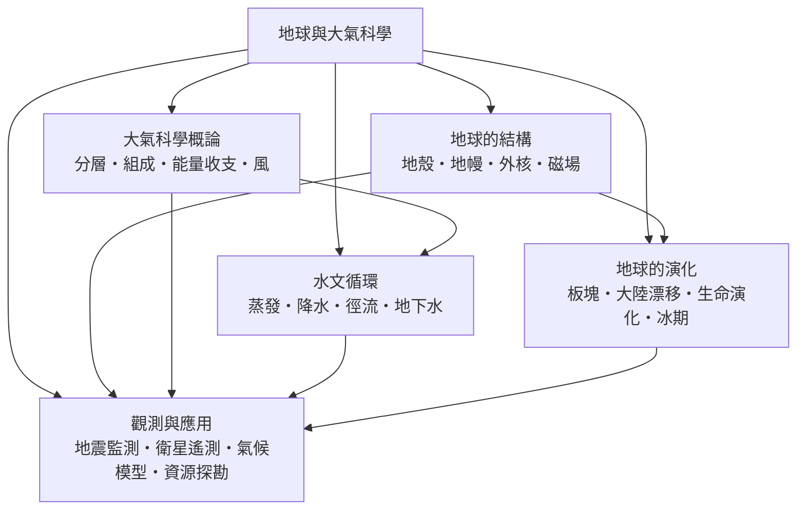

# 地球與大氣科學

> 隸屬：第一層 [理]　·　相關分類：[地質學]、[氣象學]、[海洋學]、[物理學]　·　子分類總表見 [README]

> 對應維基百科：[中文維基百科：地球科学](https://zh.wikipedia.org/wiki/%E5%9C%B0%E7%90%83%E7%A7%91%E5%AD%A6)　·　[English Wikipedia: Earth science](https://en.wikipedia.org/wiki/Earth_science)

地球與大氣科學研究**地球這顆行星的物質結構、運動過程與歷史演化**，並特別處理固體地球（岩石圈）、大氣圈與水文圈之間的耦合。它的對象不是宇宙中的任意天體，而是**我們住在上面的這個特定天體**：一個有磁場保護、有厚大氣、有海洋調節、由板塊持續翻新的系統。

這門學科的獨特之處在於**尺度跨度極大而時間尺度一致**。同一個研究對象，可以在幾秒內發生（地震波通過），也可以花四十六億年（板塊把大陸推開數千公里）；可以放大到整個地球的能量收支，也可以縮小到一顆沙粒的礦物組成。研究者因此必須同時使用地質時間尺度的「深時間」思維與氣象尺度的「短時間」思維。

在科學體系中，地球與大氣科學是**應用性最強的自然科學之一**。地震預警、礦產探勘、天氣預報、氣候評估、海洋資源管理，幾乎所有與地球資源和災害有關的決策都依賴它；同時它又是基礎研究的重要試驗場——板塊構造學、分層海洋學、大氣環流都是地球物理學中理論原創性極高的領域。

## 核心問題

四個核心問題構成一條完整鏈路。

1. **地球是什麼做的、如何分層？** 這是結構問題，由 [地球的結構] 回答：地殼、地幔、外核如何依密度與物性劃界，[磁場] 如何由外核的對流產生並反過來保護大氣。
2. **能量如何在地球系統中流動？** 這是收支問題，由 [大氣科學概論] 的 [能量收支] 回答：太陽短波輻射進入、地表吸收、長波輻射逸出，這個簡單的收支表決定了地球的溫度，也決定了 [風] 與 [大氣分層] 的形態。
3. **水在地球表面如何循環？** 這是 [水文循環] 回答的問題：[蒸發]、[降水]、[徑流]、[地下水] 四個過程把海洋、大氣與岩石圈縫成一個循環系統。
4. **地球是怎麼變成現在這樣的？** 這是 [地球的演化] 與 [觀測與應用] 回答的問題：[板塊] 與 [大陸漂移] 提供構造機制，[生命演化] 與 [冰期] 提供時間軸，[地震監測]、[衛星遙測]、[氣候模型] 與 [資源探勘] 提供觀測與應用能力。

結構決定能量如何傳遞，能量決定風與雨，風雨與岩石共同塑造地貌，而長時間尺度上的板塊運動為所有過程提供舞台——這四問因此不是並列，而是層層相扣。

## 因果鏈

1. **測地的傳統**：古代文明為灌溉與航海需要丈量土地、建立曆法，累積第一批可比較的地理資料。
2. **洪堡的綜合**：[洪堡] 以五年旅程與等溫線把氣候變成可量測、可推廣的地理對象，地質學與氣象學的雛形同時出現。
3. **地層學的建立**：19 世紀的層序地層學把「相對年齡」變成可推疊的規則，深度時間觀念成型，這是所有演化敘事的骨架。
4. **地磁與大陸漂移**：[1859年] 高斯逝世，他以數學方式描述地球磁場的方法隨後成為地磁學的基礎；此時零星的大陸漂移證據仍被拒絕；[1912年] [韋格納] 提出漂移說，爭論延續半個世紀。
5. **海底擴張與板塊**：20 世紀 1960 年代海底磁條帶與海底擴張證據成熟，板塊構造說取代固定論，地質學從「分類學」轉為「機制科學」。
6. **衛星時代的觀測革命**：[1960年] 起的人造衛星提供連續的全覆蓋觀測，使大氣環流、海洋表面溫度、冰雪範圍可以被系統性地追蹤。
7. **氣候科學的量化**：1990 年代以來，能量收支、大氣環流與碳循環被寫進耦合模式，使 [全球暖化] 從爭議議題變成可計算的物理問題。
8. **行星科學的擴張**：地球模型同時被用來解釋其他行星與衛星，反過來逼地球科學者檢驗模型的普遍性。

## 子分類的定位與相互驅動

- [地球的結構] 是**地基**：任何地質或氣候問題，最後都會回到「物質在哪裡、在什麼狀態」這個問題上。
- [大氣科學概論] 是**引擎**：太陽能量如何被吸收與傳遞，決定了大氣的運動形態，也決定了氣候的邊界條件。
- [水文循環] 是**介面**：水把固體地球、大氣與生物圈縫在一起，是地球系統的「血液循環」。
- [地球的演化] 是**時間軸**：提供「為什麼會是這樣」的答案，並解釋當今環境的來歷。
- [觀測與應用] 是**出口與回饋**：把前面四者的知識轉成預警、評估與資源決策，同時以實測需求反過來推動儀器與理論。

## 範例：從太陽常數到地表溫度

假設地球為無雲、純黑體球體，反照率 $A \approx 0.30$ ，太陽常數 $S \approx 1361\ \mathrm{W/m^2}$ ，則：

1. **全球平均入射**：地球截取的是圓面而非整球，故地表平均入射為 $S/4 \approx 340\ \mathrm{W/m^2}$ 。
2. **扣除反射**：行星反照率吸收率為 $(1 - A) \times 340 \approx 238\ \mathrm{W/m^2}$ 。
3. **平衡條件**：若地球為黑體，射出長波輻射 $F = \sigma T^4$ ，其中 $\sigma \approx 5.67 \times 10^{-8}\ \mathrm{W\,m^{-2}\,K^{-4}}$ 。
4. **解出有效溫度**： $T = (238/\sigma)^{1/4} \approx 255\ \mathrm{K}$ ，即攝氏零下 18 度左右。
5. **與實測對照**：地表實際平均溫度約 288 K（攝氏 15 度），高於黑體值，是因為**溫室效應**讓低層大氣吸收地表長波輻射再向下回射。
6. **推論**：任何改變反照率或溫室氣體濃度的行為，都會沿著同一條收支鏈改變地表溫度——這就是氣候模型的物理骨架。

這條計算鏈同時解釋了為什麼海洋（熱容量大、反射率低）會調節氣候，也解釋了為什麼雲量與冰蓋反照率回饋如此關鍵。

## 容易混淆之處

- **地球與大氣科學不等於地質學**：地質學偏重岩石與構造的歷史解讀，本分類更著重地球系統的整體耦合與觀測方法。
- **氣象與氣候不同**：氣象是短期天氣狀態，氣候是三十年的統計特徵；[竺可楨] 正是以「氣候變化是漸進的、可量測的」確立這個區分。
- **板塊不是「漂移的大陸」**：板塊構造包含擴張、俯衝、轉形三種邊界，大陸只是其中大陸地殼的一種表現。
- **地磁場不是永久不變的**：地磁北極會倒轉，過去兩百年間已有數次快速倒轉，地磁場是動態的。
- **水文循環不是「水往下流」**：蒸發與降水是循環的兩端，海洋蒸發約佔全球蒸發量的 86%，大氣與陸地只佔其餘。
- **觀測與理論不可偏廢**：衛星遙測提供連續資料，但氣候模型仍需地面觀測校正；兩者互為條件。

## 延伸閱讀

- [地質學]：本分類最相近的姊妹學科。
- [氣象學]：大氣科學的正式學科名稱與主要參考。
- [海洋學]：地球系統中的另一半——海洋圈。
- [物理學]：能量、動量與熱力學的共同語言。
- [碳循環]：理解氣候與海洋酸化的關鍵框架。
- [全球暖化]：本分類最重要的應用課題之一。

## 連結定義

[理]: ../理/README.md
[README]: README.md
[地質學]: ../地質學/README.md
[氣象學]: ../氣象學/README.md
[海洋學]: ../海洋學/README.md
[物理學]: ../物理學/README.md
[全球暖化]: ../全球暖化/README.md
[碳循環]: ../碳循環/README.md
[地球的結構]: 地球的結構.md
[地球的演化]: 地球的演化.md
[大氣科學概論]: 大氣科學概論.md
[水文循環]: 水文循環.md
[觀測與應用]: 觀測與應用.md
[磁場]: 磁場.md
[大氣分層]: 大氣分層.md
[能量收支]: 能量收支.md
[風]: 風.md
[蒸發]: 蒸發.md
[降水]: 降水.md
[徑流]: 徑流.md
[地下水]: 地下水.md
[板塊]: 板塊.md
[大陸漂移]: 大陸漂移.md
[生命演化]: 生命演化.md
[冰期]: 冰期.md
[地震監測]: 地震監測.md
[衛星遙測]: 衛星遙測.md
[氣候模型]: 氣候模型.md
[資源探勘]: 資源探勘.md
[洪堡]: ../人/地球科學家/洪堡.md
[竺可楨]: ../人/氣象學家/竺可楨.md
[韋格納]: ../人/地球科學家/韋格納.md
[1859年]: ../時/1859年.md
[1912年]: ../時/1912年.md
[1960年]: ../時/1960年.md
