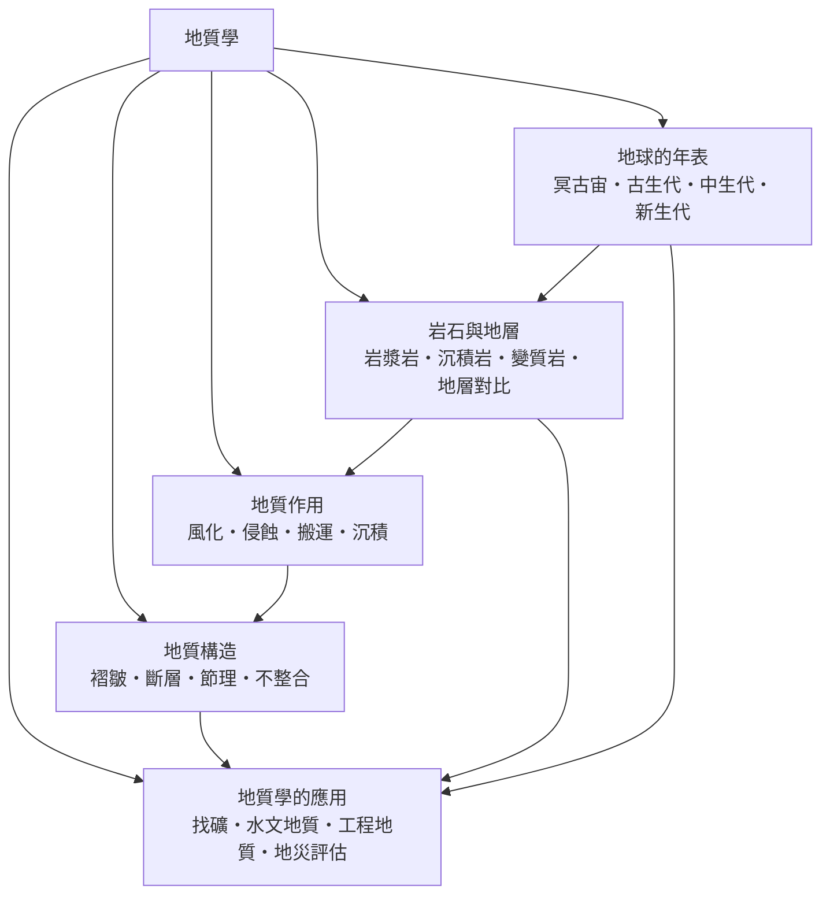

# 地質學

> 隸屬：第一層 [理]　·　相關分類：[地球與大氣科學]、[化學]、[物理學]、[生物學]　·　子分類總表見 [README]

> 對應維基百科：[中文維基百科：地質學](https://zh.wikipedia.org/wiki/%E5%9C%B0%E8%B4%A8%E5%AD%A6)　·　[English Wikipedia: Geology](https://en.wikipedia.org/wiki/Geology)

地質學研究地球的**物質構成、內部作用與歷史演化**，核心對象是岩石、構造與地球表面經歷過的過程。它要回答的典型問題是：這塊岩石是怎麼形成的？這座山是怎麼抬升起來的？這層沉積物有多老？地球上的生命出現之前是什麼樣子？

地質學與其他自然科學最大的不同，是它必須同時處理**極長的時間**與**不可重演的過程**。化學可以在實驗室裡重做一次反應，物理可以把實驗搬到太空站，但一次造山運動、一場古海洋的升降，無法重演。因此地質學的核心方法不是「操縱變因」，而是**從現存紀錄推論過去過程**——也就是 [萊伊爾] 在 1832 年確立的均變說：現在可觀察的過程，也是過去塑造地球的過程。

這門學科因此形成兩條腿：地質學家一邊讀取**岩層與構造的紀錄**，一邊用**物理與化學的定量工具**去測量它們。沒有後者，地質學只能停在描述；沒有前者，物理與化學就只能處理被操縱過的系統。

## 核心問題

1. **地球由什麼組成、經歷過哪些階段？** 這是 [地球的年表] 回答的問題：從冥古宙到新生代，四十六億年的地質時間被劃分為可對比的單位，並以絕對年齡與生物地層兩種方法標定。
2. **物質如何被分類、這些物質如何形成？** 這是 [岩石與地層] 回答的問題：岩漿岩、沉積岩、變質岩三大類的生成條件，以及地層之間如何依化石與岩性對比。
3. **地球表面與內部如何被改造？** 這是 [地質作用] 與 [地質構造] 分別回答的問題：前者處理風化、侵蝕、搬運、沉積這一組塑造地貌的過程，後者處理岩體本身被擠壓、拉張與剪斷所留下的褶皺、斷層與不整合。
4. **這些知識能做什麼？** 這是 [地質學的應用] 回答的問題：找礦、水文地質、工程地質與地災評估，把地質學從解讀過去的學問，轉成決策現實的工具。

四者的順序不能倒：先有年表框架，才談得上構造與作用；先看懂岩石與過程，才談得上應用。而應用所產生的新資料（例如鑽井、探勘地震）又不斷回頭修正年表與構造模型。

## 因果鏈

1. **礦坑與道路的經驗累積**：16 至 18 世紀的礦業開採與運河工程，讓人們注意到岩層有固定順序、化石在不同岩層中重複出現，於是先有「地層是書頁」的直覺。
2. **相對年齡的建立**：[史多佛尼] 整理出地層疊置律與化石群原理，提供了不依賴絕對計時的相對年齡方法，這是地質學第一塊真正的地基。
3. **均變說的提出**：[萊伊爾] 在《地質學原理》中主張現今過程可解釋過去紀錄，使地質學從「災變式奇蹟的記錄」轉為可累積、可推論的科學。
4. **生物地層與年代對比**：19 世紀後期，化石被系統用於劃分地質年代，地質學與 [生物學] 從此綁在一起——地層的年代表同時是生命的年代表。
5. **絕對定年的出現**：20 世紀初放射性同位素定年成熟（1907 年即有鉀－氬法），地質時間尺度第一次被錨定在物理常數上，四十六億年的地球年齡由此確立。
6. **板塊構造的革命**：1960 年代海底擴張與古地磁證據成熟，[1912年] [韋格納] 的大陸漂移說重新獲得解釋力，地球科學從「靜態的分類學」轉為「機制科學」。
7. **遙測與數值方法**：1960 年代起的人造衛星提供連續的地表觀測、地震網提供深部資料，數值模型讓板塊構造從論說進入可計算階段。
8. **面向社會的應用**：礦產資源枯竭、地下水開採與災害風險，把地質學推向城市規劃、環境評估與能源開發的現場。

## 子分類的定位與相互驅動

- [地球的年表] 是**時間軸**：它提供地質學賴以說話的坐标系。若沒有可靠的年代對應，任何「這層比那層老」的推論都只是敘述。
- [岩石與地層] 是**物質基礎**：岩石分類與地層對比把混亂的露頭整理成可比的紀錄，兩者的成果再餵給年表與構造解讀。
- [地質作用] 是**過程**：風化到沉積的循環說明地表如何被改造，也解釋了搬運物如何變成沉積岩——它是岩石與構造之間的動態橋樑。
- [地質構造] 是**檔案**：褶皺、斷層與不整合是應力與時間留下的痕跡，讀懂它們，地質學家才能還原山脈、海溝與古海的歷史。
- [地質學的應用] 是**出口與回饋**：鑽井、探勘與地質災害調查帶來新資料，也帶來新的方法需求，反過來推動儀器與模型。

## 範例：兩種定年方法如何互相驗證

假設在野外發現一組含煤層的沉積岩，煤層中夾有蕨類葉 [化石]，其上覆岩層中出現三葉蟲。請判斷這套地層的年齡。

1. **相對年齡（生物地層）**：三葉蟲是古生代晚期到中生代早期的代表類群，因此含三葉蟲的岩層必定晚於含蕨類葉化石的煤層（煤層常見於石炭紀—二疊紀的成煤環境）。這一步只給出**次序**，不給出數值。
2. **絕對年齡（放射性定年）**：若對與煤層共生的火山灰夾層測得放射鉛同位素年齡為 2.98 億年，則煤層與三葉蟲層都落在古生代末期附近。
3. **一致性檢查**：2.98 億年對應二疊紀末，符合生物地層的推論；兩種獨立方法互相支持，這正是地質學建立可信度的標準做法。
4. **核對數學**：以碳十四定年為例，其半衰期為 5,730 年，若樣本測得原有碳十四的四分之一（ $1/4$ ），則經過兩個半衰期，年代為 $t = 5730 \times 2 = 11460$ 年。
5. **推論**：煤層的生成需要溫暖潮濕、沼澤廣布的環境，加上其上覆海相地層的出現，可進一步推論此區在這段時間裡經歷了「陸地化沼澤 → 海侵」的環境轉變。

這個例子顯示地質學的典型工作流：**先由紀錄建立次序，再用物理量錨定數值，最後回到沉積環境解釋成因**。

## 容易混淆之處

- **地質學不等於地球與大氣科學**：後者著重地球系統的整體耦合與觀測方法，地質學著重岩石、構造與歷史解讀；兩者共享地震與遙測資料。
- **地質年代與地層厚度不能直接換算**：沉積速率在各地各時代差異極大，厚層不代表長期，慢堆積也不代表穩定。
- **化石不是「用來證明演化」**：化石是重建當時環境與生命組合的資料，演化論的成立靠的是可檢驗的機制，而非化石的數量。
- **不整合不是「錯誤」**：它代表時間 gap（缺失的時間），常是不整合面上下岩層分別代表不同沉積環境的結果，本身是重要資訊。
- **岩石的「年齡」有兩種**：結晶年齡（冷卻或結晶時的絕對年齡）與沉積年齡（顆粒最後沉積的時間）可能相差很大，例如經沉積作用後再生的花崗岩。
- **均變說不等於「世界從不改變」**：均變說主張的是**過程的種類**不變，不是速率、參數與結果不變。

## 延伸閱讀

- [地球與大氣科學]：地質學的姊妹分類，處理地球系統的整體耦合。
- [化學]：礦物成分、同位素與反應速率的定量來源。
- [物理學]：地震波、重力與熱流的理論基礎。
- [生物學]：[演化] 與 [生物多樣性] 的時間框架由地質年表提供。
- [數學]：年代模型、統計地層學與誤差處理的工具。
- [萊伊爾]、[史多佛尼]、[韋格納]：三位把地質學變成現代科學的人物。

## 連結定義

[理]: ../理/README.md
[README]: README.md
[地球與大氣科學]: ../地球與大氣科學/README.md
[化學]: ../化學/README.md
[物理學]: ../物理學/README.md
[生物學]: ../生物學/README.md
[數學]: ../數學/README.md
[地球的年表]: 地球的年表.md
[岩石與地層]: 岩石與地層.md
[地質作用]: 地質作用.md
[地質構造]: 地質構造.md
[地質學的應用]: 地質學的應用.md
[演化]: ../生物學/演化.md
[生物多樣性]: ../生物學/生物多樣性.md
[化石]: ../物/化石.md
[萊伊爾]: ../人/地球科學家/萊伊爾.md
[史多佛尼]: ../人/地球科學家/史多佛尼.md
[韋格納]: ../人/地球科學家/韋格納.md
[1912年]: ../時/1912年.md
