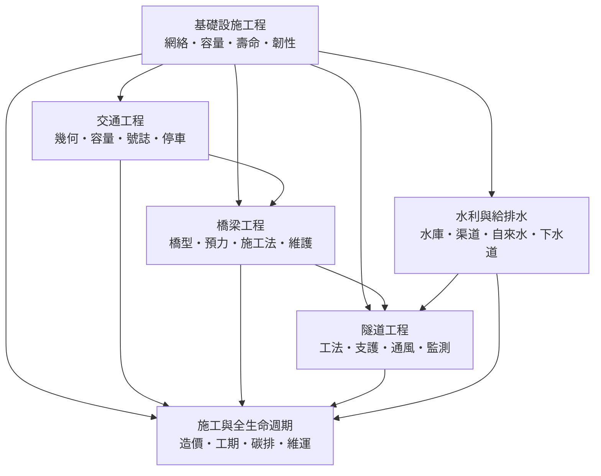

# 基礎設施工程

> 隸屬：第一層 [工]　·　相關分類：[土木工程]、[結構力學]、[流體力學]、[都市規劃]　·　子分類總表見 [README]

> 對應維基百科：[中文維基百科：基础设施](https://zh.wikipedia.org/wiki/%E5%9F%BA%E7%A1%80%E8%AE%BE%E6%96%BD)　·　[English Wikipedia: Infrastructure](https://en.wikipedia.org/wiki/Infrastructure)

基礎設施工程是**土木工程中專門處理「網路型公共設施」的分支**。它把 [土木工程] 的力學與施工能力，組織成道路、橋梁、隧道、水庫、渠道、給水管網與下水道這些**彼此連成系統的網絡**。

它與單一結構工程的差別，在於**尺度與耦合**。一棟大樓是一個獨立物件：地基壞了只影響自己。一條高速公路、一個都會區的排水系統則是網絡：其中一段的容量不足，會把流量擠壓到其他路段，把壽命問題變成全網的瓶頸；地下管網的漏水、暴雨時的內涝，會同時衝擊交通、衛生與公共安全。

因此基礎設施工程的核心問題不是「怎麼把這條路蓋好」，而是**「整個系統在尖峰、失效與衰退狀態下，還能不能運轉」**。這使得它必須同時處理三種尺度：單一構造物的強度、系統的容量與瓶頸、以及長期的汰換與維運節奏。

## 核心問題

1. **容量與需求**：系統的通行能力（或輸水能力、排水能力）有多少，尖峰需求是多少，瓶頸在哪一段？交通工程與水利給排水的問題本質相同，只是流量來源不同。
2. **幾何與結構的取捨**：路線的平面線形、縱坡、曲率半徑不僅影響行車舒適與安全，也直接決定橋梁、隧道、擋土牆與排水設施的數量與造價——**幾何是造價的第一驅動因素**。
3. **跨越與穿越的工程手段**：河谷、城市、既有交通走廊、山嶽各有其最適合的跨越或穿越方式；橋型選擇與隧道工法是基礎設施工程最具個性的兩道決策。
4. **水與環境的系統問題**：水庫與渠道要處理水量平衡、水位與生態流量；都市給排水要在雨天能把水送走、在乾天能維持壓力。
5. **全生命週期與韌性**：造價不只是一次建造費，還包含營運、維護、更新與最終退役；[永續土木] 的碳排與韌性要求，都必須在這個尺度上評估。

## 因果鏈

1. **道路網的出現**：19 世紀的工業化與汽車普及，使車道、交叉口與路基設計從地方性作法走向系統；[1950年] 美國《公路容量手冊》把通行能力變成可計算的量。
2. **結構技術的成熟**：鋼與預力技術成熟，使大跨度橋梁成為可能，長距離的連續梁與斜拉橋逐漸挑戰傳統跨度的極限。
3. **地下工程技術的突破**：[1818年] 盾構專利開啟了機械化掘進的百年歷程；當代大型盾構機讓都市地下隧道與深埋排水幹管成為可行方案。
4. **水利與都市化的耦合**：水壩與渠道支撐農業與工業，卻也改變下游生態與泥沙平衡；都市化則把給排水從「水井與渠道」推向中央化管網系統。
5. **壽命週期管理的出現**：二戰後的大規模建設在 1970 至 1990 年代集中到達設計壽命，維護支出急遽上升，橋梁檢測、病害評估與修復技術因此成為獨立領域。
6. **全生命週期與數位化**：造價估算、工期模擬與碳排計算被整合進同一套參數模型，協助在方案階段就比較各選項的總成本。
7. **韌性與永續的要求**：極端氣候使既有設施的設計條件迅速過時；韌性設計與低碳工法從附加要求變成基本要求。

## 子分類的定位與相互驅動

- [交通工程] 是**需求端與路網端**：它決定流量從哪裡來、往哪裡去，並以幾何與號誌回應需求；它是基礎設施工程中唯一以「使用者的行為」為輸入的子分類。
- [橋梁工程] 是**跨越的結構端**：當障礙無法用填方或改線解決時，橋梁是唯一選項；橋型選擇又把幾何、淨空、水文與造價綁在一起。
- [隧道工程] 是**穿越的結構端**：與橋梁互補；隧道多了支護、通風與火災風險的議題，因此對監測的依賴更強。
- [水利與給排水] 是**水循環端**：水庫與渠道調控天然水文，自來水與下水道則服務都市；它與交通工程共用「容量—需求—瓶頸」的方法論。
- [施工與全生命週期] 是**整合與評價端**：把前述各專科的成果換算成造價、工期、碳排與維運策略，供方案比較；它是五者共同的收口。

## 範例

**範例一：同一段交通走廊的三種穿越。** 某都會區的南北快速道路需穿越一條河流與一條既有鐵路：

- **橋梁**：造價與工期較高，但無需中斷鐵路營運，通車後維護成本可預期。
- [隧道工程] **隧道**：造價更高、工期更長，但可一次解決河流與鐵路的雙重阻隔，且免除橋梁的淨空與景觀衝擊。
- **立體交叉（鐵路下挖、道路上架）**：工期中等，但施工期間必須維持鐵路營運，風險集中在既有交通的保護上。

**這道選擇的真正依據，是「全生命週期成本 + 施工期交通維持成本 + 災害韌性」的加權，而不是初期造價。**

**範例二：都市排水系統的容量瓶頸。** 某市區有 400 公里的雨水管網，管徑自 $600\,\mathrm{mm}$ 至 $2{,}000\,\mathrm{mm}$ ：

- 依暴雨強度公式，某 5 年重現期降雨下，模型顯示管網可容納約 82% 的降雨量，剩餘 18% 需由路面暫滯與抽水站處理。
- 瓶頸集中在舊城區三條幹管：其管徑與坡度在二次大戰前後定案，未隨城市擴張而改建。
- 若全面換管，費用高昂且必須長期封路；**替代方案是「分區截流 + 滯洪池 + 綠化滲透」**，即把一部分流量導入非管網途徑。
- 這正是 [水利與給排水] 的「下水道」與 [施工與全生命週期] 的「工期」與「維運策略」交會的地方——**方案的關鍵不是把水送得更快，而是讓一部分水不必被送走。**

**範例三：一座橋的壽命與碳排。** 某跨海橋預鑄預力混凝土箱梁，設計壽命 100 年：

- 初期的碳排主要來自水泥與鋼材的生產。
- 若在第 40 年選擇重建，第二次的碳排加上施工期的交通替代成本（社會成本）會顯著高於**在第 40 年做一次 $10\,\mathrm{m}$ 的橋面與排水維護**。
- 因此「維護檢測」不只是安全議題，也是最有效的減碳手段之一——這把 [施工與全生命週期] 的「碳排」與「維運策略」兩項直接串起來。

## 容易混淆之處

- **基礎設施不等於「公共建設」**：自來水、瓦斯、電力、通信、污水處理都屬於基礎設施，但基礎設施工程指的是以土木構造物為主體的那一部分。
- **橋梁與隧道不是同一件事的兩種做法**：兩者的壽命、造價結構、風險型態與維護模式都不同，不能只比初期造價。
- **容量分析不等於需求分析**：通行能力是系統的物理上限，需求是行為與經濟的產物；投資不足會讓容量成為瓶頸，但盲目擴容也可能誘發新的需求。
- **「水庫」不只是一個蓄水容器**：它是水量平衡、防洪、發電與生態調度的共同節點，其下游影響可能延伸到數百公里外。
- **維護費不是「零星支出」**：在設施老化期，維護常佔生命週期成本的大宗；把它排除在方案比較之外，是常見的重大誤判。

## 延伸閱讀

- [土木工程]：本分類所屬的上位概念。
- [結構力學]：橋梁、隧道襯砌與水工結構的力學基礎。
- [流體力學]：渠道、水庫、排水與通風的水力計算。
- [水利工程]：與水利與給排水互為相鄰的水系工程分支。
- [都市規劃]、[城市]：路網與管網的空間組織。
- [地質學]：隧道與基礎的地層前提。
- [碳循環]、[地球與大氣科學]：碳排核算與氣候情境。
- [盾構機]、[預力混凝土]、[瀝青]：基礎設施的三種代表性材料與機具。

## 連結定義

[城市]: ../城市/README.md

[工]: ../工/README.md
[README]: README.md
[土木工程]: ../土木工程/README.md
[結構力學]: ../結構力學/README.md
[流體力學]: ../流體力學/README.md
[都市規劃]: ../都市規劃/README.md
[水利工程]: ../水利工程/README.md
[地質學]: ../地質學/README.md
[碳循環]: ../碳循環/README.md
[地球與大氣科學]: ../地球與大氣科學/README.md
[永續土木]: ../土木工程/永續土木.md
[交通工程]: 交通工程.md
[橋梁工程]: 橋梁工程.md
[隧道工程]: 隧道工程.md
[水利與給排水]: 水利與給排水.md
[施工與全生命週期]: 施工與全生命週期.md
[盾構機]: ../物/盾構機.md
[預力混凝土]: ../物/預力混凝土.md
[瀝青]: ../物/瀝青.md
[1950年]: ../時/1950年.md
[1818年]: ../時/1818年.md
