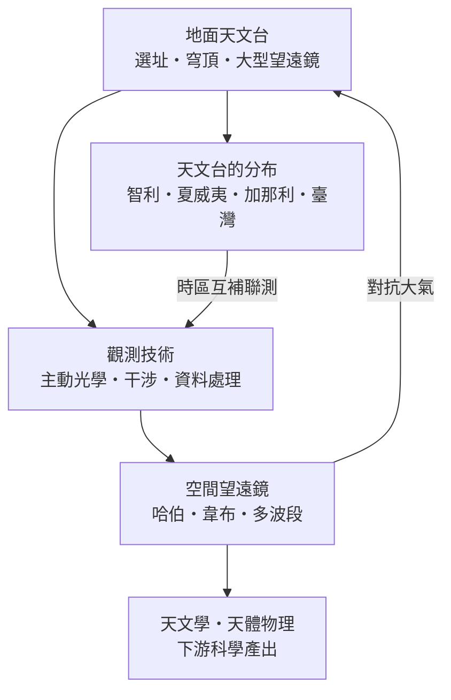

# 天文台

> 隸屬：第一層 [天]　·　相關分類：[天文學]、[物理學]、[望遠鏡]　·　子分類總表見 [README]

> 對應維基百科：[中文維基百科：天文台]　·　[English Wikipedia: Observatory]

天文台是天文學的「工廠」：把觀測需求轉化為資料的地方。它解決的核心問題是——**如何把一台精密儀器放在地球上（或地球軌道上）最合適的位置，讓它在數十年間穩定地蒐集宇宙訊號**。望遠鏡只是鏡筒與鏡片，天文台則是讓望遠鏡發揮全部潛力的系統工程：選址、建築、環境控制、儀器整合、資料管線缺一不可。因此天文台的概念遠大於「有台望遠鏡的房子」，它是儀器、地理、氣象、軟體與人力資源的綜合體。

## 核心問題

天文台的問題可以拆成四個層次：

1. **選哪裡**：大氣是最大的敵人——雲、水汽、光害、湍流都在破壞訊號；選址就是在大氣中找「透明的窗戶」。
2. **怎麼蓋**：望遠鏡需要穩定的溫度、無震動的地基、能日夜切換的穹頂；建築本身就是儀器的一部分。
3. **怎麼看**：單鏡口徑有物理極限（鏡面自重變形），必須靠主動光學、干涉陣列與太空平台突破。
4. **資料去哪**：現代天文台每晚產生數 TB 資料，處理、歸檔、開放取用成為台本體之外的第二座工廠。

第四層的規模感可以用數字說明：大型巡天望遠鏡單晚影像可達數十 TB，相當於把整座中型圖書館的內容每夜重新掃描一次；沒有自動化管線，人力根本無法消化。

## 因果鏈

1. **瓶頸：裸眼與小型儀器的極限**。伽利略時代的天文觀測靠個人在庭院完成，口徑與穩定性都太小，暗弱天體與細節結構不可及。
2. **解法：專用建築與大口徑**。十八至十九世紀大學與王室設立專職觀測站，子午儀定時、折射鏡巡星；天文台成為國家科學機構的標配。
3. **光學玻璃革命**。十九世紀末巨型折射鏡達極限（透鏡自重下垂），轉向反射鏡路線，20 世紀上半葉胡克 2.5 公尺鏡證明大反射鏡可行，遙遠星系的世界自此打開。
4. **選址科學化**。戰後天文學家系統比較全球高山台址，發現智利阿塔卡馬、夏威夷毛納基等「大氣窗口」，地面天文台的地理格局就此定型。
5. **太空平台的登場**。大氣對紅外、紫外與 X 射線近乎不透明，[1990年] 發射的哈伯太空望遠鏡把「離開大氣」變成觀測策略的正式選項。
6. **技術對抗物理極限**。主動光學與調適光學抵消鏡面變形與大氣湍流，干涉量測把解析度推過單鏡極限，地面望遠鏡重新追平並超越太空望遠鏡的部分能力。
7. **資料與開放時代**。巡天與自動化使天文台變成「資料服務業」，遠端觀測、時間申請制與公開檔案庫成為常態，天文學進入大科學模式。

## 子分類的定位與相互驅動

### 地面天文台

[地面天文台] 是最傳統也仍然最重要的型態：[選址] 決定成敗（乾燥、高海拔、無光害），[穹頂] 保護儀器並調節熱平衡，[環境] 管理包含光害防治與暗空保護，[大型望遠鏡] 則是地面路線的終極載體。地面台的成本遠低於太空任務、可持續升級，是觀測天文學的主力軍。

### 空間望遠鏡

[空間望遠鏡] 回答「大氣不透明怎麼辦」：[哈伯] 開創可維修大型太空望遠鏡的範式，[韋布] 把紅外觀測推到極致，[紅外與X射線] 說明不同波段需要不同的太空平台，[極大型] 則是下一代的設計競賽。空間與地面是互補而非取代——太空看暗與遠，地面看快與多。

### 觀測技術

[觀測技術] 是天文台的「軟實力」：[主動光學] 讓鏡面即時自我矯正，[干涉量測] 把多台望遠鏡合成一台虛擬巨鏡，[雷達] 為太陽系內天體提供主動探測，[資料處理] 把訊號變成可發表的科學。沒有這層技術，再大的鏡子也只是收集光子而無法轉化為知識。

### 天文台的分布

[天文台的分布] 是全球地理的政治經濟學：[智利] 的阿塔卡馬沙漠是北半球之外最優質的乾燥高台，[夏威夷] 的毛納基是北半球最佳台址（也是原住民權利爭議的現場），[加那利] 服務北大西洋觀測網，[臺灣] 則參與跨國望遠鏡計畫切入國際行列。分布研究也包含時區互補——跨洲台網可以連續追蹤瞬變天體。

## 範例

以**韋布太空望遠鏡（JWST）**看天文台概念的全要素。選址：它選了拉格朗日 L2 點——距地球 150 萬公里的重力平衡區，讓遮陽板同時擋住太陽、地球與月球的紅外背景，這是「選址」思想推到極致的太空版。建築：6.5 公尺鍍金拼接主鏡須在火箭整流罩內折疊，於 [2021年] 發射後在軌道上分數百個步驟展開，任何一步失敗即全盤皆輸——穹頂與地基的地面工程學在此變成展開機構學。技術：為探測 130 億年前第一批星系的紅移光，感測器須冷至攝氏零下 233 度。分布與協作：JWST 由 NASA、ESA、CSA 三方共建，觀測時間向全球天文學家開放申請——「分布」在太空時代變成國際治理問題。這個案例說明：天文台的本質從未改變——把儀器放到訊號最好的地方——改變的只是「地方」可以遠至 150 萬公里外。

## 容易混淆之處

- **天文台不等於望遠鏡**：望遠鏡是主儀器，天文台是包含建築、環境、儀器、資料與人員的系統；一台偉大的望遠鏡配錯台址就會平庸。
- **口徑不是唯一指標**：台址視寧度、儀器靈敏度與觀測時間分配同樣決定科學產出；小鏡在好台址可能勝過大鏡在爛台址。
- **太空望遠鏡不一定比地面強**：口徑與維修性上地面大型望遠鏡往往佔優；太空的優勢是波段透明與穩定，兩者是分工。
- **「天文台」一詞的歷史用法**：早期也指氣象或地磁觀測站（如格林尼治天文台兼具時間功能），今日則專指天體觀測設施。
- **業餘天文台也算天文台**：後院圓頂、學校觀測室在結構上與專業台同構，只是規模不同。

## 延伸閱讀

- 第一層總覽見 [天] 入口頁；觀測科學本身見 [天文學]。
- 天體的物理解釋見 [物理學] 與相關概念資料夾。
- 望遠鏡作為物品的技術史見 [望遠鏡]。
- 星座與天球座標是天文台排程與指向的語言，見 [星座]。
- 各子分類細節請由 [README] 分類表進入。

## 連結定義

## 連結定義

[1990年]: ../時/1990年.md
[2021年]: ../時/2021年.md
[English Wikipedia: Observatory]: https://en.wikipedia.org/wiki/Observatory
[README]: README.md
[中文維基百科：天文台]: https://zh.wikipedia.org/wiki/%E5%A4%A9%E6%96%87%E5%8F%B0
[主動光學]: 主動光學.md
[加那利]: 加那利.md
[哈伯]: 哈伯.md
[地面天文台]: 地面天文台.md
[夏威夷]: 夏威夷.md
[大型望遠鏡]: 大型望遠鏡.md
[天]: ../天/README.md
[天文台的分布]: 天文台的分布.md
[天文學]: ../天文學/README.md
[干涉量測]: 干涉量測.md
[星座]: ../星座/README.md
[智利]: 智利.md
[望遠鏡]: ../物/望遠鏡.md
[極大型]: 極大型.md
[物理學]: ../物理學/README.md
[環境]: 環境.md
[穹頂]: 穹頂.md
[空間望遠鏡]: 空間望遠鏡.md
[紅外與X射線]: 紅外與X射線.md
[臺灣]: 臺灣.md
[觀測技術]: 觀測技術.md
[資料處理]: 資料處理.md
[選址]: 選址.md
[雷達]: 雷達.md
[韋布]: 韋布.md
