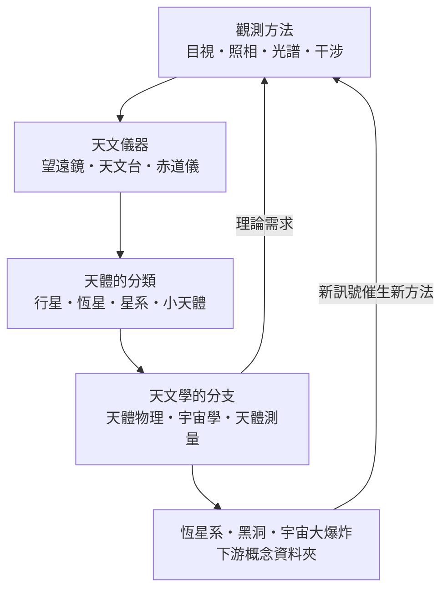

# 天文學

> 隸屬：第一層 [天]　·　相關分類：[物理學]、[數學]、[地球與大氣科學]　·　子分類總表見 [README]

> 對應維基百科：[中文維基百科：天文學]　·　[English Wikipedia: Astronomy]

天文學是研究宇宙中天體——行星、恆星、星系乃至整個宇宙——的位置、運動、結構與演化的科學。它解決的核心問題是：**在無法把研究對象放進實驗室的前提下，如何只憑抵達地球的微弱訊號，推論出億萬光年之外的物理事實**。因此天文學從一開始就與測量技術、數學工具和物理理論密不可分：古代文明用它制訂曆法與導航，牛頓用行星運動催生出萬有引力，二十世紀的觀測則直接餵養了相對論與宇宙學。

## 核心問題

天文學的問題可以拆成四個層次：

1. **測量**：天體在哪裡、多遠、多大？（天體測量與距離階梯）
2. **分類**：天上那些光點是什麼？（行星、恆星、星系、小天體的分類體系）
3. **物理解釋**：它們為何發光、為何移動、為何演化？（把物理學定律套用到天體上）
4. **整體綜合**：把所有天體放在一起，宇宙的歷史與命運是什麼？（宇宙學）

量測距離的基本工具是視差：地球繞太陽公轉半年，近距離恆星相對遠景移動的角度為 $p$ 角秒，距離即為 $d = 1/p$ 秒差距。視差只能涵蓋幾百秒差距，更遠的天體必須靠造父變星週光關係、Ia 型超新星等「標準燭光」一級級往上推，這就是天文學的**距離階梯**。量測運動則靠都卜勒效應：譜線波長的相對位移 $\Delta\lambda/\lambda \approx v/c$ 直接給出天體的視向速度。

## 因果鏈

1. **瓶頸：裸眼解析度有限**。古代天文學精確到約 1 角分，只能記錄位置與週期，開普勒仍須依賴第谷累積數十年的裸眼觀測才能導出橢圓軌道。
2. **解法：望遠鏡登場**。1609 年 [伽利略] 把 [望遠鏡] 指向天空，[1609年] 前後解析度與集光力各躍升一個量級，月面、木衛、金星相位一一現形，地心說的觀測支柱開始崩塌。
3. **解法帶動理論**。更多且更精的資料反過來逼出更好的理論：牛頓以行星運動為動機建立力學體系，天文學與物理學自此互相供養。
4. **儀器持續升級**。照相術取代目視記錄、光譜儀把星光拆成物理實驗室、干涉技術把解析度推過單鏡極限；每一步都在「測量」層次打開新問題。
5. **分類體系成形**。觀測到的天體越來越多且型態各異，迫使天文學建立行星、恆星、星系、小天體的分類，分類又暴露出「恆星為何有不同顏色」這類新謎題。
6. **分支學科誕生**。以物理解釋天體的 [天體物理] 成長為主軸，行星科學、宇宙學、天體測量各自聚焦不同尺度，分工使問題可以並行推進。
7. **資料時代的質變**。巡天與太空望遠鏡讓樣本從數千暴增到數十億，天文學家的工作重心從「看影像」轉為「管理與分析資料」，機器學習成為標準工具。
8. **回饋物理學**。天文觀測反過來成為極端物理的實驗室：從光線偏折到黑洞影像，宇宙是唯一能檢驗強場重力與高能過程的場所。

## 子分類的定位與相互驅動

### 觀測方法

[觀測方法] 負責回答「資料從哪裡來」：從古代的目視記錄、十九世紀的照相乾版，到光譜分解與干涉技術，每一種方法都把某個物理量（位置、亮度、溫度、視向速度）變成可量測的數字。它是一切的起點——沒有新的觀測手段，後面的理論就無米下鍋；反過來，理論預測的訊號（如氫 21 公分譜線）又會催生新的觀測方法。

### 天文儀器

[天文儀器] 把方法做成工具：望遠鏡、子午儀、赤道儀與天文台。儀器與方法是同一枚硬幣的兩面——方法指出要量什麼，儀器決定量得多準；大型天文台的興建更把天文學變成一門需要國家級資源投入的事業，塑造了現代大科學的模式。

### 天體的分類

[天體的分類] 是天文學的資料骨架：把觀測對象分成行星、恆星、星系與小天體。分類看似只是整理，實際上每一次分類修正都伴隨重大理論躍遷——冥王星在 2006 年被重分類為矮行星，就是「行星」定義被觀測證據逼著更新的實例。分類也決定了儀器設計：要找暗弱的小天體就須大視場巡天，要解析星系核心就須干涉陣列。

### 天文學的分支

[天文學的分支] 把物理套到各類天體上：[天體物理] 研究輻射機制與演化、行星科學研究行星系統、宇宙學研究整體時空、天體測量追求極致精度。分支依賴前三者的供養——觀測提供資料、儀器提供能力、分類提供對象——同時又以理論需求回頭驅動觀測與儀器的升級。

## 範例

以海王星的發現完整走一遍天文學的流程。1781 年赫歇爾憑改良的望遠鏡發現天王星；之後數十年，天文學家發現它的位置與牛頓力學的預測持續偏離。1846 年勒維耶假設偏差來自一顆未知行星，用萬有引力反推出它應在的位置；同年 9 月 23 日，伽勒在柏林天文台依預測座標搜尋，[1846年] 當晚就在預測位置約 1 度內找到海王星。這個案例裡，觀測方法（位置測量）提供偏差、儀器（望遠鏡與星表）提供精度、分類（「行星」）提供概念框架、分支（天體力學）提供反推的數學——四個子分類在一次發現中全部到場。

## 容易混淆之處

- **天文學不等於占星術**：占星術主張天體位置影響人間事務，沒有可重複驗證的機制與證據；天文學是可否證的實證科學。
- **天文學與天體物理的界線已模糊**：狹義上前者側重觀測與測量、後者側重物理解釋，但今日兩者幾乎合流，本概念仍依歷史脈絡分列。
- **「星系」與「恆星系」**：「恆星系」是「星系」的舊譯名，現代用法指由恆星、氣體、塵埃與暗物質構成的重力束縛系統（如銀河系），不是「行星系」。
- **光年不是時間單位**：它是光走一年的距離，約 9.46 兆公里。
- **望遠鏡越大不只看得越清楚**：集光力（正比於主鏡面積）往往比解析度更關鍵，因為多數天體的瓶頸是太暗而不是太小。

## 延伸閱讀

- 第一層總覽見 [天] 入口頁，同層還有 [氣象學] 等大氣科學分支。
- 想看天文學如何把物理推到極端，請前往 [黑洞]、[宇宙大爆炸] 與 [暗物質]。
- 恆星、星座與星系的系統性整理見 [恆星系]。
- 地面觀測設施的運作方式見 [天文台]。
- 天文學與地球科學的交界（如大氣視寧度對觀測的影響）見 [地球與大氣科學]。

## 連結定義

[天]: ../天/README.md
[README]: README.md
[物理學]: ../物理學/README.md
[數學]: ../數學/README.md
[地球與大氣科學]: ../地球與大氣科學/README.md
[伽利略]: ../人/物理學家/伽利略.md
[望遠鏡]: ../物/望遠鏡.md
[1609年]: ../時/1609年.md
[1846年]: ../時/1846年.md
[觀測方法]: 觀測方法.md
[天文儀器]: 天文儀器.md
[天體的分類]: 天體的分類.md
[天文學的分支]: 天文學的分支.md
[天體物理]: 天體物理.md
[黑洞]: ../黑洞/README.md
[宇宙大爆炸]: ../宇宙大爆炸/README.md
[暗物質]: ../暗物質/README.md
[恆星系]: ../恆星系/README.md
[氣象學]: ../氣象學/README.md
[天文台]: ../天文台/README.md
[中文維基百科：天文學]: https://zh.wikipedia.org/wiki/%E5%A4%A9%E6%96%87%E5%AD%B8
[English Wikipedia: Astronomy]: https://en.wikipedia.org/wiki/Astronomy
