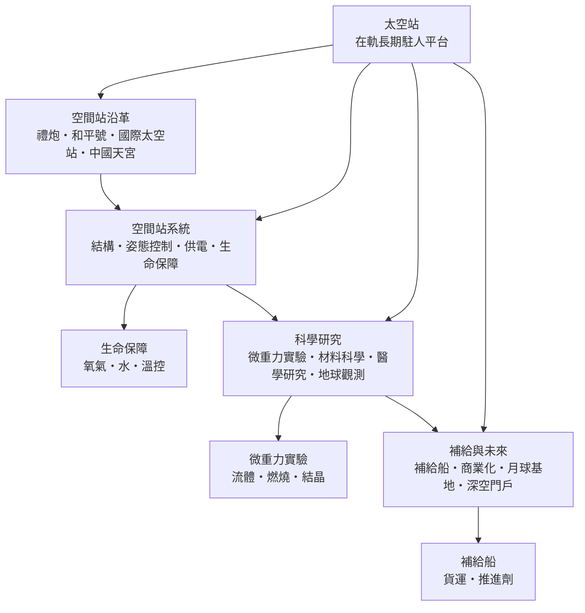

# 太空站

> 隸屬：第一層 [天]　·　相關分類：[載人航天]、[火箭]、[衛星]、[航空工程]、[材料學]　·　子分類總表見 [README]

> 對應維基百科：[中文維基百科：太空站](https://zh.wikipedia.org/wiki/%E7%A9%BA%E9%97%B4%E7%AB%99)　·　[English Wikipedia: Space station](https://en.wikipedia.org/wiki/Space_station)

太空站（又稱空間站、軌道站）是設計給**人長期駐留在地球軌道上**的大型航天器：它不像飛船那樣「上去—辦事—回來」，而是像一座停在軌道上的實驗室兼宿舍，由飛船定期接送人員與物資。自 1971 年（見 [1971年]）蘇聯把第一座禮炮一號送入軌道以來，太空站把載人航天（見 [載人航天]）從「幾天的里程碑任務」變成「以月、以年計的常態作業」，是載人航天活動最主要的在軌平台。

太空站解決的核心矛盾是：**火箭每公斤入軌成本極高，而許多科學與工程問題需要人在軌道上連續工作很長時間**。與其反覆發射一次性飛船，不如把一個大平台留在軌道上反覆使用——平台提供居住、供電、姿態維持與實驗環境，飛船只負責運人運貨。這個分工模式在國際太空站（見 [1998年]）上達到頂峰：它由十幾個國家分頭建造、接力補給，連續有人駐守已超過二十年，累積了數千項微重力實驗。

## 核心問題

一座太空站必須同時回答五個問題，缺一不可。

1. **怎麼立起來**：運載火箭的整流罩與推力有限，太空站只能分艙段發射、在軌組裝。對接機構、機械臂與艙外作業因此成為建站的基礎技術。
2. **怎麼不掉下來**：約 400 公里高的軌道仍有稀薄大氣阻力，若不維持，站體會在數月內墜入大氣。因此需要定期推進（推進艙、貨船發動機或地面指令抬升軌道），這是太空站與飛船最大的持續性差異。
3. **怎麼活著**：密閉環境裡要持續供氧、移除二氧化碳、處理水與廢物、控制溫濕度與細菌——生命保障系統必須連續運轉數十年而不能長期停機。
4. **怎麼供電與散熱**：站體每天繞地球約 16 圈，約一半時間處於地球陰影；太陽能電池陣列加上蓄電池是標準解，而真空環境中唯一的散熱手段是輻射，需要巨大的散熱板。
5. **人與貨怎麼來去**：載人與貨運飛船構成「班車系統」，對接窗口、緊急撤離與冗餘運力是任務規劃的日常難題。

這五問彼此牽制：軌道維持消耗推進劑，推進劑佔用補給噸位，補給噸位擠壓科學載荷——太空站工程史就是不斷優化這筆帳的歷史。

## 因果鏈

1. **登月之後的轉向**：1969 年（見 [1969年]）登月成功後，登月競賽失去目標，美蘇各自轉向「常駐近地軌道」；太空站成為新的競賽場，也是把昂貴火箭技術轉為持續產出的方式。
2. **從艙到站的第一步**：1971 年（見 [1971年]）禮炮一號入軌，證明人可以在軌道上連續駐留；早期站在軌道上用單一艙體一次發射，壽命短、空間小。
3. **模組化成熟**：蘇聯以禮炮六號、七號積累對接與補給經驗，1986 年（見 [1986年]）發射的和平號首次採用「核心艙＋多個對接實驗艙」的模組化構型，在軌服役十五年。
4. **國際合作**：冷戰結束後，美國邀請俄羅斯、歐洲、日本與加拿大共建國際太空站，1998 年（見 [1998年]）首艙入軌、2000 年 11 月起持續有人；太空站從國家工程變成國際工程。
5. **科學產出沉澱**：長期微重力環境使蛋白質結晶、流體物理、燃燒實驗與人體醫學研究得以做「在地面上做不了的版本」，實驗結果回流到 [材料學] 與 [生理學]。
6. **多國獨立體系**：2021 年（見 [2021年]）前後中國天宮空間站建成，採「核心艙＋兩個實驗艙」的路線，使近地軌道同時存在兩座常駐太空站。
7. **商業化接棒**：國際太空站預定退役後，商業公司規劃私營太空站接續；太空站的建設者從國家航天局擴大到企業，補給與載運也早已部分外包。

## 子分類的定位與相互驅動

- [空間站沿革] 是**經驗的時間軸**：禮炮驗證「能不能住」，和平號驗證「能不能模組化長期住」，國際太空站驗證「多國能不能一起住」，天宮驗證「新一代能不能更省地住」。每一代站的失敗與事故都直接寫進下一代的設計規範。
- [空間站系統] 是**工程的地基**：結構要經得起三十年的熱脹冷縮與微隕石撞擊，姿態控制要讓太陽翼與天線持續對準目標，供電與生命保障不能有單點失效。沒有系統工程，科學研究無從談起。
- [科學研究] 是**建站的理由**：微重力下的流體行為、燃燒、蛋白結晶與人體生理變化，只有在太空站上才能長期、重複地觀測；這些成果是說服各國繼續投資的核心論據。
- [補給與未來] 是**生存與擴張**：太空站每天都要消耗物資，補給船斷供數月站就得棄守；而月球基地與深空門戶把「常駐」的經驗推向地球軌道之外。

四者的關係是一個飛輪：沿革提供教訓 → 系統工程把教訓變成設計 → 設計支撐科學產出 → 科學產出換來下一代的預算與補給，站就一代一代蓋下去。

## 範例

**範例一：軌道衰減的數字。** 國際太空站運行在約 400 公里高度，大氣阻力使軌道每天下降約數十米至兩公里（視太陽活動強弱而定）。站體因此需要每年抬升數公里：通常由停靠的貨運飛船或進步號發動機在適當時機點火數分鐘完成。2021 年之前，若補給中斷且推進劑耗盡，站體會在數月內掉入密集大氣燒毀——這就是為什麼「補給」不只是送食物，還包括送推進劑。

**範例二：一天的電力帳。** 太空站的八組太陽能翼總長約 73 米，發電功率約 84 至 120 千瓦；每 92 分鐘繞地球一圈，其中約 36 分鐘處於陰影，此時由鎳氫蓄電池供電。生命保障、實驗設備、通訊與蓄電池充電都要在這筆電力預算內排程——大型實驗常被安排在日照段進行，這是地面實驗室從不需要考慮的排程維度。

**範例三：天宮的組裝路線。** 天宮採「一次核心、兩翼展開」的策略：2021 年 4 月天和核心艙入軌，同年 6 月神舟十二號送入首批三名航天員；其後問天、夢天兩個實驗艙於 2022 年先後交會對接，形成總重約 100 噸、可長期駐守三人的 T 字構型。整個建站過程用了約一年半，對比國際太空站動用數十次發射、耗時十餘年——模組化與對接技術的成熟，直接壓縮了建站時間表。

## 容易混淆之處

- **太空站不是太空梭**：太空梭是往返地面的載具，太空站是留在軌道的平台；太空梭退役後，站完全依賴一次性或可回收飛船接送人員。
- **失重不是沒有重力**：400 公里高度上地球引力約為地表的九成；站體與站內一切都在自由落體，才呈現「失重」。微重力實驗利用的正是這種狀態，而非「真空」。
- **空間站與空間探測器不同**：探測器前往月球、火星等深空目標，太空站固定繞地球運行；月球基地（未來）將是「另一顆天體上的站」，兩者技術相通但環境不同。
- **太空站不是永久建築**：所有站體都有壽命——和平號於 2001 年受控再入大氣銷毀，國際太空站亦計劃以引導再入的方式退役；「常駐」指的是「持續有人接替」，不是站體永存。
- **國際太空站不等於太空站**：它只是目前最大的一座；禮炮系列、天空實驗室、和平號與天宮都是太空站，且中國天宮至今仍在運行。

## 延伸閱讀

- [載人航天]：太空站是載人航天常態化的載體，逃逸、生命保障與返回技術共用。
- [火箭]：補給與組裝的運力來源，入軌成本決定站的規模上限。
- [衛星]：中繼通訊與地球觀測衛星是太空站科學產出的放大器。
- [航空工程]：返回艙的氣動與熱防護技術與航空工程同源。
- [材料學]：微重力材料實驗的成果落地處，也是站體結構材料的供給方。
- [和平號空間站]：模組化太空站的代表作，事故與教訓同樣豐富。
- [拜科努爾]、[肯尼迪太空中心]：兩大體系的主要發射場。
- [1971年]、[1986年]、[1998年]、[2021年]：三代太空站的關鍵年份。

## 連結定義

[天]: ../天/README.md
[README]: README.md
[載人航天]: ../載人航天/README.md
[火箭]: ../火箭/README.md
[衛星]: ../衛星/衛星.md
[航空工程]: ../航空工程/README.md
[材料學]: ../材料學/README.md
[空間站沿革]: 空間站沿革.md
[空間站系統]: 空間站系統.md
[科學研究]: 科學研究.md
[補給與未來]: 補給與未來.md
[和平號空間站]: ../物/和平號.md
[拜科努爾]: ../地/拜科努爾.md
[肯尼迪太空中心]: ../地/肯尼迪太空中心.md
[1971年]: ../時/1971年.md
[1969年]: ../時/1969年.md
[1986年]: ../時/1986年.md
[1998年]: ../時/1998年.md
[2021年]: ../時/2021年.md
[生理學]: ../生理學/README.md
