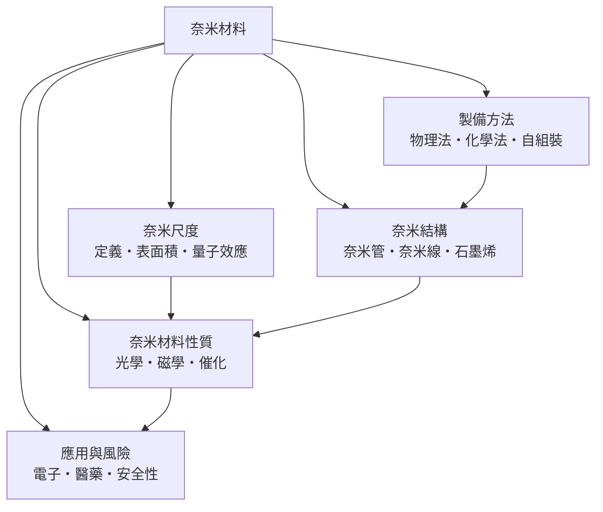

# 奈米材料

> 隸屬：第一層 [工]　·　相關分類：[材料工程]、[化學]、[物理學]　·　子分類總表見 [README]

> 對應維基百科：[中文維基百科：纳米材料]　·　[English Wikipedia: Nanomaterials]

奈米材料是**至少一個維度落在 1 至 100 奈米之間、且因此展現出與塊材不同性質的材料**。一百奈米大約是頭髮直徑的千分之一；在這個尺度上，材料表面原子占總原子數的比例急速上升，量子侷限效應開始出現，於是「同樣的化學成分，不同的物理世界」：金在奈米尺度會變成紅色甚至紫色的高效催化劑，惰性的石墨被剝成單層後搖身成為導熱導電皆頂尖的 [石墨烯]。

奈米材料的理論根據有二。其一是**表面積效應**（見 [表面積效應]）：比表面積與尺寸成反比，1 公克奈米級粉體的表面積可以達到數百平方公尺，表面能因此成為主導項，熔點下降、催化活性飆升、燒結溫度降低都由此而來。其二是**量子尺寸效應**（見 [量子尺寸效應]）：當尺寸小於電子的平均自由程或波長時，能階從連續的能帶變回分立的能階，半導體 [奈米點] 的發光波長可以直接由尺寸「調」出來。

1959 年 [費曼] 在著名演說〈底部還有很大空間〉中預言了在微小尺度上操縱物質的前景（見 [1959年]）；1980 年代掃描穿隧顯微鏡讓人第一次「看見」並搬動單顆原子；2004 年 [蓋姆] 與 [諾沃肖洛夫] 用膠帶撕出 [石墨烯]（見 [2004年]），並於 2010 年獲得諾貝爾物理學獎。奈米材料自此從實驗室奇珍走向 [半導體]、[再生能源] 與 [藥學] 的量產舞台。

## 核心問題

奈米材料的核心問題可以串成一句話：**如何在奈米尺度上大量、可控、安全地把「尺寸」變成一個新的設計變數**。

1. **尺寸如何改變性質**：比表面積、表面能與量子侷限如何定量地重塑熔點、光吸收與反應活性，是所有奈米設計的出發點。
2. **如何做出目標尺寸與形貌**：從 [物理法] 的蒸鍍濺鍍，到 [化學法] 的膠體合成，再到 [自組裝] 的分子級自動排列，製備方法決定了尺寸分布與缺陷密度。
3. **如何把性質翻譯成功能**：[催化] 的活性位、光學的局域表面電漿、磁學的超順磁極限，都是把奈米結構與工程需求對接的橋樑。
4. **如何量產與安全化**：從毫克實驗到噸級量產，粉體团聚、批次一致性與職業暴露管控，是奈米材料產業化的最後一哩路。

## 因果鏈

1. **顯微技術的瓶頸**：十九世紀以來，光學顯微鏡受限於繞射極限（約半個光波長），無法直接觀察小於 200 奈米的細節，材料科學只能「間接推論」微觀結構。
2. **電子束突破解析度**：1930 年代電子顯微鏡以波長遠小於可見光的電子成像，解析度推進到奈米級；1981 年掃描穿隧顯微鏡更達到原子級，人類第一次親眼「觸摸」表面原子。
3. **理論預言與早期實驗**：1960 至 70 年代，量子侷限與表面效應被系統化；1985 年富勒烯、1991 年碳 [奈米管] 相繼被發現，奈米結構成為獨立研究領域。
4. **膠體化學成熟**：1980 至 90 年代，金與硒化鎘奈米粒子的尺寸單分散合成被攻克，「調尺寸即調顏色」變成可重複的配方。
5. **石墨烯現身**：2004 年膠帶機械剝離得到單層石墨，二維材料的奇異性質（量子霍爾效應、超高載子遷移率）引爆全球研究熱潮。
6. **產業化落地**：化學機械拋光漿料、太陽能電池抗反射層、鋰電池電極與防晒乳的二氧化鈦，奈米材料悄悄進入量產供應鏈。
7. **風險與治理接棒**：奈米粒子能穿透細胞膜與血腦障壁的報告累積，[生物安全性] 與法規分級成為必修課，奈米材料在「性能紅利」與「暴露風險」之間尋找平衡。

## 子分類的定位與相互驅動

- [奈米尺度] 是**定義與理論地基**：先講清楚「多小才算奈米、為什麼小到這裡性質會變」，其餘子分類才有共同的語言。
- [奈米結構] 是**形狀的目錄**：零維的 [奈米點]、一維的 [奈米線] 與 [奈米管]、二維的 [石墨烯]，每一種維度對應一批獨特性質。
- [製備方法] 是**從理論到實物的轉化器**：物理法精度高但昂貴，化學法量大且柔軟，自組裝則把製造的負擔交給分子間的作用力。
- [奈米材料性質] 是**性能的翻譯機**：把結構參數（粒徑、表面修飾）翻譯成光學、磁學與催化性能，供下游選型。
- [應用與風險] 是**價值與責任的出口**：電子、醫藥與能源把奈米材料變成產品，[生物安全性] 則為整條產業鏈劃出紅線。

## 範例

**用尺寸調出想要的顏色。** 直徑約 2 奈米的硒化鎘 [奈米點] 發藍光，直徑約 6 奈米的發紅光——同一種化合物，僅改變粒子尺寸，發光波長就能從約 470 nm 連續調到約 640 nm。這是量子侷限的直接展示：粒子半徑小於激子波爾半徑（硒化鎘約 5.6 nm）時，能隙隨尺寸縮小而變寬，近似遵守有效質量模型

$$
E_g (R) \approx E_g^{\text{bulk}} + \frac{\hbar^2 \pi^2}{2 R^2} \left( \frac{1}{m_e^*} + \frac{1}{m_h^*} \right)
$$

其中 $R$ 為粒子半徑。顯示面板的量子點膜正是靠這條公式反向操作：先決定要哪個波長，再回推該長多大的粒子——「尺寸」在奈米世界裡是像成分一樣可設計的參數。

## 容易混淆之處

- **奈米材料不等於「很細的粉」**：真正的判準是性質是否因尺寸而改變；把普通微米粉體磨細一點並不會自動獲得量子效應。
- **表面積效應與量子效應是兩件事**：前者是熱力學與幾何的結果（任何材料都有），後者是電子波動性的結果（主要在半導體與金屬團簇）。
- **石墨烯不是「石墨磨細」**：石墨烯是單原子層的二維晶體，性質來自層內的大π鍵與狄拉克錐能帶；多層石墨薄片不具備單層的電子結構。
- **奈米銀的抗菌不等於奈米銀無害**：同樣的細胞穿透能力也作用於人體細胞與環境微生物，劑量與形態決定利弊。
- **「奈米」標籤常被行銷濫用**：法規上需要量測粒徑分布證明，僅在品名加「奈米」兩字不構成奈米材料。

## 延伸閱讀

- [材料工程]：奈米材料最大的應用下游，製程知識在此匯流。
- [半導體]：量子點與奈米線是次世代元件的候選結構。
- [化學]：膠體化學與表面化學是奈米合成的母體。
- [物理學]：量子力學與固態物理是奈米效應的理論根據。
- [再生能源]：量子點太陽能電池與奈米結構催化電極。
- [藥學]：奈米載藥與標靶遞送的醫藥應用。

## 連結定義

[工]: ../工/README.md
[README]: README.md
[材料工程]: ../材料工程/README.md
[化學]: ../化學/README.md
[物理學]: ../物理學/README.md
[半導體]: ../半導體/README.md
[再生能源]: ../再生能源/README.md
[藥學]: ../藥學/README.md
[奈米尺度]: 奈米尺度.md
[奈米結構]: 奈米結構.md
[奈米管]: 奈米管.md
[奈米線]: 奈米線.md
[奈米點]: 奈米點.md
[石墨烯]: 石墨烯.md
[製備方法]: 製備方法.md
[物理法]: 物理法.md
[化學法]: 化學法.md
[自組裝]: 自組裝.md
[奈米材料性質]: 奈米材料性質.md
[催化]: 催化.md
[應用與風險]: 應用與風險.md
[生物安全性]: 生物安全性.md
[表面積效應]: 表面積效應.md
[量子尺寸效應]: 量子尺寸效應.md
[費曼]: ../人/物理學家/費曼.md
[蓋姆]: ../人/物理學家/蓋姆.md
[諾沃肖洛夫]: ../人/物理學家/諾沃肖洛夫.md
[1959年]: ../時/1959年.md
[2004年]: ../時/2004年.md
[1959年]: ../時/1959年.md
[2004年]: ../時/2004年.md
[English Wikipedia: Nanomaterials]: https://en.wikipedia.org/wiki/Nanomaterials
[README]: README.md
[中文維基百科：纳米材料]: https://zh.wikipedia.org/wiki/%E7%BA%B3%E7%B1%B3%E6%9D%90%E6%96%99
[催化]: 催化.md
[再生能源]: ../再生能源/README.md
[化學]: ../化學/README.md
[化學法]: 化學法.md
[半導體]: ../半導體/README.md
[奈米尺度]: 奈米尺度.md
[奈米材料性質]: 奈米材料性質.md
[奈米管]: 奈米管.md
[奈米結構]: 奈米結構.md
[奈米線]: 奈米線.md
[奈米點]: 奈米點.md
[應用與風險]: 應用與風險.md
[材料工程]: ../材料工程/README.md
[物理學]: ../物理學/README.md
[物理法]: 物理法.md
[生物安全性]: 生物安全性.md
[石墨烯]: 石墨烯.md
[自組裝]: 自組裝.md
[蓋姆]: ../人/物理學家/蓋姆.md
[藥學]: ../藥學/README.md
[表面積效應]: 表面積效應.md
[製備方法]: 製備方法.md
[諾沃肖洛夫]: ../人/物理學家/諾沃肖洛夫.md
[費曼]: ../人/物理學家/費曼.md
[量子尺寸效應]: 量子尺寸效應.md
