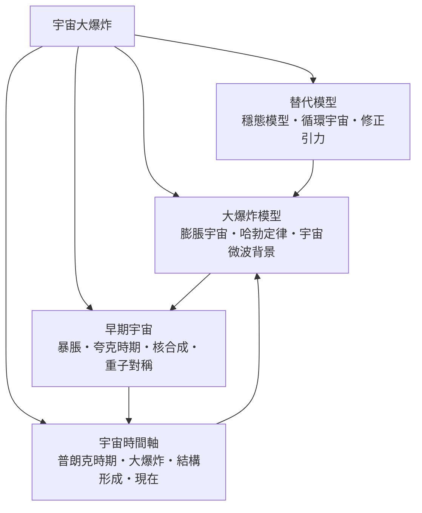

# 宇宙大爆炸

> 隸屬：第一層 [天]　·　相關分類：[天文學]、[相對論]、[黑洞]　·　子分類總表見 [README]

> 對應維基百科：[中文維基百科：大爆炸](https://zh.wikipedia.org/wiki/%E5%A4%A7%E7%88%86%E7%82%B8)　·　[English Wikipedia: Big Bang](https://en.wikipedia.org/wiki/Big_Bang)

宇宙大爆炸是**現代宇宙學的標準模型：宇宙在大約 138 億年前從極熱極密的狀態開始膨脹，至今仍在膨脹**。要澄清的第一件事是：大爆炸不是「在空間某點發生的爆炸」，而是**空間本身隨時間膨脹**——星系並非飛散開來，而是它們之間的空間在不斷伸展。另一件要澄清的事是：大爆炸理論描述的是宇宙「從極熱狀態出發之後」的演化，並不宣稱知道 $ t = 0 $ 那一刻發生了什麼。

這個理論的骨幹來自 [相對論]：[弗里德曼] 於 1922 年證明場方程容許膨脹宇宙解，[勒梅特] 於 1927 年獨立得到同樣結果並連結觀測，[哈勃] 於 [1929年] 測得星系退行速度與距離成正比。到了 [1948年]，[伽莫夫] 等人推論：既然宇宙曾經極熱，早期應留下均勻的輻射餘溫；[1965年] [彭齊亞斯] 與 [威爾遜] 意外偵測到這道「宇宙微波背景」，大爆炸就此成為標準模型。

## 核心問題

大爆炸理論要回答的核心問題有三層：

1. **宇宙在膨脹嗎？** 判準是 [哈勃定律]：星系退行速度 $ v = H_0 d $ ，今日 $ H_0 \approx 67\text{--}74\ (\mathrm{km/s})/\mathrm{Mpc} $ 。這一條式子把「宇宙的尺度隨時間改變」變成可量測的數。
2. **早期宇宙長什麼樣？** 溫度隨尺度因子倒數變化 $ T \propto 1/a $ ；把今日 $ 2.725 $ K 的微波背景往回推，可重建核合成、夸克時期等各階段的溫度與粒子反應。
3. **結構從哪裡來？** 今日的星系與星系團，源自早期宇宙百萬分之一量級的密度漣漪；[宇宙微波背景] 把這些漣漪「拍照」了下來。

## 因果鏈

1. **牛頓宇宙的困境**：無限靜態宇宙在引力下不穩定（奈維爾－瑟金的夜黑悖論亦無法解釋），需要新的時空框架。
2. **[相對論] 提供語言**：[愛因斯坦] 於 [1915年] 發表場方程，[弗里德曼] 於 [1922年] 證明膨脹解存在；愛因斯坦起初以宇宙常數強行維持靜態，後自認為「最大錯誤」。
3. **觀測的確認**：[1929年] [哈勃] 由星系紅移與距離的關係確認宇宙在膨脹，理論與觀測第一次接軌。
4. **熱宇宙的推論**：[1948年] [伽莫夫] 團隊預言早期 [核合成] 產物（氦豐度約 25%）與輻射餘溫的存在。
5. **餘溫被找到**：[1965年] [彭齊亞斯] 與 [威爾遜] 在校準天線時意外測得約 $ 3 $ K 的各向同性輻射，即 [宇宙微波背景]；兩人因此獲 1978 年諾貝爾物理學獎。
6. **精確時代**：1989 年後的衛星觀測（宇宙背景探測者等）量出背景輻射的溫度漣漪只有十萬分之一量級，凝結出「結構如何種下」的問題。
7. **暴脹與新問題**：為解釋為何背景如此均勻、宇宙為何平坦，[1980年] 前後 [暴脹] 理論被提出，成為早期宇宙研究的中心框架。
8. **暗能量的發現**：[1998年] 兩個團隊由遙遠超新星發現膨脹正在加速，標準模型補入暗能量；宇宙的過去與未來都重新改寫。

## 子分類的定位與相互驅動

- [大爆炸模型] 回答「宇宙如何整體演化」：[膨脹宇宙] 提供數學框架，[哈勃定律] 提供今天的膨脹率，[宇宙微波背景] 提供最早的「照片」；三者合起來構成檢驗一切宇宙學理論的骨架。
- [早期宇宙] 回答「最初三分鐘到三萬年間發生了什麼」：[暴脹] 解釋起點的均勻與平坦，[夸克時期] 與 [核合成] 交代物質的形成，[重子對稱] 處理「為何有東西留下來」。
- [宇宙時間軸] 把上述兩者排成一條線：從 [普朗克時期] 到 [結構形成] 再到 [現在]，每一段都有對應的物理與觀測證據。
- [大爆炸的替代模型] 回答「標準模型一定對嗎」：[穩態模型] 的失敗史教我們什麼樣的證據才有決定性，[循環宇宙] 與 [修正引力] 則是仍在討論的邊界案例。

## 範例：用微波背景算宇宙的年齡

1. **量溫度**：今日宇宙微波背景的溫度為 $ T_0 = 2.725 $ K，均勻到 $ 10^{-5} $ 量級。
2. **回推紅移**：光子退耦合發生在溫度約 $ 3000 $ K 時（電漿複合成中性氫的溫度），紅移 $ z \approx 1100 $ ，即尺度因子縮了約 1100 倍。
3. **代入模型**：在含暗物質與暗能量的標準模型中，對紅移與膨脹率歷史積分，得到宇宙年齡約 $ 138 $ 億年。
4. **交叉檢驗**：以最老恆星球的年齡（約 130 億年）做下限檢查，兩者一致——理論內部與外部都沒有矛盾。

這個計算只用三樣輸入：今天的背景溫度、退耦溫度、以及 [哈勃定律] 給出的膨脹歷史；它示範了大爆炸理論「由今日觀測重建過去」的典型工作方式。

## 容易混淆之處

- **大爆炸不是空間中的爆炸**：沒有「中心」與「邊緣」；每個星系看到的都是其他星系在退行。
- **紅移不是「星系在空間中飛行」**：宇宙學紅移是光在膨脹空間中被拉長的結果，與都卜勒效應不同（在近距離近似下兩者一致）。
- **大爆炸理論不解釋 $ t = 0 $ **：它從宇宙極熱極密但已存在的狀態開始描述；「無中生有」不是本理論的內容。
- **膨脹不是「宇宙在更大的空間裡長大」**：膨脹是內稟的尺度因子增長，不需要外部空間。
- **「大爆炸」一詞其實是反對者取的**：[霍伊爾] 在 1949 年的廣播中以嘲諷口吻使用，後來卻成了正式名稱。

## 延伸閱讀

- [天文學]：觀測宇宙學的上游基礎。
- [相對論]：宇宙學模型的數學母體。
- [黑洞]：同樣由廣義相對論推導出的極端天體，其研究與宇宙學共享數學工具。
- [暗物質]：決定結構形成的主角之一。
- [哈勃]：膨脹宇宙的觀測確認者。

## 連結定義

[1915年]: ../時/1915年.md
[1922年]: ../時/1922年.md
[1929年]: ../時/1929年.md
[1948年]: ../時/1948年.md
[1965年]: ../時/1965年.md
[1980年]: ../時/1980年.md
[1998年]: ../時/1998年.md
[README]: README.md
[伽莫夫]: ../人/物理學家/伽莫夫.md
[哈勃]: ../人/天文學家/哈勃.md
[勒梅特]: ../人/天文學家/勒梅特.md
[威爾遜]: ../人/天文學家/威爾遜.md
[彭齊亞斯]: ../人/天文學家/彭齊亞斯.md
[宇宙微波背景]: 宇宙微波背景.md
[天]: ../天/README.md
[天文學]: ../天文學/README.md
[早期宇宙]: 早期宇宙.md
[暴脹]: 暴脹.md
[普朗克時期]: 普朗克時期.md
[暗物質]: ../暗物質/README.md
[相對論]: ../相對論/README.md
[結構形成]: 結構形成.md
[膨脹宇宙]: 膨脹宇宙.md
[重子對稱]: 重子對稱.md
[夸克時期]: 夸克時期.md
[核合成]: 核合成.md
[哈勃定律]: 哈勃定律.md
[現在]: 現在.md
[霍伊爾]: ../人/天文學家/霍伊爾.md
[循環宇宙]: 循環宇宙.md
[穩態模型]: 穩態模型.md
[修正引力]: 修正引力.md
[大爆炸模型]: 大爆炸模型.md
[大爆炸的替代模型]: 大爆炸的替代模型.md
[宇宙時間軸]: 宇宙時間軸.md
[黑洞]: ../黑洞/黑洞.md
[愛因斯坦]: ../人/物理學家/愛因斯坦.md
[弗里德曼]: ../人/物理學家/弗里德曼.md
