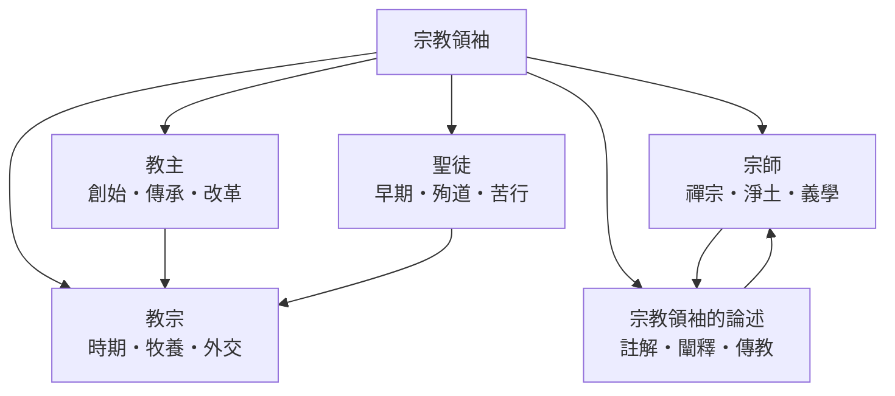

# 宗教領袖

> 分類範圍：以宗教組織中行使權威的具名個人為單位，討論教主、教宗、宗師與聖徒如何取得、維持並轉移其權威，以及他們的言說如何被組織成制度。　·　隸屬第一層：[人]　·　相關分類：[宗教學]、[歷史人物]、[人類學]　·　子分類總表見 [README]

> 對應維基百科：中文維基百科無對應條目　·　[English Wikipedia: Religious leader](https://en.wikipedia.org/wiki/Religious_leader)

「宗教領袖」指在宗教組織中對信眾行使**持續性權威**的個人。他與「宗教人物」的差別在於權威的結構性：任何人都可以聲稱得到啟示，但只有在組織承認、信眾追隨、繼承規則存在時，這種權威才會成為「領袖」。這套條目要處理的核心問題因此是：**宗教權威從哪裡來——來自創立、來自職位、來自修行成就、還是來自聖德——以及這四種來源如何互相支撐又互相競爭**。

## 核心問題：權威的四種來源

宗教權威的來源可以整理為四類，每一類對應一種領袖類型：

| 來源 | 領袖類型 | 權威的根據 | 典型的正當性語言 |
| --- | --- | --- | --- |
| 創立 | [教主] | 親自領受啟示並建立組織 | 「我直接從神／道那裡得到」 |
| 職位 | [教宗] | 佔據制度化的職位與繼承鏈 | 「我在職位上，故我有權」 |
| 修證 | [宗師] | 個人的修行成就與傳承資格 | 「我修到了，且有人為我作證」 |
| 聖德 | [聖徒] | 生前的德行與死後的崇敬 | 「我活得像樣範，故值得效法」 |

這四種來源**不是互斥的**。一位領袖往往同時依賴其中兩三種：教宗的權威既有職位的一面，也依賴歷代聖徒構成的傳統；禪宗大師的權威來自修證，但也需要師徒相承的衣缽來證明。

## 因果鏈

1. **啟示與追隨者**：一切的起點是一個人宣稱領受真理，並吸引第一批追隨者；[釋迦牟尼]、[耶穌]、[穆罕默德] 都是從這種「個人＋小團體」的形態開始。
2. **組織化**：追隨者增加後，單憑個人魅力無法維持秩序，於是出現戒律、職位與財產制度；權威從「這個人說的」轉變為「這個職位說的」。
3. **繼承問題**：創立者去世後，組織必須回答「誰有資格接續」——[聖伯多祿] 被追溯為首任教宗、[達賴喇嘛] 的轉世制度，都是對這個問題的制度化回答。
4. **經典與解釋權**：組織一旦把教導寫成經典，「誰有資格解釋經典」就成為新的權威戰場，於是出現[宗師] 的註釋傳統與教會的訓導職務。
5. **聖徒作為組織資產**：聖德典範被正式化為封聖、認證與紀念制度，聖徒成為組織自我證明的證據。
6. **現代國家與媒體**：現代宗教領袖必須同時在法律、媒體與國際政治的場域中活動，[教宗] 的外交角色因此擴張。

## 子分類的定位與相互驅動

- [教主] 提供**起點與合法性敘事**：沒有創立故事，後來的職位與傳承都無所依附。
- [教宗] 展示**職位權威的極端形態**：使徒統緒把權威從個人轉移到職位，再由職位授權給個人。
- [宗師] 保存**修證權威**：當職位權威僵化時，宣稱「親自證得」的宗師往往成為更新的力量。
- [聖徒] 提供**榜樣與動員資源**：殉道者的故事是組織在受迫害時期最強的凝聚手段。
- [宗教領袖的論述] 是**權威的技術面**：無論哪種來源的權威，最終都要靠講經、寫作與傳教行動落到信眾身上。

## 範例：同一個問題的四種答案

「誰有資格代表真理」這個問題，四個子分類給出不同的答案：

1. **佛教**：[釋迦牟尼] 临終未指定繼承人，僧團以「依法不依人」回應，於是解釋權落在長老與論師（宗師型權威）手中。
2. **天主教**：[耶穌] 對 [聖伯多祿] 的委託被解釋為職位的設立，於是出現單一、可辨認、可繼承的[教宗] 職位。
3. **伊斯蘭教**：[穆罕默德] 身兼宗教與政治權威，其去世引發「誰是繼承者」的分裂，這條裂痕延續至今的教派差異。
4. **藏傳佛教**：[達賴喇嘛] 以轉世認證解決繼承問題，把「修證成就」本身制度化為可辨認、可尋找的職位。

## 容易混淆之處

- **宗教領袖不等於宗教創立者**：多數宗教領袖是在既有組織中活動的人，創立者只是此類別的一個子集。
- **權威不等於權力**：領袖可以有巨大的道德權威而缺乏強制力，也可以相反；兩者的來源與維持方式不同。
- **聖徒是後設追認**：「聖徒」身分通常由組織或信眾在當事人死後（有時生前）追授，不是職業。
- **魅力型權威會自動例行化**：追隨者的第二代必須把個人魅力轉成規則、職位或經典，否則組織隨創立者一起消失。

## 延伸閱讀

- [宗教學]：宗教組織與教派形成的通則。
- [基督宗教]：教宗制度與教會論的脈絡。
- [佛教]：僧團、傳承與宗師制度的脈絡。
- [伊斯蘭教]：先知繼承與教法權威的脈絡。
- [人類學]：巫師、薩滿與地方宗教專家等前組織形態的權威。

## 連結定義

[人]: ../人/README.md
[README]: README.md
[宗教學]: ../宗教學/README.md
[歷史人物]: ../歷史人物/歷史人物.md
[人類學]: ../人類學/README.md
[教主]: 教主.md
[教宗]: 教宗.md
[宗師]: 宗師.md
[聖徒]: 聖徒.md
[宗教領袖的論述]: 宗教領袖的論述.md
[釋迦牟尼]: ../人/釋迦牟尼.md
[耶穌]: ../人/耶穌.md
[穆罕默德]: ../人/穆罕默德.md
[聖伯多祿]: ../人/聖伯多祿.md
[達賴喇嘛]: ../人/達賴喇嘛.md
[基督宗教]: ../基督宗教/README.md
[佛教]: ../佛教/README.md
[伊斯蘭教]: ../伊斯蘭教/README.md
