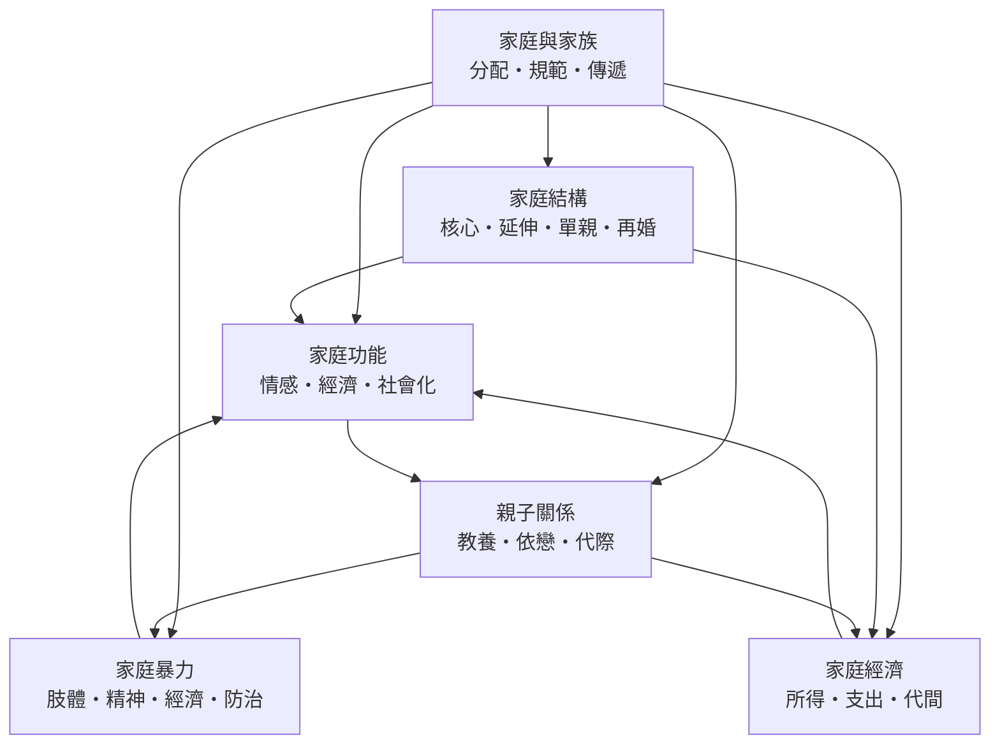

# 家庭與家族

> 隸屬：第一層 [人]　·　相關分類：[社會學]、[社會心理學]、[發展心理學]、[經濟學]、[婚姻]、[親職教育]、[人口結構]、[宗族制度]、[兒童發展]　·　子分類總表見 [README]

> 對應維基百科：[中文維基百科：家庭](https://zh.wikipedia.org/wiki/%E5%AE%B6%E5%BA%AD)　·　[English Wikipedia: Family](https://en.wikipedia.org/wiki/Family)

家庭與家族研究的是：**一群有血緣、婚姻或撫養關係的人，如何在共同生活中分配情感、權力、資源與風險**。它是一個橫跨多個學科的對象——[社會學] 研究家庭作為社會制度與結構，[發展心理學] 研究家庭內的關係如何形成人格與能力，[經濟學] 研究家庭如何把時間與貨幣轉換成養育與照顧的產出，而 [醫療衛生政策] 與 [民法] 則處理家庭內的暴力、監護與責任的外部規範。

中文語彙在此處值得先說清楚：「家庭」指共同生活、共同撫養的居住單位；「家族」則指以血緣或譜系為基礎的更大群體，前者偏向生活單位，後者偏向親屬網絡與世系。兩者在大規模工業化之前幾乎重合，在流動化城市中則逐漸分開——這正是本概念存在的理由之一：**家庭不再自動包含宗族，而宗族的規範仍透過法律、祭祀、姓氏與撫養義務繼續作用於家庭**。

本概念要處理的問題可以分成三層。第一層是**描述層**：家庭有哪些型態、如何分布、彼此如何流動。第二層是**機制層**：家庭透過什麼過程把資源與情緒傳遞給下一代——養育、依戀、社会化、勞動分工、遺產轉移。第三層是**規範與干預層**：當家庭內部出現傷害、剝奪或失衡時，國家與社會用什麼制度介入，以及介入的界線在哪裡。三層互相牽制：描述層的統計口徑決定機制層能提出什麼假設；機制層的證據決定干預層是否敢於立法；而干預層的立法又會回頭改變家庭型態的分布。

## 核心問題

### 一、家庭是自然單位，還是制度建構

把家庭視為自然單位，會得到「核心家庭普遍存在」的直觀印象；把家庭視為制度建構，則會問：哪些安排是被法律、稅制與市場鼓勵的？[伯吉斯] 與 [派森] 在 [1915年] 提出核心家庭一詞，[派森] 在 [1955年] 主張核心家庭最能同時完成社會化與情緒支持兩項功能，因而成為工業化社會的標準。但此後的實證研究顯示，延伸家庭在亞洲、拉丁美洲與南歐從未退場，其在托育、照護與勞動上的作用甚至隨都市化而增加。**「哪一種家庭形式存在」這個問題，很大程度上是「哪一種形式被制度承認與統計計入」的問題**。

### 二、家庭承擔了哪些功能，市場與國家接手了多少

[米德] 把家庭視為角色學習的第一個場所；[派森] 把情緒支持與社會化列為家庭的兩個不可替代功能。然而托育、養老、醫療與教育相繼被國家與市場接手，使家庭功能持續被「去家庭化」。問題因此是雙向的：功能外移是否真的減輕了家庭負擔？還是只是把成本轉移成父母「自掏腰包」的時間與金錢？

### 三、家庭內的權力與不平等如何被規範

家庭同時是一個親密關係與一個資源分配的單位，因此它也是權力關係最不透明的場域。[鮑曼] 在 [1966年] 提出的管教類型分析裡，「要求」與「溫暖」的組合即隱含權力分配；而 [家庭暴力] 的研究則顯示，控制、孤立與經濟剝奪常與肢體暴力並存。當這類傷害被界定後，[防治制度] 才成為必要——但同時帶來「國家介入家庭」的邊界爭議。

### 四、資源如何在世代之間流動

[恩格爾] 以食品支出比重衡量家庭生活水準，[貝克] 以時間配置理論解釋配偶分工與生育決策，[弗里德曼] 的恆常收入理論則說明家庭為何平滑跨期消費。這些工具共同支撐了 [代間轉移] 的研究：家庭既是資源傳遞的管道，也是機會不平等再生產的場所。

### 五、變遷的方向與速度

少子、高齡化、晚婚、跨國婚姻與數位溝通同時改寫了家庭的生活。[單親家庭] 與 [再婚家庭] 的比例上升，使「核心家庭為標準」的敘事更加不適用；[代際溝通] 則成為跨世代支持與衝突的新場所。

## 因果鏈

1. **家庭作為經濟單位的量化**：[恩格爾] 在 1875 年以慕尼黑家庭收支資料提出恩格爾法則，使「家庭生活水準」成為可用數字表達的對象，開啟家庭經濟學的經驗傳統。
2. **家庭型態的分類**：[伯吉斯] 與 [派森] 在 [1915年] 提出核心家庭概念，把家庭從道德與法律對象轉化為可分類的社會學對象；[派森] 在 [1955年] 進一步主張核心家庭的制度優勢。
3. **功能論與情緒支持的發現**：[库里] 的首要群體概念、[米德] 的社會自我理論，把「家庭提供歸屬與道德規範」說明為社會過程，而非自然結果。
4. **關係品質的科學化**：[鮑爾比] 的依戀理論與 [安斯沃斯] 的陌生情境程序，把嬰幼兒與照顧者的關係品質轉為可分類的行為類型，家庭第一次成為心理學的量化對象。
5. **管教研究的縱貫化**：[鮑曼] 在 [1966年] 提出四類管教架構，[麥克比] 等人的縱貫研究把管教方式與青少年結果連結，並凸顯因果方向與性別差異的問題。
6. **家庭暴力的公共化**：1970 年代的美國庇護所運動使家庭暴力從「家務事」變成公共議題，[1984年] 美國《家庭暴力保護與服務法》與各國相應立法開啟制度防治；[聯合國] 體系自 1940 年代起把人權條文與家庭保護連結，[世界衛生組織] 於 [1996年] 發表的界定報告，則使家庭暴力進入全球衛生統計。
7. **家庭經濟的理論化**：[弗里德曼] 的恆常收入理論與 [貝克] 的時間配置理論，把家庭消費、儲蓄與分工整合進可檢驗的模型，並支撐了代際所得彈性與資源傳遞的估計。
8. **少子與高齡化的重新配置**：當生育率下降、壽命延長，家庭同時成為托育不足與養老負擔的轉移點，國家介入（托育、育兒津貼、長照制度）與家庭責任的邊界成為當代核心議題；[史瓦茨] 的價值結構研究則提供了「家庭責任 vs 個人自主」的跨文化解釋。

## 子分類的定位與相互驅動

- **[家庭結構]** 是**型態層**的分類：它回答「誰與誰同住、住在哪裡、家庭如何組成與解組」，以 [核心家庭]、[延伸家庭]、[單親家庭] 與 [再婚家庭] 四種型態為骨架，提供其餘四個分支共用的分類詞彙。結構變化（單親比率、再婚比率、居住安排）既是結果，也是機制——它決定誰承擔照顧、誰分擔收入。
- **[家庭功能]** 是**產出層**的分類：它回答「家庭實際做了什麼」，把 [情感支持]、[經濟支持] 與 [社會化功能] 三種產出區分開來，使「家庭做了很多事」這類籠統判斷可以被拆解與測量。
- **[親子關係]** 是**微觀機制層**的分類：它把家庭功能轉成具體的關係過程——[教養風格] 如何運作權力與溫暖、[依戀關係] 如何形成安全基地、[代際溝通] 如何在三代之間傳遞訊息與界線。
- **[家庭暴力]** 是**失靈與規範層**的分類：它處理功能崩解的極端形式，[肢體暴力]、[精神暴力] 與 [經濟控制] 三種手段需要不同的辨識與介入，而 [防治制度] 則是跨出家庭邊界的制度性回應。
- **[家庭經濟]** 是**資源層**的分類：它以 [家庭所得]、[教養支出] 與 [代間轉移] 三個量，說明家庭能做什麼、能給什麼，以及不平等如何被傳遞。

五者互相驅動：結構決定功能分配的對象；功能中的社會化由親子關係的具體過程實現；親子關係的資源基礎來自家庭經濟；而家庭經濟的資源流向與照顧安排，反過來決定了親子關係的品質與家庭暴力的發生條件。當功能與資源的分配失衡時，家庭暴力的風險上升，並最終把問題推向防治制度與公共政策。

## 範例：一個三口之家的年度資源流轉

以城市中一名 6 歲兒童的家庭為例，可以看見五個子分類如何交疊作用：

1. **結構**：核心家庭，雙親與一名子女同住，祖輩居住於同一城市但不同住；每月有一次週末由祖輩照顧，構成延伸家庭的「部分重疊」。
2. **功能與情感支持**：父親每日接送與就寢前對話構成主要的情緒支持來源；母親在孩子發燒時請假一天，屬於「照顧請假」類型的家庭內部彈性因應。
3. **社會化**：孩子在家庭中學會排隊、等红灯與照顧弟弟的責任，透過日常參與而非講道理完成。
4. **親職關係**：以民主式管教為主（高要求、高溫暖），規則少而清楚、理由會被解釋；遇到發脾氣時以轉移注意與事後复盤為主。
5. **家庭經濟**：家庭月收入約新台幣 12 萬元，支出中住屋與餐飲合計約佔 45%，托育與教育支出約佔 15%，剩餘約 25% 供儲蓄與償貸；祖輩每月提供約 1 萬元的實質協助，約當於月支出的一成，這是「代間轉移」在都市家庭中的典型形態。
6. **風險面**：若父親長期加班、祖輩照顧中斷，則情感支持與托育支出同時惡化，家庭壓力會沿著「時間—金錢—情緒」的順序被擠壓——這正是 [家庭暴力] 研究中壓力累積路徑的日常版本。
7. **量測**：若要檢驗上述判斷，需要的不只是訪談，而是家庭時間日誌、支出紀錄與 [家庭所得] 的等價尺度換算，三者缺一則結論會偏向可觀察的部分。

## 容易混淆之處

- **家庭與住戶不同**：住戶（household）是居住與消費的統計單位，可包含無血緣關係的同居者；家庭（family）則以親屬與撫養關係界定。統計上兩者常被混用，導致家庭規模與單親比率的估計偏差。
- **核心家庭不等於小家庭**：核心家庭是以成員關係界定的型態，延伸家庭也可以只有兩個人；把「核心」與「人數少」畫上等號是最常見的誤解。
- **家庭與家族不可互換**：家族是譜系單位，帶有血緣與祭祀、繼承的規範；把現代核心家庭說成「傳統家族」的縮水版，會掩蓋宗族在法律與文化上的持續作用。
- **情感支持不等於社會支持**：社會支持包含工具性（實際幫助）與情感性兩面；家人提供的大量實務協助不必然等於心理支持，反之亦然。
- **家庭暴力統計高度依賴定義與通報率**：不同法域對「家庭暴力」的範圍與通報門檻不同，跨國比較時必須對齊定義；未報數與登記數的差距是結構性的，不是資料瑕疵。
- **相關不等於因果**：管教風格與青少年行為的研究長期受因果方向與共同方法變異影響；「嚴厲管教造成問題行為」與「問題行為引發嚴厲管教」在橫斷面資料中難以區分。
- **代間轉移不只向下**：養老支持、照顧與情緒勞動同樣是向上的轉移，只計算財產繼承會低估家庭在社會保障上的實際角色。

## 延伸閱讀

- [社會學]：家庭作為制度、階層與網絡的分析框架。
- [人口結構]：生育率、婚姻與居住安排的統計基礎。
- [婚姻]：家庭形成與解組的制度面向。
- [宗族制度]：血緣群體與傳統社會的規範系統。
- [親職教育]、[兒童發展]：家庭功能在養育與發展上的應用出口。
- [人類學]、[民俗學]：跨文化比較家庭形式的經驗來源。

## 連結定義

[人]: ../人/README.md
[README]: README.md
[社會學]: ../社會學/README.md
[社會心理學]: ../社會心理學/README.md
[發展心理學]: ../發展心理學/README.md
[經濟學]: ../經濟學/README.md
[婚姻]: ../婚姻/README.md
[親職教育]: ../親職教育/README.md
[人口結構]: ../人口結構/README.md
[宗族制度]: ../宗族制度/README.md
[醫療衛生政策]: ../醫療衛生政策/README.md
[民法]: ../民法/README.md
[人類學]: ../人類學/README.md
[民俗學]: ../民俗學/README.md
[兒童發展]: ../兒童發展/README.md
[世界衛生組織]: ../國際組織/README.md
[聯合國]: ../聯合國/README.md
[家庭結構]: 家庭結構.md
[家庭功能]: 家庭功能.md
[親子關係]: 親子關係.md
[家庭暴力]: 家庭暴力.md
[家庭經濟]: 家庭經濟.md
[核心家庭]: 核心家庭.md
[延伸家庭]: 延伸家庭.md
[單親家庭]: 單親家庭.md
[再婚家庭]: 再婚家庭.md
[情感支持]: 情感支持.md
[經濟支持]: 經濟支持.md
[社會化功能]: 社会化功能.md
[教養風格]: 教養風格.md
[依戀關係]: 依戀關係.md
[代際溝通]: 代際溝通.md
[肢體暴力]: 肢體暴力.md
[精神暴力]: 精神暴力.md
[經濟控制]: 經濟控制.md
[防治制度]: 防治制度.md
[家庭所得]: 家庭所得.md
[教養支出]: 教養支出.md
[代間轉移]: 代間轉移.md
[伯吉斯]: ../人/社會學家/伯吉斯.md
[派森]: ../人/社會學家/派森.md
[米德]: ../人/社會學家/米德.md
[库里]: ../人/社會學家/库里.md
[史瓦茨]: ../人/社會學家/史瓦茨.md
[貝克]: ../人/經濟學家/貝克.md
[弗里德曼]: ../人/經濟學家/弗里德曼.md
[恩格爾]: ../人/經濟學家/恩格爾.md
[鮑爾比]: ../人/心理學家/鮑爾比.md
[鮑曼]: ../人/心理學家/鮑曼.md
[麥克比]: ../人/心理學家/麥克比.md
[安斯沃斯]: ../人/心理學家/安斯沃斯.md
[1915年]: ../時/1915年.md
[1955年]: ../時/1955年.md
[1966年]: ../時/1966年.md
[1984年]: ../時/1984年.md
[1996年]: ../時/1996年.md
