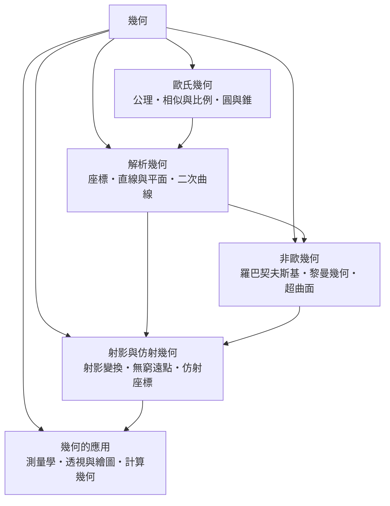

# 幾何

> 隸屬：第一層 [理]　·　相關分類：[數學]、[數學的分支]、[代數]　·　子分類總表見 [README]

> 對應維基百科：[中文維基百科：幾何學](https://zh.wikipedia.org/wiki/%E5%87%A0%E4%BD%95%E5%AD%A6)　·　[English Wikipedia: Geometry](https://en.wikipedia.org/wiki/Geometry)

幾何研究**形狀、位置、大小與它們之間的關係**。它的起點非常樸素：古埃及人要在尼羅河洪水退去後重劃田界，於是需要知道一塊地的邊界有多長、面積有多大。這個「測量」的需要，隨著希臘人把它提升為「證明」，成為西方數學的第一個成熟分支。

幾何的歷史可以說是三個轉向的歷史。

第一個轉向是**公理化**。[歐幾里得] 在前 300 年左右以五條公理與五條公理導出《原本》全書，讓人相信數學可以從少數明示前提推導出一切。這一步不只改變了幾何，也示範了現代數學的工作方式。

第二個轉向是**座標化**。1637 年 [笛卡兒] 把點與座標對應起來，把「形狀」翻譯成方程。幾何從此不再是只能看圖說話的學科，而成為可運算的對象；[高斯] 在 19 世紀把非歐幾何算出來，也是靠同一套工具。

第三個轉向是**空間多元化**。[高斯]、[羅巴契夫斯基] 與 [黎曼] 發現平行公設並非必然，黎曼更在 1854 年把幾何建立在「流形」與「曲率」之上。於是幾何的對象從平面圖形擴張為帶曲率的空間本身，並成為 [相對論] 表述引力所不可替代的語言。

反過來說，幾何也一直在被工程pull回來：測量、導航、透視繪圖、計算幾何，每一項都把抽象定理轉成可以執行的規則。

## 核心問題

幾何的核心問題可以拆成四個互相牽動的層次。

1. **描述**：一個形狀由什麼決定？這是公理與定義的問題——用哪些基本對象與規則，恰好能生出我們熟悉的空間。
2. **判定**：兩種陳述是否等價？例如「兩條直線不相交」與「它們平行」是否同義。歐氏幾何把「等價」化為可證的命題。
3. **計算**：已知條件，求未知的量——長度、角度、面積、體積、位置。這是幾何最實際的一面，也是它與工程、測量、製圖的接點。
4. **不變**：在移動、投影、變形之下，什麼量保持不變？曲率、交比、面積、角度、體積，是幾何學用來辨認「本質相同」的量。

四層之間的關係是：**描述決定什麼算合法，判定決定什麼算已知，計算給出答案，而不變量告訴我們答案是否唯一、是否可推廣**。當平行公設被放棄時，前三層都還成立，第四層卻給出了不同的答案——這正是非歐幾何的意義所在。

## 因果鏈

1. **古埃及與巴比倫的實測**：尼羅河年年泛濫，田界必須重測，於是有了面積與長度的估算，也有了三角形的實用比例。
2. **泰勒斯的幾何命題**：[泰勒斯] 以觀察與論證取代神話，並留下垂直線段與圓直徑相等的性質，是「可證明的命題」的最早形態。
3. **畢達哥拉斯與數的比例**：[畢達哥拉斯] 把直角三角形與數的關係提升為普遍真理，幾何開始與數學合流。
4. **阿基米德的定量幾何**：[阿基米德] 用窮舉法求圓的面積與拋物線弓形面積，並以力學推理輔助證明，幾何第一次走向「可算」。
5. **歐幾里得的公理化**：前 300 年左右，《原本》把零散命題整理為從五條公理出發的系統推導，確立了數學方法論。
6. **笛卡兒的座標化**：1637 年把點對應到數對，幾何命題變成代數方程，幾何開始可算、可驗證。
7. **非歐幾何與黎曼的轉向**：1829 年 [羅巴契夫斯基] 公開「虛幾何」，1854 年 [黎曼] 提出以流形與曲率為基礎的幾何，空間不再唯一。
8. **射影、仿射與計算幾何**：19 世紀的射影幾何整理無窮遠點與射影變換，20 世紀的計算幾何把凸包、三角剖分與最短路徑變成演算法。

## 子分類的定位與相互驅動

- [歐氏幾何] 是**起點與基準**：它提供公理、比例與圓錐曲線的完整體系，其他所有幾何都在說明「哪一條公理可以被替換」。
- [解析幾何] 是**橋樑**：它把幾何翻譯成代數，使非歐幾何得以被計算、被證明；同時也是幾何進入工程量測的通道。
- [非歐幾何] 是**危機與解放**：平行公設鬆動之後，幾何從唯一真理變成一族彼此獨立的幾何，曲率成為核心概念。
- [射影與仿射幾何] 是**提煉**：它丟掉度量資訊，只保留結構（哪些點共線、哪些曲線相切），因而暴露出幾何中真正本質的部分。
- [幾何的應用] 是**回路**：測量、透視與演算法把幾何送回物理世界，並以實際需求檢驗哪一套幾何更合用。

## 範例：用座標證明圓錐曲線的統一性

**問題**：為什麼拋物線、橢圓與雙曲線可以放在同一個方程裡？

1. 歐氏幾何用「與焦點的距離之和／差」定義這些曲線，性質優美但難以計算。
2. 解析幾何改用二次方程 $Ax^2 + Bxy + Cy^2 + Dx + Ey + F = 0$ 描述它們，只要 $B^2 - 4AC \ne 0$ 即為二次曲線。
3. 依 $B^2 - 4AC$ 的符號分類： $B^2 - 4AC > 0$ 得橢圓（含圓）， $= 0$ 得拋物線， $< 0$ 得雙曲線。
4. 具體例子： $x^2 + y^2 = 4$ 是半徑 $2$ 的圓（ $B^2-4AC = -4 < 0$ ）； $y^2 = 4x$ 是拋物線（ $= 0$ ）； $x^2 - y^2 = 1$ 是雙曲線（ $> 0$ ）。
5. 旋轉座標後，交叉項 $xy$ 可被消去，方程化為標準形 $x^2/a^2 + y^2/b^2 = 1$ 或 $x^2/a^2 - y^2/b^2 = 1$ ，因此焦點、頂點等幾何量都能直接讀出。
6. 這說明一件事：**歐氏幾何的「同一族曲線」在解析幾何裡是同一族方程的特化**。幾何的統一不是靠定義，而是靠座標的選擇。

第二個範例說明非歐幾何的量變。在球面三角形的黎曼幾何中，三角形內角和大於 $180$ 度，且面積越大超出越多；在雙曲幾何中則小於 $180$ 度。兩者都不是錯誤，而是把「平行」重新定義之後必然得到的不同結論。

## 容易混淆之處

- **幾何學科與幾何學會**：本條目處理的是數學中的幾何，不是學術團體的組織形式。
- **非歐幾何不是「錯誤的幾何」**：它與歐氏幾何一樣自洽，只是採用不同的平行公設；今天衛星導航仍在使用歐氏幾何的近似。
- **幾何直覺不能代替證明**：歐幾里得的讀者必須自行在腦中重建圖形，正是為了防止把圖形誤當論證。
- **曲率有兩種**：高斯曲率是曲面的內在性質，不需要嵌入空間即可定義；平均曲率則是外在描述。[非歐幾何] 處理的是前者。
- **射影幾何與仿射幾何不是同一件事**：射影保留共線與交點，仿射保留平行；前者更「弱」，因而看到的結構更基本。
- **抽象幾何不等於「不實用的幾何」**：現代幾何概念多數出自具體問題——黎曼幾何出自相對論需求，纖維叢出自規範場理論。

## 延伸閱讀

- [數學]：幾何所屬的整體，以及幾何與其他分支的分工。
- [幾何學科]：以「數學的分支」為框架的幾何概覽，涵蓋微分幾何與拓樸幾何的接壤處。
- [代數]：解析幾何與代數幾何所依賴的運算語言。
- [拓樸]：把度量與座標都拿掉之後，幾何剩下的「黏性結構」。
- [物理學]：幾何的規模型語言使用者，特別是相對論與場論。
- [演算法]：計算幾何演算法的歸屬分類。

## 連結定義

[理]: ../理/README.md
[README]: README.md
[數學]: ../數學/README.md
[數學的分支]: ../數學/數學的分支.md
[幾何學科]: ../數學/幾何.md
[代數]: ../代數/README.md
[拓樸]: ../數學/拓樸.md
[物理學]: ../物理學/README.md
[相對論]: ../相對論/README.md
[演算法]: ../演算法/README.md
[歐氏幾何]: 歐氏幾何.md
[解析幾何]: 解析幾何.md
[非歐幾何]: 非歐幾何.md
[射影與仿射幾何]: 射影與仿射幾何.md
[幾何的應用]: 幾何的應用.md
[歐幾里得]: ../人/數學家/歐幾里得.md
[泰勒斯]: ../人/數學家/泰勒斯.md
[畢達哥拉斯]: ../人/數學家/畢達哥拉斯.md
[阿基米德]: ../人/數學家/阿基米德.md
[笛卡兒]: ../人/數學家/笛卡兒.md
[高斯]: ../人/數學家/高斯.md
[黎曼]: ../人/數學家/黎曼.md
[羅巴契夫斯基]: ../人/數學家/羅巴契夫斯基.md
