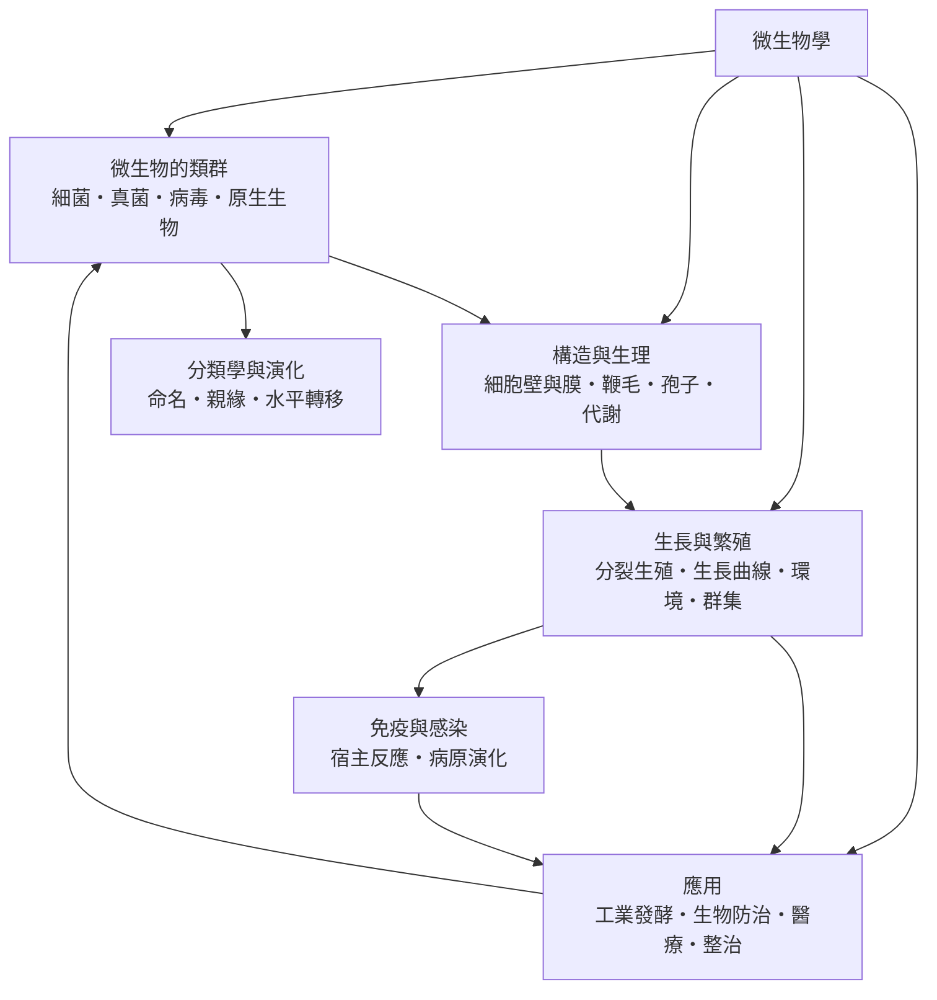

# 微生物學

> 隸屬：第一層 [理]、[物]　·　相關分類：[生物學]、[化學]、[免疫系統]　·　子分類總表見 [README]

> 對應維基百科：[中文維基百科：微生物學](https://zh.wikipedia.org/wiki/%E5%BE%AE%E7%94%9F%E7%89%A9%E5%AD%A6)　·　[English Wikipedia: Microbiology](https://en.wikipedia.org/wiki/Microbiology)

微生物學研究**肉眼看不到、卻主導地球物質循環與人類健康的一類生物**。它處理的對象包括 [細菌]、[真菌]、[病毒] 與 [原生生物]，也包括尚未被命名的新分類群；研究尺度從單一細胞的化學組成，一路延伸到沉積物、土壤、人體與整個生物圈。

這門學科的力量來自它把「看不見」變成「可操作」。19 世紀以前，人們只能推論微小生物的存在；[巴斯德] 的曲頸瓶實驗與 [科赫] 的固體培養技術，使得研究者能**分離單一菌株、培養放大、染色觀察，並且把特定微生物與特定疾病對上號**。此後每一次技術進步——電子顯微鏡、PCR、DNA 定序、基因體學——都把微生物學的可及範圍往外推了一層。

微生物學的另一項特色是**代謝的多樣性遠超動植物**。光合作用、化學自營、硝化、固氮、發酵、厭氧呼吸、產甲烷——這些在 [化學] 上截然不同的能量策略，在微生物身上幾乎都能找到代表。正因如此，碳與氮的循環主要不是由大型生物完成，而是由微生物在看不見處默默驅動。

## 核心問題

1. **生命最小的可操作單位是什麼？** 這是 [構造與生理] 回答的問題：細胞壁、細胞膜、鞭毛、孢子如何構成生存裝置，以及為何 [代謝類型] 的差異比外形差異更能預測生態角色。
2. **有生命與無生命如何區分？** 這是 [微生物的類群] 回答的問題：細菌、真菌、病毒、原生生物的判定標準，以及病毒是否構成生命的界線爭議。
3. **微生物如何增殖、如何被環境選擇？** 這是 [生長與繁殖] 回答的問題：[分裂生殖] 的機制、[生長曲線] 的階段、[環境影響] 的作用，以及 [微生物群集] 的群落結構。
4. **微生物能做什麼、造成什麼傷害？** 這是 [應用] 回答的問題：[工業發酵]、[生物防治]、[醫療應用] 與 [環境整治] 四條主線，以及 [抗生素] 與 [疫苗] 這兩項改變人類壽命的技術。
5. **我們真的看見了全部微生物嗎？** 傳統培養法只能讓不到百分之五的環境微生物生長，這個落差迫使學界發展非培養方法，並重新思考 [微生物群集] 的定義。

## 因果鏈

1. **顯微鏡與微生物的發現**：17 世紀末，[1683年] 虎克以單式顯微鏡描述細菌與原生動物，人類第一次「看見」了微生物世界。
2. **自然發生說的實驗駁斥**：19 世紀中葉的曲頸瓶與煮沸實驗證明微生物只來自既有微生物，微生物的起源從哲學問題變成實驗問題。
3. **病原學的建立**：[巴斯德] 提出病原說，[科赫] 建立純培養技術與判定病原的四項原則，微生物學從描述性觀察轉為因果研究。
4. **病毒學的另立門戶**：1890 年代煙草花葉病的研究顯示存在可通過細菌濾器的病原體，病毒學自微生物學中分化，微生物學的對象定義因此必須重寫。
5. **抗生素時代**：1920 至 1940 年代，[弗萊明] 的青黴素發現加上發酵工業與化學純化技術，使 [醫療應用] 從理想變成日常，細菌感染由主要死因轉為可治之症。
6. **分子分類的來臨**：1970 年代的核糖體小次單元 RNA 序列比較，讓「原核與真核」的二分法被三域系統取代，分類不再只靠外形。
7. **基因組與合成生物**：定序成本大幅下降後，微生物成為研究生命機制最便利的模型，基因編輯與人工合成基因組又把研究對象變成可設計的對象。
8. **微生物組與環境治理**：高通量定序顯示人體、土壤與海洋中的微生物多樣性遠超預期，微生物學的應用重心隨之從「殺死病原」轉向「調控群集」，[環境整治] 與 [公共衛生] 都因此改寫策略。

## 子分類的定位與相互驅動

- [微生物的類群] 是**對象的界定**：先決定什麼算微生物、彼此差異何在，後面的生理與應用才有共同的座標系。
- [構造與生理] 是**機制的載體**：[細胞壁與膜] 決定抗藥性與環境耐受度，[鞭毛與纖毛] 決定移動與附著，[孢子] 決定存活策略，[代謝類型] 決定生態位置。
- [生長與繁殖] 是**動態的刻度**：[分裂生殖] 解釋數量如何增加，[生長曲線] 描述批次培養的階段，[環境影響] 說明溫度、pH 與養分的門檻效應，[微生物群集] 則把個體放回群落與生物膜的脈絡。
- [應用] 是**出口與回饋**：[工業發酵]、[生物防治]、[醫療應用] 與 [環境整治] 各自解決不同產業的問題，應用中的失敗又回頭改寫基礎問題，例如抗藥性的出現，使 [流行病學] 與公共衛生重新檢視用藥策略與 [環境影響] 的控制方式。
- 分類學與演化、免疫與感染是**橫向的兩條軸**：前者解釋微生物之間的關係與命名規範，後者解釋微生物與宿主的互動，兩者共同把孤立的菌株放回系統中。

## 範例：用稀釋塗盤計算菌液濃度

某樣本以無菌生理食鹽水作 10 倍連續稀釋，取 $10^{-5}$ 稀釋液 $0.1$ 毫升塗佈於洋菜平板，於 $37$ °C 培養 24 小時後數得 84 個菌落（假設稀釋液每毫升恰含 1 毫升原液的比例換算基準相同，且稀釋液本身無菌）。

1. **稀釋倍率的換算**：塗盤所含原液量為 $0.1$ 毫升 $\times$ $10^{-5}$ 稀釋倍數，即等效原液 $10^{-6}$ 毫升。
2. **菌液濃度**：以菌落形成單位（CFU）計， $C = 84 \div 10^{-6} = 8.4 \times 10^{7}$ CFU／毫升。
3. **有效稀釋的判斷**：僅在 30 至 300 個菌落的平板上計數才可靠；84 落在區間內，因此此數值可信。
4. **可重複性檢查**：另取 $10^{-6}$ 稀釋液塗盤，若得 80 至 90 個菌落，則與前次一致，確認操作無顯著誤差。
5. **為什麼菌落數不等於細胞數**：一個菌落來自一個菌細胞或一團細胞團塊，因此 CFU 數在有 [孢子] 或成串細胞時會低估真實細胞數。
6. **這套方法的現代延伸**：上述流程的邏輯（稀釋、塗盤、計數、換算）在今天仍用於 [環境整治] 與 [公共衛生] 監測，只是把平板換成定序讀序，並以序列讀數量折算原位濃度。

## 容易混淆之處

- **微生物不等於細菌**：[真菌]、[病毒] 與 [原生生物] 同樣屬於微生物學的研究對象，病毒甚至不具備細胞構造。
- **「殺死」與「去除」不同**：消毒針對致病菌，滅菌針對全部微生物（含 [孢子]），兩者的條件與結果不能混用。
- **PCR 不等於培養**：核酸檢出病原序列，不等於取得活菌；兩者的檢出意義與後續處置完全不同。
- **菌落不是菌種**：一個菌落通常來自一個細胞，但同一菌種在不同條件下可產生不同形態；形態不足以作為定種依據。
- **「百分之五定律」**：傳統培養僅能讓少數環境微生物生長，因此傳統方法看到的不是微生物界的全貌，而是**容易培養的那一小部分**。
- **抗藥性不是個體變異**：抗藥性來自既有基因變異的選擇，而非病原因需要而主動改變。

## 延伸閱讀

- [生物學] 與 [分子生物]：微生物學在生命科學中的位置。
- [化學]：代謝途徑與分子語言。
- [免疫系統]、[疫苗學]、[藥理學]：微生物與宿主、藥物的關係。
- [生態系統] 與 [碳循環]：微生物在物質循環中的角色。
- [農] 與 [糧食作物]：微生物與農業生產。
- [巴斯德]、[科赫]、[弗萊明]：塑造這門學科的三個人。

## 連結定義

[理]: ../理/README.md
[物]: ../物/README.md
[README]: README.md
[生物學]: ../生物學/README.md
[分子生物]: ../分子生物/README.md
[化學]: ../化學/README.md
[免疫系統]: ../免疫系統/README.md
[疫苗學]: ../疫苗學/README.md
[藥理學]: ../藥理學/README.md
[生態系統]: ../生態系統/README.md
[農]: ../農/README.md
[糧食作物]: ../糧食作物/README.md
[公共衛生]: ../公共衛生/README.md
[碳循環]: ../碳循環/README.md
[流行病學]: ../流行病學/README.md
[抗生素]: ../物/抗生素.md
[疫苗]: ../物/疫苗.md
[巴斯德]: ../人/生物學家/巴斯德.md
[科赫]: ../人/生物學家/科赫.md
[弗萊明]: ../人/生物學家/弗萊明.md
[1683年]: ../時/1683年.md
[微生物的類群]: 微生物的類群.md
[構造與生理]: 構造與生理.md
[生長與繁殖]: 生長與繁殖.md
[應用]: 應用.md
[細菌]: 細菌.md
[真菌]: 真菌.md
[病毒]: 病毒.md
[原生生物]: 原生生物.md
[細胞壁與膜]: 細胞壁與膜.md
[鞭毛與纖毛]: 鞭毛與纖毛.md
[孢子]: 孢子.md
[代謝類型]: 代謝類型.md
[分裂生殖]: 分裂生殖.md
[生長曲線]: 生長曲線.md
[環境影響]: 環境影響.md
[微生物群集]: 微生物群集.md
[工業發酵]: 工業發酵.md
[生物防治]: 生物防治.md
[醫療應用]: 醫療應用.md
[環境整治]: 環境整治.md
