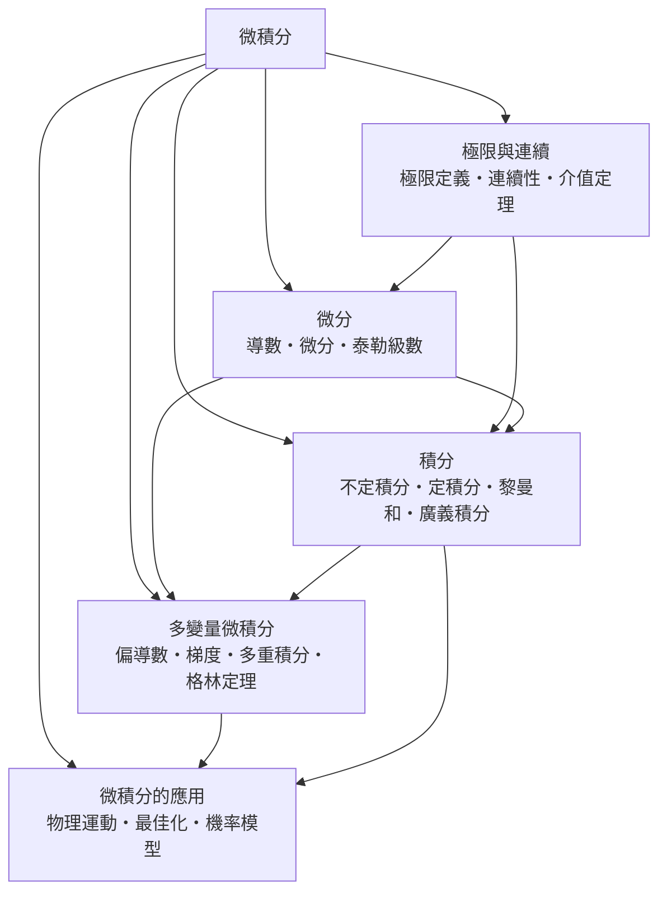

# 微積分

> 隸屬：第一層 [理]　·　相關分類：[數學]、[數學的分支]、[分析]　·　子分類總表見 [README]

> 對應維基百科：[中文維基百科：微積分學](https://zh.wikipedia.org/wiki/%E5%BE%AE%E7%A7%AF%E5%88%86%E5%AD%A6)　·　[English Wikipedia: Calculus](https://en.wikipedia.org/wiki/Calculus)

微積分研究**變化率與累積量**。它有兩個互相對偶的核心操作：微分回答「現在變得多快」，積分回答「累積了多少」。兩者之所以是同一件事的不同面向，是微積分基本定理所保證的：

$$
\int_a^b f'(x)\, dx = f(b) - f(a)
$$

這條公式把「微分後再積分」與「原函數兩端相減」綁在一起，是整個學科的中樞。

微積分是近代科學的共同語言。1687 年 [牛頓] 在《自然哲學的數學原理》中用微積分寫出運動定律與萬有引力定律，把天上與地上的運動統一在同一組方程裡；[萊布尼茲] 則在 1684 年前後以更抽象的符號語言發展出同一套方法，兩人於是各自獨立地建立了這門學科。

然而 17 世紀的微積分建立在「無窮小」之上：一個趨於零但又不等於零的量。這在直覺上很好用，在邏輯上卻站不住腳——它把「極限」這個真正困難的問題藏了起來。19 世紀的 [柯西] 與 [魏爾斯特拉斯] 用「極限」的嚴格定義取代無窮小，才使微積分成為可教授、可檢驗的學科。這個過程也是現代 [分析] 學科的起點。

## 核心問題

微積分的核心問題可以分為四層，彼此嚴格相依。

1. **逼近**：當 $x$ 趨近 $a$ 時， $f(x)$ 趨近什麼？這是 [極限與連續] 的問題，也是其餘一切的基礎。
2. **局部線性化**：在某一點附近，函數最接近什麼樣子？這是 [微分] 的問題，答案是一次式：切線。
3. **累積**：把無限多個極小的量加起來得到什麼？這是 [積分] 的問題，答案可用分割極限刻畫。
4. **推廣與應用**：多個變數同時變動時如何處理（[多變量微積分]），以及如何把上述工具用於物理、工程與機率（[微積分的應用]）。

四層的邏輯順序是：先有極限，才有導數；先有導數，才有牛頓－萊布尼茨公式；先有基本定理，兩大分支才真正是一體的。

## 因果鏈

1. **古希臘的窮舉法**：[阿基米德] 以無限分割求圓的面積，開出「以極限求量」的先河。
2. **17 世紀的問題需求**：[費馬] 處理切線與極值問題，處理運動速度與面積，成為微積分的直接前驅。
3. **牛頓與萊布尼茲的創立**：1684 至 1687 年間，兩人各自建立微積分，牛頓用「流數」記變化率，萊布尼茲用微分符號記無窮小量。
4. **基本定理的確立**：微分與積分的對偶關係被明確表述，微積分成為一個統一體系。
5. **18 世紀的計算時代**：[歐拉] 把微積分用於力學、天文與彈性理論，也大量使用級數，幾乎所有公式都在他手中成形。
6. **嚴格化**：[柯西] 用極限定義取代無窮小；[魏爾斯特拉斯] 給出 $\varepsilon$ – $\delta$ 語言，微積分從「好用的直覺」變成「嚴密的理論」。
7. **多變量推廣**：19 世紀，[高斯] 等人建立偏導數、格林定理與向量分析，微積分進入三維與更高維空間。
8. **應用與演算法**：[拉格朗日]、[傅立葉] 等人把微積分用於力學、天體力學與熱傳導，微積分成為工程與科學的通用工具。

## 子分類的定位與相互驅動

- [極限與連續] 是**地基**：所有微積分定義都以極限為唯一出發點，連續性則是導數存在的必要條件。
- [微分] 是**局部語言**：導數把函數在局部化為一次式，是物理學描述瞬時變化的標準工具。
- [積分] 是**整體語言**：它把「無窮多個小量」變成可計算的數，是微積分從微分那裡換來的第一個回報。
- [多變量微積分] 是**空間推廣**：偏導數、梯度與格林定理讓同一套語言能描述空間中的場、流動與通量。
- [微積分的應用] 是**出口**：物理運動、最佳化與機率模型顯示微積分的抽象並不遠離現實。

## 範例：從速度到距離，再用距離回推速度

**問題**：一輛汽車沿直線行駛，位置為 $s(t) = t^3 - 6t^2 + 9t$ （單位：公尺， $t$ 為秒）。

1. **微分**： $s'(t) = 3t^2 - 12t + 9 = 3(t-1)(t-3)$ ，這是速度； $s''(t) = 6t - 12$ 是加速度。 $t = 1$ 秒時速度為 $0$ ， $t = 3$ 秒時速度也為 $0$ ；當 $t > 3$ 時速度再度為正，說明汽車在 $t = 1$ 到 $t = 3$ 之間倒退。
2. **積分**： $s(2) - s(0) = 8 - 24 + 18 = 2$ 公尺，即前兩秒的位移。
3. **基本定理驗證**： $\int_0^2 s'(t)\,dt = \int_0^2 (3t^2 - 12t + 9)\,dt = [t^3 - 6t^2 + 9t]_0^2 = 2$ ，與位移一致。
4. **最佳化**：令 $s'(t) = 0$ 得 $t = 1, 3$ ；比較 $s(1) = 4$ 與 $s(3) = 0$ ，知 $t = 1$ 秒時位置最遠，正是「倒退」的起點。
5. **物理意義**：同一組公式同時回答了速度、位移與最遠點三個問題——這正是微積分的效率所在。

第二個例子說明為何需要嚴格定義。分段函數

$$
f(x) = \begin{cases} x^2, & x \ne 0 \\ 1, & x = 0 \end{cases}
$$

在 $x = 0$ 處不連續，因此沒有導數；即使只取 $f(x) = |x|$ ，它在 $0$ 處連續但導數不存在（左導數 $-1$ 、右導數 $1$ ）。「連續」與「可導」的差別，正是 [極限與連續] 與 [微分] 各自獨立成篇的理由。

## 容易混淆之處

- **微分與微積分不是同一件事**：「微分」指把變化量線性化的一種運算，而「微積分」是微分與積分的整體學科。
- **導數為零不等於該點為極值**：還需檢查左右行為； $f(x) = x^3$ 在 $0$ 處導數為零但沒有極值。
- **不定積分不是「一個答案」**：它是一族函數，差一個常數，因此談不定積分必須帶上「 $+$ 常數」。
- **極限存在不必等於函數連續**：連續要求極限存在且等於函數值。
- **微積分與數值分析不同**：微積分給出概念與定理，數值分析處理無法用符號解出的問題如何近似。
- **積分與面積不完全等價**：當函數取負值時，定積分是帶符號的面積，必須用「淨面積」理解。

## 延伸閱讀

- [數學]：微積分所屬的整體。
- [分析]：微積分嚴格化之後的完整學科。
- [數學的分支]：分析在數學版圖上的位置。
- [物理學]：微積分最主要的應用領域。
- [機率統計]：以微積分為語言的定量學科。
- [力學]：微分方程的典型來源。

## 連結定義

[理]: ../理/README.md
[README]: README.md
[數學]: ../數學/README.md
[數學的分支]: ../數學/數學的分支.md
[分析]: ../數學/分析.md
[物理學]: ../物理學/README.md
[機率統計]: ../機率統計/README.md
[力學]: ../力學/README.md
[極限與連續]: 極限與連續.md
[微分]: 微分.md
[積分]: 積分.md
[多變量微積分]: 多變量微積分.md
[微積分的應用]: 微積分的應用.md
[牛頓]: ../人/數學家/牛頓.md
[萊布尼茲]: ../人/數學家/萊布尼茲.md
[歐拉]: ../人/數學家/歐拉.md
[柯西]: ../人/數學家/柯西.md
[魏爾斯特拉斯]: ../人/數學家/魏爾斯特拉斯.md
[費馬]: ../人/數學家/費馬.md
[高斯]: ../人/數學家/高斯.md
[阿基米德]: ../人/數學家/阿基米德.md
[拉格朗日]: ../人/數學家/拉格朗日.md
[傅立葉]: ../人/數學家/傅立葉.md
