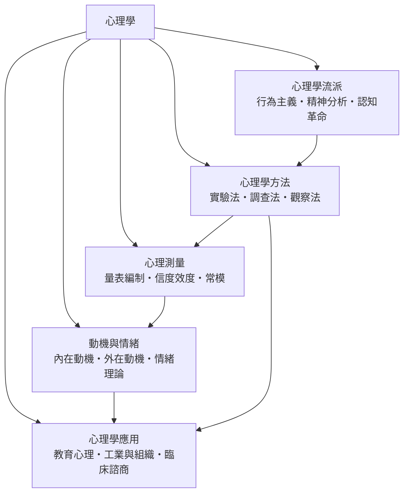

# 心理學

> 隸屬：第一層 [人]　·　相關分類：[認知科學]、[行為科學]、[神經科學]　·　子分類總表見 [README]

> 對應維基百科：[中文維基百科：心理學](https://zh.wikipedia.org/wiki/%E5%BF%83%E7%90%86%E5%AD%A6)　·　[English Wikipedia: Psychology](https://en.wikipedia.org/wiki/Psychology)

心理學是**以經驗方法研究心理現象與行為的科學**。它處理的對象包含注意、記憶、情緒、決策、動機、人格與社會互動；它的核心問題不是「人為什麼會這樣想」這種無法檢驗的追問，而是：**當內在歷程被轉化為可觀察的指標與可比較的數據，什麼樣的解釋才算合格**。

因此，心理學與哲學的分界不在研究主題，而在**證據的門檻**。哲學可以只憑論證推進；心理學若要主張「某種心理機制存在」，就必須能設計一個可能被推翻的實驗，並說明在什麼結果下這個主張會被放棄。這條門檻一旦訂立，帶來兩面性：一方面讓心理學累積了龐大、可累積的知識；另一方面也讓它長期困在方法論的自我懷疑裡。

本概念的問題是：**一套把心智當作可測量對象的科學，是如何從哲學的附庸長成獨立學科，又如何因為自身的成功而遭遇信任危機**。

## 核心問題：可測量的心智

心理學的核心問題可以拆成三個層次，三者互相咬合：

1. **測量的層次**：心理現象不能直接看見。心理學必須先設計「指標」——反應時、正確率、量表分數、生理訊號——再證明這些指標與所要推論的構念之間的關係。**沒有測量，機制無從談起**；[心理測量] 處理的就是這件事。
2. **解釋的層次**：描述（例如「參與者在 800 毫秒內反應」）不等於解釋。解釋要求提出一個能產生預測的機制，並在未被預期的情境下仍然成立。**機制若不能在邊界條件下被檢驗，就只是重新命名**。
3. **因果的層次**：相關無法推出因果。心理學的方法論核心是**隨機分派**——把混淆變項打散，讓處理組與對照組只差在一個處理上。這是 [心理學方法] 存在的理由。

三層的順序不能顛倒：先有可靠的測量，才有可重複的描述，才有可推論的因果，最後才有能被稱為「科學」的理論。反過來說，一個心理學理論若無法被任何實驗結果推翻，它在科學地位上就是空的。

## 因果鏈

1. **哲學附屬期的困境**：19 世紀之前，經驗心理學問題屬於哲學。內省法（introspection，即研究者把自己的內在經驗當作資料）既難以重複，也難以區分「被觀察的心理內容」與「研究者預期的心理內容」。**不可檢驗性成為心理學最大的瓶頸**。

2. **1879 年的實驗室與可重複的操作**：德國萊比錫大學建立第一個實驗心理學實驗室，把「反應時」——例如刺激出現到按鍵的毫秒數——變成可重複量測的依變項。**心理學由此獲得自己的身分**：它不再解釋心靈本質，而是測量心理過程的時間與數量結構。

3. **測量技術與智商量表的成熟**：20 世紀上半葉，量表編制、常模建立與信度效度分析形成體系，使「心理特質」第一次能被量化比較並用於個體決策。**心理學由實驗室走入社會**，同時也取得第一批方法論爭議的素材。

4. **行為主義的清洗（1913–1960 年代）**：以可觀察行為取代內省、以學習法則取代天生本能的取向在 1913 年被明確提出，隨後由操作制約研究推向頂峰。清洗帶來精確的可操作定義，卻也把豐富的內在歷程排除在研究之外；**限制製造反彈，反彈推動下一輪典範轉移**。

5. **認知革命（1950–1970 年代）**：電腦的出現提供了「資訊處理」這個可計算的隱喻，語言學與人工智慧提供了研究複雜符號系統的方法。心智重新被接回來，但這次是以**可以實驗操作的中間層次**（編碼、儲存、檢索）接回來的。心理學的主流問題形式於是從「什麼造成行為」轉為「資訊如何被表示與運算」。

6. **發展、臨床與組織應用的分化（1960–1990 年代）**：心理學不再只有一個核心方法，而是分裂為各有研究對象的次級學科群。**統一的科學身分被應用的多樣性稀釋**——每一個次級領域都發展出自己的典範，也各自捎帶自己的方法論弱點。

7. **效應量、可重複性與信任危機（1990 年代至今）**：心理學發現自己在研究累積上出了問題。2015 年一項針對 100 項已發表研究的重做計畫發現，約 36% 的結果未能重現；更根本的問題是**統計顯著性與實際重要性脫節**，大量研究的樣本太小、報告過度完整，機率門檻又讓「無效應」難以被接受。**學科被迫承認：方法本身的嚴謹度是知識累積的前提**。

8. **註冊報告、預註冊與開放科學**：因應危機的制度性解方出現——研究計畫在收集資料前公開登錄、公開原始資料與分析程式、區分探索性與驗證性分析。**心理學的可信度問題最終由制度設計解決**，這也說明科學的成熟不只靠更好的腦子，還靠更好的流程。

## 子分類的定位與相互驅動

- [心理學方法] 是**地基**：它決定什麼樣的證據算數。抽樣、隨機分派、控制、統計推論這套操作語言，是心理學區別於直觀思辨的地方。它的每一項改進（雙盲、預註冊、效應量報告）都會立刻改變其他子分類的結論強度。

- [心理測量] 是**橋樑**：它把理論構念接到具體題目上，並用信度與效度檢查這座橋是否真的穩固。心理測量的每一次改良都會被 [心理學方法] 吸收為資料品質的標準；反過來，測量的弱點常常正是方法論危機最先爆開的地方。

- [心理學流派] 是**遺產層**：它保存心理學曾經提出的問題與典範，並解釋今天許多概念從哪裡來。[精神分析] 貢獻了無意識與早期經驗的議題設定，[行為主義] 貢獻了操作定義與學習的研究典範，認知革命則貢獻了資訊處理的框架。**流派不是選邊站，而是可用問題的目錄**。

- [動機與情緒] 是**核心現象層**：動機與情緒是最接近日常經驗、又最難被儀器捕捉的對象，因此成為理論密度最高的區域。它逼著心理學回答一個尖銳問題：動機與情緒到底是可分解的認知歷程，還是獨立的生物系統？

- [心理學應用] 是**出口**：教育、組織與臨床三個場域各自累積了大量真實案例，也回頭檢驗理論的邊界。**應用是理論的壓力測試**——一個只在實驗室成立的效應，若在真實班級或真實職場無法複製，它就不是心理學的可靠知識。

## 範例：從一間教室走完五個子分類

以「資優生在課堂上似乎更常主動舉手，是否代表舉手次數可以當作學習動機的指標」這個日常問題為例，看五個子分類如何依序接手：

1. **第一步：用 [心理學方法] 設計可判定的實驗**。直接觀察「舉手多的學生比較愛學習」只是相關。真正可判定的是：把教材難度固定，隨機分派兩種教學方式（其中一種要求每節課至少提問一次），再測量兩組的後測成績差異。**只有在隨機分派下，差異才可能被歸因於教學方式**。若樣本只有 12 人，即使教學方式有效，也需要相當大的效應才會顯著——這一步就觸及心理學最誠實的自我限制：樣本要多大才算夠。

2. **第二步：用 [心理測量] 決定「舉手」是什麼指標**。舉手次數可以當成動機指標嗎？這要看它與目標構念的關聯。如果同一份「學習動機量表」的分數與舉手次數的相關只有 0.2 左右，該指標的效度就偏低；但若把它當作**課堂參與度**的指標而非動機指標，效度反而可能很高。**同一個行為在不同構念下有不同價值**，這是測量學的核心提醒。

3. **第三步：用 [心理學流派] 檢查解釋框架**。若沿用 [行為主義] 的思路，主動提問是可被塑造的行為，應用操作制約與回饋設計；若沿用認知革命的思路，重點應放在注意分配與工作記憶負荷；若沿用 [精神分析] 的思路，則會追問提問行為背後的權力關係與安全感。**框架決定你會測什麼變項**，因此流派不是修辭。

4. **第四步：用 [動機與情緒] 解釋結果為何不一致**。為什麼有人被要求提問後反而更退縮？這牽涉到內在與外在動機的關係——被外在要求而做的事，若本身缺乏勝算感與自主性，可能削弱內在動機；此外，失敗帶來的羞恥情緒會進一步抑制發言。**沒有動機與情緒這一層，資料只能停在「平均分提高 4 分」**。

5. **第五步：用 [心理學應用] 決定是否值得推廣**。教育心理的現場要求是：這個效應在真實班級（30–40 人、有固定課表、有教師效應）是否還成立？工業與組織的對應問題則是，這套做法搬到團隊會議或客服訓練是否也成立？臨床諮商領域則提醒，若對象焦慮程度高，就需要不同的介入。**一個效應的價值最後由它的適用邊界決定**。

6. **回頭看整條鏈**：整個案例從「看起來相關」走到「可以下結論並知道結論的邊界」，一共跨過方法、測量、框架、動機、應用五道關卡。**心理學的專業性，不是來自答案多，而是來自知道每一步答案能承擔多少重量**。

## 容易混淆之處

- **心理學不等於心理諮商**：心理學是研究與評量的學科，諮商是介入與服務的實務；兩者共享工具但目標不同。
- **「心理學證明」不意味著「永遠正確」**：心理學是**累積性的科學**，結論有支持強度與爭議狀態；引用時應說明是「有大量後續支持」還是「仍有爭議」。
- **相關不等於因果**：尤其在無法隨機分派的研究（年齡、性別、選擇性留樣）中，相關係數再高也不能支持因果推論。
- **顯著不等於重要**： $p < 0.05$ 只說明「大概不是隨機波動」，不說明效應夠大；樣本大時極小的無意義差異也會顯著，因此必須同時報告效應量與信賴區間。
- **量表分數不等於人的價值**：量表是測量工具，不是對人的評分；常模是特定族群的相對位置，跨文化使用需重新建立常模。
- **實驗室不等於真實世界**：控制得越好，情境越人工；生態效度與控制效度之間永遠存在取捨。
- **「個體差異」不是雜訊**：平均效應下的個體差異本身是研究對象，把差異平均掉的設計會讓重要機制被抹去。

## 延伸閱讀

- [認知科學]：與心理學共享資訊處理的框架，但更聚焦於跨學科（語言、神經、計算、哲學）的整合。
- [行為科學]：以行為為本的應用科學，與動機、習慣設計、行為改變直接相接。
- [神經科學]：為心理現象提供生物機制的解釋層。
- [發展心理學]、[社會心理學]：心理學中兩條成熟的主幹分支。
- [臨床心理學]、[心理治療]：心理學的臨床應用端。
- [概率統計]：心理學方法論的算術基礎。
- [哲學]：心理學的哲學問題域——心智、因果、自由意志與科學解釋的邊界。

## 連結定義

[人]: ../人/README.md
[README]: README.md
[認知科學]: ../認知科學/README.md
[行為科學]: ../行為科學/README.md
[神經科學]: ../神經科學/README.md
[發展心理學]: ../發展心理學/README.md
[社會心理學]: ../社會心理學/README.md
[臨床心理學]: ../臨床心理學/README.md
[心理治療]: ../心理治療/README.md
[概率統計]: ../機率統計/README.md
[哲學]: ../哲學/README.md
[心理學方法]: 心理學方法.md
[心理測量]: 心理測量.md
[心理學流派]: 心理學流派.md
[動機與情緒]: 動機與情緒.md
[心理學應用]: 心理學應用.md
[行為主義]: 行為主義.md
[精神分析]: 精神分析.md
