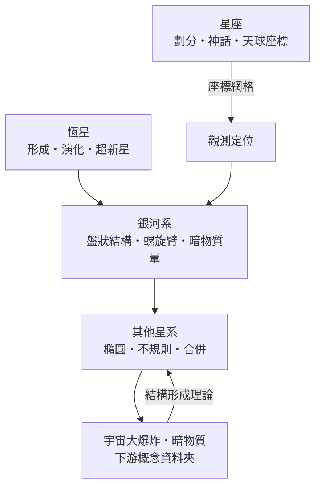

# 恆星系

> 隸屬：第一層 [天]　·　相關分類：[天文學]、[物理學]、[數學]　·　子分類總表見 [README]

> 對應維基百科：[中文維基百科：星系]　·　[English Wikipedia: Galaxy]

恆星系（galaxy，又譯星系）是由數十億到數兆顆恆星、星際氣體與塵埃、以及暗物質，靠重力束縛而成的巨大系統。它回答的問題是：**恆星不是孤立的——它們如何聚集成系統、系統如何形成與演化、我們的銀河系在其中是什麼位置**。本概念從恆星出發，經星座與銀河系，最後推廣到銀河系之外的宇宙；它上承 [天文學] 的觀測與分類，下接 [宇宙大爆炸] 與 [暗物質] 等宇宙學議題。

## 核心問題

恆星系的核心問題有三層：

1. **恆星層次**：恆星如何形成、發光、演化與死亡？物理關鍵是重力與輻射壓的平衡。恆星主序期的光度與質量有冪律關係 $L \propto M^{3.5}$ ，質量差一倍光度差十倍以上，這決定了大質量恆星只活幾百萬年、太陽卻能燃燒上百億年。
2. **銀河系層次**：我們的家是什麼形狀？如何用恆星的分布與運動重建它的盤狀結構、螺旋臂與暗物質暈？
3. **星系層次**：千姿百態的星系（螺旋、橢圓、不規則）從何而來？星系合併與環境如何塑造它們？

衡量天體亮度的標準量是星等：星等差 5 等對應亮度比 100 倍，即 $m_1 - m_2 = -2.5 \log_{10}(F_1/F_2)$ 。這個對數標尺讓天文學家能把從太陽到暗弱遠星系的亮度放在同一張表上比較。

## 因果鏈

1. **瓶頸：恆星只是光點**。十九世紀以前，恆星的位置可以量，但溫度、化學與距離一概不知，「恆星物理」無從谈起。
2. **解法：光譜術登場**。十九世紀末把光譜術應用到恆星，光譜型序列（O 到 M）出爐，溫度與化學成分第一次可測，恆星從光點變成物理對象。
3. **量出距離**。1912 年勒維特發現造父變星週光關係，加上視差定標，距離階梯建立；1924 年 [哈勃] 量出仙女座在銀河系之外，星系成為獨立的宇宙單位。
4. **銀河系成形**。沙普利用球狀星團分布定出太陽不在銀河系中心，射電天文（21 公分譜線）穿透塵埃，描繪出螺旋臂，盤狀結構確立。
5. **暗物質現形**。1970 年代魯賓與福特量測星系旋轉曲線，外側速度不降反升，可見物質的質量解釋不了——星系成為暗物質問題的主要證據來源。
6. **星系的動態歷史**。深場影像顯示遠古星系更小更亂，合併是常態；星系分類從靜態音叉圖變成動態演化史。
7. **回饋宇宙學**。星系的紅移巡天畫出宇宙的大尺度纖維結構，星系成為檢驗 [宇宙大爆炸] 模型與 [暗物質] 性質的探針。

## 子分類的定位與相互驅動

### 恆星

[恆星] 是恆星系的基本建材：研究恆星如何從分子雲塌縮誕生、如何在主序燃燒、如何以白矮星、中子星或超新星收場。理解恆星的演化時標與產物，是解讀星系光譜（星系的顏色等於其恆星族群的年齡組成）的前提；反過來，星系環境又決定新恆星的形成率。

### 星座

[星座] 是人類最早對星空的系統化：把肉眼可見的恆星連成圖案、劃分天區、編織神話。它看似文化層面，實則是天文學的座標起點——現代 88 個官方星座就是天球座標系的經緯網格，而星座神話保存了古代觀測的口述記錄。

### 銀河系

[銀河系] 把望遠鏡對準我們自己的家：用球狀星團、脈衝星與恆星計數重建盤狀結構與螺旋臂，用恆星運動推導暗物質暈。銀河系是唯一能對單顆恆星逐一解析的星系，因此是所有星系研究的對照組；星系研究的通用結論，也回頭修正我們對銀河系的理解。

### 其他星系

[其他星系] 把視野推到銀河系之外：橢圓星系、不規則星系、星系群與星系合併。正是觀測別的星系，我們才知道銀河系會與仙女座星系在約 45 億年後合併、才知道星系中心普遍藏著超大質量黑洞、才量出暗物質的主導地位。

## 範例

以仙女座星系（M31）的定位史示範「恆星系」三個層次如何接棒。十八世紀起，天文學家看到仙女座「星雲」卻無法判斷它在銀河系內還是外——這是當年「星雲是什麼」的核心爭議。1912 年勒維特發現造父變星週光關係；1923 年 [哈勃] 在仙女座星雲中找到造父變星，用週光關係算出距離約 90 萬光年（今值約 254 萬光年），遠超銀河系尺度——仙女座是獨立的星系，宇宙一夜之間放大了。之後銀河系層次的知識（沙普利定出的銀河系大小、造父定標）反過來校準星系距離；星系層次的觀測（仙女座的旋轉曲線、與銀河系的相對速度）又餵給宇宙學：兩個星系將在約 45 億年後合併，合併史正是星系演化的縮影。

## 容易混淆之處

- **「恆星系」與「行星系」**：「恆星系」歷史上是 galaxy 的舊譯；行星系（如太陽系）指繞一顆恆星的行星系統，尺度差了十個數量級。
- **星座不是實體**：同一星座裡的恆星通常距離彼此數百光年，只是投影方向相近；星座是天球的劃分，不是重力束縛的系統。
- **銀河系不是宇宙的中心**：太陽不在銀河系中心（約距 2.6 萬光年），銀河系也不在宇宙任何特殊位置——宇宙學原理假設沒有中心。
- **星雲與星系**：歷史上混稱「星雲」，今日星雲指銀河系內的氣體塵埃雲，星系才是獨立的恆星系統。
- **光年與秒差距**：1 秒差距約 3.26 光年，專業文獻慣用秒差距，科普慣用光年。

## 延伸閱讀

- 學科全貌與觀測基礎見 [天文學]，其中 [天體物理] 與 [宇宙學] 條目是本概念的理論基礎。
- 恆星演化的終點與極端天體見 [黑洞]。
- 星系尺度資料的宇宙學解讀見 [宇宙大爆炸] 與 [暗物質]。
- 望遠鏡與太空望遠鏡如何拍出星系影像，見 [物/望遠鏡] 與 [物/哈伯太空望遠鏡]。
- 第一層總覽見 [天]。

## 連結定義

[天]: ../天/README.md
[README]: README.md
[天文學]: ../天文學/README.md
[物理學]: ../物理學/README.md
[數學]: ../數學/README.md
[天體物理]: ../天文學/天體物理.md
[宇宙學]: ../天文學/宇宙學.md
[哈勃]: ../人/天文學家/哈勃.md
[恆星]: 恆星.md
[星座]: 星座.md
[銀河系]: 銀河系.md
[其他星系]: 其他星系.md
[黑洞]: ../黑洞/README.md
[宇宙大爆炸]: ../宇宙大爆炸/README.md
[暗物質]: ../暗物質/README.md
[物/望遠鏡]: ../物/望遠鏡.md
[物/哈伯太空望遠鏡]: ../物/哈伯太空望遠鏡.md
[中文維基百科：星系]: https://zh.wikipedia.org/wiki/%E6%98%9F%E7%B3%BB
[English Wikipedia: Galaxy]: https://en.wikipedia.org/wiki/Galaxy
