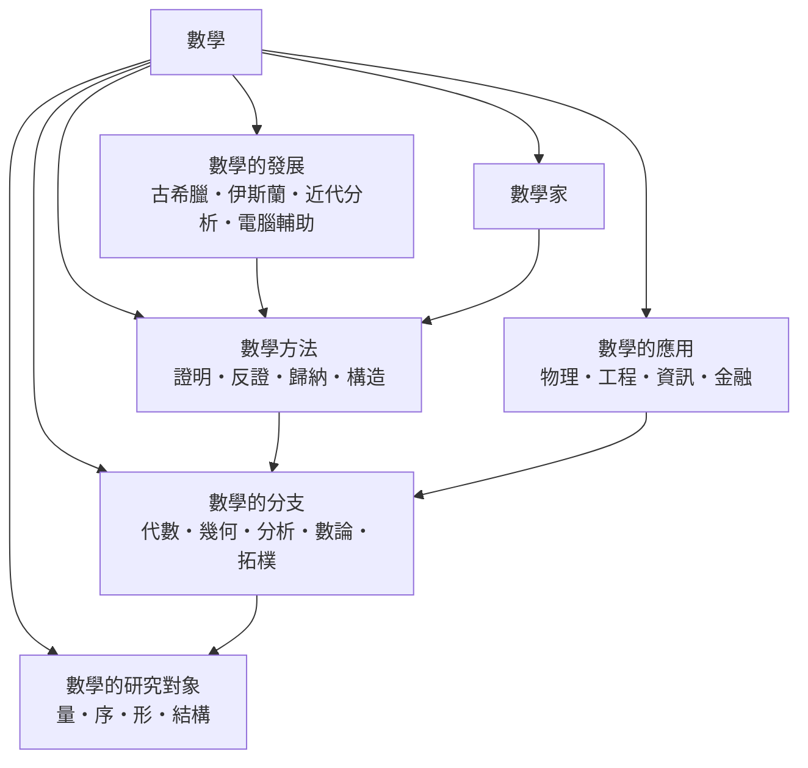

# 數學

> 隸屬：第一層 [理]　·　相關分類：[代數學科]、[幾何學科]、[物理學]、[邏輯學]　·　子分類總表見 [README]

> 對應維基百科：[中文維基百科：數學](https://zh.wikipedia.org/wiki/%E6%95%B0%E5%AD%A6)　·　[English Wikipedia: Mathematics](https://en.wikipedia.org/wiki/Mathematics)

數學研究**數量、大小、形狀與結構，以及它們之間的關係**。它與其他科學的根本差別在於：數學的命題不必靠觀察世界來判定真偽，只要公理（明示承認的前提）與推理規則固定下來，真假就被完全決定了。一個數學定理的證明一旦成立，就不需要重做，也不會因為新資料出現而失效。

因此數學有兩副面孔。面向外部，它是自然科學與工程的語言：牛頓用微積分寫出萬有引力，[高斯] 用誤差理論處理大地測量，資訊理論用資訊量衡量通訊成本。面向內部，它是一門可以不依賴經驗的學問：從「哪些量可以比較大小」這類最日常的問題出發，一路推演到群、拓樸空間、概形這類高度抽象的結構。

本概念要回答的核心問題是：**數學憑什麼可以被稱為科學，而它的抽象又是從哪裡長出來的**。

## 核心問題

把「數學」拆成三個互相牽動的問題，纔看得到它的完整面貌。

1. **什麼是數學的對象？** 數學研究的不是具體事物，而是「量的形式」——量、序、形、結構。它們可以脫離任何實例獨立存在，這就是抽象的起點。
2. **數學靠什麼前進？** 靠證明。證明是一種不依賴經驗的保證，其核心手段包括反證、歸納、構造與類比；每一種手段都有其適用範圍與代價。
3. **數學如何累積？** 靠公理化與結構分類。一個領域成熟的標誌是：它能把對象歸入有限的類型，而每類的行為可被系統研究。
4. **數學與其他學科如何交界？** 靠模型。物理與工程提供問題與檢驗，數學提供可解釋、可預測、可設計的工具。

## 因果鏈

1. **古埃及與巴比倫的實用計算**：土地測量、利息計算、天文曆法產生四則運算、分數與方程的雛形，數學首先是一套「術」。
2. **古希臘的公理化轉向**：[歐幾里得] 在前 300 年左右以少數公理推導全書，證明「從前提推出結論」比「會算」更有力量，數學第一次有了方法論。
3. **中國的算法傳統**：[九章算術] 以 246 題的程序與術語，保存了方程術、正負術與盈不足術，構成與希臘不同的另一條路徑。
4. **代數符號化**：笛卡兒在 1637 年引入座標與符號運算，使幾何與代數互通，方程成為可操作的對象。
5. **微積分與分析**：牛頓與萊布尼茲在 17 世紀建立無窮小運算，把變化率與累積量變成運算對象，隨後柯西、魏爾斯特拉斯等人把它們嚴格化。
6. **結構分類時代**：19 世紀末，伽羅瓦、諾特等人把「結構」而非「元素」當作對象；[希爾伯特] 1900 年的 23 問題則把公理化方法推向整個學科。
7. **抽象與統一**：20 世紀的範疇論、概形、泛函分析把看似無關的領域接成同一張網，數學從學科的集合走向統一語言。
8. **電腦輔助與計算轉向**：從 1976 年的四色定理電腦驗證到今日的符號代數與機器學習，數學的證明工具與研究對象都開始包含演算法。

## 子分類的定位與相互驅動

- [數學的研究對象] 是**地基**：先決定什麼是量、序、形、結構，分支才知道自己能做什麼。
- [數學的分支] 是**版圖**：代數、幾何、分析、數論、拓樸各自有方法，又互相借用對象。
- [數學方法] 是**引擎**：證明、反證、數學歸納、構造是把猜想變成定理的四種動力。
- [數學的發展] 是**時間軸**：說明當前的工具為什麼長成今天的樣子，例如為什麼歐氏幾何的公理體系能支配兩千年。
- [數學的應用] 是**出口**：物理、工程、資訊、金融把數學的結果變成對象世界的預測與設計。
- [數學家] 是**主體**：把上述五者串起來的歷史人物群，其養成與制度是數學累積的關鍵。

## 範例：從一個樸素的問題到現代數學

問題是：「對角線長度相同的矩形，哪一個面積最大？」

1. **第一階段（初等幾何）**：設長 $a$ 、寬 $b$ ，對角線長 $d$ 滿足 $a^2 + b^2 = d^2$ ，面積 $S = ab$ 。由 $2ab \le a^2 + b^2$ 得 $S \le d^2/2$ ，等號在 $a = b$ （正方形）成立。
2. **第二階段（微積分）**：固定 $a^2 + b^2 = d^2$ ，令 $b = \sqrt{d^2 - a^2}$ ，則 $S(a) = a\sqrt{d^2 - a^2}$ ，求導得 $S'(a) = \frac{d^2 - 2a^2}{\sqrt{d^2 - a^2}}$ ，令其為零得 $a = d/\sqrt{2}$ ，同樣得到正方形，並且能用二階導數判定為最大值。
3. **第三階段（幾何與對稱）**：把所有長度固定的矩形視為半徑 $d/2$ 的圓週上的點，面積正比於對角線夾角，問題變成「夾角何時為直角」，答案由對稱性直接給出。
4. **第四階段（一般化）**：把矩形放進 $n$ 維空間的固定對角線盒子，最大體積問題的答案是每邊等長的超立方體，這在高斯 1840 年代的連續性論證中給出了嚴格處理。
5. **第五階段（最優化與對偶）**：在經濟學中，這一「對給定代價函數最大化效用」的問題變成對偶理論，由拉格朗日乘子與凸分析處理，並直接支撐 [機率統計] 與 [經濟學] 中的模型。

同一個問題在五個層次上被重新表述，每一個層次都把前一層的困難轉化為新工具的示範案例。

## 容易混淆之處

- **數學不是「算術」**：算術只是數學的一小部分，幾何、拓樸、邏輯同樣屬於數學。
- **數學不是「純粹抽象」**：幾乎所有抽象概念都源自具體問題的提煉，只是提煉之後可以獨立存在。
- **抽象程度不等於價值高低**：哥德巴赫猜想至今未解，卻比許多已證明的定理更能推動新的方法。
- **「數學證明」與「自然科學驗證」不同**：前者是邏輯必然，後者是經驗支持，兩者不可互相替代。
- **數學與物理的關係不是單向的**：物理提供直覺與問題，數學常以自身的邏輯發現物理尚未預見的解，例如 [伽羅瓦] 理論先於其物理應用。

## 延伸閱讀

- [數學的分支]：數學內部的完整地圖。
- [數學方法]：如何把猜想變成定理。
- [數學的發展]：從古希臘到電腦輔助的時間軸。
- [數學家]：制度與人物。
- [科學史]：數學與其他科學的相互塑造。
- [邏輯學]：證明的邏輯基礎。

## 連結定義

[理]: ../理/README.md
[README]: README.md
[數學的研究對象]: 數學的研究對象.md
[數學的分支]: 數學的分支.md
[數學方法]: 數學方法.md
[數學的發展]: 數學的發展.md
[數學的應用]: 數學的應用.md
[數學家]: 數學家.md
[代數學科]: ../代數/README.md
[幾何學科]: ../幾何/README.md
[物理學]: ../物理學/README.md
[邏輯學]: ../邏輯學/README.md
[機率統計]: ../機率統計/README.md
[經濟學]: ../經濟學/README.md
[科學史]: ../科學史/README.md
[九章算術]: 九章算術.md
[歐幾里得]: ../人/數學家/歐幾里得.md
[高斯]: ../人/數學家/高斯.md
[希爾伯特]: ../人/數學家/希爾伯特.md
[伽羅瓦]: ../人/數學家/伽羅瓦.md
