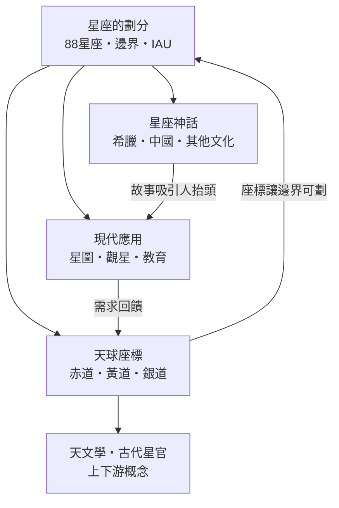

# 星座

> 隸屬：第一層 [天]　·　相關分類：[天文學]、[古代星官]、[恆星系]　·　子分類總表見 [README]

> 對應維基百科：[中文維基百科：星座]　·　[English Wikipedia: Constellation]

星座是人類為了記住天空而發明的「抽屜系統」：把肉眼可見的恆星依想像連成圖案，再以這些圖案為界，把整個天球劃分成可以命名、可以指認的區域。它解決的核心問題是——**面對幾千顆看起來完全相同的光點，如何用一套有限的、可傳授的名稱，讓任何人都能在夜空中指出「那一顆是哪一顆」**。因此星座本質上不是天文學的物理分類（同一星座裡的恆星往往彼此毫無關聯，距離可能相差千倍），而是一套**方向性的座標語言**：只要說出「天鵝座的方向」，不管你身在何處、文化為何，都能對準同一片天區。

## 核心問題

星座要回答的問題可以拆成三層：

1. **記憶**：如何在沒有紙筆的時代把星空知識一代代傳下去？答案是故事——把恆星連成獵人、天蠍、熊，故事比星表好記。
2. **指認**：如何在口語中精確指出某顆星？答案是區域命名——「獵戶座左肩的星」（參宿四）比「北偏東三十度、仰角四十度那顆」好用的多。
3. **定位**：如何把「大致在哪個星座」升級成「精確的數學座標」？答案是天球座標系——以星座為直覺、以赤經赤緯為精度。

第三層的數學基礎是天球概念：想像以觀測者為球心、半徑無限大的球面，所有天體投影在球面上。恆星的赤道座標由赤經 $\alpha$ （0 至 24 時）與赤緯 $\delta$ （ $-90^\circ$ 至 $+90^\circ$ ）給定；例如織女星的座標約為 $\alpha = 18^h 36^m$ 、 $\delta = +38.8^\circ$ 知道座標就能在全球任何觀測地點把它找出來。

## 因果鏈

1. **瓶頸：裸眼看星空是無結構的光點海**。史前人類在夜間辨識方向、決定播種與遷徙時機，迫切需要一套可分享的天空記憶法。
2. **解法：連星成圖**。兩河流域、埃及、中國各自把亮星連成圖案並附上神話，[星座神話] 於焉誕生；故事承載了季節、方位與曆法資訊。
3. **希臘系統化**。托勒密在《天文學大成》（約 150 年）整理 48 個星座，成為西方星圖千年範本；阿拉伯天文學家補上南天缺口並傳承星名。
4. **大航海暴露混亂**。十六至十七世紀航海者進入南半球，望遠鏡又讓暗星大量現形，各國星圖各自命名、邊界互相重疊，同一片天區可能同時屬於兩個「星座」。
5. **解法：國際標準化**。[國際天文聯合會]（IAU）於 1922 年正式確認 88 個星座名單，1928 至 1930 年由德勞耶沿天球經緯線劃定每個星座的精確邊界——星座從「圖案」變成「法定行政區」。
6. **座標語言普及**。有了固定邊界，任何天體都能以「位於某星座＋精確座標」登記；變星、彗星、超新星的通報與編目從此有共同語言。
7. **應用下放到大眾**。星圖、天文教育與業餘觀星把這套系統變成全民文化資產，占星術則挪用「黃道十二星座」之名另立一套非科學體系。

## 子分類的定位與相互驅動

### 星座的劃分

[星座的劃分] 是整個體系的「憲法」：誰有權決定天上分幾區、每區邊界在哪裡。它記錄了從托勒密 48 星座到 [88星座] 的法定化過程，以及 [國際天文聯合會] 如何用 [分區]（沿赤經赤緯的折線邊界）終結數百年的命名混亂。劃分一旦確定，神話、座標、應用三個子分類才有穩定的遊戲規則可循。

### 星座神話

[星座神話] 是體系的「記憶層」：[希臘神話] 提供西方星座的人物與情節，[中國星宿] 以三垣二十八宿建立完全獨立的東方分區，[其他文化]（巴比倫、埃及、毛利、印加）證明連星成圖是人類的普遍衝動。神話驅動了觀星的動機——人先被故事吸引，才會抬頭學認星星；而天文教育正是借用這股驅動力。

### 天球座標

[天球座標] 是體系的「數學層」：[赤道座標]、[黃道座標]、[銀道座標] 分別服務地面觀測、行星運動與銀河系研究，[赤經赤緯] 則是現代星表的通用格式。座標系把星座從「藝術」變成「工程」：IAU 能劃出精確邊界，正是因為先有了球面座標這把尺。

### 現代應用

[現代應用] 是體系的「出口」：[星圖] 把座標與星座畫成人人可用的地圖，[觀星] 是大眾的實作場域，[天文教育] 把星座當作科普的第一扇門，[星座占星] 則是流行文化對星座符號的（非科學）挪用。應用端回頭要求劃分層保持穩定——這也是為什麼 88 星座邊界自 1930 年後幾乎不再更動。

## 範例

以**獵戶座**完整走一遍這個體系。神話層：它是希臘神話中的巨人獵人俄里翁，死後被宙斯放到天上，與天蠍座永遠處在天球兩端、不會同時出現——這其實是觀測事實（獵戶座冬季上半夜可見，天蠍座夏季可見）被包裝成故事。劃分層：獵戶座是 88 個官方星座之一，邊界由 IAU 沿赤經赤緯折線劃定，面積 594 平方度，在全天空排第 26。座標層：獵戶座橫跨赤經約 4.7 至 6.4 時、赤緯約 $-11^\circ$ 至 $+23^\circ$ ；其腰帶三星（參宿一、參宿二、參宿三）幾乎排在赤緯 $-1^\circ$ 附近，是全世界觀星者的定位路標。應用層：沿腰帶三星向東南延伸可找到全天最亮的天狼星，向北則指向金牛座的畢宿五——新手第一晚學的就是這兩條「星座路標」。同一個星座，在神話、法律、數學、教學四個層次各有面貌，卻彼此扣合。

## 容易混淆之處

- **星座是視線投影，不是物理集團**：獵戶座的參宿四距離約 550 光年，參宿七約 860 光年，兩顆星毫無引力關聯，只是恰好投影在同一片天區。真正的物理集團叫星團或星系。
- **星座不等於占星**：占星術的「十二星座」只是黃道帶的十二個等分區塊，且因歲差，今天太陽在生日當天其實位於前一個星座；占星沒有可重複驗證的預測力。
- **星座數是 88，不是 12**：黃道十二星座只是穿越黃道面的少數星座；IAU 認定的星座總數是 88 個，另有蛇夫座橫跨黃道，所以嚴格說黃道穿過 13 個星座。
- **星座與星官**：中國傳統的「星官」是把星組織成官署體系（如紫微垣象徵皇宮），分區邏輯與西方星座不同；兩者可對照但不可混同，詳見 [古代星官]。
- **邊界是折線不是圖案輪廓**：星圖上畫的獵戶座人形只是示意；法定邊界是沿赤經赤緯的階梯狀折線，常與圖案輪廓相差甚遠。

## 延伸閱讀

- 第一層總覽見 [天] 入口頁；同層的天文觀測設施見 [天文台]。
- 恆星本身的物理性質（光度、光譜、演化）見 [恆星系] 與其中的 [恆星系星座] 概述。
- 東方分區體系的完整整理見 [古代星官]。
- 星座的觀測用途與望遠鏡實作見 [天文學]。
- 各子分類的細節請由 [README] 的分類表進入。

## 連結定義

[88星座]: 88星座.md
[English Wikipedia: Constellation]: https://en.wikipedia.org/wiki/Constellation
[README]: README.md
[中國星宿]: 中國星宿.md
[中文維基百科：星座]: https://zh.wikipedia.org/wiki/%E6%98%9F%E5%BA%A7
[其他文化]: 其他文化.md
[分區]: 分區.md
[古代星官]: ../古代星官/README.md
[國際天文聯合會]: 國際天文聯合會.md
[天]: ../天/README.md
[天文台]: ../天文台/README.md
[天文學]: ../天文學/README.md
[天文教育]: 天文教育.md
[天球座標]: 天球座標.md
[希臘神話]: 希臘神話.md
[恆星系]: ../恆星系/README.md
[恆星系星座]: ../恆星系/星座.md
[星圖]: 星圖.md
[星座占星]: 星座占星.md
[星座的劃分]: 星座的劃分.md
[星座神話]: 星座神話.md
[現代應用]: 現代應用.md
[觀星]: 觀星.md
[赤經赤緯]: 赤經赤緯.md
[赤道座標]: 赤道座標.md
[銀道座標]: 銀道座標.md
[黃道座標]: 黃道座標.md
