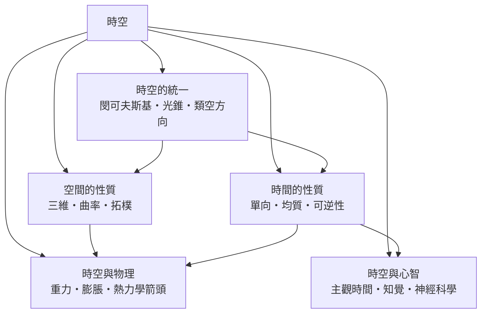

# 時空

> 隸屬：第一層 [時]　·　相關分類：[相對論]、[物理學]、[時間哲學]　·　子分類總表見 [README]

> 對應維基百科：[中文維基百科：時空](https://zh.wikipedia.org/wiki/%E6%97%B6%E7%A9%BA)　·　[English Wikipedia: Spacetime](https://en.wikipedia.org/wiki/Spacetime)

**時空**是把空間與時間合併成單一对象的物理框架。
在牛頓的 picture 裡，空間是盛放萬物的容器，時間是所有容器共用的流逝背景；
在愛因斯坦的 picture 裡，四維時空是一個連續的流形，物質與事件都是其中的幾何配置，而「哪裡是空間、
哪裡是時間」則取決於觀測者的運動狀態。

這個觀念的轉變不是哲學趣味，而是被迫的：
邁克耳孫－莫雷實驗的零結果與光速不變的 postulate 要求空間與時間在數學上必須以同一種方式處理。
1908 年 [閔可夫斯基] 把時間軸與三個空間軸並列成四維幾何，讓「同時性的相對性」
從一個悖論變成旋轉的直覺。

## 核心問題

時空要回答的核心問題有三層。

1. **事件如何定位**：在什麼參考系中，某個事件發生在什麼位置、什麼時刻？答案是**時空間隔**，由類時、類空、類光三種區別對待。
2. **因果如何判定**：兩個事件是否可能因果相連？答案是由光錐結構給出——落在同一光錐之內才可能有因果連線，落在光錐之外則只能相關而不能影響。
3. **時空如何被物質改變**：
物質與能量不僅存在於時空之中，還會使時空彎曲，由方程 $G_{\mu\nu} + \Lambda g_{\mu\nu} = \frac{8\pi G}{c^4}T_{\mu\nu}$ 描述，這正是 [重力] 的幾何表述。

三層問題的順序不能顛倒：先要能描述位置與時刻，才能談因果結構；先有因果結構，才能問動態的時空如何被物質決定。

## 因果鏈

1. **牛頓的絕對時空**：17 世紀的時空觀把時間視為自流的均勻實體，空間視為獨立容器，這為整個機械論世界觀提供了座標系。
2. **光速不變的困境**：1887 年邁克耳孫－莫雷實驗顯示光速不隨地球運動而改變，以太假說難以成立。
3. **洛倫茲的數學**：洛倫茲找出使麥克士威方程保持形式不變的座標變換，但保留了以太的解釋。
4. **狹義相對論的幾何化**：1905 年 [愛因斯坦] 以兩條公理取代以太：相對性原理與光速不變原理，並指出同時性是相對的。
5. **四維時空**：1908 年 [閔可夫斯基] 主張「空間與時間本身只不過是礦石的四面折痕」，四維時空與光錐概念由此確立。
6. **廣義相對論**：1915 年 [愛因斯坦] 把等效原理推到底，認為重力不是力而是時空的曲率，並於 1917 年引入宇宙學常數。
7. **量子與宇宙學的追問**：量子力學要求把時空也量子化，宇宙學則用膨脹模型重新檢驗「時間之箭」與初始條件。
8. **心智與時間的匯流**：神經科學與認知科學發現，主觀時間的流逝速率與注意力、情緒、生理節律相關，物理的時空與心智的時間被迫面對彼此。

## 子分類的定位與相互驅動

- [時空的統一] 是**骨架**：它把獨立的空間與時間合併為同一個幾何對象，並以 [光錐] 與 [類空方向] 刻畫因果結構，其餘四個分支都在這副骨架上展開。
- [空間的性質] 是**幾何面**：回答空間有幾維（[三維]）、如何彎曲（[曲率]）、拓撲上如何連通（[拓樸]），工具來自 [數學]。
- [時間的性質] 是**方向面**：處理單向性（[單向]）、均質性（[均質]）與可逆性（[可逆性]），這是與物理學、哲學都最常交鋒的部分。
- [時空與物理] 是**應用面**：把時空幾何接到重力（[重力]）、宇宙膨脹（[膨脹]）與熱力學箭頭（[熱力學箭頭]），形成從微觀到宇觀的完整敘事。
- [時空與心智] 是**主觀面**：處理人如何經驗時間（[主觀時間]）、知覺（[知覺]）與 [神經科學] 的成果，提醒我們客觀的時空只是人類建模的產物之一。

## 範例

**光錐與可通訊性。** 假設兩事件在某一參考系中的間隔為 $\Delta t = 1$ s、 $\Delta x = 2\times10^8$ m，則

$$
c^2\Delta t^2 - \Delta x^2 = (3\times10^8)^2 \times 1^2 - (2\times10^8)^2 = 5\times10^{16}\ \mathrm{m^2} > 0
$$

屬於類時間隔，代表兩事件可能因果相連；
若改成 $\Delta x = 4\times10^8$ m，則間隔為零，是光訊號的軌跡；
若 $\Delta x = 5\times10^8$ m，則為類空間隔，任何訊號都無法在兩者之間傳遞。

**GPS 的修正量。
** 衛星以 $3.9$ km/s 繞地飛行，其相對論時間膨脹使衛星時鐘每天慢約 $7$ 微秒，與引力造成的快約 $45$ 微秒大致抵消，但仍淨慢約 $38$ 微秒；
若不修正，定位誤差每天累積約十公里。

## 容易混淆之處

- **時空不是「四維空間」**：第四維的物理意義是時間，其結構與空間不同（正負號相反）。
- **時間膨脹不是時間變慢的「效果」**：是兩個事件之間的固有間隔不同，而不是鐘錶走快或走慢。
- **同時性不是絕對的**：在光速不變的前提下，同時性取決於參考系，這正是「同時事件的先後」可以交換的根源。
- **曲率不是「重力彎曲空間」**：在廣義相對論中，被彎曲的是整個時空，而非只有空間部分。
- **主觀時間與物理時間不同**：前者受注意力與生理狀態調控，後者由測量規範定義。

## 延伸閱讀

- [相對論]：時空觀念的物理學來源。
- [物理學]：學科層級的上位脈絡。
- [時間哲學]：時間的哲學分析傳統。
- [數學]：時空所依賴的幾何與拓樘工具。
- [熵增]：時間箭頭的另一條解釋路線。

## 連結定義

[時]: ../時/README.md
[README]: README.md
[相對論]: ../相對論/README.md
[物理學]: ../物理學/README.md
[時間哲學]: ../時間哲學/README.md
[數學]: ../數學/README.md
[熵增]: ../熵增/README.md
[愛因斯坦]: ../人/物理學家/愛因斯坦.md
[閔可夫斯基]: ../人/數學家/閔可夫斯基.md
[時空的統一]: 時空的統一.md
[光錐]: 光錐.md
[類空方向]: 類空方向.md
[空間的性質]: 空間的性質.md
[三維]: 三維.md
[曲率]: 曲率.md
[拓樸]: ../數學/拓樸.md
[時間的性質]: 時間的性質.md
[單向]: 單向.md
[均質]: 均質.md
[可逆性]: 可逆性.md
[時空與物理]: 時空與物理.md
[重力]: 重力.md
[膨脹]: 膨脹.md
[熱力學箭頭]: 熱力學箭頭.md
[時空與心智]: 時空與心智.md
[主觀時間]: 主觀時間.md
[知覺]: 知覺.md
[神經科學]: 神經科學.md
