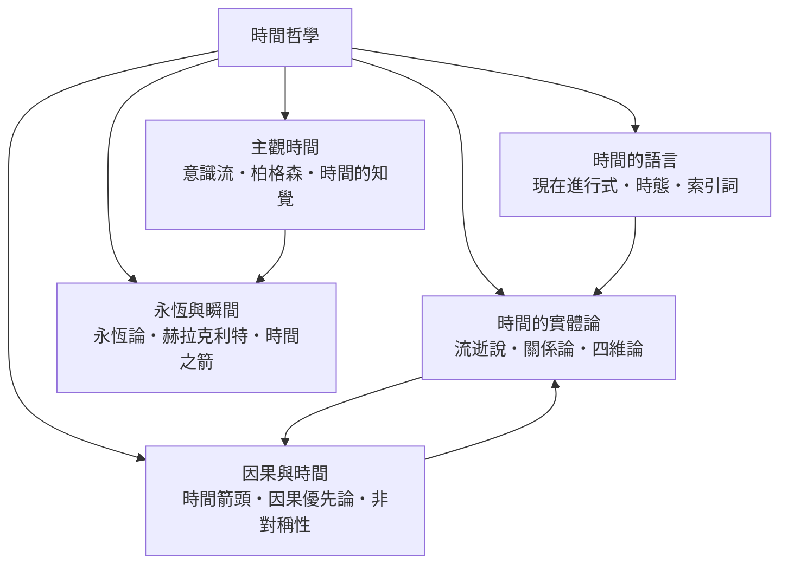

# 時間哲學

> 隸屬：第一層 [時]　·　相關分類：[哲學]、[西方哲學]、[物理學]、[語言學]　·　子分類總表見 [README]

> 對應維基百科：中文維基百科無對應條目　·　[English Wikipedia: Philosophy of space and time](https://en.wikipedia.org/wiki/Philosophy_of_space_and_time)

時間哲學問的是最熟悉也最陌生的問題：**時間是真實存在的東西，還是我們比較經驗的方式？時間真的「流逝」嗎？過去與未來和現在的地位相同嗎？**日常經驗告訴我們時間像河一樣流動，但物理學（尤其是 [相對論]）的圖像裡，時間只是座標之一，沒有哪一刻是特殊的「現在」。這條鴻溝使時間成為哲學與科學交界上爭論最久的主題之一——從 [赫拉克利特]「人不能兩次踏進同一條河」到當代分析哲學的 A 理論與 B 理論之辯，兩千五百年來爭論的核心始終未變。

因此，時間哲學的工作不是替物理學找補丁，而是弄清楚：物理時間、心理時間與語言時間三者如何相關？[時間箭頭]的不可逆性是宇宙的性質還是我們視角的產物？我們說「過去存在過、未來將到來」時，究竟在斷言什麼？本概念以五個子分類展開：實體論問時間的本體地位，主觀時間處理意識中的體驗，因果與時間研究方向性的來源，時間的語言分析我們如何談論時間，永恆與瞬間則回到最古老的形上學難題。

## 核心問題

1. **本體問題**：時間獨立於變化存在嗎？實體論者（牛頓式絕對時間）說是；[關係論] 者如萊布尼茲說時間只是事件之間先後關係的總和，沒有事件就沒有時間。
2. **流逝問題**：「時間流逝」是真實的過程，還是意識的錯覺？若四維塊狀宇宙為真，流逝就無法在物理描述中找到位置。
3. **方向問題**：物理基本定律大體上時間對稱，為何日常經驗裡雞蛋只會碎不會復原？答案通常指向 [熵增]，但熵如何「製造」方向感仍是開放問題。
4. **知覺問題**：我們如何體驗「現在」？知覺需要持續時間，[時間的知覺] 顯示「當下」其實是橫跨數百毫秒的心理建構。
5. **語言問題**：「昨天」「現在」「將會」這些 [索引詞] 與 [時態] 如何指涉時間？無時態語言（如中文）的使用者與英語使用者的時間思維相同嗎？

## 因果鏈

1. **經驗的起點**：人直接體驗到「剛剛」與「馬上」，第一反應是把時間當成流動的河——這是 [流逝說] 的直覺土壤。
2. **形上學的分裂**：巴門尼德主張變化是幻象，[赫拉克利特] 主張萬物流轉；兩條路線分別預示了後世的永恆論與流變論。
3. **牛頓與萊布尼茲之爭**：牛頓提出絕對時間（不依賴任何事件的流逝舞台），萊布尼茲以「若無事件則無時間」反駁，[時間的實體論] 對陣 [關係論] 的格局成形。
4. **康德的轉向**：康德主張時間是感知的形式而非物自體的性質——時間從「世界裡的東西」變成「經驗的框架」，開啟 [主觀時間] 的研究傳統。
5. **熱力學加入**：十九世紀 [熵增] 定律給了時間方向一個物理量，時間箭頭第一次有了定量討論。
6. **相對論的衝擊**：相對論否定絕對同時性，「現在」失去全宇宙的定義；哲學家（如羅素、Quine）據此同情四維塊狀宇宙，[四維論] 成為強力候選。
7. **分析哲學的精緻化**：麥克塔加特 1908 年提出 A 系列與 B 系列的區分，宣稱時間不實在；[柏格森] 則以「綿延」反對把時間數學化，兩條戰線延續至今。
8. **當代的整合**：[時間的知覺] 與認知科學、[時間的語言] 與語言學、塊狀宇宙與量子重力彼此交叉，時間哲學從形上學單兵作戰變成跨學科戰場。

## 子分類的定位與相互驅動

- [時間的實體論] 是**戰場中心**：流逝說、關係論與四維論的對抗是其他一切子問題的框架，先選邊，其餘問題才有答案。
- [主觀時間] 是**體驗端**：物理時間再冷峻，人仍活在綿延的體驗裡；柏格森對科學時間的批判正是從這裡發動。
- [因果與時間] 是**方向端**：時間箭頭若由因果結構或熵決定，實體論中「流逝」的物理基礎就有著落。
- [時間的語言] 是**表達端**：語言的時態系統把「過去／現在／未來」寫進文法，A 理論的直覺有一半來自語言習慣。
- [永恆與瞬間] 是**極端端**：把時間推到無限（永恆）與無限小（瞬間），是檢驗任何時間理論的兩個壓力測試點。

## 範例：McTaggart 的論證怎麼走

1. **區分**：A 系列＝事件依「過去—現在—未來」排序（會變：考試從未來變成過去）；B 系列＝事件依「早於—晚於」排序（永不變：考試永遠晚於報名）。
2. **主張**：麥克塔加特（1908）論證唯有 A 系列才算「真正的時間」，因為變化是時間的本質。
3. **歸謬**：但 A 系列「過去、現在、未來」這些屬性彼此不相容，同一事件不可能同時有三種屬性；而「輪流擁有」又必須再藉助更高階的 A 系列，無窮倒退。
4. **結論**：時間不實在——這個結論少有人接受，但論證逼迫哲學家說清楚「流逝」到底是什麼，一百年來的分析都由此出發。

## 容易混淆之處

- **物理時間不等於心理時間**：鐘錶讀數與「感覺很漫長」是兩套系統，混為一談會把兩邊的問題都搞錯。
- **四維論不否認變化**：塊狀宇宙中不同時刻的狀態不同，「變化」是不同時間切片之間的關係，不需要「流逝」。
- **「現在」在相對論中是局部的**：遙遠星系沒有與地球共享的同時面，日常的「此刻全世界」是座標約定。
- **時間箭頭不只有一個**：熱力學、心理學、宇宙學、因果的方向未必同源，把它們預設為同一個是常見的跳躍。
- **無時態語言不影響物理討論**：中文不靠動詞變化標記時態，但這是語法差異，不代表中文使用者「活在無時間的世界」。

## 延伸閱讀

- [哲學]：時間哲學所屬的母分類與基本問題。
- [相對論]：使「現在」相對化的物理理論。
- [熵增]：時間箭頭的熱力學候選解釋。
- [時空]：時間與空間如何被視為一體。
- [西方哲學]：McTaggart、羅素與當代分析哲學的脈絡。

## 連結定義
[README]: README.md
[主觀時間]: 主觀時間.md
[哲學]: ../哲學/README.md
[四維論]: 四維論.md
[因果與時間]: 因果與時間.md
[時]: ../時/README.md
[時空]: ../時空/README.md
[時間的實體論]: 時間的實體論.md
[時間的知覺]: 時間的知覺.md
[時間的語言]: 時間的語言.md
[時間箭頭]: ../相對論/實驗驗證.md
[柏格森]: 柏格森.md
[永恆與瞬間]: 永恆與瞬間.md
[流逝說]: 流逝說.md
[熵增]: ../熵增/README.md
[物理學]: ../物理學/README.md
[相對論]: ../相對論/README.md
[索引詞]: 索引詞.md
[西方哲學]: ../西方哲學/README.md
[語言學]: ../語言學/README.md
[赫拉克利特]: 赫拉克利特.md
[時態]: 時態.md
[關係論]: 關係論.md
