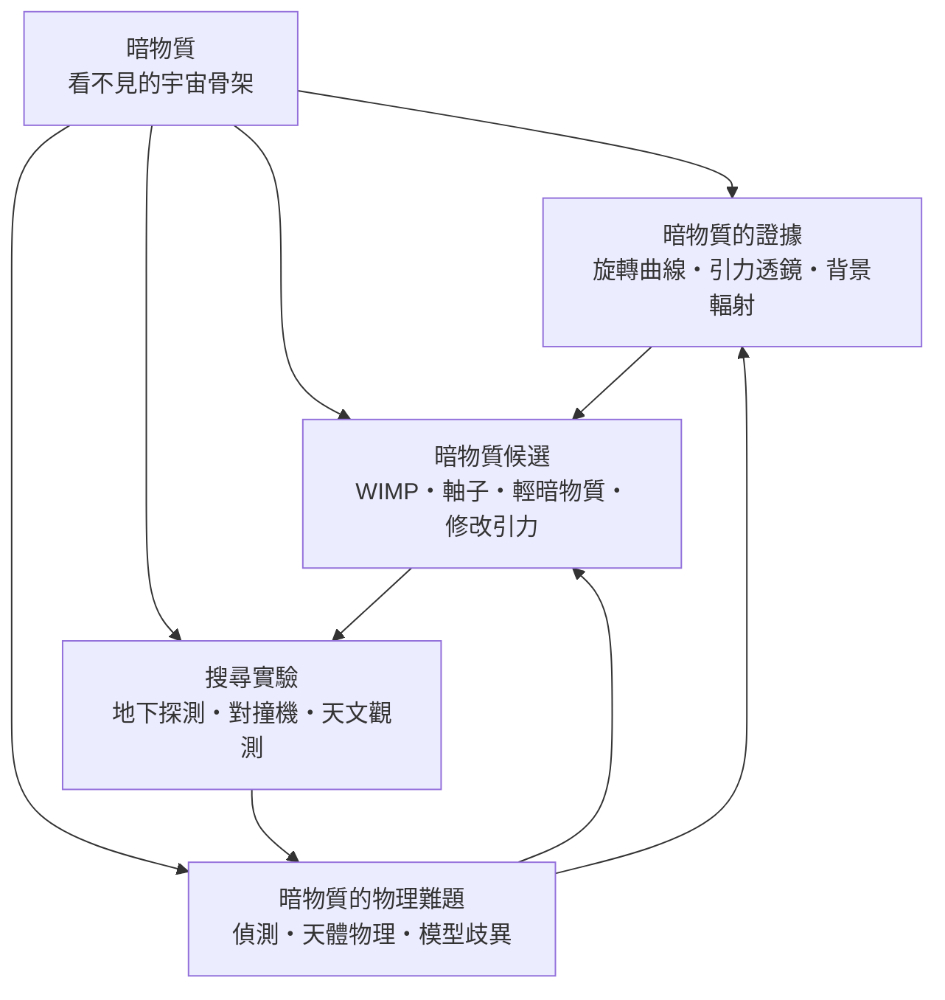

# 暗物質

> 隸屬：第一層 [天]　·　相關分類：[天文學]、[物理學]、[宇宙大爆炸]、[相對論]　·　子分類總表見 [README]

> 對應維基百科：[中文維基百科：暗物質](https://zh.wikipedia.org/wiki/%E6%9A%97%E7%89%A9%E8%B4%A8)　·　[English Wikipedia: Dark matter](https://en.wikipedia.org/wiki/Dark_matter)

暗物質是指**不發光、不吸光、不與電磁波作用，卻以引力影響可見物質的未知成分**。它回答的是二十世紀天文學最尷尬的一個問題：如果把星系與星系團裡看得見的恆星、氣體、塵埃的質量加總，引力遠不足以把這些系統綁在一起——它們早就該散掉了。宇宙中可見的普通物質只佔總質能的約百分之五，暗物質約佔百分之二十七，其餘才是更神祕的暗能量；換句話說，宇宙的骨架有五分之四以上是我們還叫不出名字的東西。

暗物質的困難在於：它的存在證據全來自**引力效應**（旋轉曲線、引力透鏡、星系團內的運動、宇宙微波背景的漣漪），但它本身不發光，所以無法「看到」，只能「感到」。這使得暗物質研究成為天文學與粒子物理的交界戰場——天文學家量出它的分布，粒子物理學家則要回答「它是什麼粒子」。目前主流圖像是「冷暗物質」：一種質量較大、移動緩慢、幾乎不與普通物質作用的粒子，在宇宙早期率先成團，為星系與星系團搭好引力腳手架，普通物質隨後落入其中發光。這一圖像由 [彭伯斯] 等人系統化，與 [宇宙大爆炸] 理論的結構形成預言高度吻合。

## 核心問題

暗物質研究可以壓縮成三個層層相依的問題。

1. **它存在嗎**：多種獨立證據互相印證。1933 年（見 [1933年]）[齊威基] 用星系團內星系的運動速度估算質量，發現引力所需的質量是可見物質的數百倍；1970 年代 [哈勃] 之後的旋轉曲線測量顯示星系外圍轉得太快；[愛因斯坦] 廣義相對論預言的光線偏折，使 [引力透鏡] 成為「稱出」看不見質量的天平；[宇宙微波背景] 的漣漪則把同一個結論推到整個宇宙的尺度。
2. **它是什麼**：候選者從超大質量的恆星殘骸（MACHO）到極輕的 [軸子] 都有可能，但目前最受青睞的是[WIMP]這類「弱作用大質量粒子」。判準是：不參與電磁作用、穩定、質量與豐度能同時解釋觀測。
3. **怎麼找它**：既然它穿過地球，就埋探測器到地底等它撞上原子核（直接偵測）；既然粒子對撞能造出它，就在 [對撞機] 裡找能量不翼而飛的事件；既然它成團會彎光線，就用望遠鏡畫出它的地圖（間接偵測）。三條路線分別對應 [地下探測]、[對撞機] 與 [天文觀測] 三類設施。

三個問題的邏輯順序是：先有「質量短缺」的觀測事實，才有「新粒子」的理論假設；有了假設，才需要設計實驗。反過來，實驗一次次排除候選者，又逼理論提出新模型——這是典型的「觀測—假設—檢驗」循環，只是這次的檢驗對象從來沒人見過。

## 因果鏈

1. **平方反比的天下**：1687 年 [牛頓] 在《自然哲學的數學原理》中提出萬有引力，天文學從此可以用引力算質量；誰也沒想到兩百年後這套算法會算出「不存在的質量」。
2. **開爾文與世紀之交的疑雲**：1900 年前後已有物理學家估計銀河系中不可見恆星的質量，指出可見星體可能只佔一部分；這是「暗物質」最早的模糊輪廓，但當時被當成觀測誤差。
3. **齊威基的星系團震撼**：1933 年（見 [1933年]）[齊威基] 用維里定理分析后髮星系團，發現要讓星系不飛散，團的質量必須遠大於可見物質；他稱之為「dunkle Materie」（暗物質）。可惜當時觀測粗略，結論被冷落數十年。
4. **旋轉曲線成鐵證**：1970 年代魯賓與福特測量星系的 [旋轉曲線]，發現外圍速度幾乎不隨距離下降——按可見質量應該是 $v \propto r^{-1/2}$ 的下墜曲線，實測卻是平的。這暗示外圍有大量看不見的質量，暗物質正式成為主流議題。
5. **理論候選者登場**：粒子物理把「暗物質是什麼」具體化。[WIMP] 源自超對稱理論的穩定粒子，[軸子] 源自解決強交互作用電荷共軛問題的假設粒子——兩者本來是為別的問題生，卻被發現恰好能當暗物質。
6. **宇宙學尺度的大勝利**：[宇宙大爆炸] 遺留的宇宙微波背景漣漪、星系大尺度分布的模擬，都只有在「冷暗物質佔多數」的模型下才對得上觀測。ΛCDM 模型成為宇宙學標準模型，暗物質從「懸案」升格為「零件」。
7. **直接偵測的三十年長征**：從 1980 年代起，一代代探測器深入礦井、把本底壓到極低，靈敏度提高了十幾個數量級，卻至今沒有確定訊號；「WIMP 奇蹟區」大半已被排除。
8. **新戰線展開**：實驗空白促使理論分化——輕暗物質、自相互作用暗物質、以及乾脆修改引力定律的 [修改引力]（MOND）陣營重新抬頭；暗物質研究從「找一個粒子」擴大成「檢驗整個引力理論」的戰場。

## 子分類的定位與相互驅動

- [暗物質的證據] 是**起訴書**：旋轉曲線、[引力透鏡]、[星系團] 運動與宇宙微波背景四路獨立證據匯成一個結論——質量短缺是真的。沒有這一層，後面一切都是空談。
- [暗物質候選] 是**嫌疑名單**：把觀測翻譯成粒子性質的邊界條件（不發光、穩定、豐度對得上），再從粒子理論裡挑出候選者，連「修改引力」這種釜底抽薪的異端也一併列入。
- [搜尋實驗] 是**法庭調查**：把候選者的性質變成可操作的信號設計——地底探測器、粒子對撞機、太空與地面望遠鏡三管齊下。
- [暗物質的物理難題] 是**上訴庭**：整理實驗的極限與矛盾、天文學尺度的反例、以及模型之間的分歧，再把未解問題反饋給證據與候選兩端。

四者的循環是暗物質學科的生命線：證據框住候選，候選指揮實驗，實驗的「沒找到」產生難題，難題回頭修正證據的解讀與候選的名單。這個環轉了快五十年還沒收口，也正是它持續吸引頂尖人力與經費的原因。

## 範例

**範例一：旋轉曲線的質量推算。** 星系中離中心 $r$ 處的恆星以速度 $v$ 繞轉，向心力由半徑內的質量提供： $\frac{GM(r)}{r^2} = \frac{v^2}{r}$ ，故 $M(r) = \frac{v^2 r}{G}$ 。測得仙女座星系外圍 $r = 20\,\mathrm{kpc}$ 處 $v \approx 250\,\mathrm{km/s}$ ，則 $M(r) \approx \frac{(2.5 \times 10^5)^2 \times 2 \times 10^{20}}{6.67 \times 10^{-11}} \approx 1.9 \times 10^{41}\,\mathrm{kg}$ ，約一千億個太陽質量；但該半徑內的恆星與氣體加起來只有其三分之一左右——其餘三分之二就是暗物質。

**範例二：齊威基的維里估算。** 星系團達到力學平衡時，動能與位能滿足維里定理 $2K + U = 0$ ，於是總質量可以用速度彌散 $\sigma$ 估出： $M \approx \frac{3 R \sigma^2}{G}$ 。齊威基測得后髮團 $R$ 約百萬光年、 $\sigma$ 約 $1000\,\mathrm{km/s}$ ，代入得質量遠大於星系發光總量所對應的值——「暗物質」一詞就此誕生。

**範例三：引力透鏡的稱重。** 前景星系團的引力會把背景星系的像拉成弧（愛因斯坦環），像的位置與弧長直接給出透鏡質量： $\theta_E \approx \sqrt{\frac{4GM}{c^2} \frac{D_{LS}}{D_L D_S}}$ 。對子彈頭星系團的觀測顯示：高溫氣體（普通物質的大宗）在碰撞中減速、留在中間，而引力質量的重心卻跟著星系繼續前進——這是暗物質「不像氣體那樣會自己剎車」的最直接影像證據。

## 容易混淆之處

- **暗物質不是暗能量**：暗物質靠引力把物質**拉攏**、幫助結構形成；暗能量是推動宇宙**加速膨脹**的成分。兩者都「暗」，但物理角色相反。
- **暗物質不是黑洞與行星**：由大爆炸核合成與微波背景的限制，由普通物質組成的暗天體（MACHO）頂多佔一小部分；主流暗物質必須是非重子粒子。
- **「看不見」不是「還沒看見」**：暗物質不是被塵埃遮住或望遠鏡不夠好的普通物質——塵埃遮蔽不改變引力質量的核算，而缺口大得無法用遮蔽解釋。
- **存在證據與粒子身分是兩回事**：引力效應證明「有東西在那裡」相當穩固；但「它是 WIMP／軸子／修改引力」仍在激烈爭論，不要把模型當成已證實的事實。
- **冷、溫、熱暗物質的「溫度」不是溫度**：指的是粒子在宇宙早期的移動速度（動能與質量比）。熱暗物質移動太快、會抹平小尺度結構，已被觀測基本排除。

## 延伸閱讀

- [天文學]：暗物質證據的觀測根據地，星系動力學是主要工具。
- [物理學]：粒子物理是「它是什麼」這一問的理論後盾。
- [宇宙大爆炸]：微波背景與核合成為暗物質豐度設下硬性限制。
- [相對論]：引力透鏡是廣義相對論光線偏折的直接應用。
- [黑洞]：另一種「看不見的質量」，但歸屬重子、與暗物質角色不同。
- [恆星系]：星系與星系團的結構形成，是暗物質腳手架的成品。
- [齊威基]、[彭伯斯]：暗物質概念的提出者與系統化者的傳記條目。

## 連結定義

[天]: ../天/README.md
[README]: README.md
[天文學]: ../天文學/README.md
[物理學]: ../物理學/README.md
[宇宙大爆炸]: ../宇宙大爆炸/README.md
[相對論]: ../相對論/README.md
[黑洞]: ../黑洞/README.md
[恆星系]: ../恆星系/README.md
[暗物質的證據]: 暗物質的證據.md
[暗物質候選]: 暗物質候選.md
[搜尋實驗]: 搜尋實驗.md
[暗物質的物理難題]: 暗物質的物理難題.md
[旋轉曲線]: 旋轉曲線.md
[愛因斯坦]: ../人/物理學家/愛因斯坦.md
[對撞機]: 對撞機.md
[地下探測]: 地下探測.md
[天文觀測]: 天文觀測.md
[引力透鏡]: 引力透鏡.md
[宇宙微波背景]: 宇宙微波背景.md
[星系團]: 星系團.md
[WIMP]: WIMP.md
[軸子]: 軸子.md
[修改引力]: 修改引力.md
[齊威基]: ../人/天文學家/齊威基.md
[哈勃]: ../人/天文學家/哈勃.md
[彭伯斯]: ../人/天文學家/彭伯斯.md
[牛頓]: ../人/物理學家/牛頓.md
[1933年]: ../時/1933年.md
