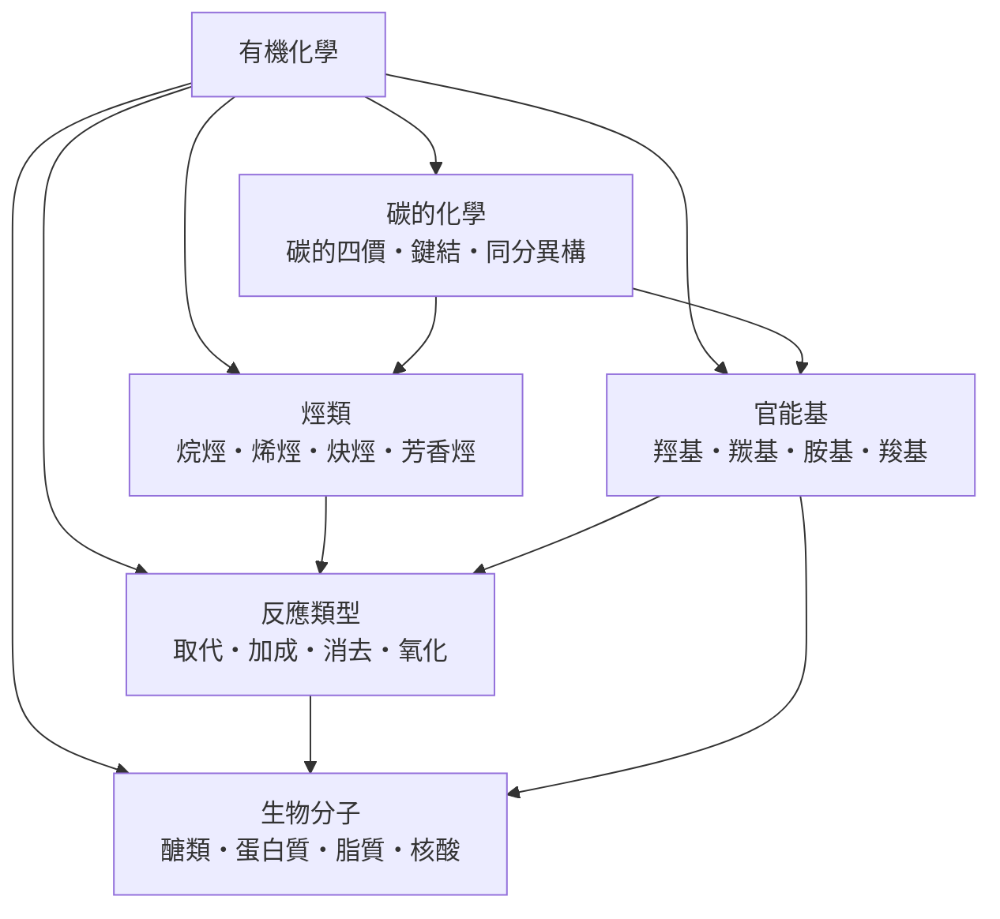

# 有機化學

> 隸屬：第一層 [理]　·　相關分類：[化學]、[無機化學]、[分析化學]　·　子分類總表見 [README]

> 對應維基百科：[中文維基百科：有機化學](https://zh.wikipedia.org/wiki/%E6%9C%89%E6%9C%BA%E5%8C%96%E5%AD%A6)　·　[English Wikipedia: Organic chemistry](https://en.wikipedia.org/wiki/Organic_chemistry)

有機化學是研究**含碳化合物**的結構、性質、合成與反應的學科。它處理的對象以碳原子為骨架：碳能形成四個共價鍵，能彼此連成鏈、環與三維網路，因此含碳化合物的數量遠超所有其他元素的化合物總和——目前已知已超過一億種。這門學科解決的核心問題是：**如何預測並控制碳骨架上的原子如何連接、如何轉變**。

「有機」一詞源於十九世紀初的「生命力論」：當時認為來自生物體的化合物必須由生物製造。1828 年 [維勒] 在實驗室中加熱氰酸銨得到尿素（ $\mathrm{NH_4OCN \to CO(NH_2)_2}$ ），首次證明有機物可以由無機物合成，生命力論隨之瓦解，有機化學才成為一門獨立的實證科學。此後 [凱庫勒] 於 1858 年提出碳的四價學說、1865 年提出苯的環狀結構，為分子結構的書寫奠定了語言。

## 核心問題

有機化學的核心問題可以拆成四層。

1. **結構如何決定性質**：同樣由碳與氫組成的分子，直鏈與支鏈性質迥異，這是 [同分異構] 的問題；而決定連接方式的基礎是 [碳的四價] 與 [鍵結]。
2. **骨架上掛了什麼**：決定分子化學行為的往往是骨架上的局部原子團，即 [官能基]——[羥基]、[羰基]、[胺基]、[羧基]各有固定的一套反應模式。
3. **骨架本身是什麼**：只含碳與氫的 [烴類]（[烷烴]、[烯烴]、[炔烴]、[芳香烴]）是有機化合物的母體，其他官能基都可視為烴的衍生物。
4. **如何從一個分子變成另一個分子**：這是 [反應類型] 的問題——[取代]、[加成]、[消去]、[氧化] 四大基本操作，也是合成化學的工具箱。

最後，這整套規則在生命系統中的應用就是 [生物分子]：[醣類]、[蛋白質]、[脂質]、[核酸] 全部是有機分子，有機化學因此成為理解生命的語言。

## 因果鏈

1. **生命力論的瓶頸**：十八世紀末，化學家能分析有機物卻無法合成，認為有機物需要「生命力」。
2. **維勒合成尿素（1828）**：氰酸銨加熱自發重排為尿素，證明無機—有機界線可以跨越，合成化學的大門自此打開。
3. **結構理論的建立**：[凱庫勒] 提出碳四價與苯環結構，分子首次能用原子間的鍵明確書寫，異構現象獲得解釋。
4. **官能基概念的成熟**：十九世紀後半，化學家發現含相同官能基的化合物反應模式相似，於是可以「以官能基為單位」設計合成路線。
5. **電子理論的注入**：二十世紀初，路易斯提出共價鍵的電子對理論，有機反應被理解為電子對的流動，反應機構（機制）成為可分析的對象。
6. **立體化學與光譜學**：凡特霍夫的四面體碳模型與後來的紅外光譜、核磁共振，讓「結構」從紙面推測變成可測量的事實。
7. **合成與生物的匯流**：從染料、藥物到 1953 年華生與克里克解出 DNA 結構，有機化學成為分子生物學與 [藥學] 的基礎。

## 子分類的定位與相互驅動

- [碳的化學] 是**地基**：四價、鍵結與異構回答「碳骨架為何、如何成立」，沒有這層，官能基與反應都無從談起。
- [烴類] 是**母體**：烷、烯、炔、芳香烴提供了所有碳骨架的原型，其他官能基都是烴的衍生物。
- [官能基] 是**反應的開關**：骨架決定範圍，官能基決定行為；認得一個官能基就等於認得一族反應。
- [反應類型] 是**動詞**：取代、加成、消去、氧化把名詞（化合物）連成句子（合成路線），是官能基之間互相轉化的橋樑。
- [生物分子] 是**出口**：四大類生物分子都是有機分子，有機化學的規則在此與生命科學接軌。

## 範例

**範例一：維勒的尿素合成**。氰酸銀與氯化銨先得氰酸銨（ $\mathrm{NH_4OCN}$ ），加熱後分子內重排為尿素（ $\mathrm{CO(NH_2)_2}$ ）。兩者原子完全相同、連接方式不同——這既是史上第一個有機合成，也是同分異構的經典實例。

**範例二：乙烯的加成反應**。乙烯（ $\mathrm{CH_2{=}CH_2}$ ）與溴發生加成，雙鍵斷開、兩個溴分別接上兩個碳，生成 1,2-二溴乙烷（ $\mathrm{BrCH_2CH_2Br}$ ）。產物原本紅棕色的溴水褪色，這是鑑別烯烴的標準方法。

**範例三：酯化**。乙酸（ $\mathrm{CH_3COOH}$ ）與乙醇（ $\mathrm{C_2H_5OH}$ ）在酸催化下脫去一分子水，生成乙酸乙酯（ $\mathrm{CH_3COOC_2H_5}$ ）——帶水果香的酯類。這一個反應同時動用了羧基與羥基兩種官能基的性質，是「官能基決定反應」的直接示範。

## 容易混淆之處

- **有機化合物不等於「天然」**：實驗室合成的尿素與尿中的尿素是同一種分子；「有機」在化學中指含碳，在農業中指栽種方式，兩者無關。
- **含碳不一定是有機物**：二氧化碳、碳酸鹽、氰化物含碳但習慣歸入無機化學。
- **同分異構不是同一種物質**：乙醇（ $\mathrm{C_2H_5OH}$ ）與二甲醚（ $\mathrm{CH_3OCH_3}$ ）分子式相同，前者是液體、會與金屬鈉反應，後者是氣體——結構不同就是不同化合物。
- **取代與加成的差別在於「換」還是「加」**：取代是原子團被替換、小分子掉下來；加成是不飽和鍵打開、原子團直接接上，分子不變小。
- **氧化在有機化學中常指「加氧或去氫」**：乙醇變乙醛是氧化，即使整個反應看起來只是「少了兩個氫」。

## 延伸閱讀

- [化學]：有機化學所屬的母學科。
- [無機化學]：以元素與配位為主題的姊妹學科，兩者以「是否以碳骨架為中心」分野。
- [分析化學]：如何確認一個有機分子的結構與純度。
- [藥學]：有機合成在藥物設計上的應用。
- [高分子塑膠]：以加成聚合為核心的工業化延伸。
- [元素週期表]：理解碳為何獨特的位置脈絡。

## 連結定義

[理]: ../理/README.md
[README]: README.md
[化學]: ../化學/README.md
[無機化學]: ../無機化學/README.md
[分析化學]: ../分析化學/README.md
[藥學]: ../藥學/README.md
[高分子塑膠]: ../高分子塑膠/README.md
[元素週期表]: ../元素週期表/README.md
[碳的化學]: 碳的化學.md
[碳的四價]: 碳的四價.md
[鍵結]: 鍵結.md
[同分異構]: 同分異構.md
[官能基]: 官能基.md
[羥基]: 羥基.md
[羰基]: 羰基.md
[胺基]: 胺基.md
[羧基]: 羧基.md
[烴類]: 烴類.md
[烷烴]: 烷烴.md
[烯烴]: 烯烴.md
[炔烴]: 炔烴.md
[芳香烴]: 芳香烴.md
[反應類型]: 反應類型.md
[取代]: 取代.md
[加成]: 加成.md
[消去]: 消去.md
[氧化]: 氧化.md
[生物分子]: 生物分子.md
[醣類]: 醣類.md
[蛋白質]: 蛋白質.md
[脂質]: 脂質.md
[核酸]: 核酸.md
[維勒]: ../人/化學家/維勒.md
[凱庫勒]: ../人/化學家/凱庫勒.md
