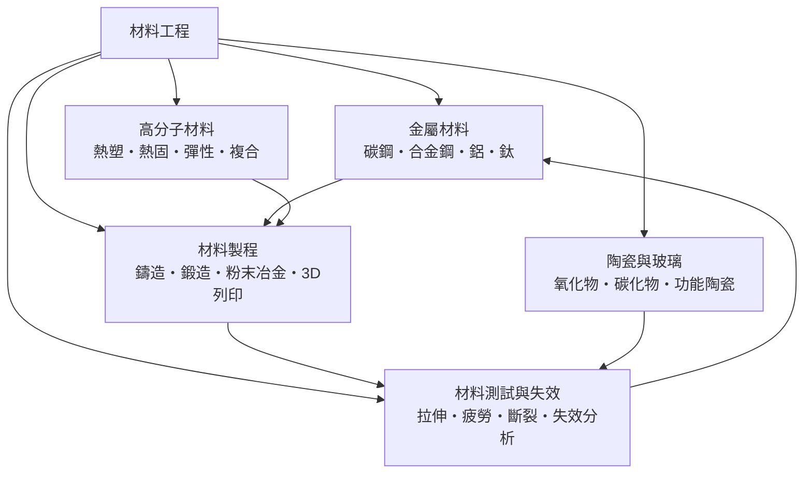

# 材料工程

> 隸屬：第一層 [工]　·　相關分類：[材料學]、[金屬]、[陶瓷]、[化學]　·　子分類總表見 [README]

> 對應維基百科：[中文維基百科：材料科学](https://zh.wikipedia.org/wiki/%E6%9D%90%E6%96%99%E7%A7%91%E5%AD%A6)　·　[English Wikipedia: Materials science](https://en.wikipedia.org/wiki/Materials_science)

材料工程是**把物質的組成與結構，轉換成可用、耐用且可量產的工程元件**的學科。它與材料學的分界在於目標：材料學追問「物質的本性為何」，材料工程追問「怎麼做出來、做出來能用多久、能不能便宜地複製」。同樣是鐵，材料學研究鐵的相變與磁性，材料工程則決定某座橋梁用哪一級結構鋼、如何熱處理、如何在工廠裡檢驗它沒有裂縫。

這門學科的底層語言是**性能與製程的對應關係**。一個工程材料可以用四個量描述它的實用價值：強度（能承受多大應力而不永久變形）、韌性（斷裂前能吸收多少能量）、硬度（抵抗磨損與刮傷的能力）與耐蝕性（在腐蝕環境中存活的時間）。這四個量彼此拉扯：提高強度常使韌性下降（晶粒越細、強化相越多，材料越硬但越脆），而提高韌性常使強度下降。因此材料工程的核心活動，是在**性能、成本與製程能力**三者的三角形中尋找可行解。

材料工程也是工業革命的支撐技術。19 世紀的鋼鐵冶煉（Bessemer 煉鋼法、轉爐與電爐）、20 世紀的航空用鋁合金與鈦合金、汽車時代的高強度鋼與工程塑膠、今日半導體工業的高純度矽晶圓與碳化矽，都是材料工程的產物。反過來，每一次材料性能躍升，都打開了新的工程可能：鈦合金讓飛機能在更高速度下飛行，高純度矽讓積體電路成為可能。

## 核心問題

材料工程要回答的問題可以分層來看。

1. **物質是什麼**：成分、相結構、晶粒大小、缺陷分布。答案來自 [材料學] 的分析技術——X 射線繞射、電子顯微鏡、原子探針tomography。沒有微觀結構的描述，就沒有性能模型。
2. **性能如何被決定**：把微觀結構對應到巨觀性能。強化理論（例如析出強化、時效硬化）、纖維強化、位錯運動的理論是這一層的核心。
3. **如何做出來**：把成分與結構變成零件。成形（[鑄造]、[鍛造]）、連接、處理（熱處理、表面工程）、以及新興的 [3D列印] 是主要手段，這一層屬 [材料製程]。
4. **如何證明它合格**：以標準化的試驗量測性能，並在失效發生時追查原因。標準化試驗（[拉伸]、[疲勞]、[斷裂韌性]）與 [失效分析] 構成本層的主體。
5. **如何在成本下量產**：良率、成本、供應鏈與環境負擔。這使得材料工程與 [化學工程]、[機械工程] 及經濟學交叉。

這五層形成一條閉環：分析 → 建模 → 製程 → 測試 → 回饋修正模型。

## 因果鏈

1. **冶金與陶藝的經驗累積**：青銅時代的合金配比、鐵器的淬火、陶瓷的燒結，都提供了「成分—製程—性能」對應關係的原始經驗，但缺乏可控變數。
2. **金相與定量分析**：19 世紀的顯微金相術讓研究者第一次看見晶粒與組織，鋼鐵的熱處理從「師傅手感」轉為可記錄的溫度—時間—組織圖表。
3. **強度理論的建立**：位錯理論（1930 年代）解釋了金屬為何屈服，也解釋了析出強化、晶粒細化與加工硬化的共同機理——材料工程第一次有了統一的機制語言。
4. **航空需求的牽引**：1930–60 年代對「更輕、更強、更耐熱」的要求，催生鋁合金、鈦合金、鎳基超合金與陶瓷基複合材料，也催生了精密的熱處理與无损檢測技術。
5. **高分子與複合材料的興起**：塑膠、橡膠、纖維與樹脂的結合，使材料工程從「改變成分」走向「改變結構」，複合材料成為輕量化與輕武器的關鍵。
6. **半導體工業的檢驗**：[半導體] 要求純度達九個九的矽、控制缺陷密度於每平方公分低於零點幾個的石英晶圓，把材料工程推向**超純、零缺陷、統計控制**的新層級。
7. **失效學與可靠度**：斷裂力學、疲勞壽命與加速壽命試驗，把材料與設計壽命掛鉤，材料工程成為可靠性工程的一部分。
8. **永續轉向**：碳排、稀土資源集中度與可回收性進入設計約束，材料工程開始在「性能」之外加上「足跡」這個目標函數。

## 子分類的定位與相互驅動

- [金屬材料] 是**工業的骨架**：鋼、鋁、鈦提供了高強度、導電、輕量與耐熱的組合，[碳鋼] 與 [合金鋼] 撐起橋梁與車體，[鋁合金] 與 [鈦合金] 撐起航空與輕量化。
- [陶瓷與玻璃] 是**高溫與化學穩定的極限**：它們在金屬軟化的地方仍不變形，但脆性是主要瓶頸；[功能陶瓷] 更把性質從「耐熱」推向「可設計的電、磁、光響應」。
- [高分子材料] 是**可成型與可複合的活體**：[熱塑性] 可回收再熔，[熱固性] 提供剛性與耐熱，[彈性體] 給出回復性，[複合材料] 把不同材料的優點拼在一起。
- [材料製程] 是**把成分變成形狀的轉換器**：[鑄造]、[鍛造]、[粉末冶金] 與 [3D列印] 各自決定了組織、缺陷型態與成本結構。
- [材料測試與失效] 是**裁判與迴路**：以標準試驗給出數字，以 [失效分析] 找出失效原因，再回頭修正前面的成分與製程選擇。

## 範例

**範例一：強度與韌性的取捨。** 考慮一條需要同時承擔拉力與衝擊的結構構件。取屈服強度 $\sigma_y = 800\ \text{MPa}$ 的高強度鋼，斷裂韌性 $K_{Ic} = 40\ \text{MPa}\sqrt{\text{m}}$ ；另一個方案是 $\sigma_y = 350\ \text{MPa}$ 、 $K_{Ic} = 200\ \text{MPa}\sqrt{\text{m}}$ 的韌性鋼。若構件厚度 $t = 20\ \text{mm}$ 且缺口半徑 $a = 1\ \text{mm}$ ，臨界應力由

$$
\sigma_c = \frac{K_{Ic}}{Y\sqrt{\pi a}}
$$

給出。取幾何因子 $Y \approx 1.0$ ：高強度鋼 $\sigma_c \approx 40 / \sqrt{\pi \times 0.001} \approx 714\ \text{MPa}$ ，低於屈服強度尚可；韌性鋼 $\sigma_c \approx 200 / \sqrt{\pi \times 0.001} \approx 3570\ \text{MPa}$ ，遠高於屈服強度。表面上前者「更安全」，但若載荷有疲勞或低溫脆化，裂縫成長速率不同——這正是材料工程不能只看單一數值的原因。

**範例二：單位強度的重量成本。** 飛機結構件比較鋁合金與碳纖維[複合材料]：鋁合金 $E = 70\ \text{GPa}$ 、密度 $\rho = 2.7 \ \text{g/cm}^3$ ，比剛度 $E/\rho \approx 26$ （以 GPa/(g/cm³) 計）；碳纖維複合材料 $E \approx 70\ \text{GPa}$ 、 $\rho \approx 1.6\ \text{g/cm}^3$ ，比剛度約 $44$ 。比剛度提高約 70%，意味著同樣的剛度需求可以減少約 40% 的結構重量——這正是航空業大量導入複合材料的原因，也是 [材料製程] 中成形成本遠高於 [鑄造] 仍值得投入的理由。

## 容易混淆之處

- **材料工程不等於材料學**：材料學解釋現象，材料工程承擔規格、成本與量產責任；兩者共用同一套物理與化學基礎。
- **強度不等於韌性**：硬度高的材料往往在缺口處更脆；安全設計看的是強度與韌性的組合，而非單一數字。
- **「金屬是導體、陶瓷是絕緣體」過於粗糙**：氮化鋁、氧化鋅、鈦酸鋇都有高介電常數；金屬氧化膜本身就是絕緣體。
- **鑄造不等於鍛造**：鑄造件的組織粗大且易有孔洞，鍛造件緻密且纖維流向明確，強度可以相差數成。
- **複合材料不是「比較差的單一材料」**：它的性能來自界面與鋪層設計，設計得當時可超越任一組成材。
- **測試值不等於使用值**：實驗室試片是均質的，工件有缺陷與殘餘應力，設計必須引入安全係數與統計容差。

## 延伸閱讀

- [材料學]：本概念的理論母體，涵蓋相變、擴散與顯微結構。
- [金屬]、[陶瓷]、[非金屬]：三大材料族的分類入口。
- [化學]：表面處理、塗裝、蝕刻與前驅物純化的化學基礎。
- [機械工程]：零件的設計與載荷條件來源。
- [半導體]、[奈米材料]：精密材料與尺度極限的兩個延伸方向。
- [土木工程]、[建築史]：材料使用量最大的產業與其歷史脈絡。

## 連結定義

[工]: ../工/README.md
[README]: README.md
[材料學]: ../材料學/README.md
[金屬]: ../金屬/README.md
[陶瓷]: ../陶瓷/README.md
[非金屬]: ../非金屬/README.md
[化學]: ../化學/README.md
[化學工程]: ../化學工程/README.md
[機械工程]: ../機械工程/README.md
[半導體]: ../半導體/README.md
[奈米材料]: ../奈米材料/README.md
[土木工程]: ../土木工程/README.md
[建築史]: ../建築史/README.md
[金屬材料]: 金屬材料.md
[陶瓷與玻璃]: 陶瓷與玻璃.md
[高分子材料]: 高分子材料.md
[材料製程]: 材料製程.md
[材料測試與失效]: 材料測試與失效.md
[碳鋼]: 碳鋼.md
[合金鋼]: 合金鋼.md
[鋁合金]: 鋁合金.md
[鈦合金]: 鈦合金.md
[鑄造]: 鑄造.md
[鍛造]: 鍛造.md
[粉末冶金]: 粉末冶金.md
[3D列印]: 3D列印.md
[拉伸]: 拉伸.md
[疲勞]: 疲勞.md
[斷裂韌性]: 斷裂韌性.md
[失效分析]: 失效分析.md
[複合材料]: 複合材料.md
[功能陶瓷]: 功能陶瓷.md
[彈性體]: 彈性體.md
[熱塑性]: 熱塑性.md
[熱固性]: 熱固性.md
