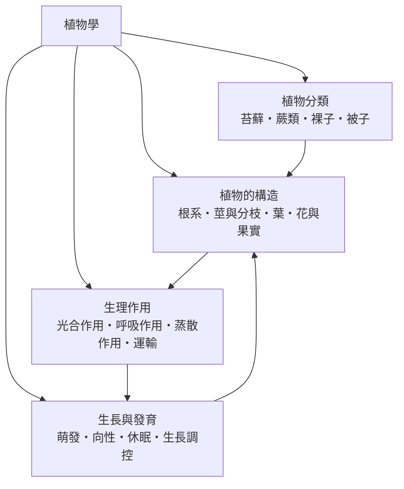

# 植物學

> 隸屬：第一層 [理]　·　相關分類：[生物學]、[生物分類學]、[農]、[中草藥]　·　子分類總表見 [README]

> 對應維基百科：[中文維基百科：植物學](https://zh.wikipedia.org/wiki/%E6%A4%8D%E7%89%A9%E5%AD%A6)　·　[English Wikipedia: Botany](https://en.wikipedia.org/wiki/Botany)

植物學研究**植物**：它們的身體如何建造、如何把陽光變成可用的能量、如何在固定的位置上完成生長與繁殖，以及地球上三十多萬種植物如何彼此相關。與動物不同，植物不能移動避開逆境，因此植物學的核心從一開始就是「**不動的生命如何解決資源、時間與繁殖的問題**」——根往深處找水、葉片調整角度追光、種子等待正確的季節。

植物學與 [生物學] 的分工，在於它聚焦於生產者這一側：植物把無機物轉成有機物，幾乎所有食物鏈都建立在這個轉換上。因此植物學的成果不只服務自身，也支撐 [農]、[中草藥]、林業與保育。它與 [生物分類學] 關係密切——植物是最早被系統命名的生物類群之一，[林奈] 的二名法正是以植物為主要素材發展出來的。

植物學的另一項特色是**同一株植物的多重時間尺度**。一片葉子可以在幾小時內改變氣孔開合，一株樹在一年內完成年輪，一個物種在百萬年間分化。植物學的敘事必須把這些尺度接起來：短期的生理調控累積成長期的形態，形態的差異又成為分類與演化的證據。

## 核心問題

1. **植物的身體由哪些構造組成，各自做什麼？** 這是 [植物的構造] 回答的問題：[根系] 如何固著與吸收，[莖與分枝] 如何支撐與運輸，[葉] 如何交換氣體與截取光，[花與果實] 如何完成繁殖與散播。
2. **植物如何把環境資源變成生命？** 這是 [生理作用] 回答的問題：[光合作用] 如何把光能固定為化學能，[呼吸作用] 如何釋出能量，[蒸散作用] 與 [水分與養分運輸] 如何讓水與鹽從根部抵達樹冠。
3. **植物如何決定何時長、往哪裡長？** 這是 [生長與發育] 回答的問題：[種子萌發] 的條件、[向性] 的方向感、[季節休眠] 的計時，以及 [生長調控] 如何用激素協調全局。
4. **植物的類群如何劃分與演化？** 這是 [植物分類] 回答的問題：從 [苔蘚植物] 登陸的嘗試、[蕨類植物] 的維管束革命，到 [裸子植物] 與 [被子植物] 的種子策略與花的三重協同演化。

四者的關係是：構造是「硬體」，生理是「軟體」，生長發育是「行程表」，分類則是「家族樹」；理解一株植物必須同時打開這四個視窗。

## 因果鏈

1. **草藥與農作的實用起點**：人類最早研究植物是為了吃與醫——哪些能吃、哪些能治病、何時播種。這些累積的知識構成 [中草藥] 與 [作物栽培] 的經驗基礎，也留下最早描述植物形態的文本。
2. **[林奈] 的命名標準化**：18 世紀中葉二名法確立，植物物種第一次擁有跨語言、跨世代的穩定名稱，全世界的標本得以被比較與累積，分類學成為可協作的科學。
3. **[顯微鏡] 揭開內部世界**：17 世紀之後細胞、導管、氣孔相繼被觀察到，植物學從外形描述深入到組織與細胞，構造與功能的對應開始成立。
4. **[光合作用] 的逐步破解**：從普利斯特里觀察到植物「恢復」空氣，到 [英根豪斯] 證明需要光，再到 [卡爾文] 用放射性碳追蹤出固定二氧化碳的途徑，植物學建立了能量轉換的化學解釋。
5. **[達爾文] 的向光性實驗與激素時代**：1880 年 [達爾文] 父子證明向光性由苗頂端傳出的訊號控制，這條線索在 1926 年被 [溫特] 發展為生長素的發現，開啟植物激素研究。
6. **遺傳學的注入**：[孟德爾] 以豌豆建立遺傳學，作物育種從經驗選拔變成有理論指導的設計；20 世紀的綠色革命用矮稈品種大幅提高產量。
7. **系統發育的分子重寫**：分子序列讓植物各大類群的親緣被重新檢驗，綠藻與陸生植物的關係、被子植物的早期分化都得到修訂，分類架構因此大幅更新。
8. **全球變遷下的新任務**：碳匯估算、糧食安全與生物多樣性喪失，使植物學從描述走向預測——模型化光合作用、追蹤物候改變、保存作物野生近緣種成為當代核心工作。

## 子分類的定位與相互驅動

- [植物的構造] 是**硬體清單**：每一個器官都是一個工程解。根與莖的分工解決「固定」與「取得」的矛盾，葉的扁平化提高受光面積。沒有構造描述，生理數據就沒有落點。
- [生理作用] 是**能量與物質的帳本**：[光合作用] 解釋植物為何需要葉與光，[蒸散作用] 解釋為何需要導水系統；生理把構造翻譯成收支表，也反過來解釋構造的取捨。
- [生長與發育] 是**時間維度**：植物無法移動，只能調整「何時做什麼」。激素與向性讓固定的身體擁有動態的應變，休眠與萌發則把生命嵌進季節的韻律。
- [植物分類] 是**歷史座標**：四大類群按登陸與生殖策略的演進排列，每一類的構造與生理都是一次創新——維管束、種子、花——也為前三者提供比較的對象組。

## 範例：追蹤一滴水從土壤到大氣

以一株向日葵為例，追蹤一滴水的旅程：

1. **進入根部**：根毛以滲透作用把水吸入，這依賴 [根系] 巨大的吸收面積。
2. **橫向越過皮層**：水經由細胞壁或穿越細胞膜進入中柱，內皮層的凱氏帶強迫水分走「受控」的路徑，確保養分選擇性吸收。
3. **沿木質部上升**：蒸散在葉片產生負壓，水分子之間的內聚力使整條水柱被「拉」上數公尺高的樹冠——這是 [蒸散作用] 與 [水分與養分運輸] 協作的結果，整個過程不需要泵。
4. **離開氣孔**：水汽經氣孔擴散到大氣，氣孔開合由保衛細胞控制，在「吸收二氧化碳」與「保水」之間取捨。
5. **能量的帳**：這滴水的上升動力其實來自太陽——陽光驅動 [光合作用]，也驅動蒸散；每固定一分子二氧化碳約需數百分子水通過氣孔。

這個例子說明：構造（根、導管、氣孔）、生理（蒸散、光合）、與調控（保衛細胞的開合）必須合起來看，缺一角就無法解釋植物如何在陸地上存活。

## 容易混淆之處

- **植物學不等於農學**：[農] 與 [作物栽培] 關心產量與管理，植物學關心機制與多樣性；兩者共享知識但目標不同。
- **「植物」的範圍隨時代改變**：傳統植物學把真菌與細菌都算進來，現代分類已把它們移出；「植物」在嚴格意義上指綠色植物及其近緣類群。
- **光合作用不等於「所有植物製造氧氣」**：少數植物在特定條件下進行光呼吸為主的路徑，某些寄生植物甚至失去光合能力。
- **蒸散不是「浪費」**：雖然 95% 以上的吸水被蒸散掉，但這正是運輸與降溫的動力，不能只以「效率」評斷。
- **一年生與多年生不是絕對**：同一物種在不同氣候下可以表現不同生活史，判斷要看族群整體。
- **向性不是「意志」**：[向性] 是生長素分布不均造成的差異生長，是化學訊號的結果，不是感知後的選擇。

## 延伸閱讀

- [生物學]：植物學的上位學科與共同方法基礎。
- [生物分類學]：命名與系統發育的規則來源。
- [農]、[作物栽培]、[園藝]：植物知識最主要的應用場域。
- [中草藥]：植物次級代謝物與人類醫療的介面。
- [保育生物學]：植物多樣性保護與棲地經營。
- [林奈]、[達爾文]、[孟德爾]、[卡爾文]：塑造現代植物學的關鍵人物。
- [顯微鏡]：讓植物內部世界可見的關鍵工具。

## 連結定義

[理]: ../理/README.md
[README]: README.md
[生物學]: ../生物學/README.md
[生物分類學]: ../生物分類學/README.md
[農]: ../農/README.md
[中草藥]: ../中草藥/README.md
[作物栽培]: ../作物栽培/README.md
[園藝]: ../園藝/README.md
[保育生物學]: ../保育生物學/README.md
[顯微鏡]: ../物/顯微鏡.md
[林奈]: ../人/生物學家/林奈.md
[達爾文]: ../人/生物學家/達爾文.md
[孟德爾]: ../人/生物學家/孟德爾.md
[卡爾文]: ../人/生物學家/卡爾文.md
[英根豪斯]: ../人/生物學家/英根豪斯.md
[溫特]: ../人/生物學家/溫特.md
[植物的構造]: 植物的構造.md
[根系]: 根系.md
[莖與分枝]: 莖與分枝.md
[葉]: 葉.md
[花與果實]: 花與果實.md
[生理作用]: 生理作用.md
[光合作用]: 光合作用.md
[呼吸作用]: 呼吸作用.md
[蒸散作用]: 蒸散作用.md
[水分與養分運輸]: 水分與養分運輸.md
[生長與發育]: 生長與發育.md
[種子萌發]: 種子萌發.md
[向性]: 向性.md
[季節休眠]: 季節休眠.md
[生長調控]: 生長調控.md
[植物分類]: 植物分類.md
[苔蘚植物]: 苔蘚植物.md
[蕨類植物]: 蕨類植物.md
[裸子植物]: 裸子植物.md
[被子植物]: 被子植物.md
