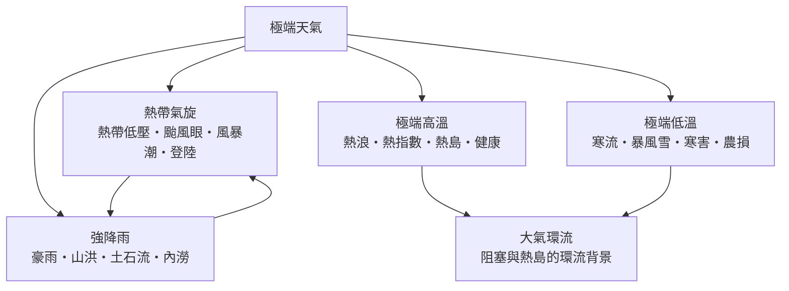

# 極端天氣

> 隸屬：第一層 [天]　·　相關分類：[氣象學]、[大氣環流]、[全球暖化]　·　子分類總表見 [README]

> 對應維基百科：[中文維基百科：極端天氣](https://zh.wikipedia.org/wiki/%E6%A5%B5%E7%AB%AF%E5%A4%A9%E6%B0%A3)　·　[English Wikipedia: Extreme weather](https://en.wikipedia.org/wiki/Extreme_weather)

極端天氣研究**偏離氣候常態甚遠、足以造成災害的大氣事件**：[熱帶氣旋]、[熱浪]、[寒流] 與 [強降雨] 是四大主角。「極端」不是形容詞而是統計概念——通常指發生機率低於某門檻（如每年最熱的百分之一）的現象；正因為罕見，它考驗的不只是大氣科學的預報能力，更是社會的防災、保險與基礎建設設計。天氣圖上每一場災難，都是環流的極端配置與人類暴露度重疊的結果。

這個領域在二十一世紀獲得全新的緊迫性：[全球暖化] 改變了極端事件的統計分布。暖化使熱浪的機率分布整體右移——原本「五十年一遇」的高溫，在部分地區已縮短為數年一遇；大氣每升溫一度可多容納約百分之七的水氣，使 [強降雨] 的強度天花板持續抬高。極端事件歸因科學（事後以模式計算「暖化使這場事件機率改變了多少倍」）更把氣候變遷從長期曲線拉到具體災害的新聞現場。

與 [大氣環流] 的分工是：環流研究風帶與環流胞的「常態」，極端天氣研究環流的「極端」——當 [阻塞高壓] 駐留、急流大幅波動、海溫異常疊加時，常態就會破裂成災害。理解極端天氣，因此既要懂物理（能量與水氣的上限），也要懂統計（機率分布的移動），還要懂社會（脆弱性與預警如何兌現成傷亡的多寡）。

## 核心問題

1. **什麼算極端？** 極端由統計門檻定義：重現期、百分位數或歷史紀錄。同一場雨在雨量充沛的宜蘭是「平常」，在乾旱的內陸就是極端——定義必須相對於當地氣候。
2. **極端的上限由什麼決定？** 物理設定天花板：熱帶氣旋強度受海面溫度與海洋熱含量限制（潛在強度理論），[強降雨] 受可降水量（Clausius–Clapeyron 關係，每度約百分之七）限制，[熱浪] 受大氣環流與土壤乾燥回饋限制。
3. **暖化如何改寫機率？** 均值位移即可大幅增加極端頻率：分布僅右移一個標準差，「百年一遇」熱浪的機率可增數倍；歸因科學把這個計算做到單一事件層級。
4. **預警如何變成防災？** 極端天氣的傷亡差距，主要來自預警鏈：觀測—預報—警報—疏散。相同的颱風，在一九七〇年代可殺死數十萬人，今天因預警與疏散通常傷亡以十計。

熱浪的危險不只看溫度，還要看濕度與持續時間；濕球溫度超過約 $35°\text{C}$ 時人體無法靠出汗散熱，這個生理上限是評估氣候風險的硬指標。

## 因果鏈

1. **環流的極端配置是起點**：[阻塞高壓] 駐留、深槽南伸或副熱帶高壓異常西伸，把某種天氣（酷熱、酷寒、連日雨）鎖在同一地區。
2. **能量與水氣設定上限**：海溫決定 [熱帶氣旋] 的潛在強度，暖化後的海面使最強風暴更強；可降水量隨溫度以每度約百分之七增加，抬高 [強降雨] 天花板。
3. **極端事件兌現成災害**：[熱浪] 疊加 [城市熱島] 使夜間無法降溫；[強降雨] 落在都市不透水層上轉成 [山洪] 與 [土石流]；颱風登陸以 [風暴潮] 直接威脅沿海人口。
4. **暴露度放大衝擊**：同樣的事件落在無人區只是氣象紀錄，落在密集城市就是災難；沿岸開發與都市擴張持續提高暴露度。
5. **預警與調適削減損失**：颱風預報的二十四小時路徑誤差從一九九〇年代約四百公里縮小到今天約一百公里，使疏散窗口從「賭」變成「算」。
6. **歸因科學把責任算清楚**：事後分析可量化「暖化使這場熱浪機率增加多少倍」，把氣候議題帶入司法、保險與公共政策的具體場景。
7. **極端事件回頭改變社會設計**：保險定價、建築規範、防洪水位、電網設計標準都隨極端統計更新——災害史就是工程規範史。

## 子分類的定位與相互驅動

- [熱帶氣旋] 是**最強的風暴機器**：從 [熱帶低壓] 到超級颱風的強度分級、[颱風眼] 的結構、[風暴潮] 的沿海殺傷與 [登陸] 的轉性過程，構成一條完整的災害鏈。
- [極端高溫] 是**最安靜的殺手**：[熱浪] 的死亡率常高於風暴，[熱指數] 與 [城市熱島] 決定實際體感，[健康影響] 把生理風險講清楚。
- [極端低溫] 是**環流變形的兌現**：[寒流] 沿 [槽線] 後的氣流南下，[暴風雪] 與 [寒害] 直接衝擊交通與 [農業損失]。
- [強降雨] 是**與暖化關聯最明確的極端**：[豪雨] 的天花板隨溫度上升，[山洪]、[土石流] 與 [都市內涝] 是同一場雨在不同地形與土地利用下的三種災型。
- 向外，極端天氣的環流背景由 [大氣環流] 提供，長期趨勢由 [全球暖化] 驅動，預報方法屬 [氣象學]。

## 範例：同一場颱風，兩種結局

以台灣的防颱經驗為對照組：

1. **一九五〇至七〇年代**：預報誤差大、無衛星，颱風警報常遲，八七水災（一九五九年）三天雨量逾一千公釐，死亡六百餘人。
2. **二〇〇九年莫拉克**：路徑預報準確，但雨量超出預期（阿里山單日逾一千四百公釐），小林村遭土石流掩埋——暴露度與地形風險仍是缺口。
3. **二〇二〇年代**：路徑二十四小時誤差約一百公里、雷達即時監測雨帶，配合預先疏散，同級颱風的傷亡通常降至個位數。
4. **教訓**：極端天氣的傷亡減少，靠的是預報（科學）、預警（制度）與調適（工程）三層同時進步；三者缺一，災害就會回到歷史水準。

## 容易混淆之處

- **極端天氣不等於氣候變遷**：單一事件無法直接證明暖化，但歸因科學可以計算暖化對其機率的貢獻。
- **寒潮的存在不否定暖化**：暖化使均值上升、變率也可能加大，極冷事件仍會發生，只是頻率趨降。
- **颱風數量與颱風強度是兩件事**：觀測傾向於全球總數穩定或略減、最強風暴占比上升。
- **熱浪殺傷力被低估**：風暴有畫面、熱浪只有數字，但熱浪的超額死亡常居各災害之首。
- **「重現期」不是週期**：「百年一遇」指每年百分之一的機率，不是每隔一百年來一次。

## 延伸閱讀

- [大氣環流]：極端事件的環流背景。
- [全球暖化]：極端統計分布移動的驅動者。
- [氣象學]：把極端變成可預報目標的學科。
- [熱帶氣旋] 與 [強降雨]：風與雨兩大災型。
- [海氣交互]：聖嬰年極端事件的全球分布。

## 連結定義

[天]: ../天/README.md
[README]: README.md
[氣象學]: ../氣象學/README.md
[大氣環流]: ../大氣環流/README.md
[全球暖化]: ../全球暖化/README.md
[海氣交互]: ../大氣環流/海氣交互.md
[槽線]: ../大氣環流/槽線.md
[阻塞高壓]: ../大氣環流/阻塞高壓.md
[熱帶氣旋]: 熱帶氣旋.md
[熱帶低壓]: 熱帶低壓.md
[颱風眼]: 颱風眼.md
[風暴潮]: 風暴潮.md
[登陸]: 登陸.md
[極端高溫]: 極端高溫.md
[熱浪]: 熱浪.md
[熱指數]: 熱指數.md
[城市熱島]: 城市熱島.md
[健康影響]: 健康影響.md
[極端低溫]: 極端低溫.md
[寒流]: 寒流.md
[暴風雪]: 暴風雪.md
[寒害]: 寒害.md
[農業損失]: 農業損失.md
[強降雨]: 強降雨.md
[豪雨]: 豪雨.md
[山洪]: 山洪.md
[土石流]: 土石流.md
[都市內涝]: 都市內涝.md
