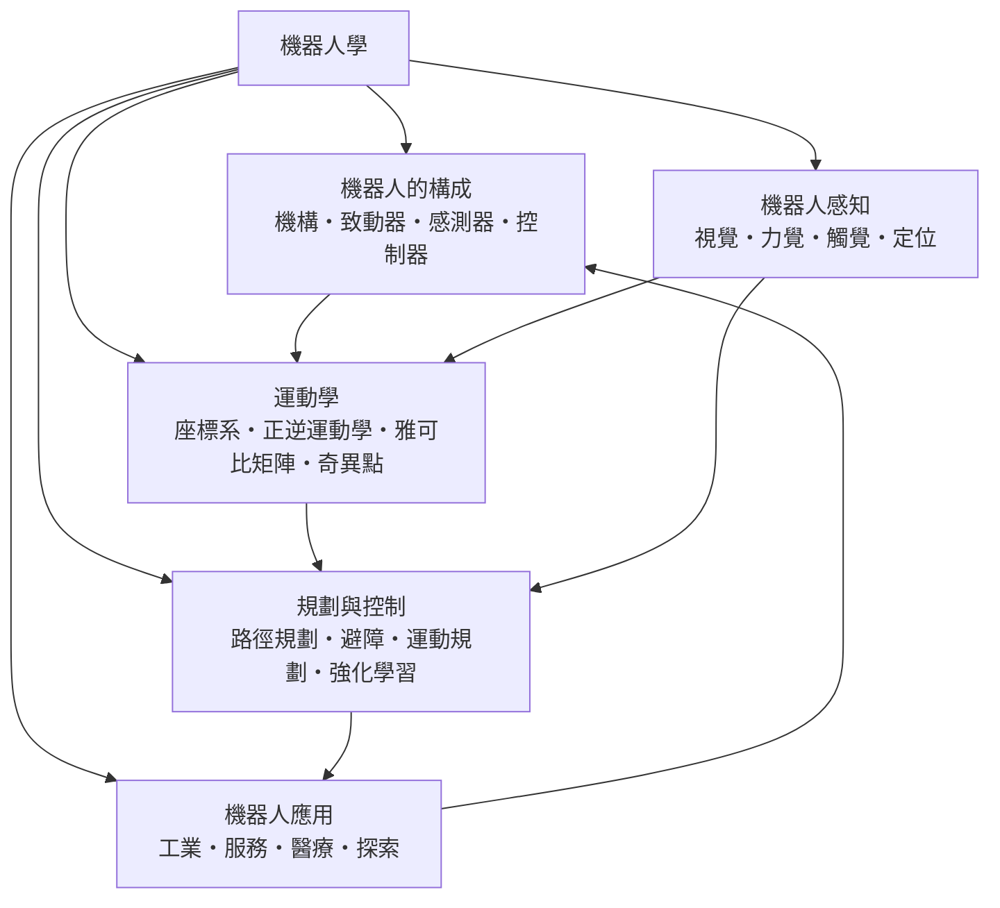

# 機器人學

> 隸屬：第一層 [工]　·　相關分類：[人工智慧]、[電機工程]、[機械工程]、[自動控制]　·　子分類總表見 [README]

> 對應維基百科：[中文維基百科：機器人學](https://zh.wikipedia.org/wiki/%E6%9C%BA%E5%99%A8%E4%BA%BA%E5%AD%A6)　·　[English Wikipedia: Robotics](https://en.wikipedia.org/wiki/Robotics)

機器人學研究的是**如何讓機器在真實世界裡感知、決策並動作**。它不是單一學科，而是把 [機械工程] 的機構設計、[電機工程] 的驅動與量測、[自動控制] 的動態分析，以及 [人工智慧] 的學習與推理方法，壓縮到同一具實體裝置上的交會點。核心差異在於：機器人面對的是**開放環境**——模型的假設會被現實推翻，而且失敗會造成實體損失。今天我們統稱的 [機器人] 這個詞，也就建立在這個交會點上。

這個領域的歷史可以分成三段。1950 年代是「能不能做」的階段，George Devol 發明可程式化的搬運機構，[1961年] [恩格爾鮑特] 把它商品化為第一台商用 [工業機器人]；同樣在 1960 年代，[維納] 於 [1948年] 出版的控制論把回授與自我調節的觀點從生物系統推廣到機器系統，為整個領域提供了方法論。1960 至 1970 年代是感知與規劃的奠基期，美國與蘇聯的太空競賽催生了具有視覺與避障能力的自主車，麻省理工學院的人工智慧實驗室則把 [機器人感知] 與 [運動規劃] 從科幻推回學術。1980 年代之後是應用擴張期，汽車工業大量導入 [工業] 這一子分類所指的 [工業機器人]，[服務] 機器人與 [醫療] 機器人相繼商業化；而 2010 年之後深度學習帶來的 [強化學習] 讓機器人第一次能靠嘗試學會走路、抓取與折疊衣物。

今天最尖端的瓶頸不在單一零件，而在**整體閉環**：感知有雜訊、模型有誤差、致動器有延遲、地面有摩擦、三個維度互相糾纏。這個瓶頸正是本概念把 [機器人的構成]、[運動學]、[機器人感知]、[規劃與控制] 與 [機器人應用] 五個子分類編排在一起的原因。

## 核心問題

1. **身體如何構成**：機構如何傳遞動力與位姿資訊，致動器如何在扭矩、速度、重量之間取捨，感測器如何在雜訊、延遲與成本之間取捨——這是 [機器人的構成] 處理的問題。
2. **位姿如何描述與計算**：一個關節角度如何對應到末端在空間中的位置與方向，什麼樣的配置無法解算——這是 [運動學] 的問題，核心工具是 [雅可比矩陣] 與 [奇異點] 分析。
3. **環境如何被理解**：機器人如何從影像、接觸與聲音中抽出可靠的狀態估計，並在自我位置尚不確定時仍能行動——這是 [機器人感知] 的問題。
4. **目標如何變成動作**：從「到達目標」到「安全繞過障礙物」再到「在任務層面學習策略」，需要把 [路徑規劃]、[避障]、[運動規劃] 與 [強化學習] 串成分層管線。
5. **整套技術賣到哪裡去**：工業、服務、醫療與探索四個市場對可靠性、認證、成本與自主程度的要求完全不同，[機器人應用] 正是用這些要求反過來篩選技術路線。

這五個問題不是並列的，而是一條閉環鏈：**構成決定能做什麼，運動學決定怎麼算，感知決定現在狀態，規劃與控制決定下一步，應用決定是否值得**。

## 因果鏈

1. **工業搬運的需求**：1960 年代的汽車與家電產線需要把零件在機台之間穩定搬運，這催生了第一代程式化機器人，其核心只有固定軌跡重播。
2. **視覺與自主的萌芽**：1966 至 1970 年代的太空競賽與無人載具研究，把相機、雷達與早期人工智慧結合，出現能辨識障礙物並規劃路徑的自主平台。
3. **運動學的數學化**：[正向運動學] 與 [逆向運動學] 的分離，使「給定末端目標求關節角」成為可求解、可優化的幾何問題，而不是靠人工示教。
4. **感測器商品化**：視覺、固態雷達、力覺與觸覺陣列的量產，讓機器人從「在結構化環境重播固定動作」跨入「在非結構化環境因應變化」。
5. **控制的匯流**：[自動控制] 的狀態空間方法與現代 [控制器] 設計，讓多關節耦合的動態可以被最佳化，機器人得以做整體運動而非逐軸動作。
6. **學習方法的介入**：2010 年之後的深度強化學習，讓機器人得以從示範或經驗中學會難以程式化的技能，例如抓取、跑跳與操作可變形物件。
7. **應用市場的檢驗**：工業的可靠度要求、醫療的認證要求、服務業對成本的敏感要求與探索任務的環境不確定性，各自拉走不同的技術分支。
8. **回頭改造硬體**：應用端暴露的瓶頸——例如末端操作精度不足——反過來催生更精緻的 [機構]、更高解析度的 [觸覺] 與更快的 [控制器]。

## 子分類的定位與相互驅動

### 機器人的構成

[機器人的構成] 是**硬體層**：它決定機器人在物理上「能感知什麼、能出力多少、能跑到多快」。[機構] 決定力量與位姿如何傳遞，[致動器]（如 [伺服馬達] 與諧波減速機的組合）決定出力上限，[感測器] 決定可觀測性，[控制器] 決定這三者的整合介面。它的輸出是一份「能力邊界清單」，後面所有演算法都在這份清單內運作。

### 運動學

[運動學] 是**幾何層**：它只描述位姿如何隨關節角改變，不涉及力與時間，因此可以完全以代數處理。[座標系] 定義語言，[正逆運動學] 定義兩方向的求解，[雅可比矩陣] 描述局部的速度傳遞關係，[奇異點] 指出幾何上不可解的方向。它把硬體的能力轉成可計算的約束。

### 機器人感知

[機器人感知] 是**狀態估計層**：機器人從來不知道自己真正的位置與環境真正的樣子，只能從帶雜訊的量測中去推估。[視覺]、[力覺]、[觸覺]、[定位] 四種模態各有盲點，互補使用；缺了這層，規劃輸出的往往是一條走不通的路徑。統計工具的源頭之一是 [梅特羅波利斯] 命名的蒙地卡羅法，如今它是粒子濾波器與隨機取樣式 [定位] 的核心。

### 規劃與控制

[規劃與控制] 是**行為層**：[路徑規劃] 回答「往哪裡走」，[避障] 回答「怎麼不撞到」，[運動規劃] 回答「手臂與身體怎麼一起動」，[強化學習] 則回答「這件事沒有解析解時怎麼學」。它把幾何與感知的輸出轉成時間序列的關節指令。

### 機器人應用

[機器人應用] 是**驗證層**：工業、服務、醫療、探索四個市場的失敗代價完全不同，因此對可靠度、自主程度與成本的容忍度也不同。它是唯一能告訴學術界「哪個瓶頸真的值得解」的層次，並因此回頭改寫 [機器人的構成] 的設計取捨。

### 五者的相互驅動

硬體定義上限，幾何把上限變成約束，感知把不確定性塞進約束，規劃與控制在不確定性下產生動作，應用以真實代價篩選方案，再回頭改寫硬體。這條閉環使機器人學成為一門「身體—幾何—感覺—行為—經濟」完整咬合的學科，而不是演算法的附屬品。

## 範例

**範例一：從影像目標到關節指令的完整鏈路。** 一台六軸機械手臂要從料架取下零件放到夾具上。

1. **感知**：相機拍到料架，經 [視覺] 取得零件在影像中的位置與姿態，深度估計換算到相機座標系。
2. **定位**：透過 [定位] 求出手眼在基地座標系中的位姿，得到零件的全局座標。
3. **運動學**：把零件座標當作末端目標，用 [正逆運動學] 解出六個關節角；若解算失敗或接近 [奇異點]，須改變末端方向或退回 [路徑規劃] 階段重新選點。
4. **避障**：在關節空間以 [運動規劃] 求出一條避開夾具與料架支撐的軌跡。
5. **控制**：把軌跡交給 [控制器] 追蹤，由 [致動器] 出力，末端 [力覺] 偵測接觸瞬間。
6. **驗證**：整條鏈路的成敗由 [機器人應用] 中的工廠驗收標準決定——每千次取件的失敗率、循環時間與節拍。

**範例二：四足機器人的平衡閉環。** 一台四足機器人抬腿時，身體會傾斜。此時 [感測器] 中的 [陀螺儀] 量到角速度、關節位置感測器量到角度，狀態估計器用 [建模方法] 的模型計算出重心投影，再由 [控制器] 依 [狀態回授] 原則算出各關節的修正力矩。這正是 [運動學] 與 [奇異點] 分析要保證的：所選步態必須避開關節極限，否則就算平衡算對也擺不出姿勢。

## 容易混淆之處

- **機器人學不等於人工智慧**：人工智慧可在沒有身體的情況下存在；機器人學的核心是身體與環境的耦合。
- **運動學不等於動力學**：運動學只問「在哪裡」，動力學才問「需要多大力」，而 [奇異點] 正是兩者交界處最容易出錯的地方。
- **逆運動學沒有唯一解**：一般存在多組解甚至無限組解，需要靠限制條件、奇異性迴避或最佳化選出實務上的一組。
- **感知誤差不會自己消失**：把相機畫面變模糊並不會讓物體位置更確定，只會讓不確定性更難被偵測。
- **規劃成功不等於執行成功**：規劃層假設環境靜態、模型正確；真實世界兩者都不成立。
- **自主程度與安全性相反**：能力越強的機器人，一旦失效後果越大，因此 [醫療] 與 [探索] 領域反而要求更保守的設計。
- **學習到的策略不等於可解釋的策略**：強化學習能給出高性能，卻常常給不出為什麼這樣做的理由。

## 延伸閱讀

- [人工智慧]：機器人感知中的模式識別、規劃中的搜尋與 [強化學習] 的演算法來源。
- [自動控制]：多關節動態、閉環穩定與最佳控制的理論基礎。
- [機械工程]：機構設計、強度、軸承與傳動的工程判準。
- [電機工程]：驅動電子、訊號量測與馬達控制的硬體基礎。
- [精密儀器]：雷射、編碼器與微型感測器的技術來源。
- [醫療器材]：醫療機器人的器械法規與安全設計條件。

## 連結定義

[工]: ../工/README.md
[README]: README.md
[人工智慧]: ../人工智慧/README.md
[自動控制]: ../自動控制/README.md
[電機工程]: ../電機工程/README.md
[機械工程]: ../機械工程/README.md
[精密儀器]: ../精密儀器/README.md
[醫療器材]: ../醫療器材/README.md
[機器人的構成]: 機器人的構成.md
[運動學]: 運動學.md
[機器人感知]: 機器人感知.md
[規劃與控制]: 規劃與控制.md
[機器人應用]: 機器人應用.md
[機構]: 機構.md
[致動器]: 致動器.md
[感測器]: 感測器.md
[控制器]: 控制器.md
[座標系]: 座標系.md
[正逆運動學]: 正逆運動學.md
[雅可比矩陣]: 雅可比矩陣.md
[奇異點]: 奇異點.md
[視覺]: 視覺.md
[力覺]: 力覺.md
[觸覺]: 觸覺.md
[定位]: 定位.md
[路徑規劃]: 路徑規劃.md
[避障]: 避障.md
[運動規劃]: 運動規劃.md
[強化學習]: 強化學習.md
[工業]: 工業.md
[服務]: 服務.md
[醫療]: 醫療.md
[探索]: 探索.md
[正向運動學]: 正逆運動學.md
[逆向運動學]: 正逆運動學.md
[建模方法]: ../自動控制/建模方法.md
[狀態回授]: ../自動控制/狀態回授.md
[機器人]: ../物/機器人.md
[工業機器人]: ../物/工業機器人.md
[陀螺儀]: ../物/陀螺儀.md
[伺服馬達]: ../物/伺服馬達.md
[恩格爾鮑特]: ../人/工程師/恩格爾鮑特.md
[維納]: ../人/數學家/維納.md
[梅特羅波利斯]: ../人/物理學家/梅特羅波利斯.md
[1948年]: ../時/1948年.md
[1961年]: ../時/1961年.md
