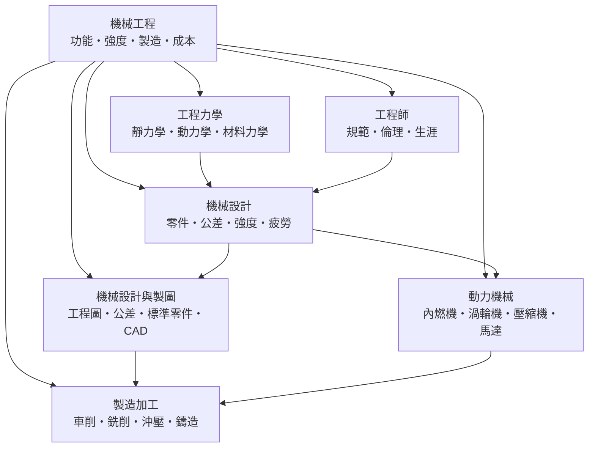

# 機械工程

> 隸屬：第一層 [工]　·　相關分類：[力學]、[材料工程]、[流體力學]　·　子分類總表見 [README]

> 對應維基百科：[中文維基百科：機械工程](https://zh.wikipedia.org/wiki/%E6%9C%BA%E6%A2%B0%E5%B7%A5%E7%A8%8B)　·　[English Wikipedia: Mechanical engineering](https://en.wikipedia.org/wiki/Mechanical_engineering)

機械工程是研究**如何把能量與物質轉化為可用機械裝置**的工程學。它既是科學也是藝術：科學的部分是把設計問題化約為可計算的力學、材料與熱力問題，藝術的部分則是在成本、重量、可製造性與可靠性的多重限制下找到一個「夠好」的答案。機械工程師的核心工作可以濃縮成一句話：給定一個功能需求，設計出一個能夠在真實世界裡被做出來、被使用、被維護，並且在壽命內不出事的機構。

機械工程是工業革命的直接產物。18 世紀的 [瓦特] 改良蒸汽機（見 [1769年]），把熱能可靠地轉為旋轉的機械功，讓工廠不必再依賴水力而能日夜生產；此後的鐵路、起重機與廠房機器，把工程學從「建造紀念碑」推向「生產零件」。今天，一台汽車包含上萬個零件、數百個控制軟體模組，其開發流程本身就是機械工程的方法論產物。

機械工程的邊界也隨技術而移動。20 世紀中期，機械工程吸收了電子與控制理論，長出機電一體的機器人與數控機床；21 世紀，它又必須面對電動化、輕量化、永續材料與軟體定義功能的挑戰。因此本條目的子分類安排反映了這條擴張軌跡：從 [工程力學] 的理論地基，到 [機械設計] 與 [機械設計與製圖] 的設計語言，再到 [製造加工] 的現實落地與 [動力機械] 的能量轉換，最後由 [工程師] 這個職業角色把整條鏈串起來。

## 核心問題

機械工程要處理的問題，可以分成四個層次。

1. **功能層**：裝置要做什麼？把「把電網的電變成轉軸的旋轉」拆成輸入、輸出與約束。
2. **力學層**：裝置怎麼運動？對每一個零件寫出受力與運動方程，這是 [工程力學] 的任務。
3. **強度層**：裝置會不會壞？零件內部的應力必須低於材料強度，且要預留 [疲勞] 與磨損的餘裕。
4. **製造與成本層**：裝置做不做得起？圖紙上的形狀必須能被 [車削] 、[銑削] 、[沖壓] 或 [鑄造] 等工藝以可接受的成本做出來。

四層之間存在大量取捨：把零件加厚可以提高剛度，但會增加重量與成本；提高轉速可以減小尺寸，但會推高 [疲勞] 與磨損；降低零件數可以簡化組裝，但會讓單一零件的失效後果更嚴重。機械工程的「藝術性」正是處理這類取捨。

## 因果鏈

1. **手工業的瓶頸**：早期機械零件靠工匠逐一製作，每件都不同，導致維修與替換困難，產能因此受限。
2. **標準化零件的出現**：螺紋、軸徑與軸承規格的統一，讓不同工廠造的零件可以互相替換，維修成本大幅下降。
3. **工量機與公差**：為了讓量產零件仍然「夠用」，工程界發展出尺寸公差與配合制度，把「合格」從玄學變成可量測的區間。
4. **理論工程的介入**：材料力學與 [流體力學] 把「為什麼會斷」與「為什麼會散熱」變成可計算的問題，讓設計從經驗轉向預測。
5. **數值方法的成熟**：有限元素與計算流體力學讓複雜形狀的應力與流動可以先用電腦試算，縮短了試製次數。
6. **電腦輔助設計的普及**：CAD 把設計圖從桌面的幾何圖轉為可運算的資料模型，讓 [工程圖] 的產出、修改與製造資訊傳遞得以自動化。
7. **機電整合與智慧化**：感測器、控制器與網路進入裝置，機械工程從純機械的學問變成跨領域的系統工程，也催生了 [機器人學] 與 [車輛工程] 等分支。
8. **永續轉型**：電動化與循環材料要求工程師重新比較整個生命週期，設計目標從「最耐用」轉向「在碳排、稀土用量與可回收性之間取得平衡」。

## 子分類的定位與相互驅動

- [工程力學] 是**地基**：它提供靜力學、動力學、材料力學與流體力學四套語言，沒有這些方程，後面所有子分類都只是經驗規則。
- [機械設計] 是**轉譯層**：把物理需求與理論結果轉換成具體零件，同時處理公差、強度與疲勞，讓設計在功能、成本與壽命間取得平衡。
- [機械設計與製圖] 是**溝通層**：工程圖、公差標示、標準零件與 CAD 構成跨部門、跨國界、跨工廠的資訊格式，使設計能被製造與檢驗。
- [製造加工] 是**現實層**：它決定設計是否可行，工藝能力會反向限制零件形狀與公差，是「設計圖上的直線到工廠裡的圓角」之間的落差所在。
- [動力機械] 是**能量層**：內燃機、渦輪機、壓縮機與馬達負責把燃料的化學能、電能轉為可用的機械功，是整個動力產業的心臟。
- [工程師] 是**制度層**：它討論規範、倫理、認證與生涯，把上述技術活動嵌入社會制度，使工程成為受公共信任的職業。

驅動關係是環狀的：工程力學提供語言 → 機械設計產生圖面 → 製圖把圖面變成可攜的資料 → 製造把資料變成零件 → 動力機械用零件組成能量轉換裝置；而工程師的規範與倫理，則在每一圈都設定了「可以做什麼、不能做什麼」的邊界。

## 範例

**範例一：設計一個提升重物的滑輪組。** 需求是「以不超過 $200\,\mathrm{N}$ 的手力，把 $1500\,\mathrm{kg}$ 的貨箱提升 $3\,\mathrm{m}$ ，且裝置自重不超過 $80\,\mathrm{kg}$ 」。

- 負載重量為 $mg = 1500 \times 9.81 \approx 14700\,\mathrm{N}$ ，功為 $W = Fd = 14700 \times 3 \approx 44100\,\mathrm{J}$ 。
- 採用動滑輪省力一半，所需手力為 $14700 / 2 = 7350\,\mathrm{N}$ ，仍遠大於 $200\,\mathrm{N}$ ，因此再改用複式滑輪，四分之一出力約得 $3680\,\mathrm{N}$ ，仍不足。
- 最後改採絞盤（槓桿式省力裝置）與機械槓桿組合，把臂長比放大到 $20:1$ ，手力降到約 $190\,\mathrm{N}$ ，但拉繩行程放大到 $60\,\mathrm{m}$ 。
- 這個算例說明機械工程的核心：省力必然以行程與自重為代價，而取捨要靠公式而不是靠感覺。

**範例二：一根軸的強度檢核。** 圓軸直徑 $d = 40\,\mathrm{mm}$ ，傳遞扭矩 $T = 600\,\mathrm{N \cdot m}$ ，材料為碳鋼，屈服強度約 $\sigma_y = 250\,\mathrm{MPa}$ 。

- 極限應力 $\tau = \frac{16T}{\pi d^3} = \frac{16 \times 600}{\pi \times 0.04^3} \approx 47.7\,\mathrm{MPa}$ 。
- 安全係數 $n = \sigma_y / \tau \approx 250 / 47.7 \approx 5.2$ ，遠高於一般要求的 $1.5$ 至 $2.5$ ，代表尺寸可以縮小以省材料與重量。
- 反過來，若這根軸每天承受起動與停止的循環載荷，就必須由靜強度檢核轉為 [疲勞] 檢核，並依 [材料力學] 的應力集中因子修正。

**範例三：把一個量產零件的成本拆開。** 某支架的單價為 $60$ 元，材料僅佔 $8$ 元。工程師發現若將原沖壓件改為由兩個標準件組裝，材料成本不變，但免除了一道沖壓模具與表面處理，單價可降到 $35$ 元。這個決策牽涉 [標準零件] 的採用、[工程圖] 的簡化與 [工程師] 對可靠性的判斷，而不是任何一條公式。

## 容易混淆之處

- **機械工程不等於「修理」**：維修是使用端的活動；機械工程的重點在設計、製造與生命週期管理。
- **應力集中不是壞處而是事實**：鍵槽、圓角、螺紋孔都是應力集中來源，設計的任務是把它算進去，而不是假裝它不存在。
- **公差不是誤差**：公差是設計者主動允許的變動範圍，用來保證「功能」而不是保證「一模一樣」。
- **安全係數不是越大越好**：安全係數過大會推高重量與成本，並可能反而增加某些失效機率的風險。
- **效率與功率不同**：效率是輸出功與輸入功之比，功率是單位時間內的轉換量；高效率的裝置仍可能輸出功率很小。
- **「符合標準」不等於「足夠安全」**：標準提供的是最低要求，特殊載荷與環境仍須由工程師自行判斷。

## 延伸閱讀

- [力學]：機械工程的理論根，提供運動與力的基本語言。
- [材料工程]：材料的強度、韌性與製程，決定零件能承受什麼。
- [流體力學]：潤滑、冷却與流體傳動的理論基礎。
- [電子工程]：現代機械裝置中的感測、致動與控制。
- [機器人學]：機械結構與控制的跨領域延伸。
- [車輛工程]：機械工程在交通工具上的完整應用。
- [工程師]：本領域的職業制度與倫理。

[工程圖]: 工程圖.md
[材料力學]: 材料力學.md
[標準零件]: 標準零件.md
## 連結定義

[工]: ../工/README.md
[README]: README.md
[力學]: ../力學/README.md
[材料工程]: ../材料工程/README.md
[流體力學]: ../流體力學/README.md
[電子工程]: ../電子工程/README.md
[機器人學]: ../機器人學/README.md
[車輛工程]: ../車輛工程/README.md
[工程力學]: 工程力學.md
[機械設計]: 機械設計.md
[製造加工]: 製造加工.md
[動力機械]: 動力機械.md
[機械設計與製圖]: 機械設計與製圖.md
[工程師]: 工程師.md
[疲勞]: 疲勞.md
[車削]: 車削.md
[銑削]: 銑削.md
[沖壓]: 沖壓.md
[鑄造]: 鑄造.md
[瓦特]: ../人/工程師/詹姆斯·瓦特.md
[1769年]: ../時/1769年.md
