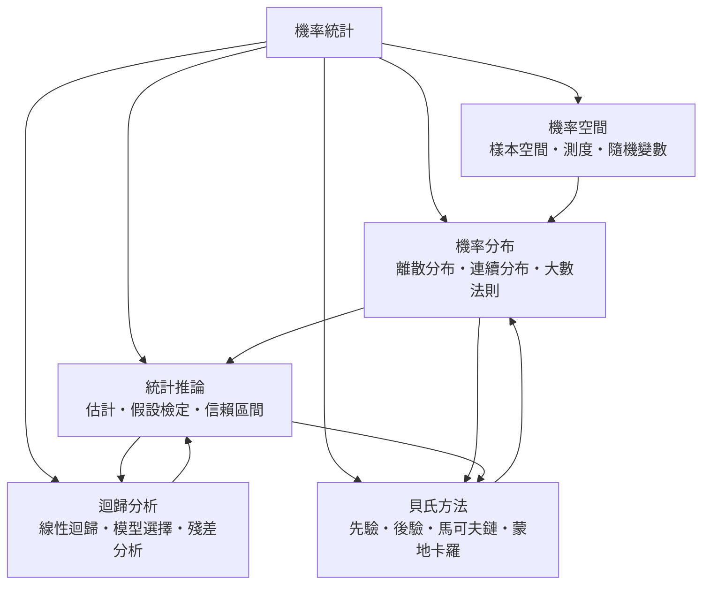

# 機率統計

> 隸屬：第一層 [理]　·　相關分類：[數學]、[演算法]　·　子分類總表見 [README]

> 對應維基百科：[中文維基百科：機率論](https://zh.wikipedia.org/wiki/%E6%A6%82%E7%8E%87%E8%AB%96)　·　[English Wikipedia: Probability theory](https://en.wikipedia.org/wiki/Probability_theory)

機率統計研究**在不完全資訊下如何作出判斷**。它由兩半組成：機率是演算法（如何把不確定性量化成數），統計是反演算法（如何從有限觀測反推未知的參數與分布）。兩者必須成對出現：沒有機率就無法把「不確定」寫成可計算的量；沒有統計，機率公理就只是沒有應用的漂亮定義。

機率統計的真正對象不是「機率」這個詞，而是**隨機性本身的可度量性**。17 世紀 [費馬] 與 [帕斯卡] 的通信處理「巴西人的問題」——擲一顆骰 [骰子] 六次皆出現六點的機率是多少——開啟了以計數處理不確定性的傳統；此後 [拉普拉斯] 在 [1812年] 把它推廣為一整套帶先驗分布的演算法；而 20 世紀 [柯爾莫哥洛夫] 在 [1933年] 用公理化方法把機率定義為「測度加計數」，終於讓機率成為可接受的數學對象。

統計推論的另一半則由 19 世紀末的農業試驗需求推動：要判斷新施肥法是否優於舊法，就必須把「差異」與「雜訊」分開。20 世紀的 [費雪]、[奈曼] 與 [尤爾] 把這件事形式化為 [假設檢定] 與 [信賴區間]，使得「沒有顯著差異」成為一個可以重複執行的程序；[貝氏] 更早於 1763 年就提出了以先驗知識更新信念的公式，[貝氏方法] 遂在 20 世紀末藉由電腦能力重新成為主流。

## 核心問題

機率統計的核心問題可以分為三層，彼此嚴格相依。

1. **量化不確定性**：不確定的事件如何賦予機率？這是 [機率空間] 與 [機率分布] 的問題，答案是一組公理加上測度。
2. **由樣本反推母體**：觀察到有限資料時，未知參數的可能範圍是什麼？這是 [統計推論] 的問題，答案是估計、檢定與 [信賴區間] 三種形式的答案。
3. **在模型之間取捨**：多個模型都與資料相容時該選哪一個？這是 [迴歸分析] 中的 [模型選擇] 與 [殘差分析]，也是 [貝氏方法] 中先驗與後驗 [先驗] [後驗] 分配的角色分工。

三層的關係是：機率公理必須先站得住，統計推論才有合法地基；統計推論產生的不確定性又回頭餵給機率模型的修正，讓分布本身隨資料更新。**[貝氏方法] 正是把這條閉環完整寫出來的方法論。**

## 因果鏈

1. **古典的機率問題**：17 世紀 [費馬] 與 [帕斯卡] 處理擲骰問題，確立「以計數求機率」的做法。
2. **機率的演算法化**：[拉普拉斯] 在 [1812年] 提出貝氏定理的完整形式，並發展出生滅過程與誤差理論，把機率用於天文觀測。
3. **最小二乘與誤差理論**：[高斯] 發展最小二乘法並用鐘錶誤差資料建立常態分布模型，機率第一次成為量測科學的工具。
4. **公理化**：[柯爾莫哥洛夫] 在 [1933年] 給出機率的公理定義，機率成為 [測度] 論的應用，解決了古典定義的循環問題。
5. **統計推論的形式化**：19 世紀末至 20 世紀初，農業試驗與生物統計的需求催生 [估計]、[假設檢定] 與 [信賴區間] 的理論框架。
6. **迴歸與模型化**：[高斯] 與 [傅立葉] 的最小二乘思想發展成 [線性迴歸]，成為所有定量科學的共同工具。
7. **隨機過程**：[馬可夫鏈] 為物理與生物系統提供狀態轉移的數學語言，並在語言模型與排程中延續至今。
8. **計算的時代**：[梅特羅波利斯] 等人在 [1953年] 發展 [蒙地卡羅] 方法，當複雜模型無法解析求解時，改以抽樣逼近答案。

## 子分類的定位與相互驅動

- [機率空間] 是**地基**：它規定哪些對象可以談機率，並用 [測度] 把「機率」變成可以運算的數。
- [機率分布] 是**詞彙表**：[離散分布] 與 [連續分布] 給出常見的具體模型，[大數法則] 則解釋為何大量樣本會讓模型行為變得可預測。
- [統計推論] 是**反演算法**：從樣本出發，把分布中的未知參數估出來，並以 [假設檢定] 與 [信賴區間] 表達不確定性。
- [迴歸分析] 是**建模層**：它把統計推論用於最常見的「多個解釋變數、兩個以上因素交錯」的場景，並提供 [模型選擇] 與 [殘差分析] 兩道防護欄。
- [貝氏方法] 是**閉環層**：它把先驗、資料與後驗串成一體，並以 [蒙地卡羅] 解決實務上無法解析計算的難題。

## 範例：從一枚骰子到完整的統計推論

**問題**：擲一枚均勻骰 [骰子] 36 次，觀察到六點出現 9 次。請估計這顆骰子的六點機率 $p$ 。

1. **建立機率空間**：樣本空間是所有長度 36 的擲骰序列，事件是「六點出現 9 次」，其機率為二項分布 $\binom{36}{9} p^9 (1-p)^{27}$ 。
2. **最大概然估計**：令對數概然函數
   $$L(p) = 9 \ln p + 27 \ln (1-p) $$
   對 $p$ 微分並令其為零，解得 $\hat{p} = 9 / 36 = 0.25$ 。
3. **估計的標準誤**：由 [估計] 的公式， $\hat{p}$ 的近似標準誤為
   $$ \mathrm{SE} = \sqrt{\frac{\hat{p}(1-\hat{p})}{36}} = \sqrt{\frac{0.25 \times 0.75}{36}} \approx 0.0722 . $$
4. **信賴區間**：95% 信賴區間約為 $0.25 \pm 1.96 \times 0.0722 = (0.109, 0.391)$ ，即「這顆骰子偏向六點，但資料不足以斷定它被灌鉛」。
5. **假設檢定**：檢定 $H_0 : p = 1/6$ ，檢驗統計量為 $z = (0.25 - 0.1667) / 0.0722 \approx 1.15$ ， $p$ 值約為 $0.25$ ，故在 5% 水準下**不拒絕**均勻假設。
6. **貝氏更新**：若先驗取均勻分布 $p \sim \mathrm{Beta}(1,1)$ ，後驗為 $p \mid \text{data} \sim \mathrm{Beta}(10, 28)$ ，後驗均值為 $10/38 \approx 0.263$ ，後驗 95% 可信區間約為 $(0.135, 0.412)$ 。

這六步正是機率統計的完整流程：**公理給出合法語言，分布給出具體模型，推論給出答案，模型選擇與殘差分析負責質疑答案，貝氏方法則讓答案隨證據持續修正。**

第二個例子說明為何需要公理化。若用古典定義「機率 = 有利情形數 ÷ 全部情形數」，遇到連續情形（例如等待時間）就完全失效：等待第一個成功的時間可以是无理數，此時「情形數」無法數。這正是 [柯爾莫哥洛夫] 用 [測度] 取代計數的動因。

## 容易混淆之處

- **機率與統計不同**：機率是演算法（已知分布求事件機率），統計是反演算法（已知樣本求分布）。
- **機率與機率密度不同**：連續情形下單點機率為零，密度值可以大於 1，機率是密度下的面積。
- **「無顯著差異」不等於「兩者相同」**：[假設檢定] 的 p 值只表示「資料與零假設不矛盾」，不表示效應不存在。
- **信賴區間不等於機率區間**：95% 信賴區間指程序的重複抽樣覆蓋率，不是固定參數落在區間內的機率（貝氏的可信區間才有後者的意義）。
- **相關不等於因果**： [迴歸分析] 中的相關係數不保證方向，更不保證無混淆變數。
- **大數法則不等於收斂速度**：它只保證樣本均值趨近期望值，不保證有限樣本就準。
- **蒙地卡羅法與隨機抽樣不同**：蒙地卡羅以系統性的隨機抽樣估积分，本身帶有可量化的誤差界。

## 延伸閱讀

- [數學]：機率統計所屬的整體。
- [演算法]：機率模型的計算落地形式。
- [資料科學]：統計推論在實務中的工程化。
- [物理學]：機率語言在統計力學與量子力學中的地位。
- [經濟學]：機率預期與貝氏決策的應用領域。

## 連結定義

[理]: ../理/README.md
[README]: README.md
[數學]: ../數學/README.md
[演算法]: ../演算法/README.md
[資料科學]: ../資料科學/README.md
[物理學]: ../物理學/README.md
[經濟學]: ../經濟學/README.md
[機率空間]: 機率空間.md
[機率分布]: 機率分布.md
[統計推論]: 統計推論.md
[迴歸分析]: 迴歸分析.md
[貝氏方法]: 貝氏方法.md
[估計]: 估計.md
[假設檢定]: 假設檢定.md
[信賴區間]: 信賴區間.md
[線性迴歸]: 線性迴歸.md
[模型選擇]: 模型選擇.md
[殘差分析]: 殘差分析.md
[測度]: 測度.md
[先驗]: 先驗.md
[後驗]: 後驗.md
[馬可夫鏈]: 馬可夫鏈.md
[蒙地卡羅]: 蒙地卡羅.md
[大數法則]: 大數法則.md
[離散分布]: 離散分布.md
[連續分布]: 連續分布.md
[貝氏]: ../人/數學家/貝葉斯.md
[帕斯卡]: ../人/數學家/帕斯卡.md
[費馬]: ../人/數學家/費馬.md
[拉普拉斯]: ../人/數學家/拉普拉斯.md
[柯爾莫哥洛夫]: ../人/數學家/柯爾莫哥洛夫.md
[高斯]: ../人/數學家/高斯.md
[傅立葉]: ../人/數學家/傅立葉.md
[費雪]: ../人/數學家/費雪.md
[奈曼]: ../人/數學家/奈曼.md
[尤爾]: ../人/數學家/尤爾.md
[梅特羅波利斯]: ../人/物理學家/梅特羅波利斯.md
[骰子]: ../物/骰子.md
[1812年]: ../時/1812年.md
[1933年]: ../時/1933年.md
[1953年]: ../時/1953年.md
