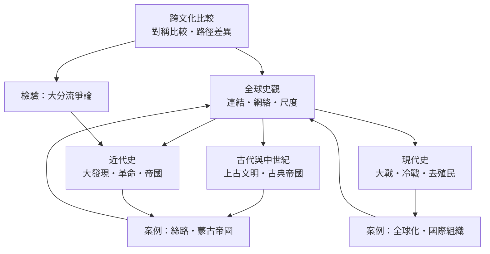

# 世界史

> 隸屬：第一層 [事]　·　相關分類：[歷史]、[古代史]、[近代史]　·　子分類總表見 [README]

> 對應維基百科：[中文維基百科：世界史](https://zh.wikipedia.org/wiki/%E4%BA%BA%E7%B1%BB%E5%8E%86%E5%8F%B2)　·　[English Wikipedia: Human history](https://en.wikipedia.org/wiki/Human_history)

世界史是以整個人類為單位、跨越單一國家與單一文明界線來敘述過去的學科。它要解決的核心問題是：當我們把視野從一國擴大到全球，歷史的因果關係會變成什麼樣子？哪些變遷是各地獨立發生的，哪些又是由接觸、貿易、征服與傳染病傳播所驅動的？

傳統史學以民族國家為敘事單位，優點是檔案集中、敘事連貫，缺點是會把跨國現象（如絲路貿易、黑死病傳播、大西洋奴隸貿易）切成碎片。世界史因此不是「把各國史加總」，而是重新選擇分析單位：有時用區域、有時用海域（地中海、印度洋）、有時用網絡（貿易路線、宗教傳播網）。

本分類的子分類可以分成兩組：一組按時間與空間切分（古代與中世紀、近代史、現代史），另一組按方法切分（全球史觀、跨文化比較、歷史學家）。兩組互相依賴：沒有時間空間的實證敘事，方法論就是空談；沒有方法論的自覺，實證敘事又會退回各國史的加總。

## 核心問題

世界史處理的是「尺度」的問題。歷史現象在不同尺度下呈現不同的面貌，例如十四世紀的黑死病，在歐洲史中是社會危機，在全球史中則是歐亞貿易網絡一體化的副作用——蒙古帝國打通了陸路，使鼠疫桿菌得以沿商路西傳。

- 連動性：某地的變遷如何透過貿易、移民、戰爭傳導到遠方？1492 年哥倫布抵達美洲後，美洲的白銀、玉米、馬鈴薯在十六至十八世紀改造了中國的賦稅制度與歐亞的人口結構。
- 同步性：為何某些變遷在互不相通的地區先後出現？農業在約公元前 9500 年於肥沃月彎、前 7000 年前後於黃河與長江流域各自起源。
- 差異性：起點相近的社會為何走上不同道路？歐洲與中國在十八世紀的生活水準差距遠小於十九世紀，這就是「大分流」爭論的起點。
- 單位選擇：敘事應以國家、區域、海洋還是網絡為單位？單位決定了看見什麼、看不見什麼。

## 因果鏈

1. **瓶頸：史料與視野都被國界束縛**。十九世紀專業史學在民族國家檔案館中成形，蘭克學派以官方檔案為核心，使歷史敘事天然偏向一國一史的框架。
2. **解法：比較視野的引入**。二十世紀上半葉，湯因比《歷史研究》以二十一個文明為單位，雖然結論爭議很大，但把「文明之間」變成合法的研究問題。
3. **進一步：長時段與結構**。布勞岱爾提出「長時段」，主張地理、氣候與人口等慢變數比王朝更替更根本，其地中海研究把海洋本身當成主角。
4. **體系化的嘗試**。沃勒斯坦在 1974 年起出版《現代世界體系》，主張十六世紀起形成以西北歐為核心、以東歐與美洲為邊陲的單一經濟體，世界史自此有了可操作的理論模型。
5. **反彈與修正**。批評者指出世界體系理論過度以歐洲為中心，因此彭慕蘭《大分流》（2000 年）改用中歐與江南互為參照的對稱比較，挑戰「歐洲必然領先」的預設。
6. **當代整合**。全球史在 1990 年代後成為主流範式，強調連結、交流與網絡，代表性成果如彭慕蘭與托皮克合著的《貿易打造的世界》，把商品（棉花、糖、菸草）當成跨國敘事的線索。

## 子分類的定位與相互驅動

### [全球史觀]

全球史觀是本分類的方法論核心，它主張歷史的基本單位是「連結」而非「國家」。它推動古代與中世紀、近代史等領域重新提問：絲路不只是商路，也是技術、宗教與病菌的傳播網。反過來，各時段的實證研究又檢驗並修正全球史觀的概括。

### [古代與中世紀]

古代與中世紀處理文字出現之前至約 1500 年的漫長時段。它為全球史觀提供最早的案例：四大古文明的獨立起源、貴霜與漢之間的絲路中介、蒙古帝國的歐亞一體化。這些案例證明「全球化」並非十五世紀之後的發明。

### [近代史]

近代史（約 1450 至 1789 年）是連動性最強的時段：地理大發現把各大洋接成單一網絡。它對全球史觀的貢獻是提供了「哥倫布大交換」與大西洋經濟體等核心案例；它從比較史學得到的問題是：為何是西歐而非明朝或蒙兀兒帝國走向海外擴張。

### [現代史]

現代史處理兩次大戰、冷戰、去殖民化與全球化。它的特殊性在於：這是第一個有全球性組織（國際聯盟、聯合國）、全球性統計與全球性媒體的時代，因此世界史在此第一次可以用全球性的資料來敘述全球性的過程。

### [跨文化比較]

跨文化比較提供方法上的自我節制：比較必須對稱，不能拿歐洲的理想型對照其他地區的實況。它推動近代史領域修正「歐洲奇蹟」敘事，也從古代與中世紀取得羅馬與漢朝、唐與阿拔斯等成對案例。

### [歷史學家]

歷史學家子分類記錄推動上述轉向的人物：從蘭克的檔案方法，到布勞岱爾的長時段、湯因比的文明研究、沃勒斯坦的體系理論與彭慕蘭的對稱比較。人物史使方法論的演進可以被具體追蹤。

## 大事年表

| 年份 | 事件 |
| --- | --- |
| 約前 3200 年 | 兩河流域出現楔形文字，歷史時期開始 |
| 前 221 年 | 秦統一中國，郡縣制成為東亞國家形態的長期範本 |
| 476 年 | 西羅馬帝國滅亡，地中海世界政治一分為二 |
| 751 年 | 怛羅斯之戰，唐與阿拔斯勢力在中亞相遇 |
| 1279 年 | 蒙古帝國完成對中國的征服，歐亞陸路一體化達到高峰 |
| 1492 年 | 哥倫布抵達美洲，哥倫布大交換開始 |
| 1600 年 | 英國東印度公司特許設立，特許公司成為殖民先鋒 |
| 1815 年 | 維也納會議後的歐洲協調，是第一個多邊安全體系的嘗試 |
| 1945 年 | 聯合國成立，全球性治理機構首次常設化 |
| 1991 年 | 蘇聯解體，冷戰體系終結，全球化加速 |

## 範例

以「哥倫布大交換」為例，可以完整看到世界史的工作方式。1492 年之後，美洲的玉米與馬鈴薯傳入歐亞，使十八世紀中國與歐洲的人口得以突破舊的糧食上限；歐亞的天花與麻疹反向傳入美洲，造成阿茲特克與印加人口在十六世紀銳減九成上下；美洲白銀經馬尼拉大帆船流入明朝，成為一條鞭法賦稅改革的貨幣基礎。

這個案例說明三件事：第一，任何單國史都無法解釋自己的關鍵變遷——清朝人口爆炸的遠因在加勒比海的甘蔗田與秘魯的銀礦；第二，因果是網狀而非線狀，糧食、病菌與貨幣同時流動；第三，尺度決定敘事，把鏡頭拉遠之後，「中國史」與「歐洲史」變成同一個過程的兩個局部。

## 容易混淆之處

- **世界史不等於外國史**。外國史仍是「以本國為中心、其餘為背景」的寫法；世界史要求連本國也變成網絡上的一個節點。
- **全球史不等於全球同時發生同樣的事**。它關心的是傳導機制與時間差，例如同一波物種交換在不同大陸的落地時間相隔數十年。
- **比較不等於排名**。問「為何是歐洲」時，若把歐洲的結果當成標準答案去打分，就會陷入歐洲中心論；正確做法是對稱比較。
- **世界史不是世界史「科」的教科書摘要**。作為研究領域，它的貢獻是新的單位與新的因果，而不是把各國史壓縮成一本。

## 延伸閱讀

- 彭慕蘭《大分流：歐洲、中國及現代世界經濟的發展》（2000 年）
- 彭慕蘭、托皮克《貿易打造的世界》（2002 年）
- 費爾南·布勞岱爾《15至18世紀的物質文明、經濟和資本主義》（1979 年）

## 連結定義

[事]: ../README.md
[歷史]: ../歷史/README.md
[古代史]: ../古代史/README.md
[近代史]: ../近代史/README.md
[README]: README.md
[全球史觀]: 全球史觀.md
[古代與中世紀]: 古代與中世紀.md
[現代史]: 現代史.md
[跨文化比較]: 跨文化比較.md
[歷史學家]: 歷史學家.md