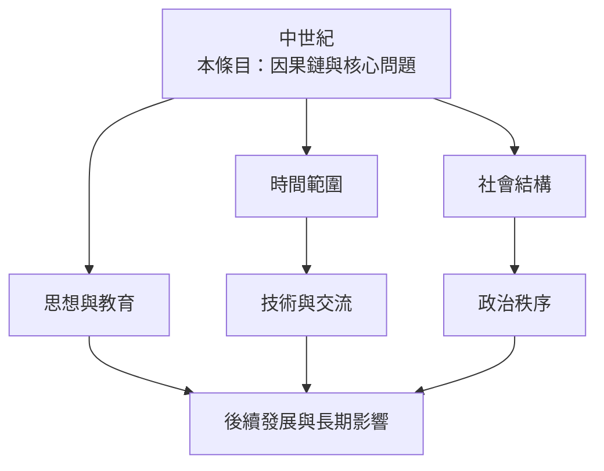

# 中世紀

> 隸屬：第一層 [歷史](../README.md)　·　相關分類：[文藝復興](../文藝復興/README.md)、[科學革命](../科學革命/README.md)　·　子分類總表見 [README](README.md)

> 對應維基百科：[中文維基百科：中世紀](https://zh.wikipedia.org/wiki/%E4%B8%AD%E4%B8%96%E7%BA%AA)　·　[English Wikipedia: Middle Ages](https://en.wikipedia.org/wiki/Middle_Ages)

中世紀是歐洲史上約從五世紀到十五世紀的分期，上承羅馬帝國瓦解，下接文藝復興與大航海時代。它的存在解決了一個敘事問題：如何在「古典古代」與「近代」之間安放長達一千年的歷史，使敘事不致斷裂。因此它不是單純的「中間時期」，而是有自己起點、動力與終點的完整敘事段落。

然而，「中間」這個命名本身帶有文藝復興人文主義者的偏見——他們自認在「復興」古典，於是把中間那一段貶稱為「黑暗時代」。這個標籤後來被史學界逐步修正：中世紀有大學、有議會、有風車與機械鐘，絕非停滯。理解這段修正史，正是本條目的核心關切。

## 核心問題

分期（periodization）指把連續的時間切成有意義的段落。中世紀的劃分依據主要有三種：政治事件說（以西元 476 年西羅馬皇帝被廢為起點，1453 年君士坦丁堡陷落為終點）、文化說（以古典文化中斷與人文主義興起為界）、社會說（以封建制度與莊園經濟的形成與解體為界）。三種依據給出不同年代，這正說明分期是史家為敘事方便而做的切割，不是自然事實。

因此本分類要回答的問題是：這一千年裡，歐洲社會靠什麼維持秩序、生產知識與累積技術？答案貫穿三條主軸——封建的政治契約、莊園的經濟組織、教會的思想權威。三條主軸互相支撐，也互相制約，最終在十四世紀的黑死病與教會分裂中同時鬆動，為近代的到來讓出空間。

## 因果鏈

1. 羅馬行政體系瓦解，西歐失去大規模徵稅與常備軍的能力，於是地方武力自衛，封建契約應運而生。
2. 封建契約把「土地換忠誠」制度化，莊園經濟則把農民綁在土地上，兩者共同構成自給自足的地方秩序。
3. 秩序穩定後人口回升，十一世紀起城市復興，商業重新需要識字與計算，教會學校因此擴張為大學。
4. 大學與經院哲學發展出系統性的論辯方法，同時十字軍與絲路貿易帶回阿拉伯與希臘的知識遺產。
5. 知識與商業累積到十四、十五世紀，黑死病削弱莊園束縛、王權壓過教權，社會結構轉型，文藝復興與大航海時代接續登場。

## 子分類的定位與相互驅動

### 時間範圍

處理「中世紀從何時到何時」的技術問題。5 至 15 世紀是通行框架，但分期爭議顯示：把 476 年當成一刀切的斷裂點，其實掩蓋了羅馬制度延續數百年的事實。常見誤用則提醒我們，「黑暗時代」一詞只適用於描述某些特定領域（如文獻存留）的收縮，不適用於整體判斷。

### 社會結構

封建制度與莊園經濟是中世紀社會的兩塊基石：前者處理「武力與忠誠如何組織」，後者處理「糧食與勞力如何分配」。十一世紀後城市復興打破這個封閉結構——商人階級、特許城市與行會帶來第三種組織原則，即以金錢而非土地為基礎的社會流動。

### 思想與教育

經院哲學把信仰與理性放進同一套論辯程序，大學興起則把知識生產變成有章程、有學位、有行會保護的制度。在古騰堡之前，知識靠手抄本流傳，因此大學同時是抄書工廠與思想法庭。這套制度直接被文藝復興與科學革命繼承。

### 技術與交流

風車水車讓中世紀的動力來源超出人力與畜力，十字軍交流與絲路貿易則把造紙術、指南針與阿拉伯數學帶入歐洲。技術的輸入與消化，正是後來工業革命得以發生的長程前提之一。

### 政治秩序

教權與王權的拉鋸產生了歐洲特有的權力多元：教宗能加冕皇帝，皇帝也能另立教宗。封建契約限定君主權力，議會起源（如 1215 年《大憲章》與 1265 年英格蘭議會）則把「君主須經同意才能徵稅」變成制度記憶，這是後來憲政傳統的遠因。

## 範例

以 1215 年《大憲章》為例：英格蘭国王約翰為對法戰爭強行加稅，貴族聯合反叛，最終在蘭尼米德迫使國王簽署文件，承認「未經王國公認之同意，不得徵收兵役免稅金」。這份文件原本只是封建契約的具體化——領主與附庸互有權利義務——但它的第 39 條「非經同儕合法裁判不得拘禁自由人」，後來被一再援引，成為 1689 年《權利法案》乃至現代法治敘事的起點。一個封建時代的政治妥協，就這樣驅動了六百年後的憲政研究。

## 容易混淆之處

- 「中世紀等於黑暗時代」：錯誤。大學、議會、機械鐘、眼鏡都出現在中世紀。
- 「中世紀只指歐洲」：本分類以歐洲分期為主軸，但同期拜占庭與伊斯蘭世界並無「中斷」，比較史研究常反對歐洲中心式分期。
- 「封建等於落後」：封建是特定生產與武力條件下的理性組織，不能以近代標準倒推評價。
- 「中世紀與文藝復興截然兩分」：兩者是連續過渡，文藝復興大量依賴中世紀大學與翻譯運動的累積。

## 深入議題
- 「黑暗時代」標籤的批評史本身是一段思想史：從佩脫拉克的哀嘆，到吉本的貶抑，再到二十世紀的全面翻案，追蹤這條曲線等於閱讀每個時代對自身的投射。
- 中世紀研究的材料門檻在於語文：拉丁文、中古英語、古法語之外的希臘文與阿拉伯文手稿傳統，決定了誰能讀到哪些文本——這也解釋了為何翻譯運動本身是中世紀史的主題。
- 閱讀提示：本頁因果鏈給出骨架，子分類條目給出血肉，對應維基百科條目提供可查證的細節；三層閱讀由粗到細，遇到年代與人名疑義時以最後一層為準。
- 寫作體例：涉及估計值（傷亡、產量、年代區間）時一律標示『約』或『估計』，並在可行時給出區間而非單點——歷史結論的可信度取決於不確定性的誠實呈現。
- **分期是敘事工具而非自然事實**：任何切分年代都有利弊，中世紀的起訖在史學界本就存在多種方案，敘事時宜標明所採用的標準。
- **比較史的方法陷阱**：以中世紀為標尺衡量不同地區時，須注意各地條件差異，避免把單一地區的經驗當成普遍規律。
- **證據的層級**：一手史料、考古證據與二手詮釋的可信度不同，涉及具體年代與人名時應回到可查證的來源。
- **長時段與短時段的互補**：布勞岱式的長時段結構（地理、經濟）與事件史（人物、戰役）各有解釋力，本分類刻意兩者並用。
- **研究的前沿**：中世紀的相關研究仍在更新，新出土資料、新統計資料或新方法（如量化史學、數位人文）都可能改寫既有結論。
- **給初學者的閱讀順序**：先掌握本頁的因果鏈，再進入子分類條目，最後以對應維基百科條目查證細節——由框架到細節，比反方向更省力。

## 與相鄰分類的關聯
- **文藝復興**：中世紀提供文藝復興所需要的長時段背景，文藝復興則回頭檢驗中世紀敘事的因果是否成立——兩者互為對照組。
- **科學革命**：中世紀提供科學革命所需要的長時段背景，科學革命則回頭檢驗中世紀敘事的因果是否成立——兩者互為對照組。
- **朝代**：中世紀提供朝代所需要的長時段背景，朝代則回頭檢驗中世紀敘事的因果是否成立——兩者互為對照組。
- **與第一層 [歷史] 入口頁**：本分類是第一層分類樹的分支，跨分類的查詢建議先回到入口頁再下行，避免漏掉同層的相近概念。

## 概念結構圖

## 連結定義

[歷史]: ../README.md
[文藝復興]: ../文藝復興/README.md
[科學革命]: ../科學革命/README.md
